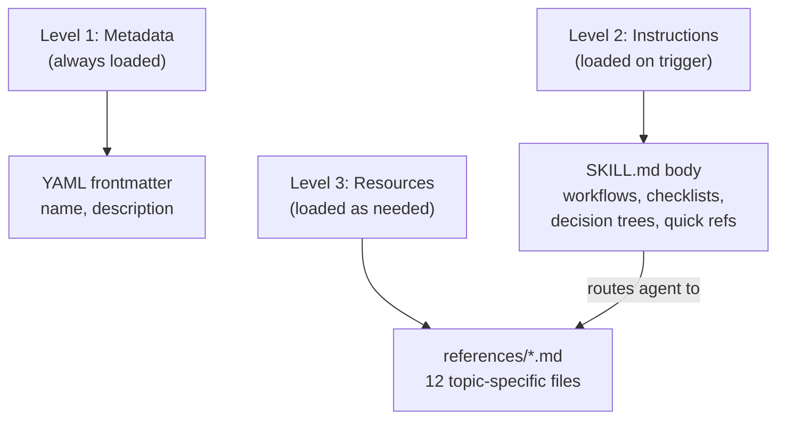
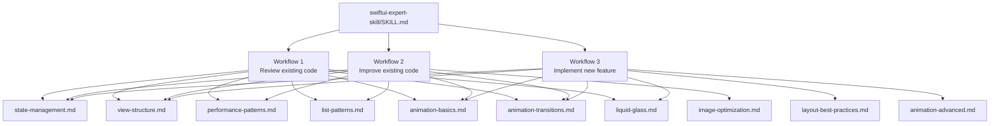
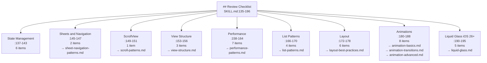

<!-- source: DeepWiki mcp.deepwiki.com · repo AvdLee/SwiftUI-Agent-Skill · page 3.1 Skill Structure · fetched 2026-10-26 -->

# Skill Structure

Relevant source files

The following files were used as context for generating this wiki page:

- [.github/copilot-instructions.md](.github/copilot-instructions.md)
- [swiftui-expert-skill/SKILL.md](swiftui-expert-skill/SKILL.md)

This page documents the internal structure of `swiftui-expert-skill/SKILL.md` — the primary entrypoint file that an AI agent loads when the SwiftUI expert skill is invoked. It covers the YAML frontmatter format, the three workflow decision trees, the core guideline sections, the quick-reference table, and the review checklist. It also explains the progressive disclosure model by which this file acts as a dispatch layer to the topic-specific reference files.

For an overview of the full knowledge base and how all reference files relate to each other, see [SwiftUI Reference Content](#3). For details on what each individual reference file contains, see pages [3.2](#3.2) through [3.11](#3.11).

---

## File Overview

`swiftui-expert-skill/SKILL.md` is the sole entrypoint into the skill. When an agent triggers the `swiftui-expert-skill`, this is the first (and sometimes only) file it reads. Everything else in the skill — the twelve reference files under `swiftui-expert-skill/references/` — is loaded on demand, based on routing instructions within this file.

The file is divided into six logical sections:

| Section | Purpose |
|---|---|
| YAML frontmatter | Machine-readable identity metadata |
| Workflow Decision Tree | Three task-type flows with explicit reference routing |
| Core Guidelines | Summarized rules for five major domains |
| Quick Reference | Property wrapper table and Liquid Glass code patterns |
| Review Checklist | Per-domain checkboxes for code review use |
| References | Canonical index of all twelve reference files |

Sources: [swiftui-expert-skill/SKILL.md:1-218]()

---

## YAML Frontmatter

The file begins with a YAML frontmatter block that provides machine-readable metadata required by the Agent Skills format.

[swiftui-expert-skill/SKILL.md:1-4]()

| Field | Value | Format Constraints |
|---|---|---|
| `name` | `swiftui-expert-skill` | Lowercase letters, numbers, hyphens only; ≤ 64 characters |
| `description` | Multi-clause statement of what the skill does and when to invoke it | Non-empty; ≤ 1024 characters; must state trigger conditions |

The `description` field is specifically designed to help an agent decide when to invoke this skill over others. It covers the three primary use cases: writing new SwiftUI code, reviewing existing code, and improving code quality. The `name` field serves as the skill's stable identifier used in `plugin.json` and `marketplace.json`.

Format compliance for these fields is enforced during code review by rules documented in `.github/copilot-instructions.md` (see [Contributing](#6)).

Sources: [swiftui-expert-skill/SKILL.md:1-4](), [.github/copilot-instructions.md:8-12]()

---

## Progressive Disclosure Model

The Agent Skills format organizes content into three levels, each loaded only when needed. `SKILL.md` operates as Levels 1 and 2; the `references/` directory is Level 3.

**Progressive Disclosure Architecture**

The design principle is that `SKILL.md` should never duplicate content from the reference files. It provides enough context for the agent to select the correct reference and delegates deep guidance to that file. This keeps the primary entrypoint short enough to load quickly while keeping detailed knowledge available on demand.

Sources: [.github/copilot-instructions.md:15-26](), [swiftui-expert-skill/SKILL.md:11-38]()

---

## Workflow Decision Trees

The `## Workflow Decision Tree` section ([swiftui-expert-skill/SKILL.md:11-38]()) defines three named task flows. Each flow lists the steps an agent should follow and explicitly routes to the relevant reference files for each step.

**Workflow Dispatch: SKILL.md to references/**

### Workflow 1 — Review Existing Code

[swiftui-expert-skill/SKILL.md:13-20]()

A sequential checklist guiding the agent to audit code across six dimensions: property wrapper correctness, view composition, performance patterns, list identity stability, animation correctness, and Liquid Glass usage. Each check references a specific file in `references/`.

### Workflow 2 — Improve Existing Code

[swiftui-expert-skill/SKILL.md:22-29]()

Mirrors Workflow 1 but is phrased as actionable improvements rather than audits. Notably includes a conditional step: image downsampling via `references/image-optimization.md` is listed as an **optional optimization**, not a mandatory fix. Liquid Glass adoption is only suggested **when explicitly requested by the user**.

### Workflow 3 — Implement New Feature

[swiftui-expert-skill/SKILL.md:31-37]()

Design-first flow that starts with data flow design (`references/state-management.md`) before touching UI structure. It introduces `references/animation-advanced.md` and `references/layout-best-practices.md`, which do not appear in the review flow. The `#available` gating requirement for iOS 26+ features appears as an explicit step here.

Sources: [swiftui-expert-skill/SKILL.md:11-38]()

---

## Core Guidelines

The `## Core Guidelines` section ([swiftui-expert-skill/SKILL.md:39-95]()) contains summarized, immediately actionable rules across five domains. These are **not** duplicates of the reference files — they are condensed rules an agent can apply without loading additional context.

### Domain Summary

| Domain | Key Rules Covered | Full Reference |
|---|---|---|
| State Management | `@State` privacy, `@Binding` intent, `@StateObject` vs `@ObservedObject`, iOS 17+ `@Observable` / `@Bindable` | `references/state-management.md` |
| View Composition | Subview extraction, modifier preference over conditionals, pure `body`, `@ViewBuilder` usage | `references/view-structure.md` |
| Performance | Dependency minimization, value-checking before state assignment, `LazyVStack`/`LazyHStack`, `AnyView` avoidance | `references/performance-patterns.md` |
| Animations | `.animation(_:value:)` with value param, `withAnimation` for events, transform vs layout, `phaseAnimator`, `keyframeAnimator` | `references/animation-basics.md`, `references/animation-advanced.md` |
| Liquid Glass (iOS 26+) | `glassEffect`, `GlassEffectContainer`, `.interactive()` scope, `glassEffectID` with `@Namespace` | `references/liquid-glass.md` |

The Liquid Glass section opens with a bolded opt-in rule: **Only adopt when explicitly requested by the user.** This is a behavioral instruction that constrains the agent's autonomy in applying these APIs.

Sources: [swiftui-expert-skill/SKILL.md:39-95]()

---

## Quick Reference

The `## Quick Reference` section ([swiftui-expert-skill/SKILL.md:96-133]()) contains two reference artifacts intended for fast lookup without navigating to a reference file.

### Property Wrapper Selection Table

[swiftui-expert-skill/SKILL.md:98-107]()

A two-column Markdown table mapping each property wrapper to its correct use case:

| Wrapper | Use When |
|---|---|
| `@State` | Internal view state (must be `private`) |
| `@Binding` | Child modifies parent's state |
| `@StateObject` | View owns an `ObservableObject` |
| `@ObservedObject` | View receives an `ObservableObject` |
| `@Bindable` | iOS 17+: Injected `@Observable` needing bindings |
| `let` | Read-only value from parent |
| `var` | Read-only value watched via `.onChange()` |

This table is the quickest decision aid available to an agent without loading `references/state-management.md`.

### Liquid Glass Patterns

[swiftui-expert-skill/SKILL.md:109-133]()

Three inline Swift code blocks demonstrating:
1. Basic `.glassEffect()` with a `#available(iOS 26, *)` gate and a `Material`-based fallback.
2. `GlassEffectContainer` wrapping multiple glass elements.
3. A `Button` using the `.glassProminent` button style.

These are the only inline code examples in the entire `SKILL.md` file — everything else delegates to reference files.

Sources: [swiftui-expert-skill/SKILL.md:96-133]()

---

## Review Checklist

The `## Review Checklist` section ([swiftui-expert-skill/SKILL.md:135-196]()) provides a set of domain-grouped checkboxes for use during code review. Each group includes a parenthetical citation pointing to the relevant reference file.

**Review Checklist Structure**

The checklist covers nine domains and 42 individual checks in total. Each item is directly traceable to a rule stated in the Core Guidelines section or in one of the reference files. The checklist is the primary tool used during **Workflow 1 (Review)**.

Sources: [swiftui-expert-skill/SKILL.md:135-196]()

---

## References Index

The `## References` section ([swiftui-expert-skill/SKILL.md:197-209]()) is a flat list of all twelve reference files with one-line descriptions. This section serves two purposes:

1. It provides a canonical, discoverable index so an agent can identify which file to load for any topic.
2. It ensures no reference file is orphaned — every file in `references/` must appear here to be reachable.

| Reference File | Topic |
|---|---|
| `references/state-management.md` | Property wrappers and data flow |
| `references/view-structure.md` | View composition, extraction, container patterns |
| `references/performance-patterns.md` | Performance optimization and anti-patterns |
| `references/list-patterns.md` | ForEach identity, stability, list best practices |
| `references/layout-best-practices.md` | Layout patterns, context-agnostic views, testability |
| `references/animation-basics.md` | Core animation, implicit/explicit, timing, performance |
| `references/animation-transitions.md` | Transitions, custom transitions, `Animatable` protocol |
| `references/animation-advanced.md` | Transactions, phase/keyframe animations, completion handlers |
| `references/sheet-navigation-patterns.md` | Sheet presentation and navigation patterns |
| `references/scroll-patterns.md` | ScrollView patterns and programmatic scrolling |
| `references/image-optimization.md` | AsyncImage, image downsampling, optimization |
| `references/liquid-glass.md` | iOS 26+ Liquid Glass API |

Sources: [swiftui-expert-skill/SKILL.md:197-209]()

---

## Philosophy Statement

The final section, `## Philosophy` ([swiftui-expert-skill/SKILL.md:211-218]()), is a brief behavioral constraint that scopes the skill's content decisions:

- No enforcement of specific architectures (MVVM, VIPER, etc.)
- Encourages business logic separation for testability, not as an architectural mandate
- Optimizes for performance and maintainability
- Follows Apple's Human Interface Guidelines and API design patterns

This philosophy directly informs which types of content are permitted in the reference files, as enforced by the review rules in `.github/copilot-instructions.md`. See [Contributing](#6) for how these constraints are applied during pull request review.

Sources: [swiftui-expert-skill/SKILL.md:211-218](), [.github/copilot-instructions.md:28-34]()

---

