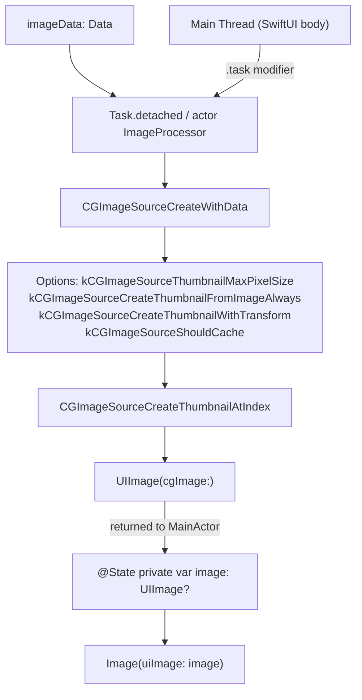
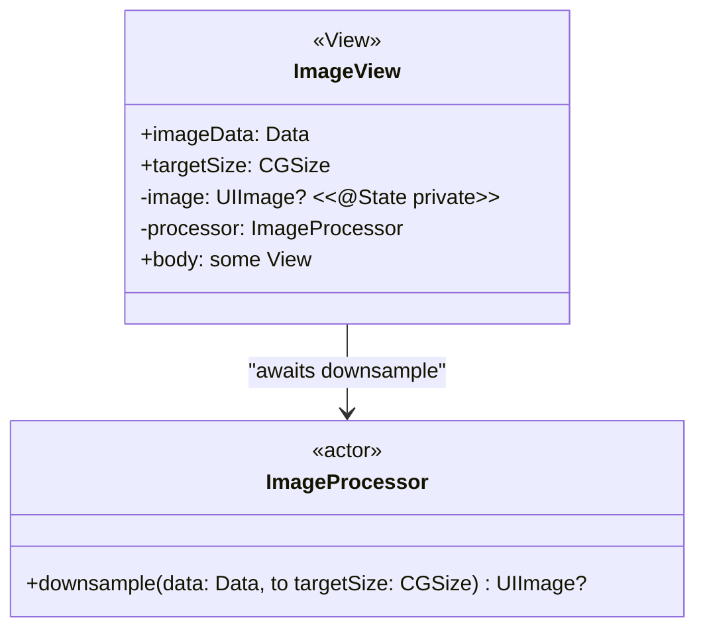
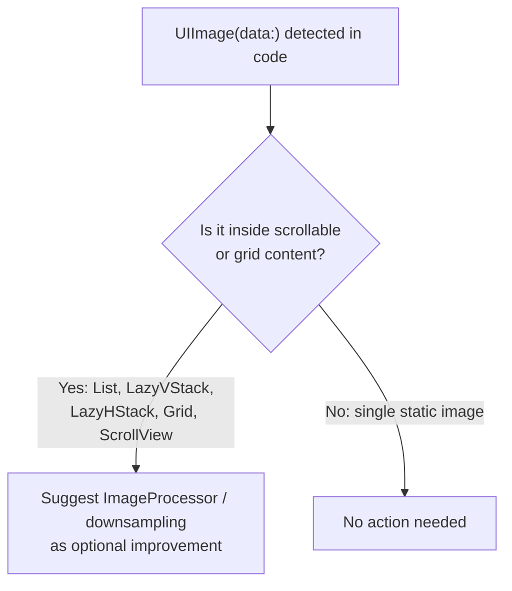
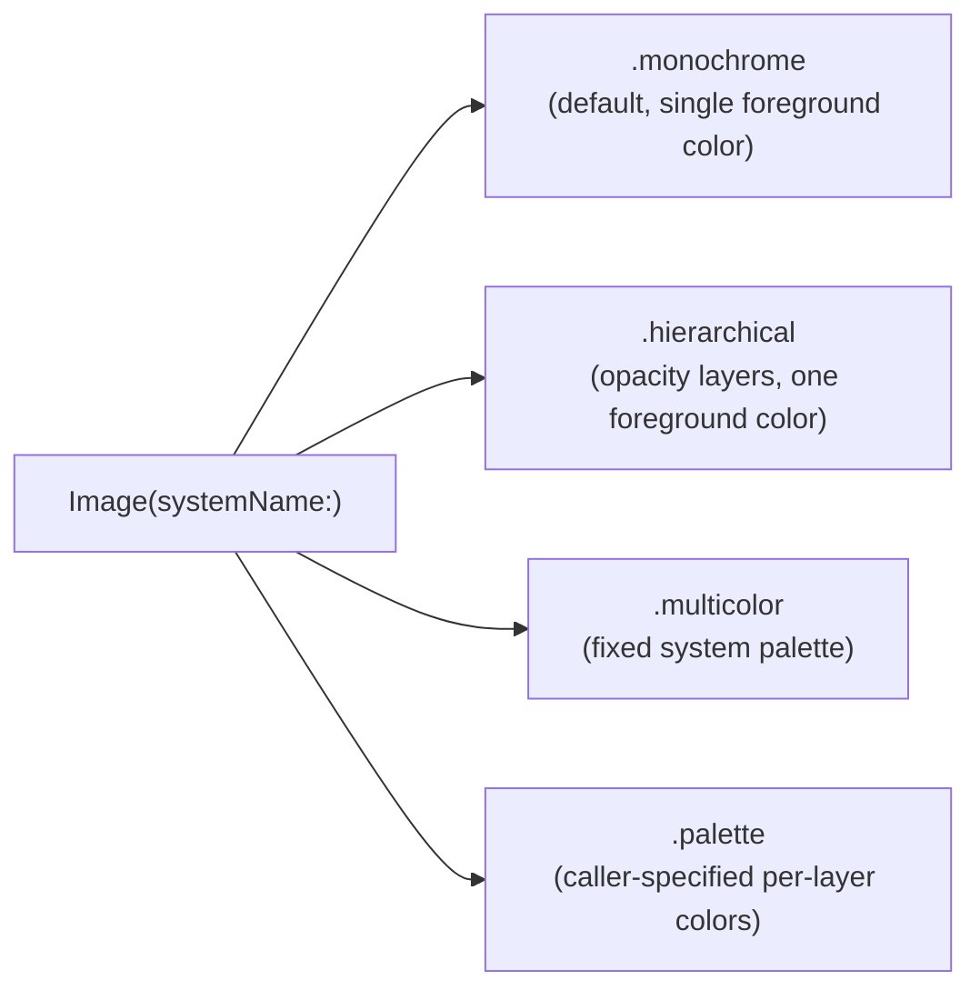

<!-- source: DeepWiki mcp.deepwiki.com · repo AvdLee/SwiftUI-Agent-Skill · page 3.10 Image Optimization · fetched 2026-10-26 -->

# Image Optimization

<details>
<summary>Relevant source files</summary>

The following files were used as context for generating this wiki page:

- [swiftui-expert-skill/SKILL.md](swiftui-expert-skill/SKILL.md)
- [swiftui-expert-skill/references/image-optimization.md](swiftui-expert-skill/references/image-optimization.md)

</details>


This page documents SwiftUI image-loading patterns, off-main-thread decoding, downsampling using Core Graphics thumbnail APIs, and SF Symbol configuration. The material originates from [swiftui-expert-skill/references/image-optimization.md]().

This page focuses on image rendering and memory concerns. For general performance patterns such as `LazyVStack` or `AnyView` avoidance, see [Performance Patterns](#3.4). For list identity strategies that affect how image views are recycled, see [List Patterns](#3.5).

---

## AsyncImage Phase Handling

`AsyncImage` accepts a phase-based closure that covers three discrete states. All three (plus an `@unknown default`) must be handled to avoid silent rendering gaps.

**`AsyncImage` Phase State Machine**

```mermaid
stateDiagram-v2
    [*] --> ".empty": "URL provided"
    ".empty" --> ".success(Image)": "Download succeeds"
    ".empty" --> ".failure(Error)": "Download fails"
    ".success(Image)" --> ".empty": "URL changes"
    ".failure(Error)" --> ".empty": "URL changes"
```

Sources: [swiftui-expert-skill/references/image-optimization.md:1-25]()

### Phase summary

| Phase | Value | Typical UI |
|---|---|---|
| `.empty` | No image yet | `ProgressView()` or color placeholder |
| `.success(let image)` | `Image` ready to display | `.resizable()` + `.aspectRatio()` |
| `.failure` | Network or decode error | System icon, e.g. `"photo"` |
| `@unknown default` | Forward-compatibility catch | `EmptyView()` |

Sources: [swiftui-expert-skill/references/image-optimization.md:6-25]()

### Adding a transition

Attach `.transition(.opacity)` inside the `.success` case and `.animation(_:value:)` on the `AsyncImage` itself. The animation is tied to the `url` value so it only fires when the URL changes, not on every body re-render.

See [swiftui-expert-skill/references/image-optimization.md:62-79]() for the full pattern.

---

## Off-Main-Thread Downsampling

`UIImage(data:)` decodes the full-resolution image on the main thread. In scrollable content this causes frame drops because decoding is CPU-intensive.

The recommended alternative:

1. Use `CGImageSourceCreateWithData` to create a `CGImageSource`.
2. Pass options including `kCGImageSourceThumbnailMaxPixelSize` to cap decoded dimensions.
3. Call `CGImageSourceCreateThumbnailAtIndex` to get a downsampled `CGImage`.
4. Wrap the whole operation in `Task.detached` (or an `actor`) to run off the main thread.

**Downsampling Data Flow**



Sources: [swiftui-expert-skill/references/image-optimization.md:98-146]()

### Key Core Graphics options

| Option key | Purpose |
|---|---|
| `kCGImageSourceThumbnailMaxPixelSize` | Maximum pixel dimension of the output image |
| `kCGImageSourceCreateThumbnailFromImageAlways` | Force thumbnail creation even if one is embedded |
| `kCGImageSourceCreateThumbnailWithTransform` | Apply EXIF orientation transform |
| `kCGImageSourceShouldCache` | Control whether decoded pixels are cached by ImageIO |

Sources: [swiftui-expert-skill/references/image-optimization.md:122-135](), [swiftui-expert-skill/references/image-optimization.md:154-165]()

---

## ImageProcessor Actor

The reusable `ImageProcessor` type encapsulates the Core Graphics work behind an `actor` boundary, which serializes concurrent calls and prevents data races.

**`ImageProcessor` Structure**



Sources: [swiftui-expert-skill/references/image-optimization.md:151-196]()

`ImageProcessor.downsample(data:to:)` multiplies `targetSize` by `UIScreen.main.scale` before passing it to `kCGImageSourceThumbnailMaxPixelSize`, ensuring the output matches physical pixels on Retina displays.

See [swiftui-expert-skill/references/image-optimization.md:151-172]() for the full actor implementation.

The calling view uses `.task` to run the async call without blocking the main thread:

```
.task {
    image = await processor.downsample(data: imageData, to: targetSize)
}
```

[swiftui-expert-skill/references/image-optimization.md:191-193]()

---

## When to Suggest Downsampling

Downsampling is an **optional** optimization. The agent is instructed to suggest it when `UIImage(data:)` appears in specific contexts, not to apply it automatically.

**Decision Rule**



Sources: [swiftui-expert-skill/references/image-optimization.md:199-207](), [swiftui-expert-skill/SKILL.md:28](), [swiftui-expert-skill/SKILL.md:72]()

Contexts where the optimization is most relevant:

- `List` or `ScrollView` with `LazyVStack` / `LazyHStack`
- Grid layouts (`LazyVGrid`, `LazyHGrid`) with many images
- Image galleries or carousels
- Any case where a large source image is displayed at a small target size

---

## SF Symbols

SF Symbols are vector assets provided by the system and referenced by name via `Image(systemName:)`. Three rendering modes control how color is applied.

**SF Symbol Rendering Modes**



Sources: [swiftui-expert-skill/references/image-optimization.md:209-243]()

Apply rendering mode with `.symbolRenderingMode(_:)` before `.foregroundStyle(_:)`.

### `symbolEffect` (iOS 17+)

The `.symbolEffect(_:)` modifier animates SF Symbols using built-in behaviors:

| Effect | Symbol type | Behavior |
|---|---|---|
| `.variableColor` | Variable color symbols | Cycles through color layers |
| `.bounce` | Any | One-shot bounce animation |
| `.pulse` | Any | Continuous opacity pulse |
| `.rotate` | Any | Continuous rotation |

See [swiftui-expert-skill/references/image-optimization.md:227-230]() for usage.

---

## Summary Checklist

| Concern | Requirement |
|---|---|
| `AsyncImage` phase handling | Handle `.empty`, `.success`, `.failure`, and `@unknown default` |
| Transition on image load | Attach `.transition()` in `.success` case; bind `.animation(_:value:)` to URL |
| Main-thread decoding | Never call `UIImage(data:)` directly in hot paths; use `Task.detached` or `ImageProcessor` |
| Downsampling dimensions | Scale `targetSize` by `UIScreen.main.scale` to match physical pixels |
| `kCGImageSourceShouldCache` | Set `false` in `ImageProcessor` when memory is a concern |
| Downsampling trigger | Suggest only when `UIImage(data:)` appears in scrollable/grid contexts |
| SF Symbol rendering | Use `.symbolRenderingMode(_:)` appropriate to the symbol's layer structure |
| SF Symbol animation | Use `.symbolEffect(_:)` for continuous or one-shot animations (iOS 17+) |

Sources: [swiftui-expert-skill/references/image-optimization.md:245-256](), [swiftui-expert-skill/SKILL.md:72]()

---

