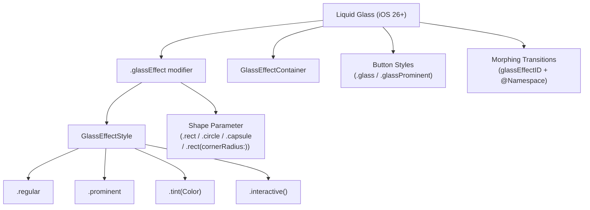
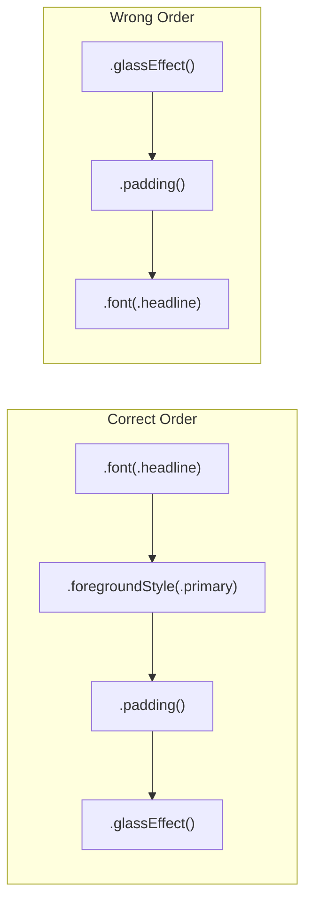
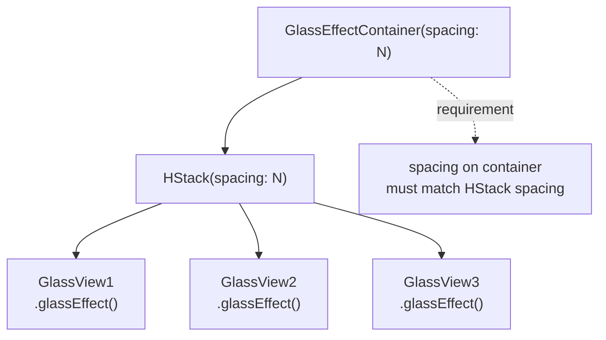
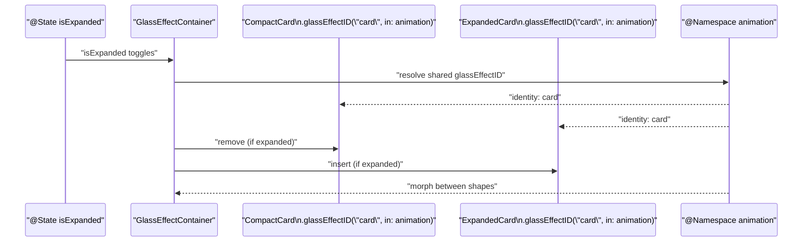

<!-- source: DeepWiki mcp.deepwiki.com · repo AvdLee/SwiftUI-Agent-Skill · page 3.11 Liquid Glass (iOS 26+) · fetched 2026-10-26 -->

# Liquid Glass (iOS 26+)

<details>
<summary>Relevant source files</summary>

The following files were used as context for generating this wiki page:

- [swiftui-expert-skill/SKILL.md](swiftui-expert-skill/SKILL.md)
- [swiftui-expert-skill/references/liquid-glass.md](swiftui-expert-skill/references/liquid-glass.md)

</details>


This page documents the iOS 26+ Liquid Glass SwiftUI APIs: the modifier, style options, container, button styles, morphing transitions, modifier ordering, and fallback strategies. It covers usage guidance and correctness rules drawn from the agent's reference material.

For the agent workflow rules that govern *when* to adopt Liquid Glass (only on explicit user request), see the Skill Structure page ([3.1](#3.1)). For general view composition rules that apply to glass views, see View Composition & Structure ([3.3](#3.3)).

---

## Availability Requirement

All Liquid Glass APIs require **iOS 26 or later**. Every usage site must be gated with an `#available` check and provide a `Material`-based fallback.

[swiftui-expert-skill/references/liquid-glass.md:7-17]()

```
if #available(iOS 26, *) {
    // Liquid Glass implementation
} else {
    // Fallback using Material
}
```

The agent's review checklist in `SKILL.md` explicitly flags missing `#available` guards as a defect.

[swiftui-expert-skill/SKILL.md:191-195]()

Sources: `swiftui-expert-skill/references/liquid-glass.md`, `swiftui-expert-skill/SKILL.md`

---

## Core API Map

**Diagram: Liquid Glass API Surface**



Sources: `swiftui-expert-skill/references/liquid-glass.md:19-145`

---

## `.glassEffect` Modifier

The primary modifier for applying a glass surface to a view.

**Signature** (from [swiftui-expert-skill/references/liquid-glass.md:26-27]()):

```
.glassEffect(_ style: GlassEffectStyle = .regular, in shape: some Shape = .rect)
```

### Shape Options

| Shape Argument | Result |
|---|---|
| `.rect` (default) | Rectangular glass, no rounding |
| `.rect(cornerRadius: 16)` | Rounded rectangle |
| `.circle` | Circular glass |
| `.capsule` | Pill-shaped glass |

[swiftui-expert-skill/references/liquid-glass.md:38-52]()

### Modifier Order

**Critical rule**: `.glassEffect()` must be applied *after* all layout and visual modifiers.

**Diagram: Correct vs Incorrect Modifier Order**



[swiftui-expert-skill/references/liquid-glass.md:178-193]()

Sources: `swiftui-expert-skill/references/liquid-glass.md`

---

## `GlassEffectStyle`

`GlassEffectStyle` is a chainable value type with the following options:

| Option | Purpose |
|---|---|
| `.regular` | Standard glass appearance |
| `.prominent` | Higher contrast, more visible |
| `.tint(Color)` | Adds a color tint overlay |
| `.interactive()` | Enables touch/hover response |

These options can be combined via chaining:

[swiftui-expert-skill/references/liquid-glass.md:57-84]()

For example: `.regular.tint(.blue).interactive()` applies a tinted, interactive glass.

**Rule**: Only apply `.interactive()` to elements that actually respond to user input (buttons, tappable views, focusable elements). Do not use it on static content.

[swiftui-expert-skill/SKILL.md:93-94]()

Sources: `swiftui-expert-skill/references/liquid-glass.md:54-84`, `swiftui-expert-skill/SKILL.md:88-95`

---

## `GlassEffectContainer`

`GlassEffectContainer` is a layout container that groups multiple glass-effect views so that their visual surfaces are rendered together correctly.

**Key rules:**

- Wrap any group of sibling glass views inside a `GlassEffectContainer`.
- The `spacing:` parameter on the container should match the actual spacing used in the inner layout (e.g., the `HStack`'s `spacing:` value).
- Do not nest `GlassEffectContainer` unnecessarily.

[swiftui-expert-skill/references/liquid-glass.md:86-115]()

**Diagram: GlassEffectContainer Layout Model**



[swiftui-expert-skill/references/liquid-glass.md:102-115]()

Sources: `swiftui-expert-skill/references/liquid-glass.md:86-115`

---

## Glass Button Styles

Two built-in `ButtonStyle` values apply glass appearance automatically:

| Style | Usage |
|---|---|
| `.glass` | Standard glass button |
| `.glassProminent` | Higher-visibility glass button |

[swiftui-expert-skill/references/liquid-glass.md:119-128]()

For custom control over shape and interactivity, apply `.glassEffect(.regular.interactive(), in: .capsule)` directly to the button's label view instead of using a button style.

[swiftui-expert-skill/references/liquid-glass.md:131-141]()

Sources: `swiftui-expert-skill/references/liquid-glass.md:119-141`

---

## Morphing Transitions

Glass surfaces can morph smoothly between different states (e.g., collapsed → expanded) using `glassEffectID(_:in:)` combined with `@Namespace`.

**Requirements** ([swiftui-expert-skill/references/liquid-glass.md:169-174]()):

1. Both views (before and after the state change) must declare the **same** `glassEffectID` string.
2. Both must reference the **same** `@Namespace` instance.
3. Both must be inside a `GlassEffectContainer`.
4. An `.animation` modifier must be applied to the container or a parent.

**Diagram: Morphing Transition Data Flow**



[swiftui-expert-skill/references/liquid-glass.md:144-174]()

Sources: `swiftui-expert-skill/references/liquid-glass.md:144-174`

---

## Fallback Strategies

When `iOS 26` is not available, the standard approach is to use `Material` backgrounds, which are the closest pre-existing equivalent.

### Material Options for Fallback

| Material | Opacity Level |
|---|---|
| `.ultraThinMaterial` | Closest to glass appearance |
| `.thinMaterial` | Slightly more opaque |
| `.regularMaterial` | Standard blur |
| `.thickMaterial` | More opaque |
| `.ultraThickMaterial` | Most opaque |

[swiftui-expert-skill/references/liquid-glass.md:309-327]()

### `glassEffectWithFallback` Extension Pattern

The reference file defines a reusable `@ViewBuilder` extension on `View` named `glassEffectWithFallback(_:in:fallbackMaterial:)` that encapsulates the `#available` check. This avoids repeating the conditional at every call site.

[swiftui-expert-skill/references/liquid-glass.md:329-346]()

The extension's signature accepts a `GlassEffectStyle`, a `Shape`, and a `Material`, all with defaults matching the most common usage.

Sources: `swiftui-expert-skill/references/liquid-glass.md:309-346`

---

## Review Checklist

The agent applies this checklist when reviewing code that uses Liquid Glass APIs.

[swiftui-expert-skill/SKILL.md:190-195]()  
[swiftui-expert-skill/references/liquid-glass.md:368-376]()

| Check | Rule |
|---|---|
| `#available(iOS 26, *)` guard present | Required at every usage site |
| Fallback with `Material` provided | Required for older iOS |
| Glass views wrapped in `GlassEffectContainer` | Required when multiple sibling glass views exist |
| `.glassEffect()` applied after layout/visual modifiers | Critical ordering rule |
| `.interactive()` only on user-interactable elements | Do not apply to static content |
| `glassEffectID` with `@Namespace` used for morphing | Required for morph transitions |
| Container `spacing:` matches layout `spacing:` | Ensures correct glass rendering |
| Consistent shapes and corner radii across feature | Design consistency |

Sources: `swiftui-expert-skill/SKILL.md:190-195`, `swiftui-expert-skill/references/liquid-glass.md:368-376`

---

## Adoption Policy

The agent's workflow explicitly states that Liquid Glass should **only be adopted when explicitly requested by the user**. It is never automatically suggested during a generic "improve" workflow.

[swiftui-expert-skill/SKILL.md:29]()  
[swiftui-expert-skill/SKILL.md:88-89]()

When implementing a new feature and the user has requested glass effects, the agent applies glass modifiers *after* establishing the layout and appearance modifiers, consistent with the modifier order rule above.

[swiftui-expert-skill/SKILL.md:36-37]()

Sources: `swiftui-expert-skill/SKILL.md:29`, `swiftui-expert-skill/SKILL.md:88-95`

---

