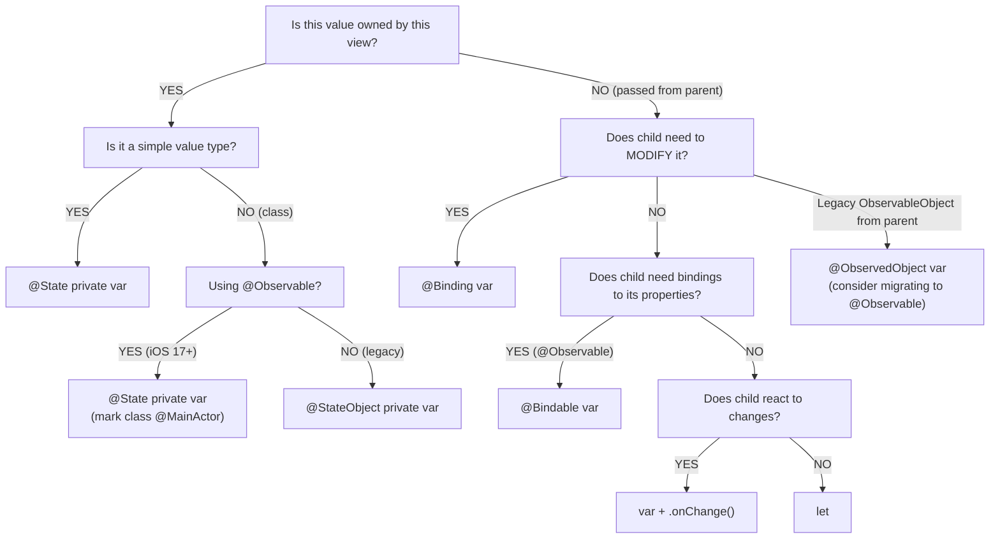
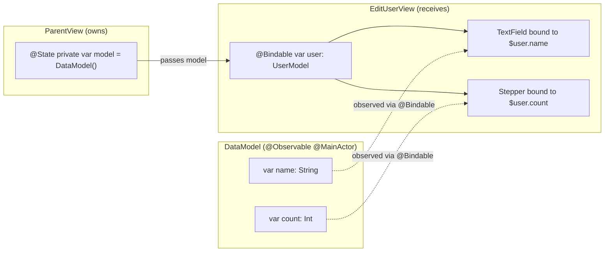
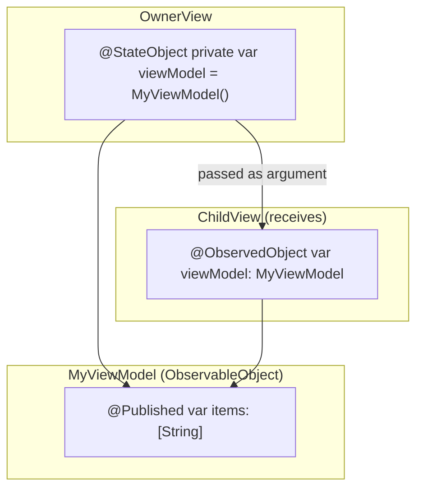
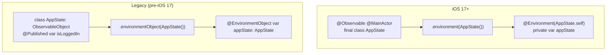
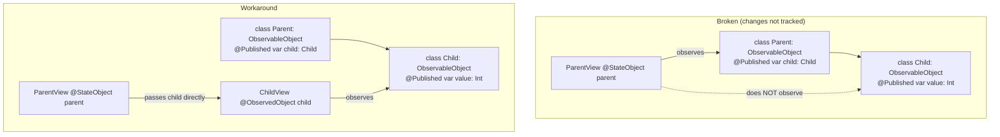

<!-- source: DeepWiki mcp.deepwiki.com · repo AvdLee/SwiftUI-Agent-Skill · page 3.2 State Management · fetched 2026-10-26 -->

# State Management

<details>
<summary>Relevant source files</summary>

The following files were used as context for generating this wiki page:

- [swiftui-expert-skill/SKILL.md](swiftui-expert-skill/SKILL.md)
- [swiftui-expert-skill/references/state-management.md](swiftui-expert-skill/references/state-management.md)

</details>


This page documents all SwiftUI state management patterns, property wrapper selection rules, ownership semantics, modern iOS 17+ patterns versus legacy patterns, thread safety with `@MainActor`, the nested `ObservableObject` limitation, and state privacy rules.

For performance considerations that interact with state (e.g., minimizing update fan-out), see [Performance Patterns](#3.4). For how `SKILL.md` routes the agent to this reference, see [Skill Structure](#3.1).

---

## Property Wrapper Overview

The following table summarizes every property wrapper relevant to SwiftUI state management, organized by era and ownership role.

| Wrapper | Era | Ownership | Use When |
|---|---|---|---|
| `@State` | All | Owned | Internal view state that triggers UI updates |
| `@Binding` | All | Borrowed | Child view needs to **modify** parent's state |
| `@FocusState` | All | Owned | Controlling keyboard focus for text fields |
| `let` | All | N/A | Read-only value passed from parent |
| `var` | All | N/A | Read-only value, reacted to via `.onChange()` |
| `@Bindable` | iOS 17+ | Borrowed | Received `@Observable` object that needs bindings |
| `@StateObject` | Legacy | Owned | View creates and owns an `ObservableObject` |
| `@ObservedObject` | Legacy | Borrowed | View receives an `ObservableObject` from outside |
| `@Environment` | All | Borrowed | Accessing environment values or injected `@Observable` |
| `@EnvironmentObject` | Legacy | Borrowed | Accessing `ObservableObject` injected via `.environmentObject()` |

Sources: [swiftui-expert-skill/references/state-management.md:1-17]()

---

## Decision Flowchart

**Diagram: Property Wrapper Selection**



Sources: [swiftui-expert-skill/references/state-management.md:426-447]()

---

## @State

`@State` is for internal view state: values the view creates, owns, and updates itself.

**Rules:**
- Always mark `@State` as `private`.
- Use `@State` with `@Observable` classes on iOS 17+ — do **not** use `@StateObject` for these.
- Never declare a value passed from a parent as `@State` (see [Don't Pass Values as @State](#dont-pass-values-as-state)).

The `private` modifier is not just style. It prevents the property from appearing in the synthesized initializer, which blocks the common bug of passing an initial value that will be silently ignored after first render.

Sources: [swiftui-expert-skill/references/state-management.md:19-53]()

---

## @Observable and @MainActor (iOS 17+)

The `@Observable` macro (iOS 17+) is the preferred replacement for `ObservableObject`. When using it:

- Declare the model with `@Observable` on the class.
- Mark the class `@MainActor` to ensure thread safety with SwiftUI's rendering system.
- Use `@State` (not `@StateObject`) to own the instance inside a view.

The `@MainActor` annotation is redundant only if the project or package already sets Default Actor Isolation to `MainActor` globally.

**Diagram: @Observable Ownership and Binding Chain**



Sources: [swiftui-expert-skill/references/state-management.md:31-55](), [swiftui-expert-skill/references/state-management.md:303-331]()

---

## @Binding

Use `@Binding` only when the child view needs to **write** to the parent's state. If the child only reads a value, use `let`.

| Situation | Correct Pattern |
|---|---|
| Child displays a value, never modifies it | `let title: String` |
| Child modifies a value owned by the parent | `@Binding var isSelected: Bool` |
| Child creates bindings to properties of an `@Observable` object | `@Bindable var user: UserModel` |

Sources: [swiftui-expert-skill/references/state-management.md:57-101]()

---

## @Bindable (iOS 17+)

`@Bindable` is used when a view **receives** an `@Observable` object from outside and needs to create `$`-prefixed bindings to its properties (e.g., for `TextField`, `Toggle`, etc.).

It is distinct from `@Binding`:
- `@Binding` wraps a single value.
- `@Bindable` wraps an `@Observable` reference type, enabling per-property bindings.

Sources: [swiftui-expert-skill/references/state-management.md:302-331]()

---

## @FocusState

`@FocusState` controls keyboard focus for text input fields.

**Choosing the type:**

| Scenario | Type | Notes |
|---|---|---|
| Single focusable field | `Bool` | Simple; toggle on/off |
| Multiple fields | `Field?` (a `Hashable` enum) | Type-safe, readable transitions |

When multiple fields are present, define a nested `Hashable` enum (e.g., `Field`) with one case per focusable field. Use `.focused($focusedField, equals: .name)` to bind each field.

**Diagram: @FocusState Enum Flow**

```mermaid
stateDiagram-v2
    direction LR
    [*] --> "nil (no focus)"
    "nil (no focus)" --> ".name": "onAppear / tap"
    ".name" --> ".email": "Next button"
    ".email" --> ".password": "Next button"
    ".password" --> "nil (no focus)": "Next button (done)"
    "nil (no focus)" --> [*]
```

Sources: [swiftui-expert-skill/references/state-management.md:103-169]()

---

## @StateObject vs @ObservedObject (Legacy)

These wrappers apply to `ObservableObject` (the pre-iOS 17 protocol). The distinction is purely about **ownership**:

- `@StateObject`: The view **creates** the object. SwiftUI retains it across re-renders.
- `@ObservedObject`: The view **receives** the object from outside. SwiftUI does not retain it.

**Critical mistake — never do this:**

```
// @ObservedObject var viewModel = MyViewModel()  ← creates new instance on every update
```

Always use `@StateObject` for objects the view owns, and receive objects from outside via `@ObservedObject`.

**Diagram: Ownership Split — StateObject vs ObservedObject**



Sources: [swiftui-expert-skill/references/state-management.md:171-258]()

### @StateObject in Custom Initializer

When a `@StateObject` must be initialized with parameters in a custom `init`, use `StateObject(wrappedValue:)` with an inline expression. This leverages Swift's `@autoclosure` behavior to prevent redundant allocations:

[swiftui-expert-skill/references/state-management.md:221-258]()

The wrong pattern (`let viewModel = ...; _viewModel = StateObject(wrappedValue: viewModel)`) allocates a new instance every time SwiftUI evaluates the initializer for structural identity checks. The correct pattern passes the expression directly to `StateObject(wrappedValue:)`.

Sources: [swiftui-expert-skill/references/state-management.md:221-261]()

---

## Don't Pass Values as @State

`@State` and `@StateObject` retain their value across view updates. This means: when a parent passes a new value to a child that declared it as `@State`, the child ignores the update — it only uses the value at first creation.

**Prevention rule:** Always mark `@State` and `@StateObject` as `private`. This removes them from the generated initializer, making it impossible to accidentally pass a value to them.

Sources: [swiftui-expert-skill/references/state-management.md:262-300]()

---

## let vs var for Passed Values

| Pattern | When to Use |
|---|---|
| `let title: String` | Child displays or reads the value, never reacts to changes |
| `var externalValue: Int` + `.onChange()` | Child needs to react when the value changes |

`var` for passed values does not grant write access to the parent's state; it simply allows `.onChange(of:)` to fire. If write access is needed, use `@Binding`.

Sources: [swiftui-expert-skill/references/state-management.md:333-365]()

---

## @Environment and @EnvironmentObject

### @Environment (System Values and iOS 17+ Observable Injection)

`@Environment` reads values provided by SwiftUI's system or by parent views. On iOS 17+, it is also the preferred way to inject `@Observable` objects into a subtree.

```
// Inject at root:  ContentView().environment(AppState())
// Access in child: @Environment(AppState.self) private var appState
```

### @EnvironmentObject (Legacy)

`@EnvironmentObject` is the pre-iOS 17 equivalent for `ObservableObject`. Inject with `.environmentObject(_:)`, access with `@EnvironmentObject var appState: AppState`. Prefer the `@Observable` + `@Environment` pattern for new code.

**Diagram: Environment Injection Paths**



Sources: [swiftui-expert-skill/references/state-management.md:367-424]()

---

## Nested ObservableObject Problem

`ObservableObject` does not propagate changes through nested `ObservableObject` properties. SwiftUI only observes top-level `@Published` changes on the parent; changes deep inside a nested child object go undetected.

**The limitation:**
- A `Parent: ObservableObject` that holds a `@Published var child: Child` (where `Child: ObservableObject`) will not trigger view updates when `child.value` changes.

**Workaround:** Pass the nested object directly to the child view using `@ObservedObject`.

**Note:** This limitation is specific to `ObservableObject`. `@Observable` fully supports nested observed objects — no workaround is needed.

**Diagram: Nested ObservableObject — Problem and Workaround**



Sources: [swiftui-expert-skill/references/state-management.md:475-507]()

---

## State Privacy Rules

All view-owned state must be `private`. Injected or passed values must not be `private`.

| Property Kind | Private? | Examples |
|---|---|---|
| Created by the view | Yes | `@State`, `@StateObject`, `@AppStorage`, `@Environment` |
| Passed from parent | No | `let title`, `@Binding var isSelected`, `@Bindable var user` |

This convention makes the public API of a view (its initializer parameters) immediately readable, and prevents callers from accidentally supplying initial values to state properties that will be ignored.

Sources: [swiftui-expert-skill/references/state-management.md:449-473]()

---

## Key Principles Summary

1. **Prefer `@Observable` over `ObservableObject`** for all new code.
2. **Mark `@Observable` classes with `@MainActor`** unless default actor isolation is already set project-wide.
3. Use `@State` (not `@StateObject`) with `@Observable` classes.
4. Use `@Bindable` for injected `@Observable` objects that need per-property bindings.
5. **Always mark `@State` and `@StateObject` as `private`.**
6. **Never declare a passed-in value as `@State` or `@StateObject`.**
7. With `@Observable`, nested objects work correctly. With `ObservableObject`, pass nested objects directly to child views via `@ObservedObject`.

Sources: [swiftui-expert-skill/references/state-management.md:509-518](), [swiftui-expert-skill/SKILL.md:42-48]()

---

