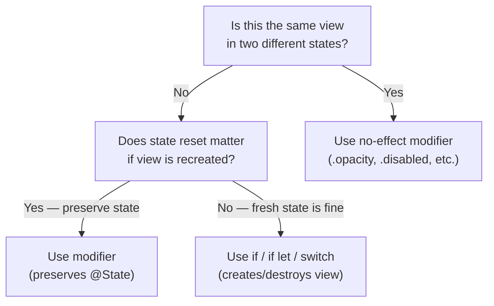
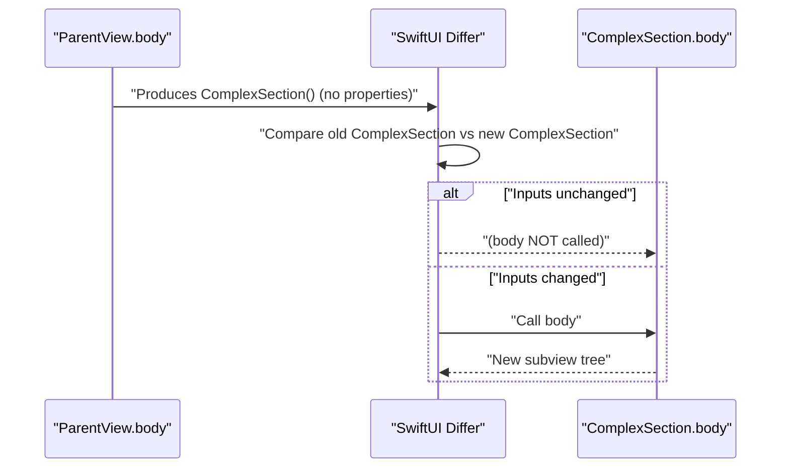
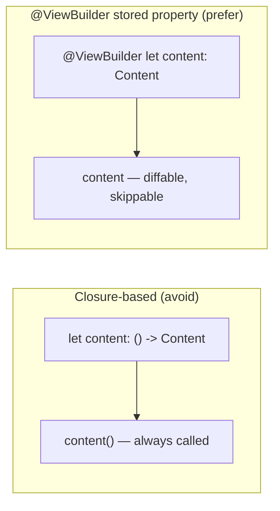
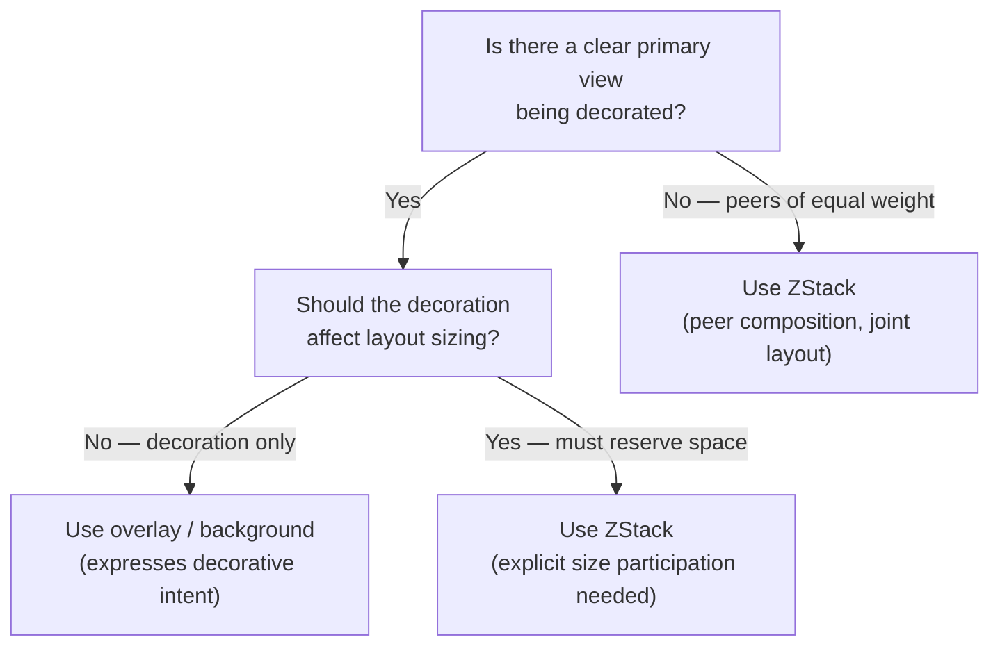

<!-- source: DeepWiki mcp.deepwiki.com · repo AvdLee/SwiftUI-Agent-Skill · page 3.3 View Composition & Structure · fetched 2026-10-26 -->

# View Composition & Structure

<details>
<summary>Relevant source files</summary>

The following files were used as context for generating this wiki page:

- [swiftui-expert-skill/SKILL.md](swiftui-expert-skill/SKILL.md)
- [swiftui-expert-skill/references/list-patterns.md](swiftui-expert-skill/references/list-patterns.md)
- [swiftui-expert-skill/references/performance-patterns.md](swiftui-expert-skill/references/performance-patterns.md)
- [swiftui-expert-skill/references/sheet-navigation-patterns.md](swiftui-expert-skill/references/sheet-navigation-patterns.md)
- [swiftui-expert-skill/references/view-structure.md](swiftui-expert-skill/references/view-structure.md)

</details>


This page documents SwiftUI best practices for composing, extracting, and structuring views. It covers view identity, modifier usage, struct extraction, container patterns, and layering choices. For performance techniques that go beyond view structure (lazy containers, state update optimization, debugging), see [Performance Patterns](#3.4). For layout sizing and `GeometryReader` usage, see [Layout Best Practices](#3.8).

---

## View Identity and the Diffing Algorithm

SwiftUI maintains a persistent view hierarchy and uses a **diffing algorithm** to determine which views need updating. A view's *identity* determines whether SwiftUI updates an existing view or destroys and recreates it.

Two kinds of identity exist:

| Identity Type | How It Works | Implication |
|---|---|---|
| **Structural identity** | Determined by position in the view hierarchy and type | Conditional branches (`if/else`) create distinct identity slots |
| **Explicit identity** | Set with `.id(_:)` modifier | Forces a new view when the value changes |

When a view is destroyed and recreated (identity changes), any `@State` stored in it is reset, animations are interrupted, and rendering cost increases. Proper composition avoids unnecessary identity changes.

**Sources:** [swiftui-expert-skill/references/view-structure.md:1-6]()

---

## Prefer Modifiers Over Conditional Views

When a condition controls *visibility or appearance* of the **same conceptual view**, use a no-effect modifier rather than branching the view tree.

### When to Use `.opacity` Instead of `if`

Conditional inclusion changes view identity. Modifier-based control preserves it.

[swiftui-expert-skill/references/view-structure.md:11-24]()

**Decision rule:**

```
Is this the same view in two different states?
  → YES: use a modifier (.opacity, .disabled, .foregroundStyle, etc.)
  → NO:  use a conditional (if/else, if let)
```

### When Conditionals Are Correct

[swiftui-expert-skill/references/view-structure.md:26-42]()

Use `if`/`else` or `if let` when the branches represent **fundamentally different views** — different types, different semantic content, or content that should not retain state across the transition.

**Decision diagram: Conditional vs. Modifier**



**Sources:** [swiftui-expert-skill/references/view-structure.md:8-42](), [swiftui-expert-skill/SKILL.md:52-53]()

---

## Struct Extraction vs. `@ViewBuilder` Computed Properties

### Why `@ViewBuilder` Functions Cause Unnecessary Work

A `@ViewBuilder` function or computed property **is part of the parent view**. When the parent's `body` re-executes, the function re-executes unconditionally — SwiftUI has no way to skip it.

[swiftui-expert-skill/references/view-structure.md:44-74]()

### Why Separate Structs Can Be Skipped

A separate `struct` conforming to `View` is an independent node in the diffing graph. SwiftUI compares the struct's stored properties before calling `body`. If the struct has no changed inputs, `body` is never called.

[swiftui-expert-skill/references/view-structure.md:76-112]()

**Struct skipping mechanism:**



**Sources:** [swiftui-expert-skill/references/view-structure.md:44-112]()

### When `@ViewBuilder` Functions Are Acceptable

Use `@ViewBuilder` functions or computed properties when:

- The section is **small** (few views, no expensive rendering)
- The section contains **no independent state** to isolate
- Re-execution on every parent update is negligible in cost

[swiftui-expert-skill/references/view-structure.md:114-146]()

### Extraction Criteria

Extract to a separate `struct` when any of these apply:

| Condition | Extract to struct? |
|---|---|
| View has multiple logical sections | Yes |
| View contains reusable components | Yes |
| `body` is hard to read | Yes |
| Inputs are independent of parent state | Yes (enables skipping) |
| View is small and stateless | No — `@ViewBuilder` is fine |

[swiftui-expert-skill/references/view-structure.md:148-155]()

---

## Container View Pattern

A container view accepts child content through a generic parameter. The storage type of that content determines whether SwiftUI can diff it.

### Closure-Based Content (Avoid)

Closures cannot be compared for equality. SwiftUI must always call the closure and evaluate its result, preventing any skip optimization.

[swiftui-expert-skill/references/view-structure.md:157-180]()

### `@ViewBuilder let content: Content` (Prefer)

Declaring content as a stored `@ViewBuilder` property of type `Content` (a `View` conforming generic) gives SwiftUI a concrete value it can compare. If the content value is unchanged, SwiftUI can skip rendering it.

[swiftui-expert-skill/references/view-structure.md:182-201]()

**Container pattern comparison:**



**Sources:** [swiftui-expert-skill/references/view-structure.md:157-201](), [swiftui-expert-skill/SKILL.md:55]()

---

## `ZStack` vs. `overlay` / `background`

Both approaches layer views, but they differ in **layout participation** and **intent expression**.

| Aspect | `overlay` / `background` | `ZStack` |
|---|---|---|
| Layout anchor | Primary view is the anchor; decorator adopts its size | Each child participates independently |
| Implicit size inheritance | Yes — child adopts parent's proposed size | No |
| Expresses intent | Decoration of a primary view | Peer composition |
| When to use | Badges, icons, borders, fill patterns | Multiple peers jointly defining layout |

[swiftui-expert-skill/references/view-structure.md:203-214]()

### Choosing the Right Layering Construct



### Key Behavioral Difference

In `overlay` and `background`, the child view that lacks an explicit size adopts the size proposed to the **parent**. In `ZStack`, no such inheritance occurs — each child sizes itself independently.

[swiftui-expert-skill/references/view-structure.md:210-214]()

**Sources:** [swiftui-expert-skill/references/view-structure.md:203-267]()

---

## Avoiding Side Effects in `body`

The `body` property must be **pure**: it should only read state and return a view description. It must not:

- Dispatch async work (use `.task` or `.onAppear` instead)
- Mutate state (triggers re-entrant re-renders)
- Create expensive objects (recreated on every evaluation)
- Contain complex business logic (belongs in services/models)

From `SKILL.md` [swiftui-expert-skill/SKILL.md:53]():

> Keep view `body` simple and pure (no side effects or complex logic)

Action handlers should call methods rather than contain inline logic. Business logic belongs in `@Observable` or `ObservableObject` service classes, not in view structs.

**Sources:** [swiftui-expert-skill/SKILL.md:50-58]()

---

## Code Entity Map

The following diagram maps the primary code constructs discussed in this page to their roles in SwiftUI's view composition model.

```mermaid
graph TD
    subgraph "View Struct (struct ... View)"
        body["body: some View"]
        state["@State / @Binding"]
        body --> state
    end

    subgraph "Extraction Targets"
        sep["Separate struct View\n(diffable, skippable)"]
        vb["@ViewBuilder func\n(part of parent, not skippable)"]
    end

    subgraph "Modifiers"
        opacity[".opacity(_:)"]
        overlay[".overlay(alignment:content:)"]
        background[".background(content:)"]
    end

    subgraph "Layering"
        ZStack["ZStack\n(peer composition)"]
        overlayMod[".overlay / .background\n(decoration)"]
    end

    subgraph "Container Pattern"
        closure["let content: () -> Content\n(closure — not diffable)"]
        stored["@ViewBuilder let content: Content\n(stored — diffable)"]
    end

    body -->|"complex section"| sep
    body -->|"simple section"| vb
    body -->|"same view, different state"| opacity
    body -->|"decorate primary view"| overlay
    body -->|"decorate primary view"| background
    body -->|"peer layers"| ZStack
    body -->|"accepts child content"| stored
```



**Sources:** [swiftui-expert-skill/references/view-structure.md:1-276](), [swiftui-expert-skill/SKILL.md:50-58]()

---

## Review Checklist

This checklist mirrors the View Structure section of `SKILL.md` [swiftui-expert-skill/SKILL.md:152-156]():

- [ ] Modifiers used instead of conditionals for state-only changes
- [ ] Complex views extracted to separate `struct` types
- [ ] `@ViewBuilder` functions only used for small, simple sections
- [ ] Container views declare `@ViewBuilder let content: Content`, not `() -> Content`
- [ ] `overlay` / `background` preferred over `ZStack` for decoration
- [ ] `ZStack` used only when peer views jointly define layout
- [ ] `body` contains no side effects, no object creation, no business logic

**Sources:** [swiftui-expert-skill/references/view-structure.md:269-276](), [swiftui-expert-skill/SKILL.md:152-156]()

---

