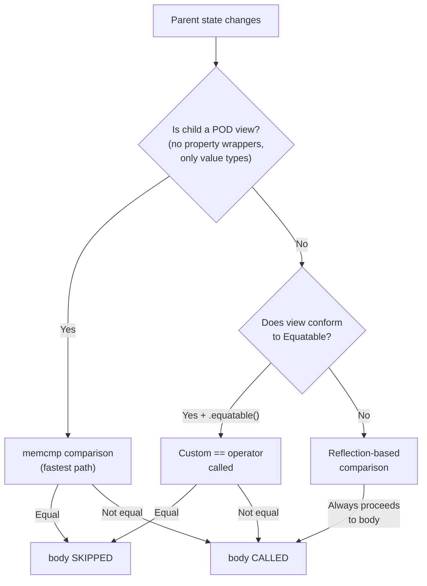
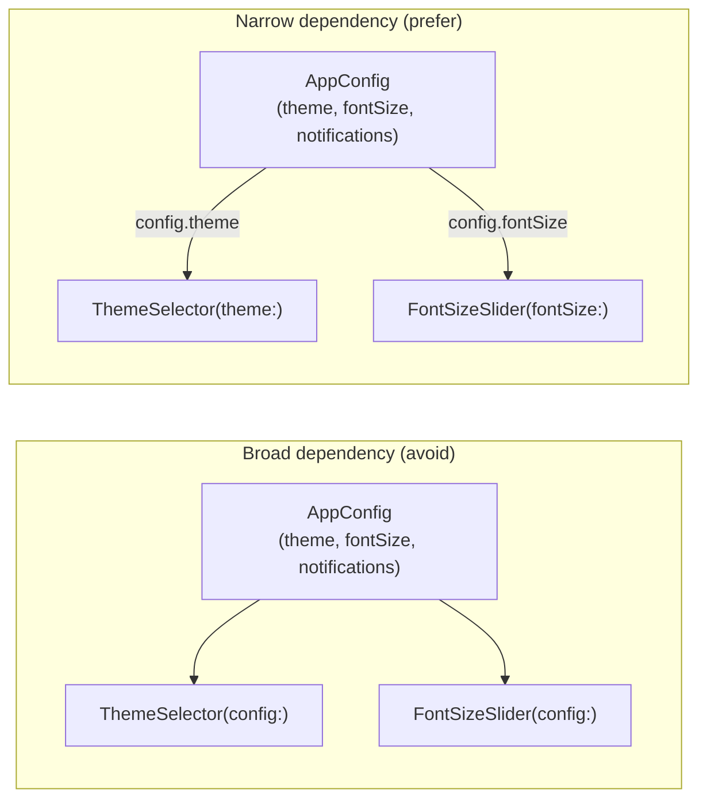
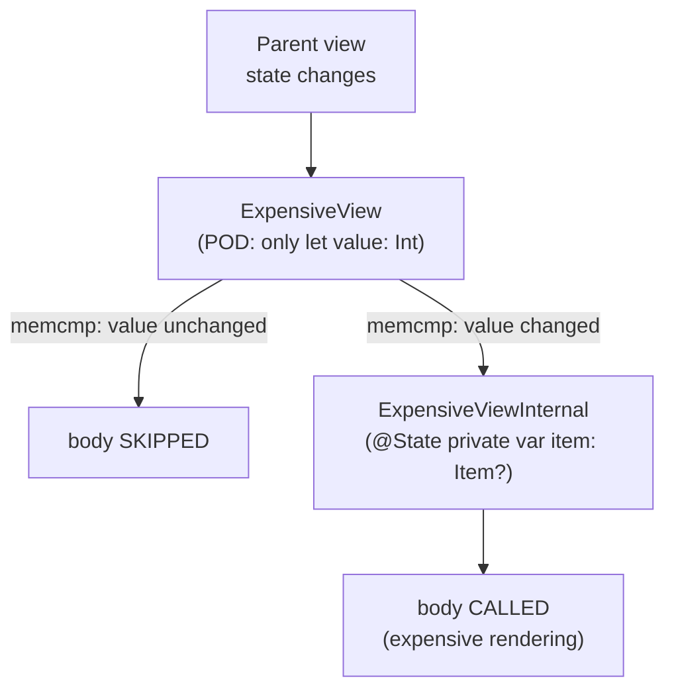
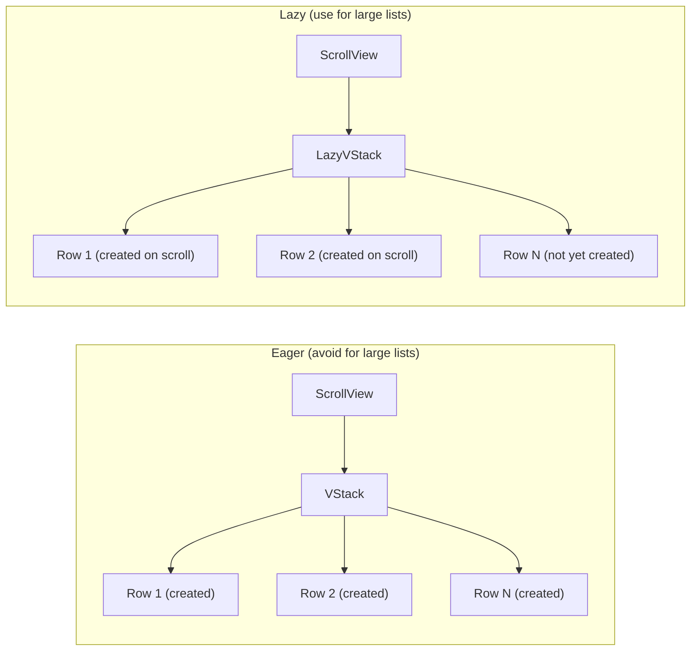
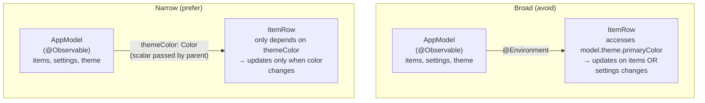

<!-- source: DeepWiki mcp.deepwiki.com · repo AvdLee/SwiftUI-Agent-Skill · page 3.4 Performance Patterns · fetched 2026-10-26 -->

# Performance Patterns

<details>
<summary>Relevant source files</summary>

The following files were used as context for generating this wiki page:

- [swiftui-expert-skill/SKILL.md](swiftui-expert-skill/SKILL.md)
- [swiftui-expert-skill/references/list-patterns.md](swiftui-expert-skill/references/list-patterns.md)
- [swiftui-expert-skill/references/performance-patterns.md](swiftui-expert-skill/references/performance-patterns.md)
- [swiftui-expert-skill/references/sheet-navigation-patterns.md](swiftui-expert-skill/references/sheet-navigation-patterns.md)
- [swiftui-expert-skill/references/view-structure.md](swiftui-expert-skill/references/view-structure.md)

</details>


This page documents the SwiftUI performance techniques encoded in `swiftui-expert-skill/references/performance-patterns.md`. It covers how to reduce unnecessary view updates, structure state dependencies correctly, defer work to avoid blocking the render cycle, and diagnose regressions.

For related topics that affect performance indirectly: view extraction rules are in [View Composition & Structure (3.3)](#3.3), list-specific identity rules are in [List Patterns (3.5)](#3.5), and layout costs from `GeometryReader` nesting are in [Layout Best Practices (3.8)](#3.8).

---

## How SwiftUI Decides to Redraw

SwiftUI re-evaluates a view's `body` when any input it tracks changes. The diffing strategy varies by view type:

**Diffing Algorithm by View Type**



Sources: [swiftui-expert-skill/references/performance-patterns.md:107-155]()

---

## Core Principles

The ten numbered techniques in `performance-patterns.md` fall into four categories:

| Category | Techniques | Goal |
|---|---|---|
| Eliminate unnecessary work | Avoid redundant state updates, eliminate unnecessary dependencies | Fewer `body` calls |
| Reduce dependency surface | Pass only needed values, narrow state scope | Smaller update fan-out |
| Defer expensive work | `LazyVStack`/`LazyHStack`, `.task` modifier | On-demand rendering |
| Optimize diffing cost | POD views, `Equatable` conformance | Faster equality checks |

---

## 1. Avoid Redundant State Updates

SwiftUI does not compare values before triggering a `body` re-evaluation when state is assigned. Assigning the same value unconditionally causes a needless redraw.

[swiftui-expert-skill/references/performance-patterns.md:7-20]()

Apply this guard in any `onReceive`, `onChange`, or scroll handler:

```
if self.currentValue != newValue {
    self.currentValue = newValue
}
```

**Hot paths** — scroll handlers, gesture recognizers, preference key callbacks — fire at very high frequency. Gate state changes behind threshold checks rather than updating on every event.

[swiftui-expert-skill/references/performance-patterns.md:23-39]()

The pattern for a scroll-driven title appearance:

```
// Only update when the boolean result changes, not on every offset value
let shouldShow = offset.y <= -32
if shouldShow != shouldShowTitle {
    shouldShowTitle = shouldShow
}
```

Sources: [swiftui-expert-skill/references/performance-patterns.md:5-39]()

---

## 2. Pass Only Required Values to Child Views

Passing an entire model object to a view that needs only one field creates a dependency on all fields in that object.

**Dependency surface comparison**



With `ObservableObject`, any `@Published` change triggers all observers of the object. With `@Observable`, the runtime tracks which properties are accessed during `body`, but passing an entire model object still gives the view access to — and therefore a dependency on — more than it needs.

Rule: **pass the specific scalar or value each child view actually reads**.

Sources: [swiftui-expert-skill/references/performance-patterns.md:42-80](), [swiftui-expert-skill/SKILL.md:61-62]()

---

## 3. Keep `body` Pure

`body` should be a **pure, side-effect-free** structural description of state. Any work placed inside `body` runs every time the view is re-evaluated.

### Creating Objects in `body`

Reference types (e.g., `DateFormatter`, `NumberFormatter`) allocated inside `body` are discarded and recreated on every render. Move them to `static` stored properties.

[swiftui-expert-skill/references/performance-patterns.md:274-295]()

```
// Pattern: static stored formatter
private static let dateFormatter: DateFormatter = { ... }()
```

### Heavy Computation in `body`

Sorting, filtering, and other O(n) operations in `body` re-run on every update.

[swiftui-expert-skill/references/performance-patterns.md:297-350]()

Three approaches, in increasing order of correctness:

| Approach | Mechanism |
|---|---|
| `@State` + `.onChange` | Store sorted result; recompute only when source changes |
| Computed property on `@Observable` model | Computed on model, accessed reactively via `@Observable` tracking |
| Model method (`loadItems`) + `.task` | Async fetch; model owns data lifecycle |

### Unnecessary Stored State

Derived values should be computed properties, not stored `@State`. Storing `itemCount` separately from `items` requires manual synchronization and doubles the update surface.

[swiftui-expert-skill/references/performance-patterns.md:352-363]()

Sources: [swiftui-expert-skill/references/performance-patterns.md:273-363](), [swiftui-expert-skill/SKILL.md:53-54]()

---

## 4. Equatable Conformance for Expensive Views

For views with expensive `body` implementations, conform to `Equatable` and apply the `.equatable()` modifier. SwiftUI will call your `==` operator before evaluating `body`.

[swiftui-expert-skill/references/performance-patterns.md:83-104]()

```
struct ExpensiveView: View, Equatable {
    static func == (lhs: Self, rhs: Self) -> Bool {
        lhs.data.id == rhs.data.id
    }
    ...
}
// At call site:
ExpensiveView(data: data).equatable()
```

**Caution**: When you add new stored properties or dependencies to the view, the `==` function must be updated to include them. Stale equality implementations cause missed updates.

Sources: [swiftui-expert-skill/references/performance-patterns.md:83-104]()

---

## 5. POD Views for Fast Diffing

A **POD (Plain Old Data) view** contains only simple value types and no property wrappers. SwiftUI uses `memcmp` to compare POD views, which is significantly faster than reflection-based comparison.

[swiftui-expert-skill/references/performance-patterns.md:107-155]()

**POD wrapper pattern**



The outer `ExpensiveView` is POD and uses fast `memcmp`. Only when `value` changes does `ExpensiveViewInternal` (which holds the `@State`) get re-evaluated.

This pattern is also closely related to the struct-extraction rule in [View Composition & Structure (3.3)](#3.3): extracted `struct` views with no changing inputs have their `body` skipped automatically.

Sources: [swiftui-expert-skill/references/performance-patterns.md:107-155](), [swiftui-expert-skill/references/view-structure.md:78-106]()

---

## 6. Lazy Loading with `LazyVStack` / `LazyHStack`

`VStack` and `HStack` inside a `ScrollView` create all child views immediately. `LazyVStack` and `LazyHStack` create views on demand as they scroll into the viewport.

[swiftui-expert-skill/references/performance-patterns.md:157-179]()



Use `LazyVStack`/`LazyHStack` when the collection is large enough that upfront creation would cause visible lag. For fixed, small sets, `VStack`/`HStack` is fine and avoids lazy-loading overhead.

Sources: [swiftui-expert-skill/references/performance-patterns.md:157-179](), [swiftui-expert-skill/SKILL.md:66]()

---

## 7. `.task` Modifier Lifecycle

The `.task` modifier attaches an async task to a view's lifetime. The task is:
- **started** when the view appears
- **cancelled** automatically when the view disappears

[swiftui-expert-skill/references/performance-patterns.md:182-199]()

This makes `.task` the correct place to initiate data fetching — it replaces the `onAppear` + manual `Task { }` + cancellation-token pattern:

```
.task {
    data = await fetchData()   // Cancelled if view leaves hierarchy
}
```

Do not place the task's result assignment inside `body`. Keep `body` as a read-only structural description.

Sources: [swiftui-expert-skill/references/performance-patterns.md:182-199]()

---

## 8. Eliminating Unnecessary Dependencies

Narrowing how much state a view accesses directly reduces how often it re-evaluates.

[swiftui-expert-skill/references/performance-patterns.md:223-260]()

**Before and after dependency narrowing**



Even with `@Observable` (which tracks accessed properties), a view that holds a reference to the entire model object can access additional properties later, widening its tracked set. Passing scalar values to leaf views is the most defensive approach.

Sources: [swiftui-expert-skill/references/performance-patterns.md:223-260](), [swiftui-expert-skill/SKILL.md:61-75]()

---

## 9. Debugging Unexpected Redraws with `Self._printChanges()`

`Self._printChanges()` is a debug-only API that prints the reason a view's `body` was called to the console. Call it as a discarded expression at the top of `body`:

[swiftui-expert-skill/references/performance-patterns.md:202-221]()

```
var body: some View {
    let _ = Self._printChanges()
    ...
}
```

The output identifies which property changed and triggered the re-evaluation. Remove this call before committing — it is a diagnostic tool only.

**When to use it**: When a child view is re-rendering despite seemingly unchanged inputs, `Self._printChanges()` reveals whether the trigger is a property wrapper, an `@Environment` value, or a parent structural change.

Sources: [swiftui-expert-skill/references/performance-patterns.md:202-221](), [swiftui-expert-skill/SKILL.md:75]()

---

## 10. Common Performance Bottlenecks

[swiftui-expert-skill/references/performance-patterns.md:262-271]()

| Bottleneck | Cause | Fix |
|---|---|---|
| View invalidation storms | Broad state changes on a shared `@Observable` or `ObservableObject` | Narrow passed values; split models |
| Unstable list identity | `ForEach` with `id: \.self` or `.indices` | Use `Identifiable` or stable keypath (see [3.5](#3.5)) |
| Heavy work in `body` | Sorting, formatting, decoding inside `body` | Move to model or use `.onChange` cache |
| Layout thrash | Deep stacks, excessive `GeometryReader` nesting | Flatten hierarchy; use `containerRelativeFrame` (see [3.8](#3.8)) |
| Preference chain cost | Unthresholded `onPreferenceChange` | Gate updates by threshold |

For deeper profiling, use the **SwiftUI Instruments template** to identify which views are re-rendering and at what frequency.

Sources: [swiftui-expert-skill/references/performance-patterns.md:262-271](), [swiftui-expert-skill/SKILL.md:63-75]()

---

## Review Checklist

Drawn from the Performance section of `SKILL.md` [swiftui-expert-skill/SKILL.md:157-164]() and the summary in `performance-patterns.md` [swiftui-expert-skill/references/performance-patterns.md:365-377]():

- [ ] State updates check for value changes before assigning
- [ ] Hot paths minimize state updates (threshold gating)
- [ ] Only required values are passed to child views — no large config objects
- [ ] Large lists use `LazyVStack` / `LazyHStack`
- [ ] No object creation (e.g., `DateFormatter`) inside `body`
- [ ] Heavy computation moved out of `body` (model or `.onChange` cache)
- [ ] `body` is side-effect-free
- [ ] Derived state is computed, not stored as `@State`
- [ ] `Self._printChanges()` used to diagnose unexpected updates (removed before commit)
- [ ] Expensive views use `Equatable` conformance + `.equatable()` where appropriate
- [ ] POD view wrappers considered for advanced optimization scenarios

---

