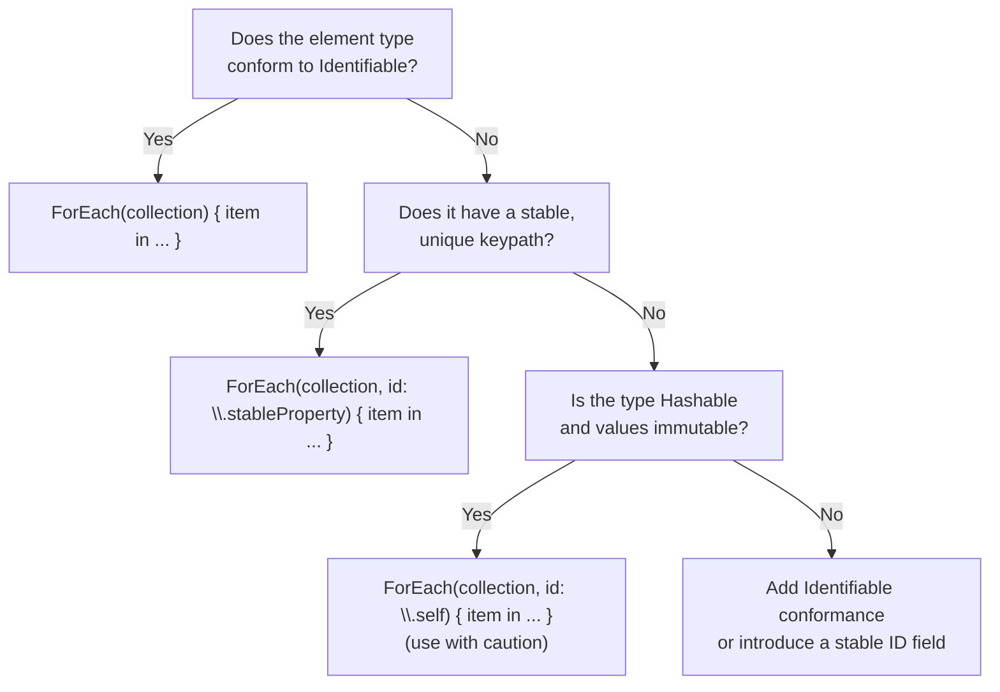
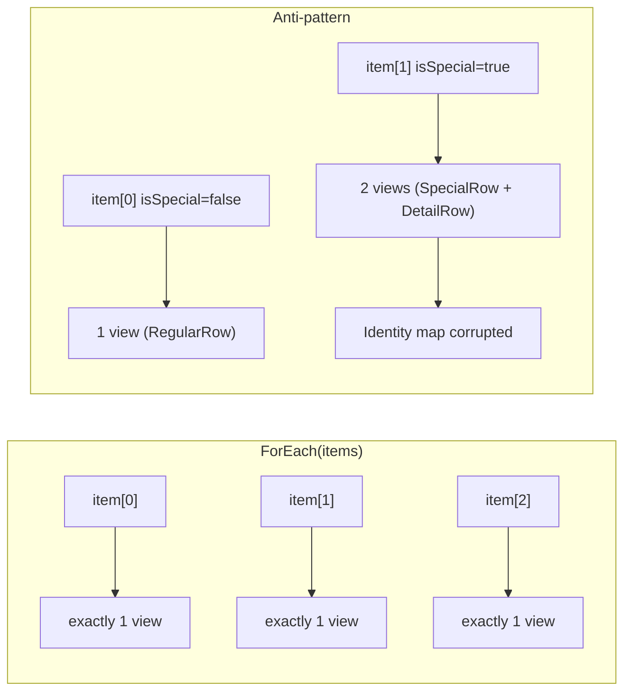
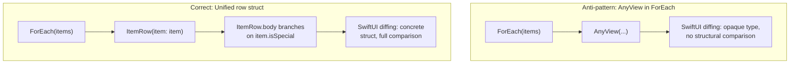
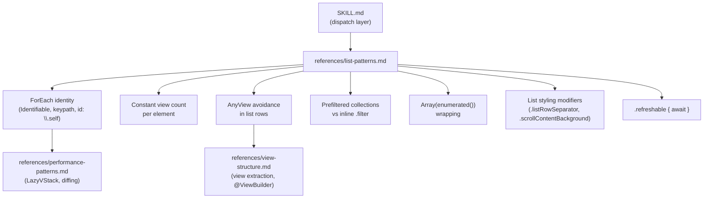

<!-- source: DeepWiki mcp.deepwiki.com · repo AvdLee/SwiftUI-Agent-Skill · page 3.5 List Patterns · fetched 2026-10-26 -->

# List Patterns

<details>
<summary>Relevant source files</summary>

The following files were used as context for generating this wiki page:

- [swiftui-expert-skill/SKILL.md](swiftui-expert-skill/SKILL.md)
- [swiftui-expert-skill/references/list-patterns.md](swiftui-expert-skill/references/list-patterns.md)
- [swiftui-expert-skill/references/performance-patterns.md](swiftui-expert-skill/references/performance-patterns.md)
- [swiftui-expert-skill/references/sheet-navigation-patterns.md](swiftui-expert-skill/references/sheet-navigation-patterns.md)
- [swiftui-expert-skill/references/view-structure.md](swiftui-expert-skill/references/view-structure.md)

</details>


This page documents SwiftUI patterns for `ForEach` identity, row composition, `List` customization, and pull-to-refresh. It focuses specifically on the rules encoded in [swiftui-expert-skill/references/list-patterns.md](). For general view composition patterns such as extracting subviews or avoiding `AnyView` in complex hierarchies, see [View Composition & Structure](#3.3). For performance techniques like `LazyVStack` and `LazyHStack`, see [Performance Patterns](#3.4).

---

## ForEach Identity

SwiftUI uses identity to diff list contents, animate insertions and deletions, and preserve per-row state. Providing **stable, unique identity** is the most important correctness requirement for any `ForEach`.

There are three mechanisms for specifying identity, ranked from most to least preferred:

| Mechanism | Syntax | Notes |
|---|---|---|
| `Identifiable` conformance | `ForEach(users)` | Cleanest; ID derived from `id` property |
| Explicit key path | `ForEach(users, id: \.userId)` | Useful when you can't add `Identifiable` |
| `id: \.self` | `ForEach(users, id: \.self)` | Only safe if the type is `Hashable` and values are truly stable |
| `.indices` | `ForEach(users.indices, id: \.self)` | **Unsafe for dynamic content** — do not use |

### Conforming to `Identifiable`

[swiftui-expert-skill/references/list-patterns.md:8-15]()

Use a stable, persistent field as the `id`. Avoid synthesized properties like array positions or object memory addresses.

### The `.indices` Problem

[swiftui-expert-skill/references/list-patterns.md:22-25]()

When the backing array is mutated (insertion, deletion, reordering), indices shift. A view at index `2` after deletion now corresponds to a different element. This can cause:

- Incorrect animations
- Stale data displayed in rows
- Index-out-of-bounds crashes at runtime

**Decision diagram for ForEach identity:**

**ForEach Identity Selection**



Sources: [swiftui-expert-skill/references/list-patterns.md:3-31](), [swiftui-expert-skill/SKILL.md:67]()

---

## Constant View Count Per Element

SwiftUI tracks the number of views produced per `ForEach` element. If this count varies across elements or across renders, identity tracking breaks.

[swiftui-expert-skill/references/list-patterns.md:33-50]()

**Incorrect — variable view count per element:**

The `if/else` branch produces either one or two views depending on `item.isSpecial`, which corrupts the identity map.

**Correct — one view per element:**

Each element maps to exactly one view. Internal branching is delegated to the row view's own `body`.

**Diagram: view count stability requirement**

**ForEach View Count Invariant**



Sources: [swiftui-expert-skill/references/list-patterns.md:33-50]()

---

## Avoiding `AnyView` in List Rows

[swiftui-expert-skill/references/list-patterns.md:73-97]()

`AnyView` is a type-erasing wrapper. When used inside `ForEach`, it:

- Hides the concrete type from SwiftUI's diffing algorithm
- Prevents structural identity comparisons
- Increases allocation overhead per row

The correct alternative is to create a single unified row view that handles branching in its own `body`:

| Approach | Identity visible to SwiftUI | Performance |
|---|---|---|
| `AnyView(condition ? ViewA() : ViewB())` | No — type erased | Higher cost per row |
| `ItemRow(item: item)` with branching inside | Yes — concrete struct | Lower cost per row |

The unified `ItemRow` pattern is documented at [swiftui-expert-skill/references/list-patterns.md:86-97]().

**AnyView vs Unified Row view**



Sources: [swiftui-expert-skill/references/list-patterns.md:73-97](), [swiftui-expert-skill/SKILL.md:70]()

---

## Inline Filtering Anti-Pattern

[swiftui-expert-skill/references/list-patterns.md:53-71]()

Calling `.filter { }` directly inside `ForEach` is evaluated on every `body` call. This has two problems:

1. **Performance**: filtering runs on every render, not just when data changes
2. **Identity instability**: the filtered array's indices shift whenever the source changes, making row identity unreliable

**Preferred approach**: precompute the filtered result and store it in `@State`, updating it reactively via `.onChange(of:)`.

| Pattern | Filtering cost | Identity stability |
|---|---|---|
| `ForEach(items.filter { ... })` | Every `body` call | Unstable |
| `@State var enabledItems` + `.onChange` | Only on `items` change | Stable |

Sources: [swiftui-expert-skill/references/list-patterns.md:53-71]()

---

## Enumerated Sequences

[swiftui-expert-skill/references/list-patterns.md:101-117]()

`Sequence.enumerated()` returns a lazy sequence of `(offset, element)` tuples. `ForEach` requires a `RandomAccessCollection`, so `enumerated()` alone does not compile.

Wrap with `Array(...)` before passing to `ForEach`:

```
ForEach(Array(items.enumerated()), id: \.offset) { index, item in ... }
```

Use `id: \.offset` only when the order is stable and elements are not reordered or deleted dynamically. If items can be inserted or removed, prefer `Identifiable` conformance instead.

Sources: [swiftui-expert-skill/references/list-patterns.md:101-117]()

---

## List Appearance Customization

[swiftui-expert-skill/references/list-patterns.md:119-132]()

`List` applies system default styling (background, separators, row insets). Override with these modifiers:

| Modifier | Effect |
|---|---|
| `.listStyle(.plain)` | Removes grouped appearance |
| `.scrollContentBackground(.hidden)` | Hides default scroll view background |
| `.background(Color.customBackground)` | Applies custom background |
| `.listRowSeparator(.hidden)` | Hides row separator lines |
| `.listRowInsets(EdgeInsets(...))` | Overrides default row padding |
| `.environment(\.defaultMinListRowHeight, 1)` | Allows rows shorter than the system default |

Apply `listRowSeparator` and `listRowInsets` inside the row view or directly on the row, not on the `List` itself — they are per-row modifiers.

Sources: [swiftui-expert-skill/references/list-patterns.md:119-132]()

---

## Pull-to-Refresh

[swiftui-expert-skill/references/list-patterns.md:134-143]()

Add the `.refreshable` modifier to a `List` to enable the system pull-to-refresh UI. The closure must be `async`; SwiftUI automatically manages the loading indicator lifecycle for the duration of the `await`.

```
List(items) { item in
    ItemRow(item: item)
}
.refreshable {
    await loadItems()
}
```

The modifier is available on `List` and `ScrollView`. The async function is called on the main actor by default.

Sources: [swiftui-expert-skill/references/list-patterns.md:134-143]()

---

## Relationship to Other Patterns

**List Patterns module relationships**



Sources: [swiftui-expert-skill/SKILL.md:14-17](), [swiftui-expert-skill/SKILL.md:166-170]()

---

## Summary Checklist

This checklist mirrors the one in [swiftui-expert-skill/references/list-patterns.md:145-153]() and in the review section of `SKILL.md` at [swiftui-expert-skill/SKILL.md:166-170]().

- [ ] `ForEach` uses `Identifiable` conformance or a stable keypath — never `.indices` for dynamic content
- [ ] Each `ForEach` element produces a constant number of views
- [ ] No `AnyView` wrapping row views — use a unified row struct instead
- [ ] No inline `.filter { }` inside `ForEach` — precompute and store filtered results
- [ ] Enumerated sequences wrapped with `Array(items.enumerated())` before use in `ForEach`
- [ ] Pull-to-refresh implemented with `.refreshable { await ... }`
- [ ] List appearance customized with appropriate per-row and per-list modifiers

---

