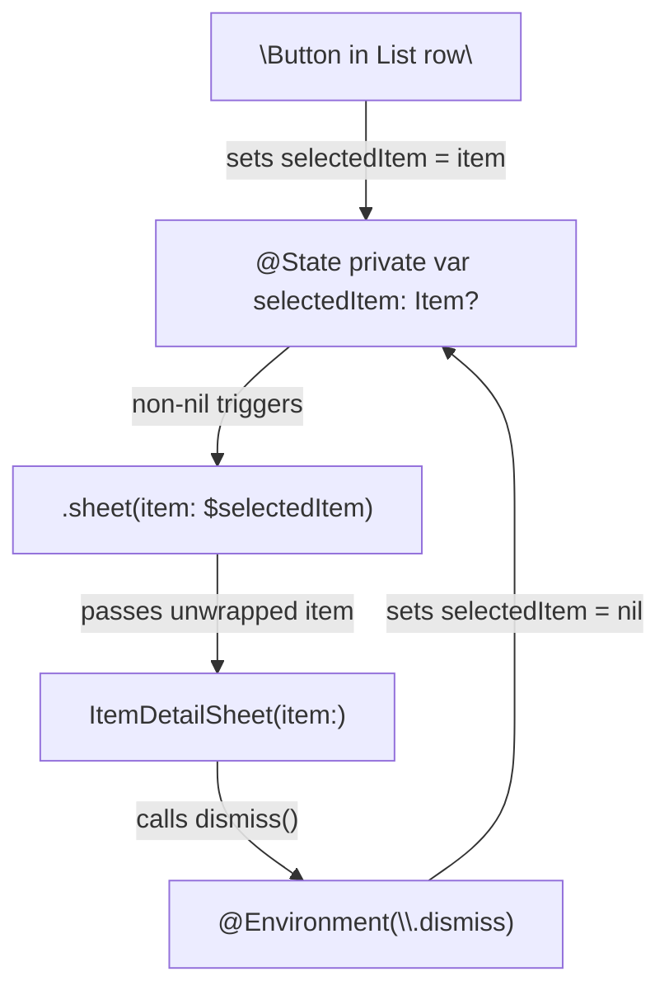

<!-- source: DeepWiki mcp.deepwiki.com · repo AvdLee/SwiftUI-Agent-Skill · page 3.6 Sheet & Navigation Patterns · fetched 2026-10-26 -->

# Sheet & Navigation Patterns

<details>
<summary>Relevant source files</summary>

The following files were used as context for generating this wiki page:

- [swiftui-expert-skill/SKILL.md](swiftui-expert-skill/SKILL.md)
- [swiftui-expert-skill/references/list-patterns.md](swiftui-expert-skill/references/list-patterns.md)
- [swiftui-expert-skill/references/performance-patterns.md](swiftui-expert-skill/references/performance-patterns.md)
- [swiftui-expert-skill/references/sheet-navigation-patterns.md](swiftui-expert-skill/references/sheet-navigation-patterns.md)
- [swiftui-expert-skill/references/view-structure.md](swiftui-expert-skill/references/view-structure.md)

</details>


This page documents preferred patterns for modal presentation and stack-based navigation in SwiftUI, sourced from [swiftui-expert-skill/references/sheet-navigation-patterns.md](). It covers `.sheet(item:)`, `@Environment(\.dismiss)`, `NavigationStack`, `NavigationPath`, `fullScreenCover`, `popover`, `alert`, and `confirmationDialog`.

For state management patterns that inform how data flows into and out of sheets, see [3.2](#3.2). For view composition rules that apply inside sheet content views, see [3.3](#3.3).

---

## Sheet Presentation

### `.sheet(item:)` vs `.sheet(isPresented:)`

The preferred pattern for model-driven sheets is `.sheet(item:)`. It binds presentation state directly to an optional model value, eliminating the need for a separate Boolean flag.

**Comparison table:**

| Aspect | `.sheet(item:)` | `.sheet(isPresented:)` |
|---|---|---|
| Trigger state | `@State private var selectedItem: Item?` | `@State private var showSheet = false` + `@State private var selectedItem: Item?` |
| State variables needed | 1 | 2 |
| Optional unwrapping in sheet body | Not needed — item is non-optional in closure | Required (`if let selectedItem`) |
| Auto-dismiss on `nil` | Yes | Manual (`selectedItem = nil`) |

The item-driven form is shown in [swiftui-expert-skill/references/sheet-navigation-patterns.md:9-42]().

When the bound optional is set to a non-`nil` value, the sheet is presented. Setting it back to `nil` dismisses it. SwiftUI handles the lifecycle automatically.

**Diagram: Sheet Presentation Data Flow**



Sources: [swiftui-expert-skill/references/sheet-navigation-patterns.md:1-43]()

---

### Sheet Ownership: Dismiss and Actions Internally

Sheets should manage their own dismiss logic and async actions. Passing dismiss or save callbacks from the parent creates tight coupling and makes the sheet harder to reuse.

**Preferred: sheet owns its actions**

- Access `@Environment(\.dismiss)` inside the sheet view.
- Access shared state via `@Environment` (e.g., a data store injected into the environment).
- Perform async work (e.g., save) inside the sheet's own methods.

See the complete `EditItemSheet` example at [swiftui-expert-skill/references/sheet-navigation-patterns.md:50-115]().

Key elements of that pattern:

| Code Element | Role |
|---|---|
| `@Environment(\.dismiss) private var dismiss` | Allows the sheet to close itself |
| `@Environment(DataStore.self) private var store` | Injects shared model without callback |
| `@State private var isSaving` | Local async state owned by sheet |
| `ToolbarItem(placement: .cancellationAction)` | Cancel button calls `dismiss()` directly |
| `ToolbarItem(placement: .confirmationAction)` | Save button launches `Task { await save() }` |
| `private func save() async` | Calls store, then calls `dismiss()` |

**Anti-pattern to avoid:** passing `onSave:` and `onCancel:` closures from parent into the sheet. See [swiftui-expert-skill/references/sheet-navigation-patterns.md:93-115]().

**Diagram: Sheet Ownership Pattern (Code Entities)**

```mermaid
classDiagram
    class EditItemSheet {
        +@Environment dismiss
        +@Environment DataStore store
        +@State isSaving Bool
        +@State name String
        +body View
        -save() async
    }
    class DataStore {
        +updateItem(_:name:) async
    }
    class ParentView {
        +@State selectedItem Item?
        +body View
    }

    ParentView --> EditItemSheet : "presents via .sheet(item:)"
    EditItemSheet --> DataStore : "@Environment injection"
    EditItemSheet ..> EditItemSheet : "dismiss() closes self"
```

Sources: [swiftui-expert-skill/references/sheet-navigation-patterns.md:46-118](), [swiftui-expert-skill/SKILL.md:145-148]()

---

## Navigation

### `NavigationStack` with Type-Safe `NavigationLink` Values

The modern navigation API uses `NavigationStack` paired with `.navigationDestination(for:)`. Route values are typed, `Hashable` enums or structs rather than destination view closures embedded in the link itself.

**Structure:**

1. Define a `Hashable` `Route` enum.
2. Use `NavigationLink("Label", value: Route.someCase)` in the view hierarchy.
3. Register a `.navigationDestination(for: Route.self)` handler that switches on the route.

See [swiftui-expert-skill/references/sheet-navigation-patterns.md:122-148]().

| Component | Purpose |
|---|---|
| `NavigationStack` | Owns the navigation stack; wraps the root view |
| `NavigationLink(_, value:)` | Pushes a typed value onto the stack |
| `.navigationDestination(for:)` | Maps typed values to destination views |
| `enum Route: Hashable` | Encodes all navigable destinations |

---

### Programmatic Navigation with `NavigationPath`

When navigation must be triggered from non-link code (e.g., a button action, a deep link handler), pass a `NavigationPath` binding to `NavigationStack`.

See [swiftui-expert-skill/references/sheet-navigation-patterns.md:150-176]().

```
@State private var navigationPath = NavigationPath()
NavigationStack(path: $navigationPath) { … }
navigationPath.append(DetailRoute.item(id: 1))  // push programmatically
```

`NavigationPath` is a type-erased stack, so it can hold values of mixed `Hashable` types. When state restoration is needed, `navigationPath` can be encoded/decoded via `NavigationPath.CodableRepresentation`.

**Diagram: NavigationStack Resolution Flow**

```mermaid
flowchart LR
    ButtonAction["\"Button action / deep link\""]
    NavigationPath["NavigationPath\n.append(DetailRoute.item(id:))"]
    NavigationStack["NavigationStack(path: $navigationPath)"]
    Destination[".navigationDestination(for: DetailRoute.self)"]
    ItemDetailView["ItemDetailView(id:)"]

    ButtonAction -->|"appends route"| NavigationPath
    NavigationPath -->|"bound to"| NavigationStack
    NavigationStack -->|"evaluates top of stack"| Destination
    Destination -->|"switch case .item(let id)"| ItemDetailView
```



Sources: [swiftui-expert-skill/references/sheet-navigation-patterns.md:150-203]()

---

### State Restoration Pattern

For apps that need to persist and restore navigation state, extract the `.navigationDestination` handler into a `@ViewBuilder` helper. The `navigationPath` state can be serialized separately. See [swiftui-expert-skill/references/sheet-navigation-patterns.md:178-203]().

---

## Other Presentation Modifiers

### `fullScreenCover`

Use `.fullScreenCover(isPresented:)` when the presented content must occupy the entire screen with no visible parent behind it. Unlike `.sheet`, it does not allow swipe-to-dismiss by default on iOS.

See [swiftui-expert-skill/references/sheet-navigation-patterns.md:207-222]().

### `popover` with Compact Adaptation

On iPad, `.popover` presents as a floating popover anchored to the source. On iPhone (compact size class), it defaults to a sheet. To suppress the sheet adaptation and force popover behavior, apply `.presentationCompactAdaptation(.popover)` inside the popover content.

See [swiftui-expert-skill/references/sheet-navigation-patterns.md:224-240]().

### `alert`

Use the modern `.alert(_:isPresented:actions:message:)` API. Destructive actions use `role: .destructive`; cancel actions use `role: .cancel`.

See [swiftui-expert-skill/references/sheet-navigation-patterns.md:242-263]().

### `confirmationDialog`

`.confirmationDialog(_:isPresented:actions:)` presents an action sheet on iPhone and a popover on iPad. Use it for multi-choice destructive or significant actions. Structure is analogous to `.alert`.

See [swiftui-expert-skill/references/sheet-navigation-patterns.md:265-281]().

---

## Presentation Modifier Comparison

| Modifier | Use Case | Swipe Dismiss | Compact Adaptation |
|---|---|---|---|
| `.sheet(item:)` | Model-driven modal | Yes (default) | — |
| `.sheet(isPresented:)` | Boolean-driven modal | Yes (default) | — |
| `.fullScreenCover(isPresented:)` | Full-screen modal | No (default) | — |
| `.popover(isPresented:)` | Anchored floating panel | — | Becomes sheet unless `.presentationCompactAdaptation(.popover)` |
| `.alert(_:isPresented:actions:message:)` | Confirmation / info dialog | N/A | N/A |
| `.confirmationDialog(_:isPresented:actions:)` | Multi-action choice | N/A | N/A |

---

## Review Checklist

Drawn from [swiftui-expert-skill/SKILL.md:145-148]() and [swiftui-expert-skill/references/sheet-navigation-patterns.md:283-293]():

- [ ] `.sheet(item:)` used for model-based sheets (not a Boolean + separate optional)
- [ ] Sheets access `@Environment(\.dismiss)` to dismiss themselves
- [ ] Sheets do not receive `onSave` / `onCancel` / `onDismiss` closure props from parent
- [ ] `NavigationStack` used with `.navigationDestination(for:)` for type-safe routing
- [ ] Route types conform to `Hashable`
- [ ] `NavigationPath` used when navigation must be triggered programmatically
- [ ] `fullScreenCover` used only when full-screen coverage is required
- [ ] Popovers apply `.presentationCompactAdaptation(.popover)` when sheet adaptation is undesired
- [ ] Alerts use the `actions:message:` form with explicit `role:` on destructive buttons
- [ ] Navigation state serialized/restored where deep-link or restoration support is required

---

