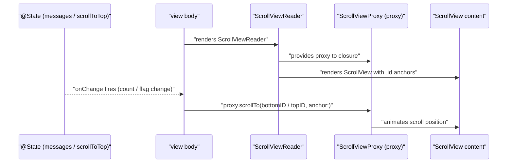
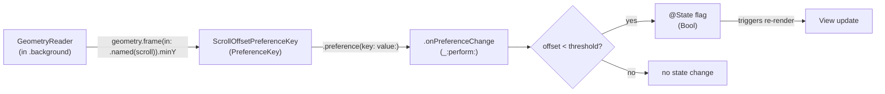
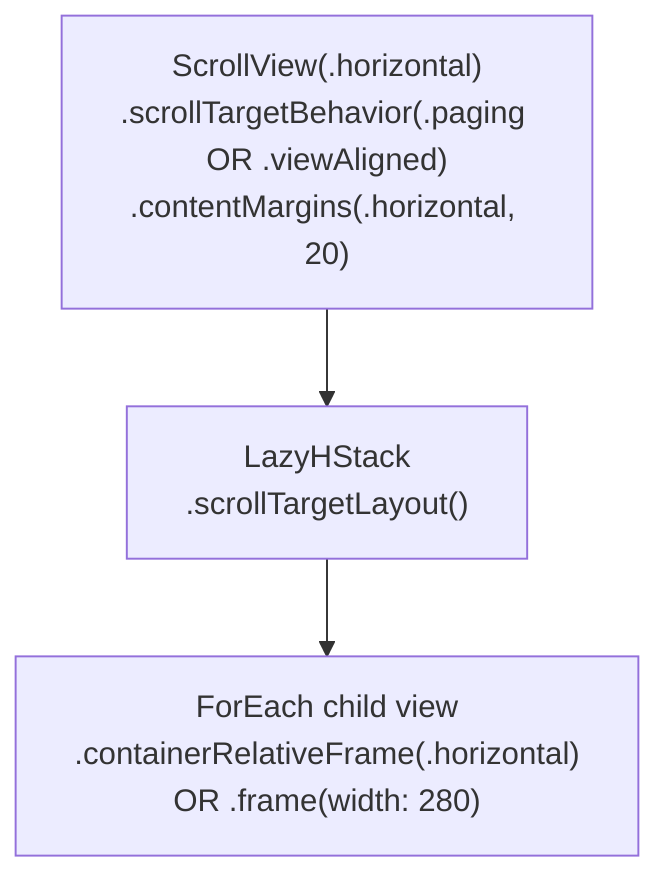

<!-- source: DeepWiki mcp.deepwiki.com · repo AvdLee/SwiftUI-Agent-Skill · page 3.7 Scroll Patterns · fetched 2026-10-26 -->

# Scroll Patterns

Relevant source files

The following files were used as context for generating this wiki page:

- [swiftui-expert-skill/SKILL.md](swiftui-expert-skill/SKILL.md)
- [swiftui-expert-skill/references/scroll-patterns.md](swiftui-expert-skill/references/scroll-patterns.md)

This page documents the scroll-related APIs and patterns used in SwiftUI, as codified in the skill's reference knowledge base. It covers four distinct areas: programmatic scrolling via `ScrollViewReader`, scroll position tracking via `PreferenceKey`, scroll-based visual effects via `.visualEffect`, and paging/snap behavior via `.scrollTargetBehavior`. For list-specific patterns such as `ForEach` identity and `LazyVStack` usage, see [List Patterns](#3.5). For layout concerns such as `GeometryReader` usage, see [Layout Best Practices](#3.8).

---

## Overview

The scroll patterns reference is the file the agent loads when reviewing or implementing scroll-related SwiftUI code.

**Decision tree entry points** in `SKILL.md`:

- **Review**: Check `references/scroll-patterns.md` per the ScrollView checklist item [swiftui-expert-skill/SKILL.md:149-150]()
- **Implement new feature**: Programmatic scroll logic is validated against stable ID and animation rules

The following diagram maps the four scroll pattern categories to the specific SwiftUI types and modifiers they use.

**Diagram: Scroll Pattern Categories and Code Entities**

```mermaid
graph TD
    SP["scroll-patterns.md"]

    SP --> A["Programmatic Scrolling"]
    SP --> B["Position Tracking"]
    SP --> C["Visual Effects (iOS 17+)"]
    SP --> D["Target Behavior (iOS 17+)"]

    A --> A1["ScrollViewReader"]
    A --> A2["proxy.scrollTo(_:anchor:)"]
    A --> A3["Stable IDs on views (.id(...))"]
    A --> A4["withAnimation + onChange/onAppear"]

    B --> B1["PreferenceKey protocol\n(ScrollOffsetPreferenceKey)"]
    B --> B2["GeometryReader + .preference(key:value:)"]
    B --> B3[".coordinateSpace(name:)"]
    B --> B4[".onPreferenceChange(_:)"]
    B --> B5["Threshold gating (avoid per-frame state)"]

    C --> C1[".visualEffect { content, geometry in ... }"]
    C --> C2["geometry.frame(in: .scrollView)"]

    D --> D1[".scrollTargetLayout()"]
    D --> D2[".scrollTargetBehavior(.paging)"]
    D --> D3[".scrollTargetBehavior(.viewAligned)"]
    D --> D4[".contentMargins(.horizontal, _)"]
    D --> D5[".containerRelativeFrame(.horizontal)"]
```

Sources: [swiftui-expert-skill/references/scroll-patterns.md:1-286]()

---

## ScrollViewReader for Programmatic Scrolling

`ScrollViewReader` provides a `proxy` value of type `ScrollViewProxy` that exposes `scrollTo(_:anchor:)`. This is the correct way to jump to a specific item in a scroll container.

### Key rules

| Rule | Reason |
|---|---|
| Assign stable `.id(...)` to scroll targets | `scrollTo` matches by ID; unstable IDs cause jumps to wrong positions |
| Always wrap `proxy.scrollTo` in `withAnimation` | Prevents jarring instant jumps |
| Use a sentinel view (e.g., `Color.clear`) for top/bottom anchors | Keeps the data model IDs independent of scroll bookmarks |
| Trigger scrolls from `.onChange(of:)` or `.onAppear` | Ensures the scroll view layout is complete before calling `scrollTo` |

### Scroll-to-bottom (chat pattern)

The pattern shown in [swiftui-expert-skill/references/scroll-patterns.md:8-35]() uses a `bottomID` string constant attached to a 1pt `Color.clear` spacer placed after the last `ForEach` row. `onChange(of: messages.count)` fires `proxy.scrollTo(bottomID, anchor: .bottom)`.

### Scroll-to-top (feed pattern)

The pattern in [swiftui-expert-skill/references/scroll-patterns.md:38-70]() uses a `topID` sentinel at the head of the list and a `@State private var scrollToTop: Bool` flag. `onChange(of: scrollToTop)` reads the flag, calls `proxy.scrollTo(topID, anchor: .top)`, then resets the flag to `false`.

**Diagram: ScrollViewReader Data Flow**

Sources: [swiftui-expert-skill/references/scroll-patterns.md:3-72]()

---

## Scroll Position Tracking with PreferenceKey

### The problem with direct position storage

Storing a raw `CGFloat` scroll offset in `@State` on every scroll frame causes continuous view re-renders. The bad pattern in [swiftui-expert-skill/references/scroll-patterns.md:78-103]() assigns `scrollPosition = value` inside `onPreferenceChange`, which fires on every pixel of movement.

### Threshold-gated approach

The preferred pattern [swiftui-expert-skill/references/scroll-patterns.md:108-143]() stores only a `Bool` flag (`startAnimation`) and only updates it when the offset crosses a defined threshold (e.g., `< -100`). This dramatically reduces the number of state mutations.

**Diagram: PreferenceKey Scroll Tracking Pipeline**

### How `ScrollOffsetPreferenceKey` is structured

[swiftui-expert-skill/references/scroll-patterns.md:137-143]() defines:

- `defaultValue: CGFloat = 0`
- `reduce(value:nextValue:)` — overwrites with the child's value (last writer wins, sufficient for a single scroll content view)

### Scroll-based header visibility

[swiftui-expert-skill/references/scroll-patterns.md:147-181]() demonstrates a common pattern:

| Condition | Action |
|---|---|
| `offset < -50` | `withAnimation { showHeader = false }` |
| `offset > 50` | `withAnimation { showHeader = true }` |

The header uses `.transition(.move(edge: .top))`, and the animation is triggered from within `onPreferenceChange`, not from the `GeometryReader` itself.

Sources: [swiftui-expert-skill/references/scroll-patterns.md:74-181]()

---

## Scroll-Based Visual Effects (iOS 17+)

> **Availability**: All `.visualEffect` APIs require **iOS 17 or later**.

`.visualEffect { content, geometry in ... }` lets you apply geometry-driven visual transforms without triggering additional layout passes. This is the correct approach for scroll-driven animations because it avoids state mutation entirely.

### How it differs from `GeometryReader` + `@State`

| Approach | State updates | Layout impact |
|---|---|---|
| `GeometryReader` + `@State` flag | Triggers re-render on threshold cross | Additional layout pass |
| `.visualEffect` closure | No state, reads geometry inline | No extra layout pass |

### Scroll-based opacity

[swiftui-expert-skill/references/scroll-patterns.md:188-207]() reads `geometry.frame(in: .scrollView).minY` to compute an opacity value as an item scrolls off the top of the viewport. The formula `1 + distance / 200` fades the item as `distance` becomes increasingly negative.

### Parallax header

[swiftui-expert-skill/references/scroll-patterns.md:211-232]() applies a vertical `.offset(y:)` proportional to the scroll offset. When `offset > 0` (overscroll), no transform is applied; otherwise the image is shifted upward at half the scroll speed (`-offset * 0.5`). `.clipped()` prevents the image from overflowing its frame.

Sources: [swiftui-expert-skill/references/scroll-patterns.md:183-232]()

---

## Scroll Target Behavior (iOS 17+)

> **Availability**: `.scrollTargetBehavior`, `.scrollTargetLayout`, and `.containerRelativeFrame` require **iOS 17 or later**.

These APIs replace manual paging logic and gesture-based snapping with declarative modifiers.

### API responsibilities

| Modifier | Applied to | Purpose |
|---|---|---|
| `.scrollTargetLayout()` | Inner stack (`LazyHStack`) | Marks the stack's children as scroll targets |
| `.scrollTargetBehavior(.paging)` | `ScrollView` | Full-page paging, each page = scroll container width |
| `.scrollTargetBehavior(.viewAligned)` | `ScrollView` | Snaps to the nearest child view |
| `.containerRelativeFrame(.horizontal)` | Each page child | Sizes each page to the scroll container's width |
| `.contentMargins(.horizontal, _)` | `ScrollView` | Adds leading/trailing insets while keeping snap alignment |

### Paging layout

[swiftui-expert-skill/references/scroll-patterns.md:240-255]() shows the full paging setup: `ScrollView(.horizontal)` wraps a `LazyHStack(spacing: 0)` with `ForEach` children each sized via `.containerRelativeFrame(.horizontal)`. The stack gets `.scrollTargetLayout()`, and the scroll view gets `.scrollTargetBehavior(.paging)`.

### Snap-to-item layout

[swiftui-expert-skill/references/scroll-patterns.md:259-275]() shows fixed-width cards (280pt) in a `LazyHStack(spacing: 16)`. `.scrollTargetLayout()` on the stack and `.scrollTargetBehavior(.viewAligned)` on the scroll view produce snap behavior. `.contentMargins(.horizontal, 20)` creates a peek effect for adjacent cards.

**Diagram: scrollTargetBehavior Modifier Placement**

Sources: [swiftui-expert-skill/references/scroll-patterns.md:234-275]()

---

## Review Checklist

The agent uses this checklist when reviewing scroll-related code. It is sourced from [swiftui-expert-skill/SKILL.md:149-150]() and [swiftui-expert-skill/references/scroll-patterns.md:278-286]().

| Check | Detail |
|---|---|
| `ScrollViewReader` uses stable IDs | ID values must not change across renders |
| `scrollTo` wrapped in `withAnimation` | Prevents instant positional jumps |
| `.visualEffect` used for scroll-driven visuals | Avoids state mutations for purely visual changes |
| Scroll position updates are threshold-gated | `onPreferenceChange` should not write state on every frame |
| `PreferenceKey` used for custom position tracking | Direct `GeometryReader` state writes are too frequent |
| `.scrollTargetBehavior(.paging)` for full-page paging | iOS 17+; do not gate if minimum deployment target >= iOS 17 |
| `.scrollTargetBehavior(.viewAligned)` for snap-to-item | Requires `.scrollTargetLayout()` on the inner stack |

Sources: [swiftui-expert-skill/SKILL.md:149-150](), [swiftui-expert-skill/references/scroll-patterns.md:278-286]()

---

