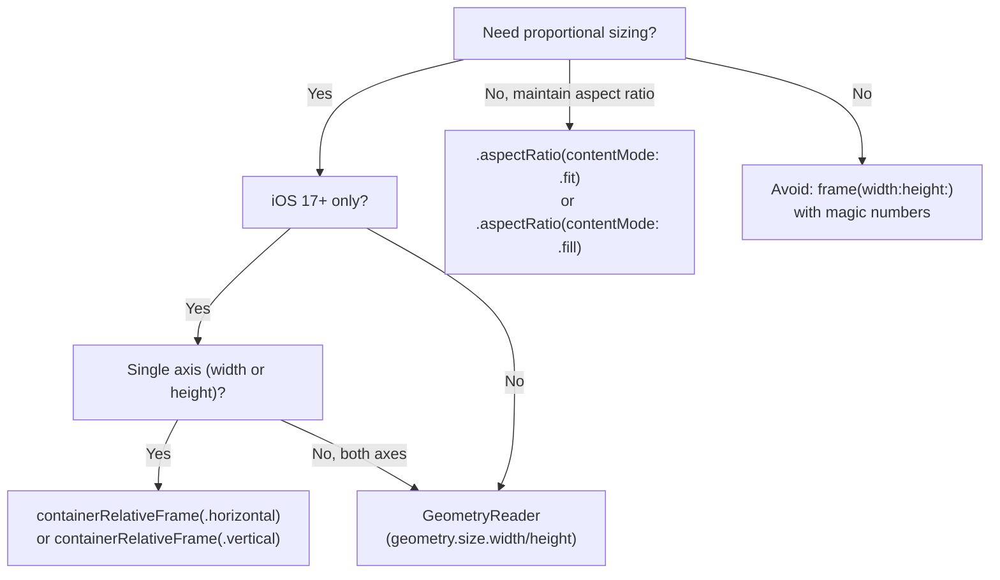
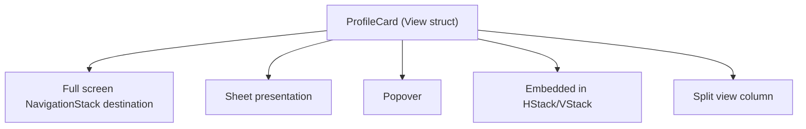
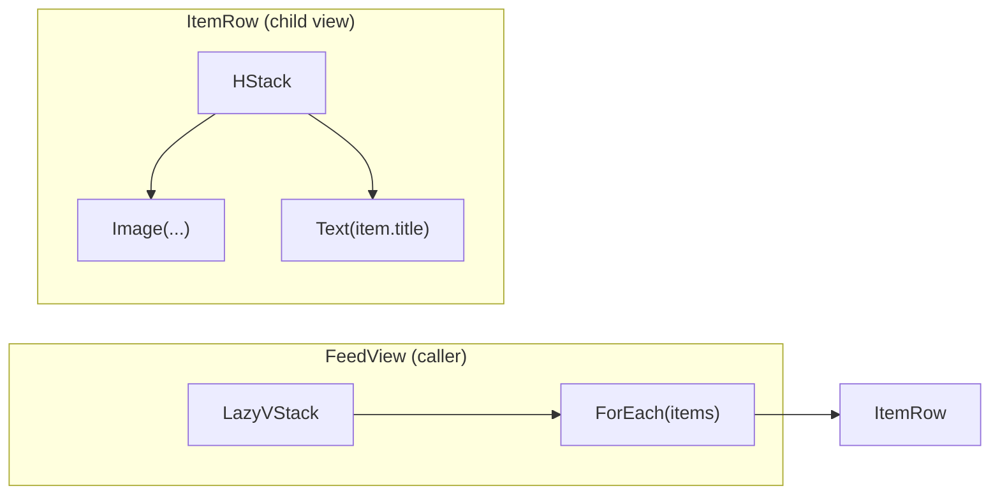
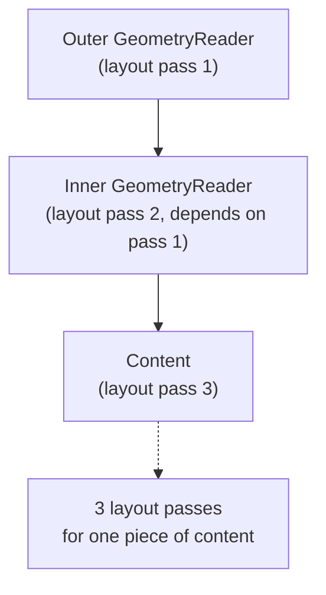
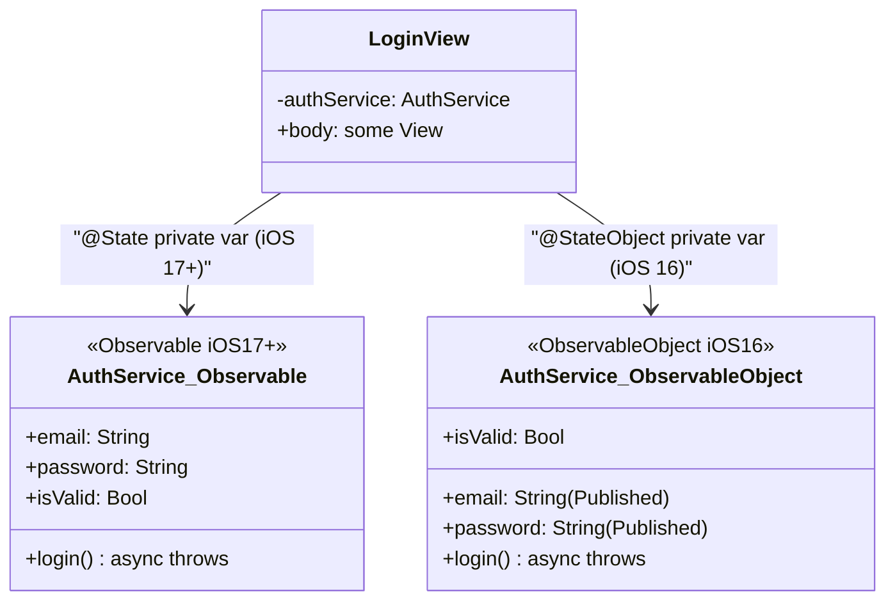

<!-- source: DeepWiki mcp.deepwiki.com · repo AvdLee/SwiftUI-Agent-Skill · page 3.8 Layout Best Practices · fetched 2026-10-26 -->

# Layout Best Practices

<details>
<summary>Relevant source files</summary>

The following files were used as context for generating this wiki page:

- [swiftui-expert-skill/SKILL.md](swiftui-expert-skill/SKILL.md)
- [swiftui-expert-skill/references/layout-best-practices.md](swiftui-expert-skill/references/layout-best-practices.md)

</details>


This page covers SwiftUI layout patterns from [swiftui-expert-skill/references/layout-best-practices.md](), including relative sizing with `GeometryReader` and `containerRelativeFrame()`, designing context-agnostic views, container ownership rules, preventing layout thrash, and separating business logic from view code.

For view extraction and the `@ViewBuilder` composition model, see [View Composition & Structure](#3.3). For `ForEach` identity and list-specific layout concerns, see [List Patterns](#3.5). For scroll-related geometry and `PreferenceKey` patterns, see [Scroll Patterns](#3.7).

---

## Relative Layout Over Constants

Hard-coded frame values (`frame(height: 150)`) do not adapt to different screen sizes, orientations, or system features such as the Dynamic Island or status bar height changes during calls.

**Preferred approaches:**

| Approach | iOS Availability | Use Case |
|---|---|---|
| `GeometryReader` | All | Proportional sizing based on parent geometry |
| `containerRelativeFrame(.horizontal)` | iOS 17+ | Width-relative sizing without a full geometry reader |
| `.aspectRatio(contentMode:)` | All | Maintain image or view proportions |

`GeometryReader` provides a `GeometryProxy` whose `.size` property reflects the actual available space at runtime. See [swiftui-expert-skill/references/layout-best-practices.md:7-23]() for the canonical pattern.

`containerRelativeFrame()` (iOS 17+) is the lighter-weight alternative for single-axis proportional sizing. It avoids the full layout-pass overhead of a `GeometryReader`. See [swiftui-expert-skill/references/layout-best-practices.md:143-145]().

**Layout sizing decision flow:**



Sources: [swiftui-expert-skill/references/layout-best-practices.md:3-23](), [swiftui-expert-skill/references/layout-best-practices.md:130-146](), [swiftui-expert-skill/SKILL.md:177]()

---

## Context-Agnostic Views

Views must not assume how or where they are presented. Referencing `UIScreen.main.bounds` inside a view body is always wrong — it returns the full device screen, ignoring whether the view is inside a sheet, popover, sidebar, or split view.

**Anti-pattern to avoid:**

```swift
// From layout-best-practices.md lines 49-59
Image(user.avatar)
    .frame(width: UIScreen.main.bounds.width)  // Assumes full-screen presentation
```

**Correct pattern:** let the SwiftUI layout system allocate space, and use `.resizable()` with `.aspectRatio(contentMode:)` so the image fills whatever space is offered. See [swiftui-expert-skill/references/layout-best-practices.md:32-62]().

This rule is enforced in the `SKILL.md` review checklist under the Layout section: [swiftui-expert-skill/SKILL.md:178]().

**Where views are legitimately used:**



A context-agnostic `ProfileCard` renders correctly in all of these — a context-aware one breaks in at least one.

Sources: [swiftui-expert-skill/references/layout-best-practices.md:27-62](), [swiftui-expert-skill/SKILL.md:58](), [swiftui-expert-skill/SKILL.md:178]()

---

## Container Ownership Rules

The rule is: **a custom view owns its static (non-repeating) container, but the caller owns any lazy or repeating container.**

| Container type | Who owns it | Why |
|---|---|---|
| `HStack`, `VStack`, `ZStack` (static) | The view itself | View defines its own layout axis and alignment |
| `LazyVStack`, `LazyHStack` | The caller | Lazy containers control when children are instantiated; a child view deciding to be lazy is a hidden performance concern for the caller |
| `List` | The caller | Scroll position, refresh behavior, and selection are caller concerns |
| `ForEach` (dynamic items) | The caller | The caller controls identity and data ownership |

**Reference implementation of the ownership split:**

See [swiftui-expert-skill/references/layout-best-practices.md:64-100]() for `HeaderView` (owns its `HStack`) and `FeedView` (caller owns `LazyVStack` + `ForEach`).

**Container ownership diagram:**



Sources: [swiftui-expert-skill/references/layout-best-practices.md:64-100]()

---

## Layout Performance

### Avoiding Layout Thrash

SwiftUI performs a layout pass for every view in the hierarchy. Unnecessarily deep nesting multiplies the number of passes and the work done per frame.

**Anti-pattern:** five levels of alternating `VStack`/`HStack` for a single `Text` view. See [swiftui-expert-skill/references/layout-best-practices.md:110-128]().

**Guideline:** keep hierarchies as flat as the visual design allows. Extract subviews for readability (see [View Composition & Structure](#3.3)), but do not introduce extra container layers with no visual purpose.

### Excessive `GeometryReader` Nesting

`GeometryReader` triggers a layout pass each time its content is re-evaluated. Nesting two `GeometryReader` instances means two cascading layout recalculations.



**Preferred:** use a single `GeometryReader` at the highest necessary level, or switch to `containerRelativeFrame()` (iOS 17+) which avoids a full reader entirely.

See [swiftui-expert-skill/references/layout-best-practices.md:131-146]().

### Threshold-Gating Geometry Updates

`PreferenceKey` listeners and `.onPreferenceChange` callbacks fire on every layout pass. Assigning state on every callback triggers a view update on every pixel change during scrolling.

**Anti-pattern:**
```swift
// Triggers a state update (and re-render) on every layout change
.onPreferenceChange(ViewSizeKey.self) { size in
    currentSize = size
}
```

**Correct pattern:** compare against the current value and apply a minimum change threshold before writing to state. See [swiftui-expert-skill/references/layout-best-practices.md:150-163]().

The threshold value (e.g., `10` points) should reflect how precisely the downstream UI reacts to the size value. A header that only changes layout at a 50-point threshold should gate at 50, not 10.

Sources: [swiftui-expert-skill/references/layout-best-practices.md:103-163](), [swiftui-expert-skill/SKILL.md:73-74]()

---

## Business Logic Separation

Business logic in a view `body` cannot be unit-tested without instantiating the full view hierarchy. The fix is to move logic into a dedicated class — referred to in this codebase as a *service* — and have the view reference it.

**Relationship between view and service:**



The `isValid` computed property and `login()` method live in `AuthService`, not in `LoginView`. Tests can construct `AuthService` directly, set `email` and `password`, and assert on `isValid` or mock `login()` — no view instantiation required.

**iOS version patterns:**

| iOS target | Class annotation | View property wrapper |
|---|---|---|
| iOS 17+ | `@Observable` | `@State private var authService = AuthService()` |
| iOS 16 and earlier | `ObservableObject` + `@Published` | `@StateObject private var authService = AuthService()` |

Full implementation for both variants: [swiftui-expert-skill/references/layout-best-practices.md:165-260]().

**What belongs in a service vs. in a view:**

| Belongs in service/model | Belongs in view |
|---|---|
| Validation logic (`isValid`, `canSubmit`) | Which controls to show (`if authService.isValid`) |
| Network calls, persistence | Navigation triggers (`.sheet`, `.navigationDestination`) |
| Data transformation | Layout and spacing |
| Error handling policy | Error display (alert, inline text) |

> The reference explicitly states this is about testability, not about enforcing MVVM or any other architecture. See [swiftui-expert-skill/references/layout-best-practices.md:260]() and [swiftui-expert-skill/SKILL.md:213-217]().

Sources: [swiftui-expert-skill/references/layout-best-practices.md:165-261](), [swiftui-expert-skill/SKILL.md:34](), [swiftui-expert-skill/SKILL.md:56-57]()

---

## Action Handlers

The same principle that pushes business logic out of views applies to button and gesture handlers. An inline closure in a `Button` action is not independently testable and clutters the `body`.

**Preferred pattern:** `Button("Label", action: service.methodName)` — pass a method reference directly. See [swiftui-expert-skill/references/layout-best-practices.md:265-293]().

**Anti-pattern:** a button closure that reads and writes multiple `@State` properties and calls an API client. This mixes layout (the button exists and is labeled) with behavior (what happens when it is tapped).

Sources: [swiftui-expert-skill/references/layout-best-practices.md:262-295](), [swiftui-expert-skill/SKILL.md:57](), [swiftui-expert-skill/SKILL.md:176]()

---

## Review Checklist

The following items from `SKILL.md`'s Layout section map directly to the topics above:

| Checklist item | Covered in section |
|---|---|
| Avoid layout thrash (deep hierarchies, excessive `GeometryReader`) | Layout Performance |
| Gate frequent geometry updates by thresholds | Layout Performance |
| Business logic in services/models, not in views | Business Logic Separation |
| Action handlers reference methods, not inline logic | Action Handlers |
| Use relative layout (no hard-coded constants) | Relative Layout Over Constants |
| Views work in any context (context-agnostic) | Context-Agnostic Views |

Source: [swiftui-expert-skill/SKILL.md:172-178](), [swiftui-expert-skill/references/layout-best-practices.md:297-308]()

---

