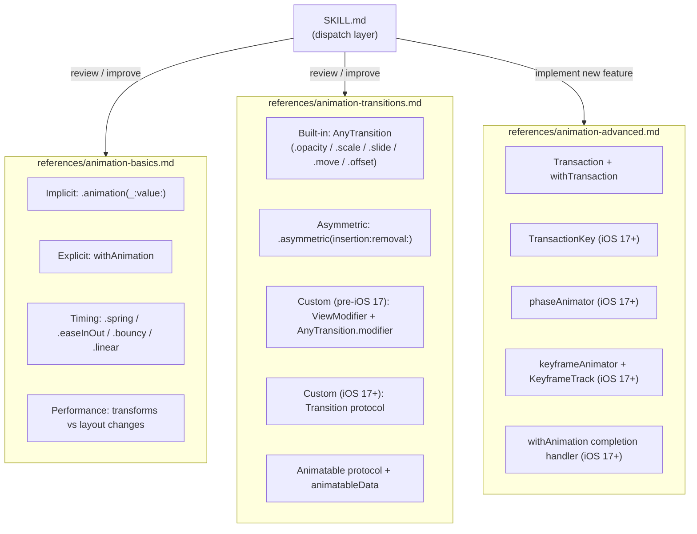
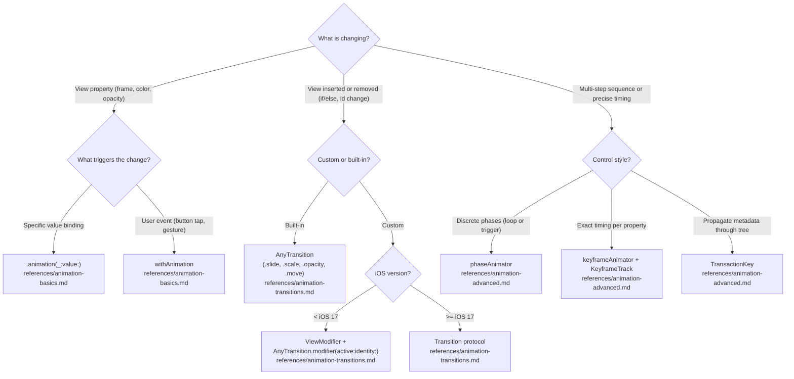

<!-- source: DeepWiki mcp.deepwiki.com · repo AvdLee/SwiftUI-Agent-Skill · page 3.9 Animation · fetched 2026-10-26 -->

# Animation

Relevant source files

The following files were used as context for generating this wiki page:

- [swiftui-expert-skill/SKILL.md](swiftui-expert-skill/SKILL.md)
- [swiftui-expert-skill/references/animation-advanced.md](swiftui-expert-skill/references/animation-advanced.md)
- [swiftui-expert-skill/references/animation-basics.md](swiftui-expert-skill/references/animation-basics.md)
- [swiftui-expert-skill/references/animation-transitions.md](swiftui-expert-skill/references/animation-transitions.md)

This page is an index for the three animation reference files in the SwiftUI expert skill. It covers when to use each animation approach, how the animation system is structured, and how `SKILL.md` routes agents to the correct reference. For details on each topic, see the sub-pages linked below.

---

## Scope

The animation knowledge base covers three distinct layers:

| Sub-page | Reference File | Topic |
|---|---|---|
| [Animation Basics](#3.9.1) | `references/animation-basics.md` | Implicit vs explicit animations, timing curves, performance |
| [Transitions](#3.9.2) | `references/animation-transitions.md` | View insertion/removal, `AnyTransition`, `Animatable` protocol |
| [Advanced Animation](#3.9.3) | `references/animation-advanced.md` | `Transaction`, `phaseAnimator`, `keyframeAnimator`, completion handlers |

---

## How SKILL.md Routes to Animation References

`SKILL.md` references animation files in all three workflow modes (review, improve, implement). The routing is explicit — each workflow step names the relevant file.

**Routing from SKILL.md:**

[swiftui-expert-skill/SKILL.md:18-18]()
[swiftui-expert-skill/SKILL.md:27-27]()
[swiftui-expert-skill/SKILL.md:35-35]()

**Animation decision points in `SKILL.md`'s review checklist:**

[swiftui-expert-skill/SKILL.md:180-188]()

**Animation decision points in `SKILL.md`'s guidelines:**

[swiftui-expert-skill/SKILL.md:77-86]()

---

## Animation System Overview

The following diagram shows how the three reference files map to the SwiftUI animation APIs they document.

**Diagram: Animation Knowledge Base Structure**

Sources: [swiftui-expert-skill/SKILL.md:13-37](), [swiftui-expert-skill/SKILL.md:180-188]()

---

## When to Use Each Approach

The choice between animation styles depends on what is changing and when.

**Diagram: Animation API Decision Flow**

Sources: [swiftui-expert-skill/references/animation-basics.md:1-75](), [swiftui-expert-skill/references/animation-transitions.md:1-35](), [swiftui-expert-skill/references/animation-advanced.md:1-50]()

---

## Key Rules Shared Across All Animation Topics

These rules appear in `SKILL.md`'s core guidelines and review checklist and apply regardless of which animation API is used.

| Rule | Reason |
|---|---|
| Use `.animation(_:value:)` with a `value` parameter | Parameterless form is deprecated and animates all state changes |
| Use `withAnimation` for event-driven changes | Explicit control over when animations fire |
| Prefer transforms (`.scaleEffect`, `.offset`, `.rotationEffect`) over layout changes (`.frame`, `.padding`) | Transforms are GPU-accelerated; layout changes trigger re-layout passes |
| Place transition animation context outside `if`/conditional structures | Animation modifier inside the conditional is removed with the view on dismissal |
| Implement `animatableData` explicitly on `Animatable` conformances | Omitting it silently falls back to `EmptyAnimatableData`, causing jumps instead of interpolation |
| Use `.transaction(value:)` for completion handlers that must refire | Without `value:`, the completion fires only once |
| Implicit animations override explicit animations | The later modifier in the view tree wins |

Sources: [swiftui-expert-skill/SKILL.md:77-86](), [swiftui-expert-skill/SKILL.md:180-188]()

---

## Sub-page Summaries

### [3.9.1 Animation Basics](#3.9.1)

Covers `.animation(_:value:)`, `withAnimation`, the available timing curves, animation placement rules, selective animation, performance (transforms vs layout), and debugging slow animations.

Reference file: `swiftui-expert-skill/references/animation-basics.md`

---

### [3.9.2 Transitions](#3.9.2)

Covers the distinction between property animations and transitions, built-in `AnyTransition` values, combining and asymmetric transitions, custom transitions via `ViewModifier` (pre-iOS 17) and the `Transition` protocol (iOS 17+), view identity and how it triggers transitions, and the `Animatable` protocol with `animatableData` and `AnimatablePair`.

Reference file: `swiftui-expert-skill/references/animation-transitions.md`

---

### [3.9.3 Advanced Animation](#3.9.3)

Covers the `Transaction` system underlying all SwiftUI animations, `withTransaction`, the `.transaction` modifier, animation precedence, `disablesAnimations`, custom `TransactionKey` for metadata propagation (iOS 17+), `phaseAnimator` for multi-step sequences (iOS 17+), `keyframeAnimator` with `KeyframeTrack` and the four keyframe types (`CubicKeyframe`, `SpringKeyframe`, `LinearKeyframe`, `MoveKeyframe`) (iOS 17+), `KeyframeTimeline` for external value querying, and animation completion handlers via `withAnimation` and `.transaction(value:)`.

Reference file: `swiftui-expert-skill/references/animation-advanced.md`

---

## iOS Version Compatibility Summary

| API | Minimum iOS |
|---|---|
| `.animation(_:value:)` | iOS 15 |
| `withAnimation` | iOS 13 |
| `AnyTransition` built-ins | iOS 13 |
| `Transition` protocol | iOS 17 |
| `phaseAnimator` | iOS 17 |
| `keyframeAnimator` / `KeyframeTrack` | iOS 17 |
| `KeyframeTimeline` | iOS 17 |
| `TransactionKey` | iOS 17 |
| `withAnimation` completion handler | iOS 17 |
| `.transaction(value:)` | iOS 17 |
| `.bouncy` timing curve | iOS 17 |

Sources: [swiftui-expert-skill/references/animation-advanced.md:1-10](), [swiftui-expert-skill/references/animation-basics.md:121-128](), [swiftui-expert-skill/references/animation-transitions.md:127-165]()

---

