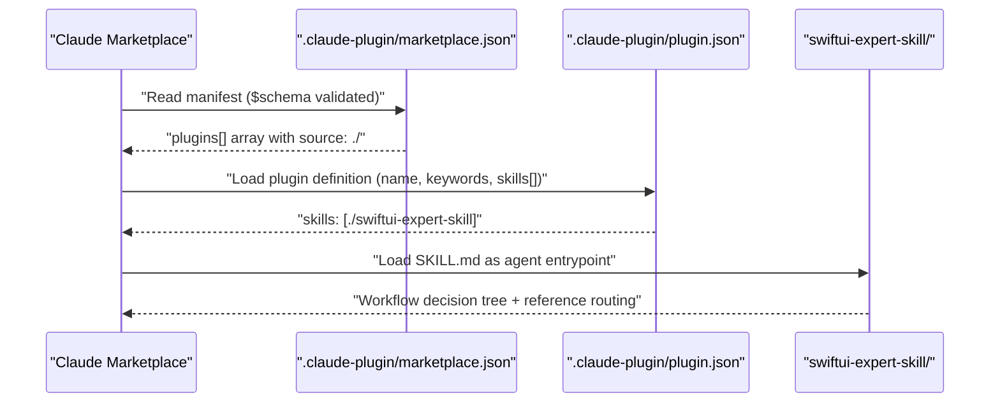

<!-- source: DeepWiki mcp.deepwiki.com · repo AvdLee/SwiftUI-Agent-Skill · page 4 Claude Plugin Integration · fetched 2026-10-26 -->

# Claude Plugin Integration

<details>
<summary>Relevant source files</summary>

The following files were used as context for generating this wiki page:

- [.claude-plugin/marketplace.json](.claude-plugin/marketplace.json)
- [.claude-plugin/plugin.json](.claude-plugin/plugin.json)

</details>


This page explains how the `swiftui-expert-skill` is packaged as a Claude plugin — covering the two manifest files, their relationship to each other and to the Anthropics marketplace schema, how discoverability keywords are structured, and how versioning is managed across both files.

For a detailed field-by-field breakdown of each manifest, see [Marketplace Manifest](#4.1) and [Plugin Definition](#4.2). For the automation that keeps versions synchronized on release, see [Release Workflow](#5.1).

---

## Overview

Two JSON files in the `.claude-plugin/` directory register the skill with the Claude ecosystem:

| File | Role |
|---|---|
| `.claude-plugin/plugin.json` | Plugin identity: name, keywords, `skills[]` array pointing to implementation |
| `.claude-plugin/marketplace.json` | Marketplace manifest: wraps `plugin.json` fields inside a `plugins[]` array, adds schema validation, owner, and marketplace-specific metadata |

`marketplace.json` is what the Claude Marketplace reads. It nests the plugin definition inline within its `plugins[]` array, effectively combining both concerns into one JSON document for submission. `plugin.json` serves as the standalone plugin definition used when the skill is installed directly via Claude Code without the marketplace.

**Registration Hierarchy**

```mermaid
graph TD
    SCH["\"anthropics/claude-code\nmarketplace.schema.json\n(external validation)\""]
    MJ["\".claude-plugin/marketplace.json\"\nname: swiftui-expert-skill\nversion: 1.2.0"]
    PJ["\".claude-plugin/plugin.json\"\nname: swiftui-expert\nversion: 1.2.0"]
    SKILL["\"swiftui-expert-skill/\"\n(SKILL.md + references/)"]

    SCH -->|"validates structure of"| MJ
    MJ -->|"plugins[] array mirrors fields from"| PJ
    PJ -->|"skills[] array points to"| SKILL
```

Sources: [.claude-plugin/marketplace.json:1-45](), [.claude-plugin/plugin.json:1-27]()

---

## Manifest Relationship

`marketplace.json` does not reference `plugin.json` by file path. Instead, the plugin fields defined in `plugin.json` are duplicated inside the `plugins[0]` object in `marketplace.json`. Both files must be kept in sync — particularly `version`, `name`, `description`, `author`, and `keywords`.

**Field Mapping Between the Two Files**

The following diagram shows which fields exist in which file and where they overlap.

```mermaid
graph LR
    subgraph mj[".claude-plugin/marketplace.json"]
        MJ_SCHEMA["\"$schema\""]
        MJ_NAME["\"name: swiftui-expert-skill\""]
        MJ_VERSION["\"version: 1.2.0\""]
        MJ_OWNER["\"owner{}\""]
        MJ_META["\"metadata.description\""]
        MJ_PLUGINS["\"plugins[]\""]
    end

    subgraph pj[".claude-plugin/plugin.json"]
        PJ_NAME["\"name: swiftui-expert\""]
        PJ_VERSION["\"version: 1.2.0\""]
        PJ_DESC["\"description\""]
        PJ_AUTHOR["\"author{}\""]
        PJ_REPO["\"repository\""]
        PJ_LICENSE["\"license\""]
        PJ_KEYWORDS["\"keywords[]\""]
        PJ_SKILLS["\"skills[]\""]
    end

    subgraph embedded["plugins[0] inside marketplace.json"]
        E_NAME["\"name: swiftui-expert\""]
        E_VERSION["\"version: 1.2.0\""]
        E_DESC["\"description\""]
        E_AUTHOR["\"author{}\""]
        E_REPO["\"repository\""]
        E_LICENSE["\"license\""]
        E_KEYWORDS["\"keywords[], tags[]\""]
        E_SOURCE["\"source: ./\""]
    end

    MJ_PLUGINS -->|"contains"| embedded
    PJ_NAME -.->|"mirrors"| E_NAME
    PJ_VERSION -.->|"mirrors"| E_VERSION
    PJ_DESC -.->|"mirrors"| E_DESC
    PJ_AUTHOR -.->|"mirrors"| E_AUTHOR
    PJ_KEYWORDS -.->|"subset appears in"| E_KEYWORDS
```

Sources: [.claude-plugin/marketplace.json:1-45](), [.claude-plugin/plugin.json:1-27]()

---

## Schema Validation

`marketplace.json` includes a `$schema` field pointing to the external Anthropics validation schema:

```
https://raw.githubusercontent.com/anthropics/claude-code/refs/heads/main/marketplace/marketplace.schema.json
```

[.claude-plugin/marketplace.json:2]()

This schema is maintained by Anthropic and defines the required structure for marketplace submissions. The `$schema` field enables editors and CI tools to validate the manifest against it automatically.

Sources: [.claude-plugin/marketplace.json:2]()

---

## Discoverability via Keywords

Both files carry a `keywords` list. `marketplace.json`'s embedded plugin entry also includes a `tags` field, which mirrors `keywords` exactly at the current version.

**Keyword Coverage**

| Keyword | In `plugin.json` | In `marketplace.json` plugins[0] |
|---|---|---|
| `swift` | ✓ | ✓ |
| `swiftui` | ✓ | ✓ |
| `ios` | ✓ | ✓ |
| `apple` | ✓ | ✓ |
| `state-management` | ✓ | ✓ |
| `performance` | ✓ | ✓ |
| `liquid-glass` | ✓ | ✓ |
| `view-composition` | ✓ | — |
| `navigation` | ✓ | — |
| `lists` | ✓ | — |
| `sheets` | ✓ | — |

`plugin.json` carries four additional keywords (`view-composition`, `navigation`, `lists`, `sheets`) that are not present in the marketplace entry. These broaden the match surface when the plugin is installed directly and queried locally.

Sources: [.claude-plugin/plugin.json:11-23](), [.claude-plugin/marketplace.json:24-41]()

---

## The `source` Field

Inside `marketplace.json`'s `plugins[0]` object, the `source` field is set to `"./"` [.claude-plugin/marketplace.json:42](). This tells the Claude Marketplace where to find the plugin implementation relative to the manifest file. Because both files reside in `.claude-plugin/` and the skill directory `swiftui-expert-skill/` is at the repository root, a `source` of `"./"` resolves to the repository root — which contains both the `.claude-plugin/` directory and the `swiftui-expert-skill/` directory.

`plugin.json` uses a `skills` array instead, with the value `"./swiftui-expert-skill"` [.claude-plugin/plugin.json:24-26](), pointing directly to the skill subdirectory.

---

## Versioning

Both `plugin.json` and `marketplace.json` carry independent `version` fields, and the `plugins[0]` entry inside `marketplace.json` carries its own `version` as well. All three must match.

| Location | Field path | Current value |
|---|---|---|
| `plugin.json` | `.version` | `1.2.0` |
| `marketplace.json` | `.version` | `1.2.0` |
| `marketplace.json` | `.plugins[0].version` | `1.2.0` |

The release workflow handles all three updates atomically using `jq`. See [Release Workflow](#5.1) for implementation details.

Sources: [.claude-plugin/plugin.json:3](), [.claude-plugin/marketplace.json:4](), [.claude-plugin/marketplace.json:17]()

---

## Runtime Loading Flow

When a developer installs the plugin via the Claude Marketplace, the marketplace resolves the skill implementation as follows:



Sources: [.claude-plugin/marketplace.json:1-45](), [.claude-plugin/plugin.json:1-27]()

---

