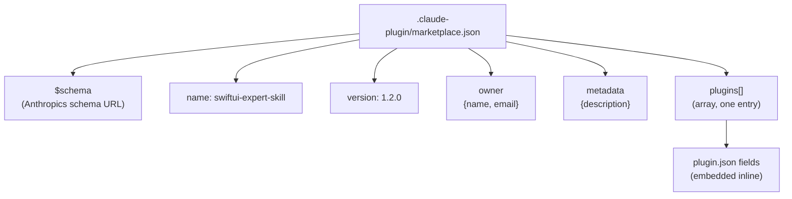
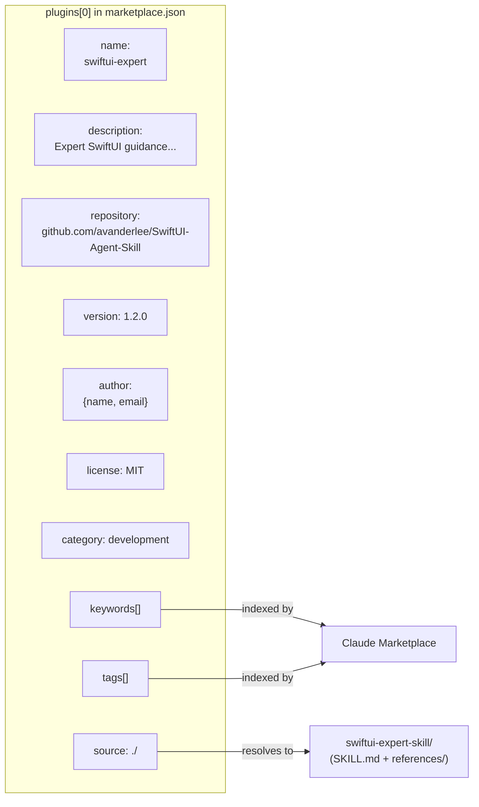
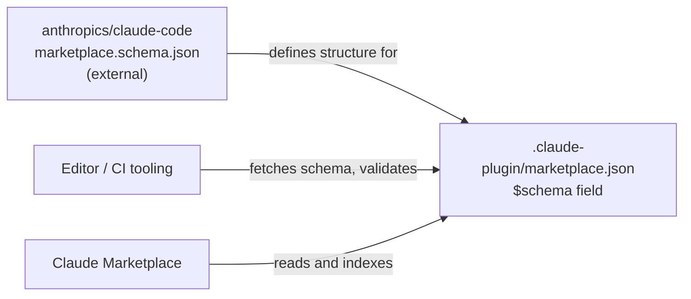

<!-- source: DeepWiki mcp.deepwiki.com · repo AvdLee/SwiftUI-Agent-Skill · page 4.1 Marketplace Manifest · fetched 2026-10-26 -->

# Marketplace Manifest

<details>
<summary>Relevant source files</summary>

The following files were used as context for generating this wiki page:

- [.claude-plugin/marketplace.json](.claude-plugin/marketplace.json)

</details>


This page documents every field in `.claude-plugin/marketplace.json`, which is the top-level entry point for registering the `swiftui-expert-skill` in the Claude marketplace. The manifest wraps the plugin definition in a discoverable envelope validated against the Anthropics schema.

For the inner plugin definition (`plugin.json`) that the `plugins[]` array wraps, see [Plugin Definition](#4.2). For a broader overview of how the two files relate to each other and to the skill implementation, see [Claude Plugin Integration](#4).

---

## Role of marketplace.json

`marketplace.json` serves two purposes:

1. **Marketplace registration** — It is the file the Claude marketplace reads to index and display the skill. It carries the top-level identity (`name`, `version`, `owner`) independently of the embedded plugin entry.
2. **Schema validation** — The `$schema` field points to the Anthropics-maintained JSON Schema, allowing editors and CI pipelines to validate the file's structure before it is published.

The file lives at `.claude-plugin/marketplace.json` and is kept in sync with `plugin.json` by the release workflow (see [Release Workflow](#5.1)).

Sources: [.claude-plugin/marketplace.json:1-45]()

---

## File Structure Overview

**Diagram: marketplace.json top-level structure**



Sources: [.claude-plugin/marketplace.json:1-45]()

---

## Top-Level Fields

| Field | Value | Purpose |
|---|---|---|
| `$schema` | Anthropics schema URL | Enables JSON Schema validation |
| `name` | `swiftui-expert-skill` | Marketplace-level identifier for the skill |
| `version` | `1.2.0` | Semver string kept in sync with `plugin.json` |
| `owner.name` | `Antoine van der Lee` | Human-readable owner name |
| `owner.email` | `contact@avanderlee.com` | Contact address for the skill owner |
| `metadata.description` | See below | Short summary shown in marketplace listings |

### `$schema`

[.claude-plugin/marketplace.json:2]()

Points to the raw JSON Schema file hosted in the `anthropics/claude-code` repository. This is an external URL and is **not** a local file. Editors that support JSON Schema (VS Code, JetBrains IDEs) will auto-validate field names and types against this schema when the file is open.

### `name`

[.claude-plugin/marketplace.json:3]()

`"swiftui-expert-skill"` — the marketplace-level identifier. This is distinct from the plugin-level `name` field (`"swiftui-expert"`) nested inside `plugins[0]`. The marketplace uses this top-level name as the primary lookup key.

### `version`

[.claude-plugin/marketplace.json:4]()

Follows semantic versioning (`MAJOR.MINOR.PATCH`). This field and the `plugins[0].version` field [.claude-plugin/marketplace.json:17]() are both updated atomically by the release workflow using `jq`. They must remain identical; see [Release Workflow](#5.1) for the exact `jq` command sequence.

### `owner`

[.claude-plugin/marketplace.json:5-8]()

An object with `name` and `email` sub-fields. This is the top-level skill owner, separate from the `author` object inside `plugins[0]` [.claude-plugin/marketplace.json:18-21](). Both carry the same values in the current manifest, but structurally they represent different levels: `owner` is the marketplace registrant, `author` is the plugin implementor.

### `metadata.description`

[.claude-plugin/marketplace.json:9-11]()

```
"SwiftUI best practices for state management, view composition, performance, and iOS 26+ Liquid Glass."
```

This is the human-facing description used in marketplace listings. It summarises the four major topic domains the skill covers. The `plugins[0].description` field carries a slightly more detailed variant [.claude-plugin/marketplace.json:15]().

---

## The `plugins[]` Array

[.claude-plugin/marketplace.json:12-44]()

The `plugins` field is an array that currently holds exactly one entry. Each entry is an inline plugin definition equivalent in structure to `plugin.json`. The marketplace uses this array to enumerate all plugins bundled with the skill.

**Diagram: plugins[0] field map to code entities**



Sources: [.claude-plugin/marketplace.json:13-43]()

### `plugins[0]` Fields

| Field | Value | Notes |
|---|---|---|
| `name` | `swiftui-expert` | Plugin identifier, distinct from top-level `name` |
| `description` | `"Expert SwiftUI guidance..."` | Longer than `metadata.description` |
| `repository` | GitHub URL | Points to the public repository |
| `version` | `1.2.0` | Must match top-level `version` |
| `author.name` | `Antoine van der Lee` | Plugin implementor |
| `author.email` | `contact@avanderlee.com` | Plugin implementor contact |
| `license` | `MIT` | SPDX identifier |
| `category` | `development` | Marketplace category filter |
| `keywords` | See below | Used for search indexing |
| `tags` | Same as `keywords` | Duplicate set; both are used |
| `source` | `"./"` | Relative path to the implementation root |

### `keywords` and `tags`

[.claude-plugin/marketplace.json:24-41]()

Both arrays contain the same seven values:

| Term | Domain |
|---|---|
| `swift` | Language |
| `swiftui` | Framework |
| `ios` | Platform |
| `apple` | Ecosystem |
| `state-management` | Skill topic (see [State Management](#3.2)) |
| `performance` | Skill topic (see [Performance Patterns](#3.4)) |
| `liquid-glass` | Skill topic (see [Liquid Glass](#3.11)) |

Having identical values in both `keywords` and `tags` is intentional — the Anthropics marketplace schema treats them as separate indexing fields and may use them differently for search ranking vs. label display.

### `source`

[.claude-plugin/marketplace.json:42]()

`"source": "./"` tells the Claude toolchain where the skill implementation lives relative to the manifest file. Because `marketplace.json` is in `.claude-plugin/` and the implementation is in `swiftui-expert-skill/` at the repository root, the effective resolution path is the **repository root**, not a subdirectory.

> **Note:** The `source` field allows the manifest and implementation to be co-located in a monorepo. Setting it to `"./"` means the Claude runtime treats the directory containing `marketplace.json` as the skill root. The actual skill entry point (`SKILL.md`) is then located by the `skills[]` array in the embedded plugin definition (see [Plugin Definition](#4.2)).

Sources: [.claude-plugin/marketplace.json:42]()

---

## Validation and Schema Relationship

**Diagram: Schema validation chain**



Sources: [.claude-plugin/marketplace.json:2]()

The `$schema` URL at line 2 is the only external dependency in this file. The schema is not vendored locally. If the Anthropics schema evolves with breaking changes, the manifest may need to be updated. The release workflow does not validate against the schema automatically — that is left to editor tooling and any pre-merge checks contributors run locally.

---

## Versioning Behaviour

The release workflow updates `version` in two locations within this file:

| JSON path | Line | Updated by |
|---|---|---|
| `.version` | [.claude-plugin/marketplace.json:4]() | `jq` step 5 in `release.yml` |
| `.plugins[0].version` | [.claude-plugin/marketplace.json:17]() | Same `jq` step |

Both values must be identical at all times. After a release, the commit pushed to `main` will reflect the same version in both `marketplace.json` and `plugin.json`. See [Release Workflow](#5.1) for full details on the `jq` write pattern.

Sources: [.claude-plugin/marketplace.json:4](), [.claude-plugin/marketplace.json:17]()

---

