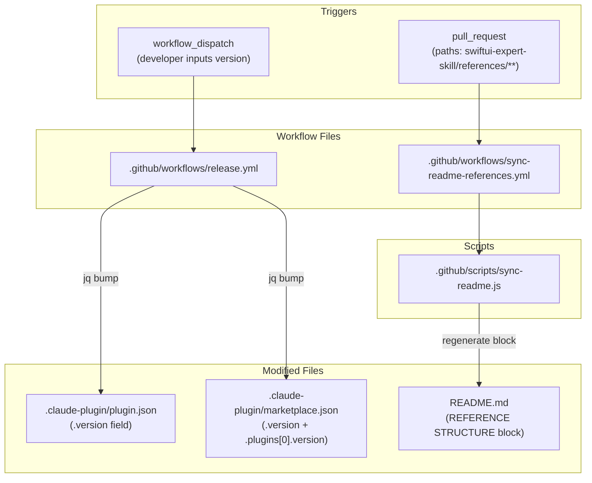
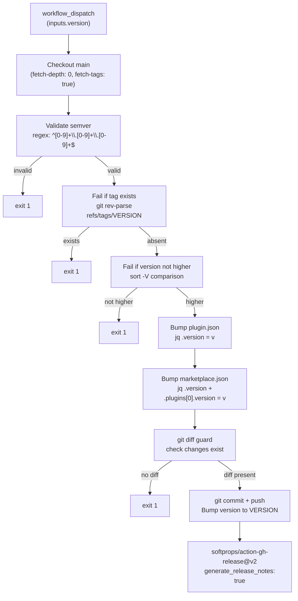
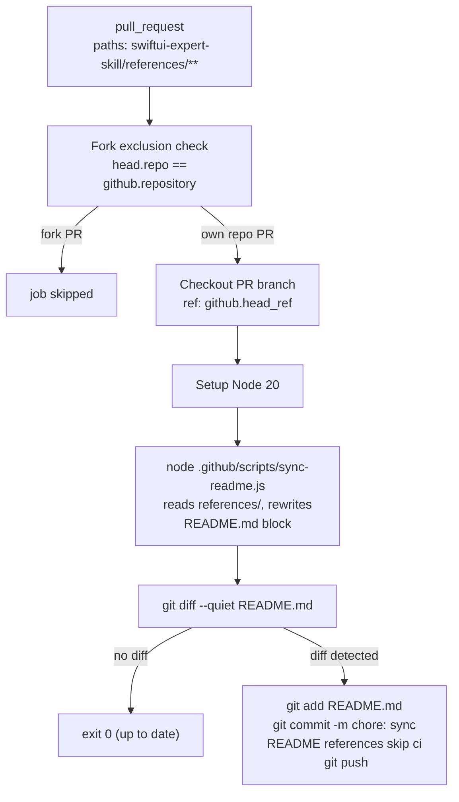

<!-- source: DeepWiki mcp.deepwiki.com · repo AvdLee/SwiftUI-Agent-Skill · page 5 Automation & Maintenance · fetched 2026-10-26 -->

# Automation & Maintenance

<details>
<summary>Relevant source files</summary>

The following files were used as context for generating this wiki page:

- [.github/workflows/release.yml](.github/workflows/release.yml)
- [.github/workflows/sync-readme-references.yml](.github/workflows/sync-readme-references.yml)

</details>


This page covers the two GitHub Actions workflows that automate repository upkeep: version releasing and documentation consistency. These workflows operate independently and are triggered by different events. For details on the plugin manifests that the release workflow modifies, see [Claude Plugin Integration](#4). For details on the reference files that the sync workflow monitors, see [SwiftUI Reference Content](#3).

---

## Overview

The repository contains two workflows under `.github/workflows/`. Each targets a distinct maintenance concern:

| Workflow file | Trigger | What it automates |
|---|---|---|
| `release.yml` | Manual (`workflow_dispatch`) | Validates, bumps version in JSON manifests, commits, and creates a GitHub release |
| `sync-readme-references.yml` | PR modifying `references/**` | Regenerates the reference structure block in `README.md` via a Node.js script |

Neither workflow depends on the other, and they write to different files.

---

## Workflow Responsibilities

**Responsibility diagram: workflows and the files they touch**



Sources: [.github/workflows/release.yml:1-115](), [.github/workflows/sync-readme-references.yml:1-41]()

---

## Release Workflow (`release.yml`)

Triggered manually via `workflow_dispatch` with a single required input: `version` (e.g. `1.2.0`). The workflow runs only on `main` [.github/workflows/release.yml:16]().

The workflow enforces three validation gates before making any changes:

1. **Semver format check** — rejects anything that does not match `^[0-9]+\.[0-9]+\.[0-9]+$` [.github/workflows/release.yml:34-37]()
2. **Tag uniqueness check** — fails if the git tag already exists [.github/workflows/release.yml:43-46]()
3. **Version ordering check** — rejects a version that is not strictly higher than the latest semver tag [.github/workflows/release.yml:52-69]()

After validation, `jq` rewrites:
- `.version` in `.claude-plugin/plugin.json` [.github/workflows/release.yml:75]()
- `.version` and `.plugins[0].version` in `.claude-plugin/marketplace.json` [.github/workflows/release.yml:87]()

Both writes use a safe `tmp`-file pattern: the new JSON is written to a `.tmp` file, size-checked (`-s`), then moved over the original. This prevents truncation on failure [.github/workflows/release.yml:75-93]().

After a `git commit` and `git push` to `main`, the workflow uses `softprops/action-gh-release@v2` with `generate_release_notes: true` to create the GitHub release [.github/workflows/release.yml:111-114]().

**Full release workflow step sequence:**



Sources: [.github/workflows/release.yml:1-115]()

---

## README Sync Workflow (`sync-readme-references.yml`)

Triggered on any pull request that modifies files under `swiftui-expert-skill/references/**` [.github/workflows/sync-readme-references.yml:5-6]().

A fork-exclusion guard prevents the workflow from running on PRs from forks (which cannot push back to the repository):

```
if: github.event.pull_request.head.repo.full_name == github.repository
```

[.github/workflows/sync-readme-references.yml:10]()

The workflow checks out the **PR branch** (not `main`) using `github.head_ref` [.github/workflows/sync-readme-references.yml:17-18](), sets up Node 20, and runs `.github/scripts/sync-readme.js`. That script scans the `references/` directory and regenerates a delimited block in `README.md` bounded by HTML comment markers (`BEGIN REFERENCE STRUCTURE` / `END REFERENCE STRUCTURE`).

Before committing, `git diff --quiet README.md` guards against an empty commit [.github/workflows/sync-readme-references.yml:30-33](). If the file changed, the workflow commits with the message `chore: sync README references [skip ci]` — the `[skip ci]` tag prevents an infinite workflow trigger loop [.github/workflows/sync-readme-references.yml:39]().

**Full sync workflow step sequence:**



Sources: [.github/workflows/sync-readme-references.yml:1-41]()

---

## Subpages

Detailed documentation for each workflow is available on dedicated pages:

- **[Release Workflow](#5.1)** — covers all validation gates, the `jq` bump pattern, the safe `tmp`-file write, and `softprops/action-gh-release` configuration.
- **[README Sync Workflow](#5.2)** — covers the paths filter, fork exclusion, `sync-readme.js` logic, HTML comment markers, the `git diff` guard, and `[skip ci]` conventions.

---

