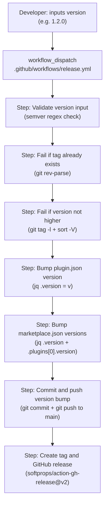
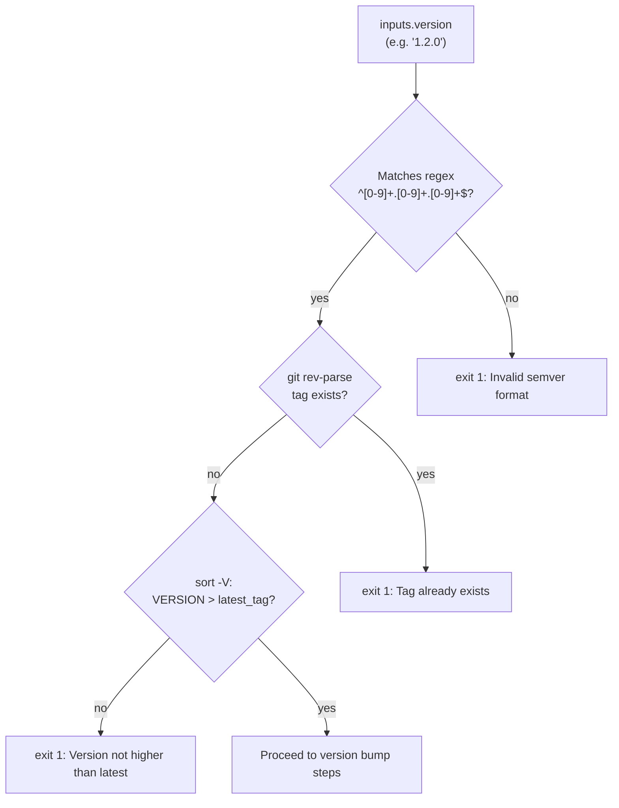
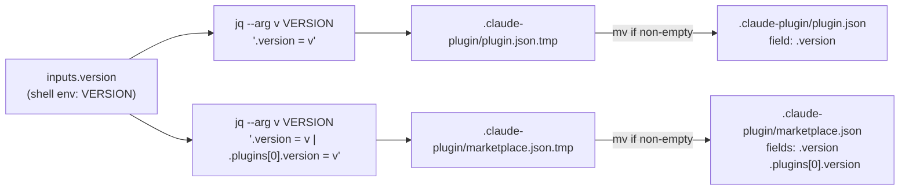

<!-- source: DeepWiki mcp.deepwiki.com · repo AvdLee/SwiftUI-Agent-Skill · page 5.1 Release Workflow · fetched 2026-10-26 -->

# Release Workflow

<details>
<summary>Relevant source files</summary>

The following files were used as context for generating this wiki page:

- [.claude-plugin/marketplace.json](.claude-plugin/marketplace.json)
- [.claude-plugin/plugin.json](.claude-plugin/plugin.json)
- [.github/workflows/release.yml](.github/workflows/release.yml)

</details>


## Purpose

This page documents the manual release process implemented in [`.github/workflows/release.yml`](.github/workflows/release.yml:1-115)(). It covers the trigger mechanism, the three validation gates, the `jq`-based version-bumping steps for both manifest files, the safe write pattern used to avoid data loss, and the final GitHub release creation.

For an overview of both CI/CD workflows in this repository, see the parent page [Automation & Maintenance](#5). For the other automated workflow that keeps README documentation in sync, see [README Sync Workflow](#5.2).

---

## Overview

The release workflow is triggered **manually** via `workflow_dispatch`. A developer inputs a target version string, and the workflow validates it, bumps the version in both JSON manifests, commits the change to `main`, and creates a tagged GitHub release with auto-generated release notes.

**Diagram: Release Workflow — Trigger to Completion**



Sources: [`.github/workflows/release.yml:1-115`](.github/workflows/release.yml:1-115)()

---

## Trigger & Permissions

The workflow fires only on `workflow_dispatch` — there is no automatic trigger. It requires one input:

| Input | Type | Required | Description |
|---|---|---|---|
| `version` | `string` | Yes | The semantic version to release, e.g. `1.2.0` |

The job runs only when the current branch is `refs/heads/main` [`.github/workflows/release.yml:16`](.github/workflows/release.yml:16)(). This prevents accidental releases from feature branches.

The workflow requires `contents: write` permission [`.github/workflows/release.yml:11-12`](.github/workflows/release.yml:11-12)() to push commits and create GitHub releases.

The checkout step uses `fetch-depth: 0` and `fetch-tags: true` [`.github/workflows/release.yml:24-28`](.github/workflows/release.yml:24-28)() so that the full tag history is available for version comparison in the validation gates.

Sources: [`.github/workflows/release.yml:1-28`](.github/workflows/release.yml:1-28)()

---

## Validation Gates

Three sequential checks must pass before any file is modified. Any failure exits with code `1` and halts the workflow.

**Diagram: Validation Gate Logic**



Sources: [`.github/workflows/release.yml:30-69`](.github/workflows/release.yml:30-69)()

### Gate 1 — Semver Format

[`.github/workflows/release.yml:31-37`](.github/workflows/release.yml:31-37)()

The input string is matched against the regex `^[0-9]+\.[0-9]+\.[0-9]+$`. Anything other than three dot-separated integers (e.g. `1.2.0-beta`) fails immediately.

### Gate 2 — Tag Uniqueness

[`.github/workflows/release.yml:39-46`](.github/workflows/release.yml:39-46)()

`git rev-parse -q --verify "refs/tags/$VERSION"` checks whether the tag already exists in the repository. If it does, the workflow refuses to overwrite an existing release.

### Gate 3 — Version Ordering

[`.github/workflows/release.yml:48-69`](.github/workflows/release.yml:48-69)()

`git tag -l '[0-9]*.[0-9]*.[0-9]*' --sort=-v:refname | head -n 1` retrieves the highest existing semver tag. The new version is compared using `sort -V` to confirm it is strictly greater than the current latest. If no existing semver tags are found, this gate passes unconditionally.

---

## Version Bumping

After all three validation gates pass, `jq` is used to update version strings in both manifest files. Neither file is modified in-place; a safe tmp-file pattern is used to prevent data loss.

**Diagram: File Mutation — Targets and Fields**



Sources: [`.github/workflows/release.yml:71-93`](.github/workflows/release.yml:71-93)()

### Bumping `plugin.json`

[`.github/workflows/release.yml:71-81`](.github/workflows/release.yml:71-81)()

```
jq --arg v "$VERSION" '.version = $v' .claude-plugin/plugin.json > .claude-plugin/plugin.json.tmp
```

Only the top-level `.version` field in `.claude-plugin/plugin.json` is updated.

### Bumping `marketplace.json`

[`.github/workflows/release.yml:83-93`](.github/workflows/release.yml:83-93)()

```
jq --arg v "$VERSION" '.version = $v | .plugins[0].version = $v' .claude-plugin/marketplace.json > .claude-plugin/marketplace.json.tmp
```

Two fields are updated in `.claude-plugin/marketplace.json`:
- `.version` — the top-level marketplace entry version
- `.plugins[0].version` — the version inside the embedded plugin definition

After the current version of these files, both fields hold the same version string (e.g. `1.2.0`). See [`.claude-plugin/marketplace.json:3,17`](.claude-plugin/marketplace.json:3-17)().

### Safe Write Pattern

For each file, `jq` writes output to a `.tmp` sibling file. The workflow then checks `[ -s <file>.tmp ]` (non-zero size) before executing `mv`. If `jq` produces an empty file — indicating a failure — the step exits with an error rather than silently truncating the original. This pattern is applied identically to both files.

| File written | Temp file | Fields updated |
|---|---|---|
| `.claude-plugin/plugin.json` | `plugin.json.tmp` | `.version` |
| `.claude-plugin/marketplace.json` | `marketplace.json.tmp` | `.version`, `.plugins[0].version` |

Sources: [`.github/workflows/release.yml:71-93`](.github/workflows/release.yml:71-93)()

---

## Commit & Push

[`.github/workflows/release.yml:95-108`](.github/workflows/release.yml:95-108)()

Before committing, the step runs `git diff --quiet` on both modified files. If no diff is detected (meaning the files were already at the target version), the step fails with an explanatory message.

The bot identity is set via:
- `user.name`: `github-actions[bot]`
- `user.email`: `github-actions[bot]@users.noreply.github.com`

Both files are staged and committed with the message `Bump version to $VERSION`, then pushed directly to `main`.

---

## GitHub Release Creation

[`.github/workflows/release.yml:110-114`](.github/workflows/release.yml:110-114)()

The final step uses the `softprops/action-gh-release@v2` action:

| Parameter | Value |
|---|---|
| `tag_name` | `inputs.version` (the new version string) |
| `generate_release_notes` | `true` |

The action creates a new Git tag at the current `HEAD` of `main` (which is now the version-bump commit) and publishes a GitHub release with automatically generated release notes based on commits since the previous tag.

Sources: [`.github/workflows/release.yml:110-115`](.github/workflows/release.yml:110-115)()

---

## End-to-End Step Summary

| Step | Key Command/Action | Failure Condition |
|---|---|---|
| Validate version input | `[[ "$VERSION" =~ ^[0-9]+\.[0-9]+\.[0-9]+$ ]]` | Format mismatch |
| Fail if tag already exists | `git rev-parse -q --verify "refs/tags/$VERSION"` | Tag found |
| Fail if version not higher | `sort -V` comparison vs. `git tag -l` | New ≤ latest |
| Bump `plugin.json` | `jq .version = $v` → tmp → mv | Empty tmp file |
| Bump `marketplace.json` | `jq .version + .plugins[0].version = $v` → tmp → mv | Empty tmp file |
| Commit and push | `git add`, `git commit`, `git push` | No diff detected |
| Create GitHub release | `softprops/action-gh-release@v2` | Action failure |

Sources: [`.github/workflows/release.yml:1-115`](.github/workflows/release.yml:1-115)()

---

