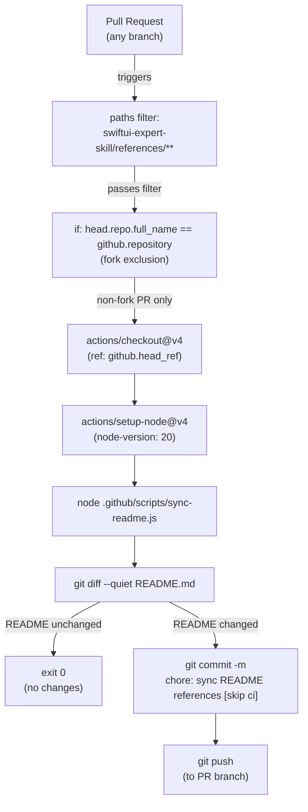
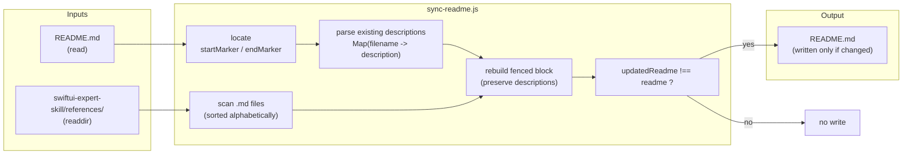
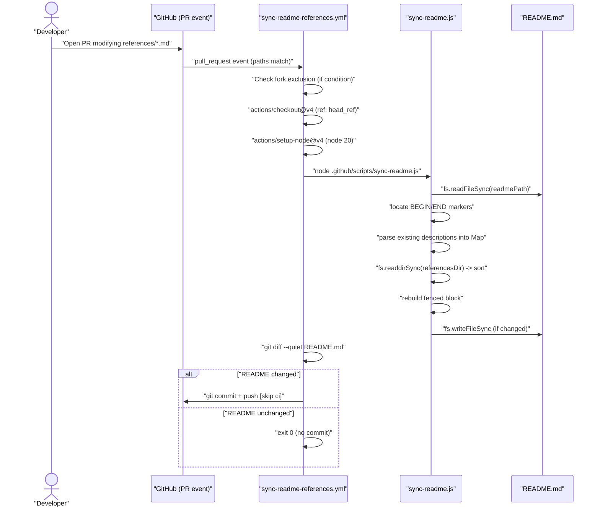

<!-- source: DeepWiki mcp.deepwiki.com · repo AvdLee/SwiftUI-Agent-Skill · page 5.2 README Sync Workflow · fetched 2026-10-26 -->

# README Sync Workflow

<details>
<summary>Relevant source files</summary>

The following files were used as context for generating this wiki page:

- [.github/scripts/sync-readme.js](.github/scripts/sync-readme.js)
- [.github/workflows/sync-readme-references.yml](.github/workflows/sync-readme-references.yml)

</details>


## Purpose & Scope

This page documents the `sync-readme-references.yml` GitHub Actions workflow and the `sync-readme.js` Node.js script it invokes. Together, they ensure the reference file listing in `README.md` stays synchronized whenever the `swiftui-expert-skill/references/` directory changes.

This page covers only the README sync automation. For the release workflow that bumps version numbers in `plugin.json` and `marketplace.json`, see [Release Workflow](#5.1). For an overview of both workflows together, see [Automation & Maintenance](#5).

---

## How It Fits Into the CI/CD Picture

**Workflow trigger diagram: sync-readme-references.yml**



Sources: [.github/workflows/sync-readme-references.yml:1-41]()

---

## Workflow File: `sync-readme-references.yml`

File: [.github/workflows/sync-readme-references.yml:1-41]()

### Trigger

The workflow fires on the `pull_request` event, but only when the changed files match the path glob `swiftui-expert-skill/references/**`.

```yaml
on:
  pull_request:
    paths:
      - "swiftui-expert-skill/references/**"
```

This means: adding, renaming, or deleting any `.md` file inside the `references/` directory will trigger the workflow. Changes to `SKILL.md`, `README.md`, or anything else in the repository do not trigger it.

### Fork Exclusion

The job has an `if` condition at [.github/workflows/sync-readme-references.yml:10]():

```
if: github.event.pull_request.head.repo.full_name == github.repository
```

This prevents the job from running on PRs submitted from forks. Forked repositories do not have access to `secrets.GITHUB_TOKEN` with write permissions, so a push attempt would fail. The condition short-circuits execution entirely for fork PRs.

### Steps Summary

| Step | Action | Detail |
|---|---|---|
| Checkout | `actions/checkout@v4` | Checks out the PR's head branch (`github.head_ref`), not `main` |
| Setup Node | `actions/setup-node@v4` | Installs Node.js 20 |
| Sync README structure | `node .github/scripts/sync-readme.js` | Rebuilds the reference block in `README.md` |
| Commit README update | inline shell | Guards against empty commits; pushes with `[skip ci]` |

Sources: [.github/workflows/sync-readme-references.yml:14-40]()

### The `[skip ci]` Commit Convention

The commit message is `chore: sync README references [skip ci]`. The `[skip ci]` token instructs GitHub Actions not to re-trigger workflows on this automated commit. Without it, the push back to the PR branch could trigger another workflow run in a feedback loop.

Sources: [.github/workflows/sync-readme-references.yml:39]()

### Empty-Commit Guard

Before committing, the shell step runs:

```sh
if git diff --quiet README.md; then
  echo "README is up to date."
  exit 0
fi
```

This compares the working tree against the index. If `sync-readme.js` produced no net change to `README.md` (e.g., the file listing was already correct), the step exits cleanly without creating an empty commit.

Sources: [.github/workflows/sync-readme-references.yml:29-33]()

---

## Script: `sync-readme.js`

File: [.github/scripts/sync-readme.js:1-57]()

This is a standalone Node.js script with no npm dependencies. It uses only the built-in `fs` and `path` modules.

### What It Does

**sync-readme.js data flow diagram**



Sources: [.github/scripts/sync-readme.js:1-57]()

### HTML Comment Markers

The script uses two HTML comment strings as delimiters to locate the managed block inside `README.md`:

```
<!-- BEGIN REFERENCE STRUCTURE -->
<!-- END REFERENCE STRUCTURE -->
```

These are defined as constants at [.github/scripts/sync-readme.js:8-9]():

```js
const startMarker = "<!-- BEGIN REFERENCE STRUCTURE -->";
const endMarker   = "<!-- END REFERENCE STRUCTURE -->";
```

If either marker is missing or `endIndex < startIndex`, the script throws an error rather than silently corrupting the file ([.github/scripts/sync-readme.js:15-17]()).

### Description Preservation

The script parses the existing block to extract per-file descriptions before replacing it. This is done at [.github/scripts/sync-readme.js:22-27]():

```js
const match = line.match(/^\s+([a-z0-9-]+\.md)\s+-\s+(.*)$/i);
if (match) {
  descriptions.set(match[1], match[2].trim());
}
```

The regex matches lines of the form `    filename.md - human-readable description`. Descriptions are stored in a `Map<string, string>`. When rebuilding the block, any file whose name exists in the map gets its description appended; new files without a description are listed without one.

This ensures that manually-authored descriptions in `README.md` are not lost when a new reference file is added.

### Output Block Format

The rebuilt block is a fenced `text` code block:

```
<!-- BEGIN REFERENCE STRUCTURE -->
```text
swiftui-expert-skill/
  SKILL.md
  references/
    animation-advanced.md - description if present
    animation-basics.md - description if present
    ...
```
<!-- END REFERENCE STRUCTURE -->
```

Files are sorted alphabetically by `String.prototype.localeCompare` ([.github/scripts/sync-readme.js:31-32]()).

Sources: [.github/scripts/sync-readme.js:29-57]()

---

## Data Flow: PR Branch to README

**End-to-end sequence diagram**



Sources: [.github/workflows/sync-readme-references.yml:1-41](), [.github/scripts/sync-readme.js:1-57]()

---

## Key Invariants

| Property | Detail |
|---|---|
| Workflow trigger | `pull_request` + `paths: swiftui-expert-skill/references/**` only |
| Fork safety | `if: head.repo.full_name == github.repository` blocks fork PRs |
| Marker requirement | Both `<!-- BEGIN REFERENCE STRUCTURE -->` and `<!-- END REFERENCE STRUCTURE -->` must exist in `README.md` |
| Description preservation | Existing per-file descriptions in the block are retained via regex parse into a `Map` |
| File ordering | Reference files are sorted alphabetically (`localeCompare`) |
| Empty-commit protection | `git diff --quiet` prevents spurious commits |
| Re-trigger prevention | `[skip ci]` on the automated commit message |
| Node version | Node.js 20, no external npm packages |

Sources: [.github/workflows/sync-readme-references.yml:1-41](), [.github/scripts/sync-readme.js:1-57]()

---

