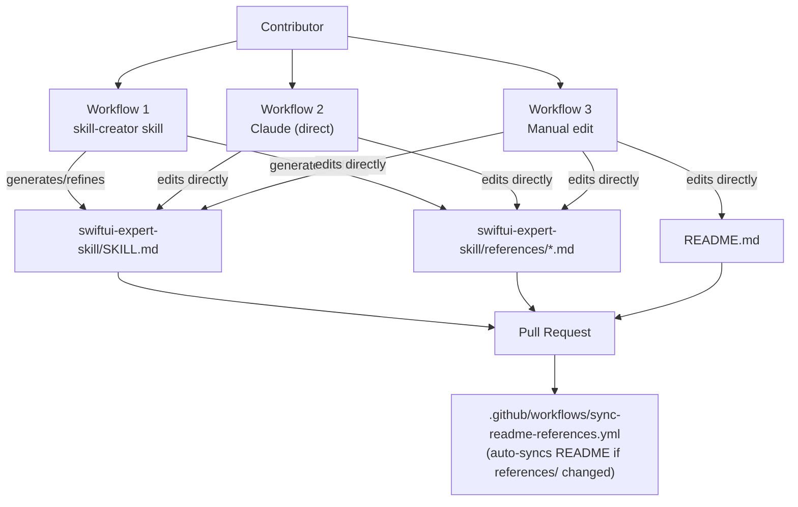
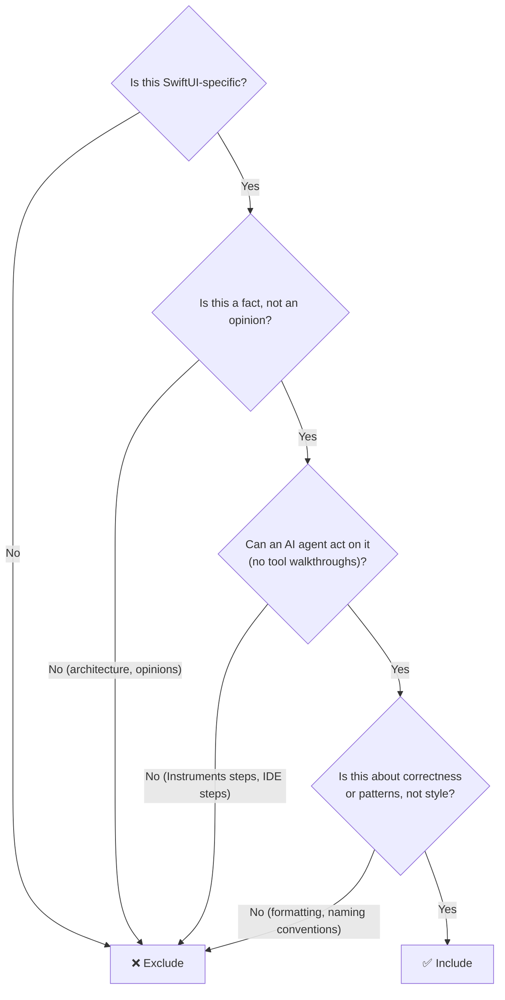
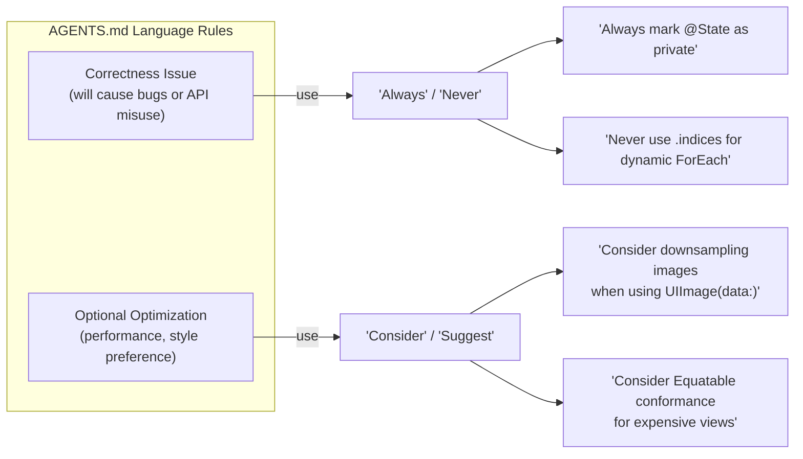
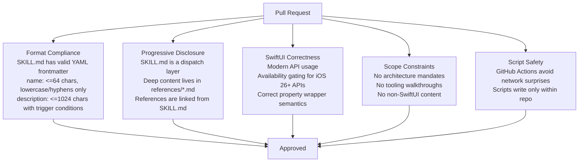

<!-- source: DeepWiki mcp.deepwiki.com · repo AvdLee/SwiftUI-Agent-Skill · page 6 Contributing · fetched 2026-10-26 -->

# Contributing

Relevant source files

The following files were used as context for generating this wiki page:

- [.github/FUNDING.yml](.github/FUNDING.yml)
- [.github/copilot-instructions.md](.github/copilot-instructions.md)
- [.gitignore](.gitignore)
- [AGENTS.md](AGENTS.md)
- [CONTRIBUTING.md](CONTRIBUTING.md)
- [LICENSE](LICENSE)

This page covers the process and standards for contributing to the `swiftui-expert-skill` repository. It explains the three supported editing workflows, content quality rules, language conventions, and the automated checks that run on pull requests. For context on how the skill content is structured internally, see [Skill Structure](#3.1). For how releases are cut after merging, see [Release Workflow](#5.1).

---

## Editing Workflows

There are three supported paths for making changes to skill content.

### Workflow Comparison

| Workflow | Tool Required | Primary Targets | Best For |
|---|---|---|---|
| `skill-creator` skill | Claude with skill-creator | `SKILL.md`, `references/*.md` | Proposing changes in plain language |
| Claude (no skill-creator) | Any Claude instance | `SKILL.md`, `references/*.md` | Targeted edits with AI assistance |
| Manual Markdown editing | Text editor | Any `.md` file | Precise, reviewable diffs |

**Diagram: Editing Workflow Entry Points**

Sources: [CONTRIBUTING.md:11-23]()

### Skill-Creator Workflow

The `skill-creator` skill lets you describe a change in plain language and have it generate or refine `SKILL.md` and the reference files. After generation, review the output for SwiftUI accuracy and consistency before opening a PR.

### Claude (Direct) Workflow

Edit `swiftui-expert-skill/SKILL.md` or any file under `swiftui-expert-skill/references/` directly in a Claude session. This is suitable when you have a clear, scoped change in mind and do not need the full skill-creator generation loop.

### Manual Markdown Workflow

Edit `.md` files directly in any text editor. When editing:

- Keep headings consistent with the existing file structure in `swiftui-expert-skill/references/`.
- Do not reformat checklists or frontmatter in `SKILL.md` unless fixing a compliance issue.
- If you add or rename a file under `swiftui-expert-skill/references/`, the `README.md` reference block is automatically updated by the sync workflow on your PR — you do not need to edit `README.md` manually. See [README Sync Workflow](#5.2) for details.

Sources: [CONTRIBUTING.md:17-23](), [CONTRIBUTING.md:46-48]()

---

## Types of Contributions

[CONTRIBUTING.md:25-31]() lists the accepted contribution categories:

| Category | Examples |
|---|---|
| Correctness fixes | Fix wrong property wrapper usage, fix incorrect API names |
| Modern API additions | Add iOS 17+ / iOS 26+ patterns, flag deprecated APIs |
| Checklist improvements | Clarify review checklist steps in `SKILL.md` |
| Reference expansions | Add new SwiftUI patterns to `references/*.md` |
| Documentation | Improve `README.md` or `CONTRIBUTING.md` clarity |

---

## Content Quality Standards

The rules below apply to all content in `swiftui-expert-skill/SKILL.md` and `swiftui-expert-skill/references/`. They are enforced during PR review via `.github/copilot-instructions.md`.

**Diagram: Content Inclusion Decision Tree**

Sources: [AGENTS.md:126-133](), [CONTRIBUTING.md:33-37]()

### SwiftUI Scope

The skill is **SwiftUI-only**. Do not add:

- Swift concurrency deep dives (actors, `Sendable`, structured concurrency) — unless they directly concern a SwiftUI API like `.task`
- UIKit patterns, except where bridging is strictly required
- Backend or server-side Swift patterns
- General Swift language features unrelated to SwiftUI view behavior

Sources: [AGENTS.md:7-13]()

### No Architectural Mandates

Do not prescribe specific architectures. Contributions must not enforce:

- MVVM, MVC, VIPER, or any named pattern
- View model class requirements
- Folder or project structure
- Dependency injection or coordinator/router patterns

Separating business logic for testability is acceptable as a *suggestion*, not a requirement.

Sources: [AGENTS.md:24-32]()

### No Tool-Specific Instructions

Do not provide step-by-step usage of any external tool. Prohibited:

- Xcode Instruments profiling walkthroughs
- IDE-specific feature guides
- Debugger usage steps

Mentioning that profiling with Instruments is possible is acceptable; providing instructions is not.

Sources: [AGENTS.md:34-41]()

### No Formatting or Linting Rules

Do not add property ordering requirements, whitespace rules, naming conventions, or code organization mandates as requirements. These may appear only as optional suggestions for readability.

Sources: [AGENTS.md:14-23]()

### API Modernity

Prefer current, non-deprecated APIs. Flag deprecated APIs explicitly. Examples of preferred modern equivalents:

| Deprecated / Older | Preferred Modern |
|---|---|
| `NavigationView` | `NavigationStack` |
| `foregroundColor()` | `foregroundStyle()` |
| `@ObservedObject` (as source of truth) | `@StateObject` or `@Observable` |
| `ObservableObject` + `@Published` | `@Observable` macro (iOS 17+) |

Sources: [.github/copilot-instructions.md:32-33]()

---

## Language Conventions

The `AGENTS.md` file defines exactly when to use prescriptive versus suggestive language. All contributions must follow this convention.

**Diagram: Language Convention Rules**

Sources: [AGENTS.md:45-62]()

### Quick Reference

| Situation | Correct Phrasing | Incorrect Phrasing |
|---|---|---|
| Correctness / will cause bugs | "Always use `stable id` for `ForEach`" | "You should use stable id" |
| Anti-pattern | "Never use `.indices` for dynamic content" | "Avoid using `.indices` if possible" |
| Performance optimization | "Consider downsampling images" | "Always downsample images" |
| Optional suggestion | "Consider extracting into a sub-view" | "You must extract views" |

Sources: [AGENTS.md:46-54]()

---

## Pull Request Review Checklist

The `.github/copilot-instructions.md` file defines the automated review focus used by GitHub Copilot on PRs. Contributors should self-check against the same criteria before opening a PR.

**Diagram: PR Review Check Areas**

Sources: [.github/copilot-instructions.md:36-66]()

### Common Issues Flagged by Copilot Review

| Issue | File Affected | Flag Reason |
|---|---|---|
| Missing or invalid YAML frontmatter | `swiftui-expert-skill/SKILL.md` | Format compliance |
| `name` contains uppercase, underscores, or spaces | `swiftui-expert-skill/SKILL.md` | Format compliance |
| `description` is vague (e.g., "helps with SwiftUI") | `swiftui-expert-skill/SKILL.md` | No trigger conditions |
| `SKILL.md` duplicates large reference content | `swiftui-expert-skill/SKILL.md` | Progressive disclosure violation |
| Reference file not linked from `SKILL.md` | `swiftui-expert-skill/references/*.md` | Agent cannot discover it |
| Architecture prescription or project structure mandate | Any `references/*.md` | Scope violation |
| Step-by-step tool walkthrough | Any `references/*.md` | Scope violation |
| iOS 26+ API without `#available` guard | Any `references/*.md` | SwiftUI correctness |

Sources: [.github/copilot-instructions.md:58-67]()

---

## Pull Request Process

[CONTRIBUTING.md:40-44]() defines the standard PR flow:

1. Fork the repository (or branch if you have write access).
2. Make changes in a focused scope — one topic or fix per PR is preferred.
3. Ensure `SKILL.md` and the affected reference files remain consistent with each other.
4. Open a PR with a short summary of what changed and why.

When a PR modifies files under `swiftui-expert-skill/references/`, the `sync-readme-references.yml` workflow automatically updates the reference block in `README.md` and commits it back to the PR branch. No manual `README.md` edits are needed in that case.

Sources: [CONTRIBUTING.md:40-48](), [.github/workflows/sync-readme-references.yml]()

---

## Development Environment

No special build tooling is required to contribute content changes. Standard Markdown editing is sufficient.

The `.gitignore` file reveals the environment assumptions:

| Ignored Pattern | Tool |
|---|---|
| `xcuserdata/`, `*.xcworkspace` | Xcode |
| `.build/` | Swift Package Manager |
| `Carthage/Build/` | Carthage |
| `node_modules/` | Node.js (used only by `.github/scripts/sync-readme.js`) |
| `fastlane/` artifacts | Fastlane |

Node.js is only needed if you are modifying `.github/scripts/sync-readme.js`. The sync script runs automatically in CI; local execution is not required for content contributions.

Sources: [.gitignore:1-66](), [CONTRIBUTING.md:46-47]()

---

## License

Contributions are accepted under the MIT License. See [LICENSE:1-21]().

Sources: [LICENSE:1-21](), [CONTRIBUTING.md:53-54]()