# Page: Overview

# Overview

<details>
<summary>Relevant source files</summary>

The following files were used as context for generating this wiki page:

- [README.md](README.md)
- [swiftui-expert-skill/SKILL.md](swiftui-expert-skill/SKILL.md)

</details>


This page describes the purpose, architecture, and major subsystems of the `SwiftUI-Agent-Skill` repository. It covers what the skill is, the open format it follows, and how its four subsystems fit together. For installation steps, see [Installation & Usage](#2). For the full knowledge base content, see [SwiftUI Reference Content](#3). For plugin registration details, see [Claude Plugin Integration](#4). For CI/CD automation, see [Automation & Maintenance](#5).

---

## What This Repository Is

`SwiftUI-Agent-Skill` is an **AI agent skill** that provides practical SwiftUI guidance to AI coding tools. It targets correctness and performance without mandating a specific architecture or code style.

The skill is built on the [Agent Skills open format](https://agentskills.io/home), which defines a standard way to package domain knowledge so that multiple AI coding tools (Claude Code, Codex, Cursor, etc.) can consume it.

**Target audience:**
- Teams adopting modern SwiftUI APIs who want correct defaults
- Developers reviewing or refactoring SwiftUI views and data flow
- Anyone shipping performant lists, scrolling, sheets, and navigation in SwiftUI

Sources: [README.md:1-11]()

---

## The Agent Skills Open Format

The Agent Skills format specifies a directory containing:

1. A **`SKILL.md` entrypoint** — YAML frontmatter identifying the skill, followed by workflow decision trees, core guidelines, and a review checklist.
2. A **`references/` subdirectory** — topic-specific Markdown files that the agent loads on demand.

A compliant AI tool reads `SKILL.md` first, then navigates to the relevant reference file based on the task at hand. The `swiftui-expert-skill/` directory in this repository is the complete implementation of one such skill.

Sources: [swiftui-expert-skill/SKILL.md:1-4](), [README.md:109-128]()

---

## Two-Layer Architecture

The skill content is split into two layers:

| Layer | File(s) | Role |
|---|---|---|
| **Dispatch layer** | `swiftui-expert-skill/SKILL.md` | Workflow decision trees, core guidelines, quick-reference tables, review checklist |
| **Reference layer** | `swiftui-expert-skill/references/*.md` (12 files) | Deep-dive content for each SwiftUI topic domain |

`SKILL.md` routes the agent to one or more reference files based on the task type (review, improve, or implement). The reference files are loaded lazily — only the files relevant to the task are read.

Sources: [swiftui-expert-skill/SKILL.md:11-37](), [swiftui-expert-skill/SKILL.md:197-209]()

**Diagram: SKILL.md as Dispatch Layer**

```mermaid
graph TD
    SKILLMD["swiftui-expert-skill/SKILL.md
    (entrypoint: frontmatter, workflow trees, checklist)"]

    subgraph state_data["Data & State"]
        SM["references/state-management.md"]
    end

    subgraph ui["UI Components"]
        LP["references/list-patterns.md"]
        SP["references/scroll-patterns.md"]
        SNP["references/sheet-navigation-patterns.md"]
    end

    subgraph perf["Performance"]
        PP["references/performance-patterns.md"]
        IO["references/image-optimization.md"]
    end

    subgraph layout["Layout & Composition"]
        VS["references/view-structure.md"]
        LBP["references/layout-best-practices.md"]
    end

    subgraph anim["Animation"]
        AB["references/animation-basics.md"]
        AA["references/animation-advanced.md"]
        AT["references/animation-transitions.md"]
    end

    subgraph ios26["iOS 26+"]
        LG["references/liquid-glass.md"]
    end

    SKILLMD --> SM
    SKILLMD --> LP
    SKILLMD --> SP
    SKILLMD --> SNP
    SKILLMD --> PP
    SKILLMD --> IO
    SKILLMD --> VS
    SKILLMD --> LBP
    SKILLMD --> AB
    SKILLMD --> AA
    SKILLMD --> AT
    SKILLMD --> LG
```

Sources: [swiftui-expert-skill/SKILL.md:197-209](), [README.md:110-128]()

---

## Repository Subsystems

The repository is composed of four subsystems:

| Subsystem | Key Files | Responsibility |
|---|---|---|
| **Skill Content** | `swiftui-expert-skill/SKILL.md`, `swiftui-expert-skill/references/*.md` | The agent knowledge base |
| **Claude Plugin Infrastructure** | `.claude-plugin/plugin.json`, `.claude-plugin/marketplace.json` | Packages and registers the skill for Claude Code |
| **CI/CD Automation** | `.github/workflows/release.yml`, `.github/workflows/sync-readme-references.yml`, `.github/scripts/sync-readme.js` | Version management and documentation sync |
| **Project Metadata** | `README.md`, `AGENTS.md`, `CONTRIBUTING.md`, `.github/copilot-instructions.md` | Installation docs, contribution guidelines, agent behavior rules |

**Diagram: Top-Level Subsystem Map**

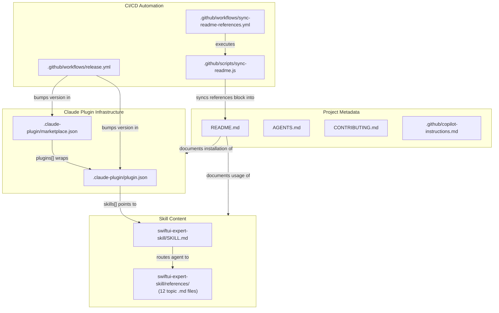

Sources: [README.md:17-82](), [README.md:130-134]()

---

## Agent Runtime Flow

When a developer invokes the skill, the agent loads `SKILL.md` first, then follows the workflow decision tree to determine which reference files to read.

**Diagram: Agent Invocation Sequence**

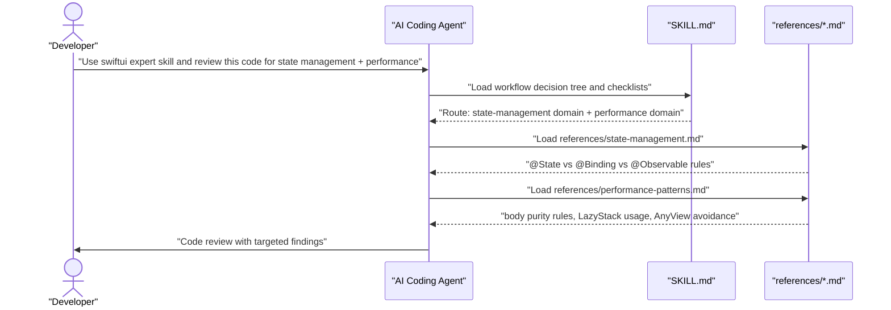

Sources: [swiftui-expert-skill/SKILL.md:11-37](), [README.md:28-30]()

---

## Skill Content Summary

`SKILL.md` defines three workflow modes, each routing to a different subset of the reference files:

| Workflow | Trigger | Key Reference Files |
|---|---|---|
| **Review existing code** | Agent is asked to review a view or feature | `state-management.md`, `view-structure.md`, `performance-patterns.md`, `list-patterns.md`, `animation-basics.md`, `liquid-glass.md` |
| **Improve existing code** | Agent is asked to refactor or optimize | `state-management.md`, `view-structure.md`, `performance-patterns.md`, `list-patterns.md`, `image-optimization.md` |
| **Implement new feature** | Agent is asked to build something new | `state-management.md`, `view-structure.md`, `layout-best-practices.md`, `animation-basics.md`, `animation-transitions.md`, `animation-advanced.md`, `liquid-glass.md` |

The skill's philosophy (stated in `SKILL.md`) is to focus on **facts and best practices**, not architectural opinions — it does not enforce MVVM, VIPER, or any other pattern.

Sources: [swiftui-expert-skill/SKILL.md:11-37](), [swiftui-expert-skill/SKILL.md:211-218]()

---

## Claude Plugin Infrastructure

The skill is also published as a Claude Code plugin. Two JSON files in `.claude-plugin/` handle registration:

- **`.claude-plugin/plugin.json`** — plugin identity (`name: swiftui-expert`, `version`, `description`, keywords, `skills[]` array pointing to `swiftui-expert-skill/`)
- **`.claude-plugin/marketplace.json`** — marketplace manifest (`name: swiftui-expert-skill`, `owner: Antoine van der Lee`, `plugins[]` wrapping `plugin.json`)

The `marketplace.json` validates against an external Anthropics schema. The `plugin.json` `skills[]` field uses `source: './'` to co-locate the manifest with the implementation directory.

For full details, see [Claude Plugin Integration](#4).

Sources: [README.md:32-67]()

---

## CI/CD Automation

Two GitHub Actions workflows automate maintenance:

| Workflow File | Trigger | What It Does |
|---|---|---|
| `.github/workflows/release.yml` | Manual `workflow_dispatch` | Validates semver, bumps version in `plugin.json` and `marketplace.json`, commits to `main`, creates GitHub release |
| `.github/workflows/sync-readme-references.yml` | PR modifying `swiftui-expert-skill/references/**` | Runs `sync-readme.js` to rebuild the `<!-- BEGIN REFERENCE STRUCTURE -->` block in `README.md` |

For full details, see [Automation & Maintenance](#5).

Sources: [README.md:109-128]()

---

# Page: Installation & Usage

# Installation & Usage

<details>
<summary>Relevant source files</summary>

The following files were used as context for generating this wiki page:

- [.claude-plugin/marketplace.json](.claude-plugin/marketplace.json)
- [.claude-plugin/plugin.json](.claude-plugin/plugin.json)
- [README.md](README.md)

</details>


This page covers how to install the `swiftui-expert-skill` into an AI coding tool and how to invoke it once installed. It describes all three supported installation methods, the required configuration for each, and example invocation prompts.

For details on what the skill contains once loaded (the knowledge base structure, reference files, and workflow modes), see [SwiftUI Reference Content](#3). For how the Claude plugin manifests are structured, see [Claude Plugin Integration](#4).

---

## Installation Methods Overview

The skill can be installed three ways. The method you choose depends on your toolchain.

| Method | Best For | Key File(s) |
|---|---|---|
| **Option A**: `npx skills add` | Any agent that supports the Agent Skills open format | `swiftui-expert-skill/SKILL.md` + `references/` |
| **Option B**: Claude Code Plugin | Claude Code users, personal or project-wide | `.claude-plugin/plugin.json`, `.claude-plugin/marketplace.json` |
| **Option C**: Manual clone/symlink | Any agent tool with custom skills path support | `swiftui-expert-skill/` directory |

**Installation method decision diagram**

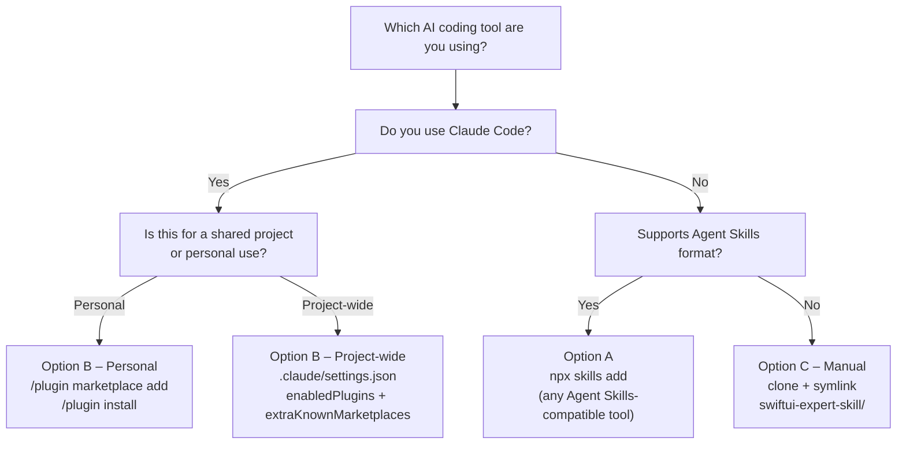

Sources: [README.md:19-82]()

---

## Option A: skills.sh / npx

This is the recommended method for any agent tool that supports the [Agent Skills open format](https://agentskills.io/home).

Run the following command in your terminal:

```bash
npx skills add https://github.com/avdlee/swiftui-agent-skill --skill swiftui-expert-skill
```

This command fetches the `swiftui-expert-skill/` directory from the repository and registers it with the local skills runtime. No further configuration is required.

After installation, verify the skill is recognized by asking your agent to reference the workflow in `swiftui-expert-skill/SKILL.md`.

Sources: [README.md:19-29]()

---

## Option B: Claude Code Plugin

The skill is packaged as a Claude Code plugin. The plugin identity is defined in [.claude-plugin/plugin.json:1-27]() and the marketplace manifest in [.claude-plugin/marketplace.json:1-45]().

### Personal Installation

Run these two commands inside Claude Code:

```
/plugin marketplace add AvdLee/SwiftUI-Agent-Skill
/plugin install swiftui-expert@swiftui-expert-skill
```

- `/plugin marketplace add` registers the GitHub repository `AvdLee/SwiftUI-Agent-Skill` as a source.
- `/plugin install swiftui-expert@swiftui-expert-skill` installs the `swiftui-expert` plugin, loading the `swiftui-expert-skill` entry from the `skills[]` array in `plugin.json`.

### Project-Wide Installation

To make the skill available to every developer working in a repository, add the following to `.claude/settings.json` in the project root:

```json
{
  "enabledPlugins": {
    "swiftui-expert@swiftui-expert-skill": true
  },
  "extraKnownMarketplaces": {
    "swiftui-expert-skill": {
      "source": {
        "source": "github",
        "repo": "AvdLee/SwiftUI-Agent-Skill"
      }
    }
  }
}
```

When a team member opens the project in Claude Code, Claude Code will detect the `enabledPlugins` entry and prompt them to install the skill automatically.

**How plugin.json maps to the install command**

```mermaid
graph LR
    CMD["\"swiftui-expert@swiftui-expert-skill\"\n(install command)"]
    PJ["plugin.json\nname: swiftui-expert"]
    SK["skills[]\n./swiftui-expert-skill"]
    DIR["swiftui-expert-skill/\nSKILL.md + references/"]
    MJ["marketplace.json\nplugins[0].name: swiftui-expert"]

    CMD -->|"resolves plugin name via"| MJ
    MJ -->|"wraps"| PJ
    PJ -->|"skills[] points to"| SK
    SK -->|"loads from disk"| DIR
```

Sources: [README.md:31-67](), [.claude-plugin/plugin.json:1-27](), [.claude-plugin/marketplace.json:1-45]()

---

## Option C: Manual Clone / Symlink

1. Clone the repository:

   ```bash
   git clone https://github.com/AvdLee/SwiftUI-Agent-Skill.git
   ```

2. Install or symlink the `swiftui-expert-skill/` directory into the location your tool expects for skills. Refer to the official documentation for your tool:

   | Tool | Documentation |
   |---|---|
   | Codex | Where to save skills |
   | Claude | Using Skills |
   | Cursor | Enabling Skills |

3. Instruct your agent to use the `swiftui-expert` skill for SwiftUI tasks.

The directory that must be registered with the tool is `swiftui-expert-skill/`, which contains `SKILL.md` as the agent entrypoint and a `references/` subdirectory with twelve topic-specific files.

Sources: [README.md:69-82]()

---

## Verifying Installation

After any installation method, confirm the skill is active by asking your agent:

> "Use the swiftui expert skill and review the state management in this file."

A correctly installed skill causes the agent to:

1. Load `swiftui-expert-skill/SKILL.md` to read the workflow decision tree.
2. Identify the relevant topic domains (e.g., `state-management`).
3. Load the corresponding reference file (e.g., `swiftui-expert-skill/references/state-management.md`).
4. Apply the checklist and guidelines from that file to the provided code.

If the agent does not reference `SKILL.md` or the reference files, the skill directory is not correctly registered.

Sources: [README.md:80-82]()

---

## Invoking the Skill

Once installed, invoke the skill by explicitly naming it in your prompt. The agent uses the skill name as a signal to load `SKILL.md` before proceeding.

### Example Prompts

| Task | Example Prompt |
|---|---|
| Review existing code | `Use the swiftui expert skill and review the current SwiftUI code for state-management and performance improvements` |
| Improve a specific area | `Use the swiftui expert skill and suggest improvements to this view's composition and layout` |
| Implement a new feature | `Use the swiftui expert skill and implement a sheet-based navigation flow for this screen` |
| iOS 26+ adoption | `Use the swiftui expert skill and apply Liquid Glass effects to this view with appropriate fallbacks` |

### Agent Resolution Flow

**Skill invocation sequence**

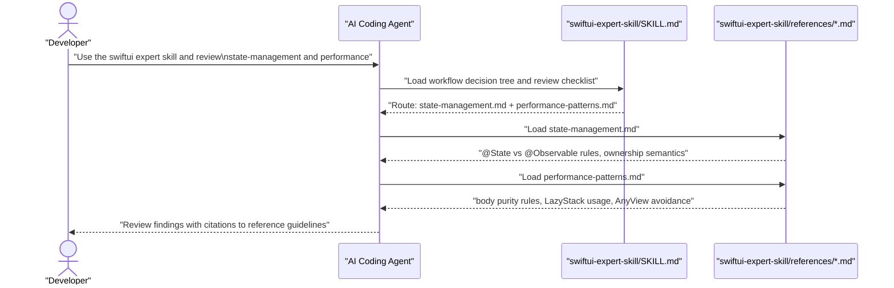

Sources: [README.md:17-82](), [.claude-plugin/plugin.json:24-26]()

---

## Relationship Between Installation Options and Repository Files

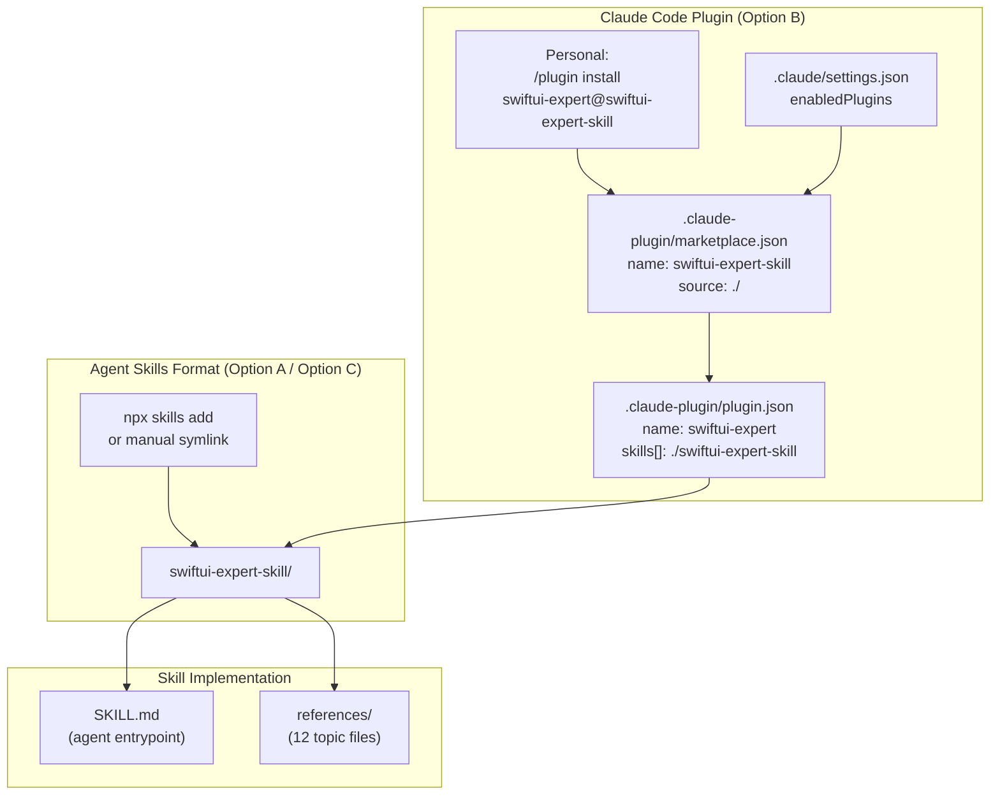

Sources: [README.md:19-82](), [.claude-plugin/plugin.json:1-27](), [.claude-plugin/marketplace.json:1-45]()

---

# Page: SwiftUI Reference Content

# SwiftUI Reference Content

<details>
<summary>Relevant source files</summary>

The following files were used as context for generating this wiki page:

- [README.md](README.md)
- [swiftui-expert-skill/SKILL.md](swiftui-expert-skill/SKILL.md)

</details>


This page is the index for the full SwiftUI knowledge base inside this repository. It covers how `SKILL.md` acts as a dispatch layer, how it routes an agent to one of twelve topic-specific reference files, and what workflow mode governs the routing logic.

For implementation details of `SKILL.md`'s internal structure (YAML frontmatter, review checklist, property wrapper table), see [Skill Structure](#3.1).
For plugin registration and marketplace manifests, see [Claude Plugin Integration](#4).

---

## How Routing Works

`swiftui-expert-skill/SKILL.md` is the agent entrypoint. When an agent loads this skill, it reads a workflow decision tree that maps the task type to one or more reference files under `swiftui-expert-skill/references/`. The agent does not load all reference files — it loads only the ones relevant to the task.

**Dispatch diagram: SKILL.md to reference files**

```mermaid
graph TD
    SKILL["swiftui-expert-skill/SKILL.md"]

    subgraph state_data["State & Data Flow"]
        SM["references/state-management.md"]
    end

    subgraph ui["UI Components"]
        LP["references/list-patterns.md"]
        SP["references/scroll-patterns.md"]
        SNP["references/sheet-navigation-patterns.md"]
    end

    subgraph perf["Performance"]
        PP["references/performance-patterns.md"]
        IO["references/image-optimization.md"]
    end

    subgraph layout["Layout & Composition"]
        VS["references/view-structure.md"]
        LBP["references/layout-best-practices.md"]
    end

    subgraph anim["Animation"]
        AB["references/animation-basics.md"]
        AT["references/animation-transitions.md"]
        AA["references/animation-advanced.md"]
    end

    subgraph ios26["iOS 26+"]
        LG["references/liquid-glass.md"]
    end

    SKILL --> SM
    SKILL --> LP
    SKILL --> SP
    SKILL --> SNP
    SKILL --> PP
    SKILL --> IO
    SKILL --> VS
    SKILL --> LBP
    SKILL --> AB
    SKILL --> AT
    SKILL --> AA
    SKILL --> LG
```

Sources: [swiftui-expert-skill/SKILL.md:197-209](), [README.md:110-128]()

---

## Twelve Reference Files

Each file is a self-contained topic reference. The table below maps each file to the wiki sub-page that documents it in detail.

| File | One-Line Description | Wiki Page |
|---|---|---|
| `references/state-management.md` | Property wrapper selection, ownership semantics, `@Observable` vs legacy patterns | [3.2](#3.2) |
| `references/view-structure.md` | View extraction, view identity, modifier ordering, `@ViewBuilder` conventions | [3.3](#3.3) |
| `references/performance-patterns.md` | Body purity, `LazyVStack`/`LazyHStack`, `Self._printChanges()`, update fan-out reduction | [3.4](#3.4) |
| `references/list-patterns.md` | `ForEach` stable identity, `Identifiable`, `.indices` risks, `AnyView` avoidance | [3.5](#3.5) |
| `references/sheet-navigation-patterns.md` | `.sheet(item:)`, `@Environment(\.dismiss)`, `NavigationStack`, `NavigationPath` | [3.6](#3.6) |
| `references/scroll-patterns.md` | `ScrollViewReader`, `proxy.scrollTo`, `scrollTargetBehavior`, `PreferenceKey` threshold tracking | [3.7](#3.7) |
| `references/layout-best-practices.md` | `GeometryReader`, `containerRelativeFrame()`, context-agnostic views, logic separation | [3.8](#3.8) |
| `references/animation-basics.md` | `.animation(_:value:)`, `withAnimation`, timing curves | [3.9.1](#3.9.1) |
| `references/animation-transitions.md` | `AnyTransition`, asymmetric transitions, `Animatable` protocol | [3.9.2](#3.9.2) |
| `references/animation-advanced.md` | `Transaction`, `phaseAnimator`, `keyframeAnimator`, completion handlers | [3.9.3](#3.9.3) |
| `references/image-optimization.md` | `AsyncImage` phase handling, off-main-thread downsampling, SF Symbol rendering | [3.10](#3.10) |
| `references/liquid-glass.md` | `.glassEffect`, `GlassEffectContainer`, `glassEffectID`, iOS 26+ availability gating | [3.11](#3.11) |

Sources: [swiftui-expert-skill/SKILL.md:197-209](), [README.md:110-128]()

---

## Three Workflow Modes

`SKILL.md` defines three named workflows. Each routes the agent to a different subset of reference files based on task intent.

**Workflow routing diagram**

```mermaid
flowchart TD
    Task["Agent receives task"]

    Task --> W1["Workflow 1: Review existing code"]
    Task --> W2["Workflow 2: Improve existing code"]
    Task --> W3["Workflow 3: Implement new feature"]

    W1 --> R1A["references/state-management.md"]
    W1 --> R1B["references/view-structure.md"]
    W1 --> R1C["references/performance-patterns.md"]
    W1 --> R1D["references/list-patterns.md"]
    W1 --> R1E["references/animation-basics.md"]
    W1 --> R1F["references/animation-transitions.md"]
    W1 --> R1G["references/liquid-glass.md"]

    W2 --> R2A["references/state-management.md"]
    W2 --> R2B["references/view-structure.md"]
    W2 --> R2C["references/performance-patterns.md"]
    W2 --> R2D["references/list-patterns.md"]
    W2 --> R2E["references/animation-basics.md"]
    W2 --> R2F["references/animation-transitions.md"]
    W2 --> R2G["references/image-optimization.md"]

    W3 --> R3A["references/state-management.md"]
    W3 --> R3B["references/view-structure.md"]
    W3 --> R3C["references/layout-best-practices.md"]
    W3 --> R3D["references/animation-basics.md"]
    W3 --> R3E["references/animation-transitions.md"]
    W3 --> R3F["references/animation-advanced.md"]
    W3 --> R3G["references/liquid-glass.md"]
```

Sources: [swiftui-expert-skill/SKILL.md:12-37]()

### Workflow 1: Review Existing Code

Triggered when the user asks the agent to audit or inspect existing SwiftUI code.

Steps defined in `SKILL.md` [swiftui-expert-skill/SKILL.md:13-20]():

1. Check property wrapper usage → `references/state-management.md`
2. Verify view composition rules → `references/view-structure.md`
3. Check performance patterns → `references/performance-patterns.md`
4. Verify list identity stability → `references/list-patterns.md`
5. Check animation patterns → `references/animation-basics.md`, `references/animation-transitions.md`
6. Inspect Liquid Glass usage → `references/liquid-glass.md`
7. Validate `#available` gating for iOS 26+

### Workflow 2: Improve Existing Code

Triggered when the user asks the agent to refactor or optimize existing SwiftUI code.

Steps defined in `SKILL.md` [swiftui-expert-skill/SKILL.md:23-30]():

1. Audit state management → `references/state-management.md`
2. Extract complex views → `references/view-structure.md`
3. Refactor hot paths → `references/performance-patterns.md`
4. Ensure `ForEach` stable identity → `references/list-patterns.md`
5. Improve animation patterns → `references/animation-basics.md`, `references/animation-transitions.md`
6. Suggest image downsampling when `UIImage(data:)` is present → `references/image-optimization.md`
7. Liquid Glass adoption only if explicitly requested by the user

### Workflow 3: Implement New Feature

Triggered when the user asks the agent to build a new SwiftUI view or feature from scratch.

Steps defined in `SKILL.md` [swiftui-expert-skill/SKILL.md:32-37]():

1. Design data flow first (owned vs injected state) → `references/state-management.md`
2. Structure for optimal diffing → `references/view-structure.md`
3. Keep business logic in services/models → `references/layout-best-practices.md`
4. Use correct animation patterns → `references/animation-basics.md`, `references/animation-transitions.md`, `references/animation-advanced.md`
5. Apply glass effects after layout/appearance modifiers → `references/liquid-glass.md`
6. Gate iOS 26+ features with `#available` and provide fallbacks

---

## Reference Coverage by Domain

The following table shows which reference files are consulted in each workflow mode.

| Reference File | Review | Improve | Implement |
|---|:---:|:---:|:---:|
| `state-management.md` | ✓ | ✓ | ✓ |
| `view-structure.md` | ✓ | ✓ | ✓ |
| `performance-patterns.md` | ✓ | ✓ | |
| `list-patterns.md` | ✓ | ✓ | |
| `animation-basics.md` | ✓ | ✓ | ✓ |
| `animation-transitions.md` | ✓ | ✓ | ✓ |
| `animation-advanced.md` | | | ✓ |
| `layout-best-practices.md` | | | ✓ |
| `image-optimization.md` | | ✓ (conditional) | |
| `liquid-glass.md` | ✓ | ✓ (on request) | ✓ |
| `sheet-navigation-patterns.md` | (via checklist) | | |
| `scroll-patterns.md` | (via checklist) | | |

Sources: [swiftui-expert-skill/SKILL.md:12-37](), [swiftui-expert-skill/SKILL.md:135-195]()

---

## Review Checklist Sections

In addition to the workflow decision tree, `SKILL.md` contains a structured review checklist [swiftui-expert-skill/SKILL.md:135-195]() that the agent applies during code review. The checklist is organized into the following sections, each of which cross-references the relevant reference file:

| Checklist Section | Reference File |
|---|---|
| State Management | `references/state-management.md` |
| Sheets & Navigation | `references/sheet-navigation-patterns.md` |
| ScrollView | `references/scroll-patterns.md` |
| View Structure | `references/view-structure.md` |
| Performance | `references/performance-patterns.md` |
| List Patterns | `references/list-patterns.md` |
| Layout | `references/layout-best-practices.md` |
| Animations | `references/animation-basics.md`, `references/animation-transitions.md`, `references/animation-advanced.md` |
| Liquid Glass (iOS 26+) | `references/liquid-glass.md` |

The checklist provides concrete boolean assertions (e.g., `@State` properties are `private`, `ForEach` uses stable identity, `#available(iOS 26, *)` is present for glass effects) that an agent can evaluate against any given view file.

Sources: [swiftui-expert-skill/SKILL.md:135-195]()

---

# Page: Skill Structure

# Skill Structure

<details>
<summary>Relevant source files</summary>

The following files were used as context for generating this wiki page:

- [.github/copilot-instructions.md](.github/copilot-instructions.md)
- [swiftui-expert-skill/SKILL.md](swiftui-expert-skill/SKILL.md)

</details>


This page documents the internal structure of `swiftui-expert-skill/SKILL.md` — the primary entrypoint file that an AI agent loads when the SwiftUI expert skill is invoked. It covers the YAML frontmatter format, the three workflow decision trees, the core guideline sections, the quick-reference table, and the review checklist. It also explains the progressive disclosure model by which this file acts as a dispatch layer to the topic-specific reference files.

For an overview of the full knowledge base and how all reference files relate to each other, see [SwiftUI Reference Content](#3). For details on what each individual reference file contains, see pages [3.2](#3.2) through [3.11](#3.11).

---

## File Overview

`swiftui-expert-skill/SKILL.md` is the sole entrypoint into the skill. When an agent triggers the `swiftui-expert-skill`, this is the first (and sometimes only) file it reads. Everything else in the skill — the twelve reference files under `swiftui-expert-skill/references/` — is loaded on demand, based on routing instructions within this file.

The file is divided into six logical sections:

| Section | Purpose |
|---|---|
| YAML frontmatter | Machine-readable identity metadata |
| Workflow Decision Tree | Three task-type flows with explicit reference routing |
| Core Guidelines | Summarized rules for five major domains |
| Quick Reference | Property wrapper table and Liquid Glass code patterns |
| Review Checklist | Per-domain checkboxes for code review use |
| References | Canonical index of all twelve reference files |

Sources: [swiftui-expert-skill/SKILL.md:1-218]()

---

## YAML Frontmatter

The file begins with a YAML frontmatter block that provides machine-readable metadata required by the Agent Skills format.

[swiftui-expert-skill/SKILL.md:1-4]()

| Field | Value | Format Constraints |
|---|---|---|
| `name` | `swiftui-expert-skill` | Lowercase letters, numbers, hyphens only; ≤ 64 characters |
| `description` | Multi-clause statement of what the skill does and when to invoke it | Non-empty; ≤ 1024 characters; must state trigger conditions |

The `description` field is specifically designed to help an agent decide when to invoke this skill over others. It covers the three primary use cases: writing new SwiftUI code, reviewing existing code, and improving code quality. The `name` field serves as the skill's stable identifier used in `plugin.json` and `marketplace.json`.

Format compliance for these fields is enforced during code review by rules documented in `.github/copilot-instructions.md` (see [Contributing](#6)).

Sources: [swiftui-expert-skill/SKILL.md:1-4](), [.github/copilot-instructions.md:8-12]()

---

## Progressive Disclosure Model

The Agent Skills format organizes content into three levels, each loaded only when needed. `SKILL.md` operates as Levels 1 and 2; the `references/` directory is Level 3.

**Progressive Disclosure Architecture**

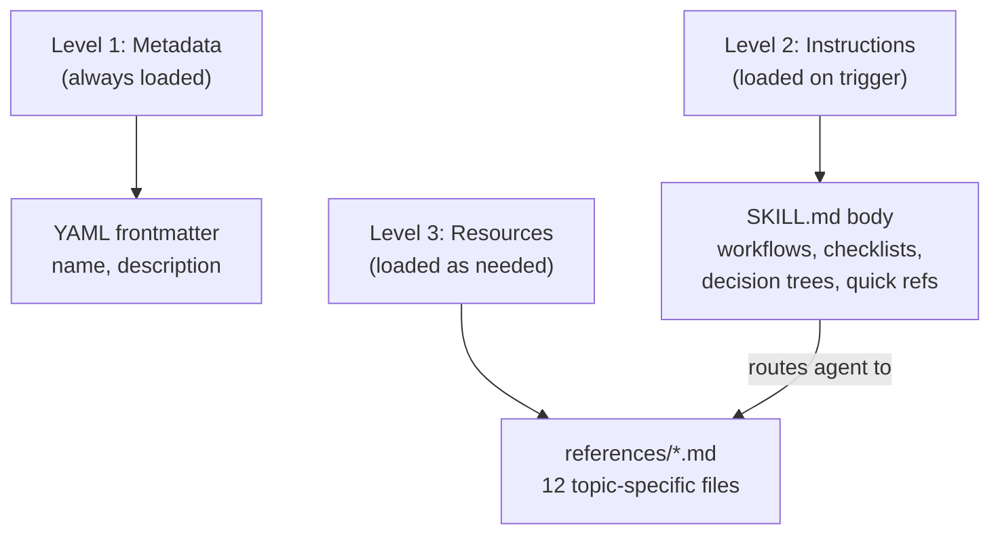

The design principle is that `SKILL.md` should never duplicate content from the reference files. It provides enough context for the agent to select the correct reference and delegates deep guidance to that file. This keeps the primary entrypoint short enough to load quickly while keeping detailed knowledge available on demand.

Sources: [.github/copilot-instructions.md:15-26](), [swiftui-expert-skill/SKILL.md:11-38]()

---

## Workflow Decision Trees

The `## Workflow Decision Tree` section ([swiftui-expert-skill/SKILL.md:11-38]()) defines three named task flows. Each flow lists the steps an agent should follow and explicitly routes to the relevant reference files for each step.

**Workflow Dispatch: SKILL.md to references/**

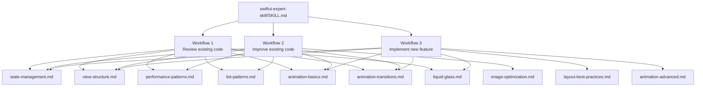

### Workflow 1 — Review Existing Code

[swiftui-expert-skill/SKILL.md:13-20]()

A sequential checklist guiding the agent to audit code across six dimensions: property wrapper correctness, view composition, performance patterns, list identity stability, animation correctness, and Liquid Glass usage. Each check references a specific file in `references/`.

### Workflow 2 — Improve Existing Code

[swiftui-expert-skill/SKILL.md:22-29]()

Mirrors Workflow 1 but is phrased as actionable improvements rather than audits. Notably includes a conditional step: image downsampling via `references/image-optimization.md` is listed as an **optional optimization**, not a mandatory fix. Liquid Glass adoption is only suggested **when explicitly requested by the user**.

### Workflow 3 — Implement New Feature

[swiftui-expert-skill/SKILL.md:31-37]()

Design-first flow that starts with data flow design (`references/state-management.md`) before touching UI structure. It introduces `references/animation-advanced.md` and `references/layout-best-practices.md`, which do not appear in the review flow. The `#available` gating requirement for iOS 26+ features appears as an explicit step here.

Sources: [swiftui-expert-skill/SKILL.md:11-38]()

---

## Core Guidelines

The `## Core Guidelines` section ([swiftui-expert-skill/SKILL.md:39-95]()) contains summarized, immediately actionable rules across five domains. These are **not** duplicates of the reference files — they are condensed rules an agent can apply without loading additional context.

### Domain Summary

| Domain | Key Rules Covered | Full Reference |
|---|---|---|
| State Management | `@State` privacy, `@Binding` intent, `@StateObject` vs `@ObservedObject`, iOS 17+ `@Observable` / `@Bindable` | `references/state-management.md` |
| View Composition | Subview extraction, modifier preference over conditionals, pure `body`, `@ViewBuilder` usage | `references/view-structure.md` |
| Performance | Dependency minimization, value-checking before state assignment, `LazyVStack`/`LazyHStack`, `AnyView` avoidance | `references/performance-patterns.md` |
| Animations | `.animation(_:value:)` with value param, `withAnimation` for events, transform vs layout, `phaseAnimator`, `keyframeAnimator` | `references/animation-basics.md`, `references/animation-advanced.md` |
| Liquid Glass (iOS 26+) | `glassEffect`, `GlassEffectContainer`, `.interactive()` scope, `glassEffectID` with `@Namespace` | `references/liquid-glass.md` |

The Liquid Glass section opens with a bolded opt-in rule: **Only adopt when explicitly requested by the user.** This is a behavioral instruction that constrains the agent's autonomy in applying these APIs.

Sources: [swiftui-expert-skill/SKILL.md:39-95]()

---

## Quick Reference

The `## Quick Reference` section ([swiftui-expert-skill/SKILL.md:96-133]()) contains two reference artifacts intended for fast lookup without navigating to a reference file.

### Property Wrapper Selection Table

[swiftui-expert-skill/SKILL.md:98-107]()

A two-column Markdown table mapping each property wrapper to its correct use case:

| Wrapper | Use When |
|---|---|
| `@State` | Internal view state (must be `private`) |
| `@Binding` | Child modifies parent's state |
| `@StateObject` | View owns an `ObservableObject` |
| `@ObservedObject` | View receives an `ObservableObject` |
| `@Bindable` | iOS 17+: Injected `@Observable` needing bindings |
| `let` | Read-only value from parent |
| `var` | Read-only value watched via `.onChange()` |

This table is the quickest decision aid available to an agent without loading `references/state-management.md`.

### Liquid Glass Patterns

[swiftui-expert-skill/SKILL.md:109-133]()

Three inline Swift code blocks demonstrating:
1. Basic `.glassEffect()` with a `#available(iOS 26, *)` gate and a `Material`-based fallback.
2. `GlassEffectContainer` wrapping multiple glass elements.
3. A `Button` using the `.glassProminent` button style.

These are the only inline code examples in the entire `SKILL.md` file — everything else delegates to reference files.

Sources: [swiftui-expert-skill/SKILL.md:96-133]()

---

## Review Checklist

The `## Review Checklist` section ([swiftui-expert-skill/SKILL.md:135-196]()) provides a set of domain-grouped checkboxes for use during code review. Each group includes a parenthetical citation pointing to the relevant reference file.

**Review Checklist Structure**

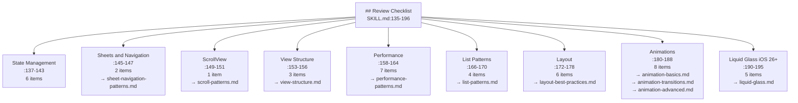

The checklist covers nine domains and 42 individual checks in total. Each item is directly traceable to a rule stated in the Core Guidelines section or in one of the reference files. The checklist is the primary tool used during **Workflow 1 (Review)**.

Sources: [swiftui-expert-skill/SKILL.md:135-196]()

---

## References Index

The `## References` section ([swiftui-expert-skill/SKILL.md:197-209]()) is a flat list of all twelve reference files with one-line descriptions. This section serves two purposes:

1. It provides a canonical, discoverable index so an agent can identify which file to load for any topic.
2. It ensures no reference file is orphaned — every file in `references/` must appear here to be reachable.

| Reference File | Topic |
|---|---|
| `references/state-management.md` | Property wrappers and data flow |
| `references/view-structure.md` | View composition, extraction, container patterns |
| `references/performance-patterns.md` | Performance optimization and anti-patterns |
| `references/list-patterns.md` | ForEach identity, stability, list best practices |
| `references/layout-best-practices.md` | Layout patterns, context-agnostic views, testability |
| `references/animation-basics.md` | Core animation, implicit/explicit, timing, performance |
| `references/animation-transitions.md` | Transitions, custom transitions, `Animatable` protocol |
| `references/animation-advanced.md` | Transactions, phase/keyframe animations, completion handlers |
| `references/sheet-navigation-patterns.md` | Sheet presentation and navigation patterns |
| `references/scroll-patterns.md` | ScrollView patterns and programmatic scrolling |
| `references/image-optimization.md` | AsyncImage, image downsampling, optimization |
| `references/liquid-glass.md` | iOS 26+ Liquid Glass API |

Sources: [swiftui-expert-skill/SKILL.md:197-209]()

---

## Philosophy Statement

The final section, `## Philosophy` ([swiftui-expert-skill/SKILL.md:211-218]()), is a brief behavioral constraint that scopes the skill's content decisions:

- No enforcement of specific architectures (MVVM, VIPER, etc.)
- Encourages business logic separation for testability, not as an architectural mandate
- Optimizes for performance and maintainability
- Follows Apple's Human Interface Guidelines and API design patterns

This philosophy directly informs which types of content are permitted in the reference files, as enforced by the review rules in `.github/copilot-instructions.md`. See [Contributing](#6) for how these constraints are applied during pull request review.

Sources: [swiftui-expert-skill/SKILL.md:211-218](), [.github/copilot-instructions.md:28-34]()

---

# Page: State Management

# State Management

<details>
<summary>Relevant source files</summary>

The following files were used as context for generating this wiki page:

- [swiftui-expert-skill/SKILL.md](swiftui-expert-skill/SKILL.md)
- [swiftui-expert-skill/references/state-management.md](swiftui-expert-skill/references/state-management.md)

</details>


This page documents all SwiftUI state management patterns, property wrapper selection rules, ownership semantics, modern iOS 17+ patterns versus legacy patterns, thread safety with `@MainActor`, the nested `ObservableObject` limitation, and state privacy rules.

For performance considerations that interact with state (e.g., minimizing update fan-out), see [Performance Patterns](#3.4). For how `SKILL.md` routes the agent to this reference, see [Skill Structure](#3.1).

---

## Property Wrapper Overview

The following table summarizes every property wrapper relevant to SwiftUI state management, organized by era and ownership role.

| Wrapper | Era | Ownership | Use When |
|---|---|---|---|
| `@State` | All | Owned | Internal view state that triggers UI updates |
| `@Binding` | All | Borrowed | Child view needs to **modify** parent's state |
| `@FocusState` | All | Owned | Controlling keyboard focus for text fields |
| `let` | All | N/A | Read-only value passed from parent |
| `var` | All | N/A | Read-only value, reacted to via `.onChange()` |
| `@Bindable` | iOS 17+ | Borrowed | Received `@Observable` object that needs bindings |
| `@StateObject` | Legacy | Owned | View creates and owns an `ObservableObject` |
| `@ObservedObject` | Legacy | Borrowed | View receives an `ObservableObject` from outside |
| `@Environment` | All | Borrowed | Accessing environment values or injected `@Observable` |
| `@EnvironmentObject` | Legacy | Borrowed | Accessing `ObservableObject` injected via `.environmentObject()` |

Sources: [swiftui-expert-skill/references/state-management.md:1-17]()

---

## Decision Flowchart

**Diagram: Property Wrapper Selection**

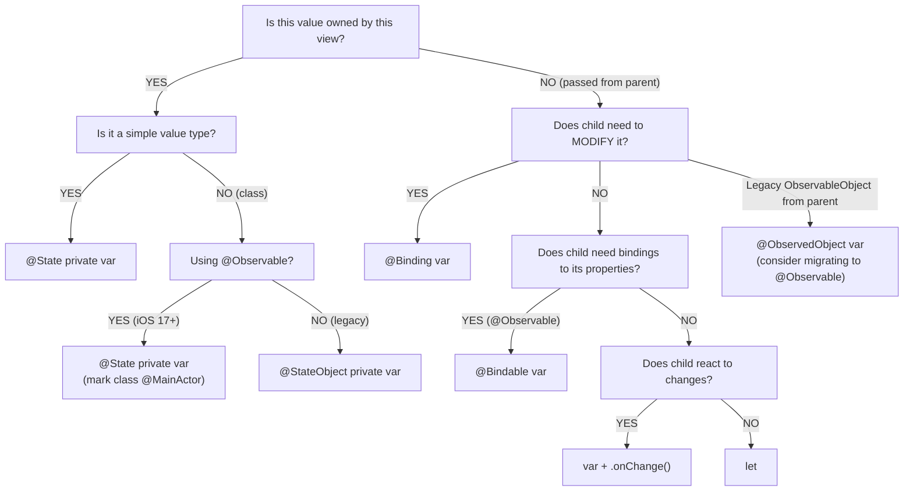

Sources: [swiftui-expert-skill/references/state-management.md:426-447]()

---

## @State

`@State` is for internal view state: values the view creates, owns, and updates itself.

**Rules:**
- Always mark `@State` as `private`.
- Use `@State` with `@Observable` classes on iOS 17+ — do **not** use `@StateObject` for these.
- Never declare a value passed from a parent as `@State` (see [Don't Pass Values as @State](#dont-pass-values-as-state)).

The `private` modifier is not just style. It prevents the property from appearing in the synthesized initializer, which blocks the common bug of passing an initial value that will be silently ignored after first render.

Sources: [swiftui-expert-skill/references/state-management.md:19-53]()

---

## @Observable and @MainActor (iOS 17+)

The `@Observable` macro (iOS 17+) is the preferred replacement for `ObservableObject`. When using it:

- Declare the model with `@Observable` on the class.
- Mark the class `@MainActor` to ensure thread safety with SwiftUI's rendering system.
- Use `@State` (not `@StateObject`) to own the instance inside a view.

The `@MainActor` annotation is redundant only if the project or package already sets Default Actor Isolation to `MainActor` globally.

**Diagram: @Observable Ownership and Binding Chain**

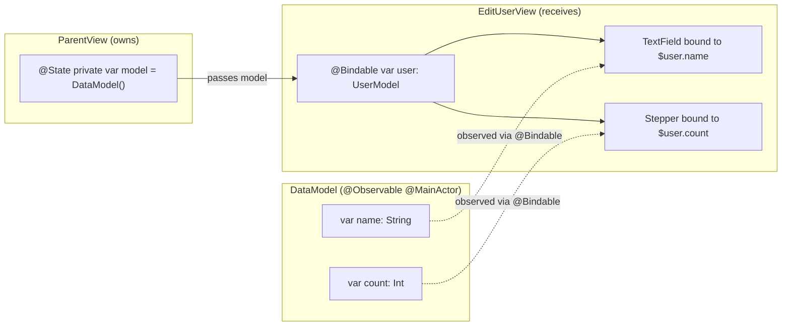

Sources: [swiftui-expert-skill/references/state-management.md:31-55](), [swiftui-expert-skill/references/state-management.md:303-331]()

---

## @Binding

Use `@Binding` only when the child view needs to **write** to the parent's state. If the child only reads a value, use `let`.

| Situation | Correct Pattern |
|---|---|
| Child displays a value, never modifies it | `let title: String` |
| Child modifies a value owned by the parent | `@Binding var isSelected: Bool` |
| Child creates bindings to properties of an `@Observable` object | `@Bindable var user: UserModel` |

Sources: [swiftui-expert-skill/references/state-management.md:57-101]()

---

## @Bindable (iOS 17+)

`@Bindable` is used when a view **receives** an `@Observable` object from outside and needs to create `$`-prefixed bindings to its properties (e.g., for `TextField`, `Toggle`, etc.).

It is distinct from `@Binding`:
- `@Binding` wraps a single value.
- `@Bindable` wraps an `@Observable` reference type, enabling per-property bindings.

Sources: [swiftui-expert-skill/references/state-management.md:302-331]()

---

## @FocusState

`@FocusState` controls keyboard focus for text input fields.

**Choosing the type:**

| Scenario | Type | Notes |
|---|---|---|
| Single focusable field | `Bool` | Simple; toggle on/off |
| Multiple fields | `Field?` (a `Hashable` enum) | Type-safe, readable transitions |

When multiple fields are present, define a nested `Hashable` enum (e.g., `Field`) with one case per focusable field. Use `.focused($focusedField, equals: .name)` to bind each field.

**Diagram: @FocusState Enum Flow**

```mermaid
stateDiagram-v2
    direction LR
    [*] --> "nil (no focus)"
    "nil (no focus)" --> ".name": "onAppear / tap"
    ".name" --> ".email": "Next button"
    ".email" --> ".password": "Next button"
    ".password" --> "nil (no focus)": "Next button (done)"
    "nil (no focus)" --> [*]
```

Sources: [swiftui-expert-skill/references/state-management.md:103-169]()

---

## @StateObject vs @ObservedObject (Legacy)

These wrappers apply to `ObservableObject` (the pre-iOS 17 protocol). The distinction is purely about **ownership**:

- `@StateObject`: The view **creates** the object. SwiftUI retains it across re-renders.
- `@ObservedObject`: The view **receives** the object from outside. SwiftUI does not retain it.

**Critical mistake — never do this:**

```
// @ObservedObject var viewModel = MyViewModel()  ← creates new instance on every update
```

Always use `@StateObject` for objects the view owns, and receive objects from outside via `@ObservedObject`.

**Diagram: Ownership Split — StateObject vs ObservedObject**

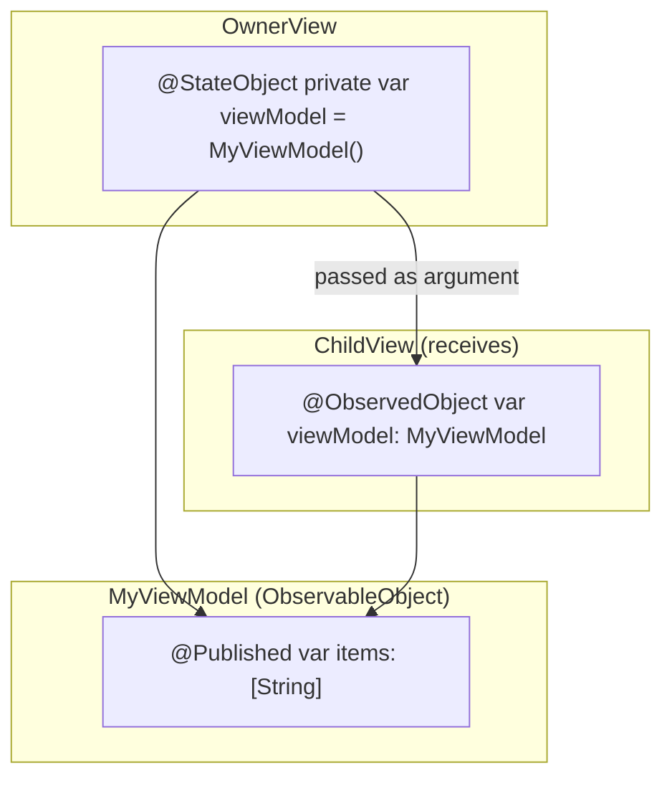

Sources: [swiftui-expert-skill/references/state-management.md:171-258]()

### @StateObject in Custom Initializer

When a `@StateObject` must be initialized with parameters in a custom `init`, use `StateObject(wrappedValue:)` with an inline expression. This leverages Swift's `@autoclosure` behavior to prevent redundant allocations:

[swiftui-expert-skill/references/state-management.md:221-258]()

The wrong pattern (`let viewModel = ...; _viewModel = StateObject(wrappedValue: viewModel)`) allocates a new instance every time SwiftUI evaluates the initializer for structural identity checks. The correct pattern passes the expression directly to `StateObject(wrappedValue:)`.

Sources: [swiftui-expert-skill/references/state-management.md:221-261]()

---

## Don't Pass Values as @State

`@State` and `@StateObject` retain their value across view updates. This means: when a parent passes a new value to a child that declared it as `@State`, the child ignores the update — it only uses the value at first creation.

**Prevention rule:** Always mark `@State` and `@StateObject` as `private`. This removes them from the generated initializer, making it impossible to accidentally pass a value to them.

Sources: [swiftui-expert-skill/references/state-management.md:262-300]()

---

## let vs var for Passed Values

| Pattern | When to Use |
|---|---|
| `let title: String` | Child displays or reads the value, never reacts to changes |
| `var externalValue: Int` + `.onChange()` | Child needs to react when the value changes |

`var` for passed values does not grant write access to the parent's state; it simply allows `.onChange(of:)` to fire. If write access is needed, use `@Binding`.

Sources: [swiftui-expert-skill/references/state-management.md:333-365]()

---

## @Environment and @EnvironmentObject

### @Environment (System Values and iOS 17+ Observable Injection)

`@Environment` reads values provided by SwiftUI's system or by parent views. On iOS 17+, it is also the preferred way to inject `@Observable` objects into a subtree.

```
// Inject at root:  ContentView().environment(AppState())
// Access in child: @Environment(AppState.self) private var appState
```

### @EnvironmentObject (Legacy)

`@EnvironmentObject` is the pre-iOS 17 equivalent for `ObservableObject`. Inject with `.environmentObject(_:)`, access with `@EnvironmentObject var appState: AppState`. Prefer the `@Observable` + `@Environment` pattern for new code.

**Diagram: Environment Injection Paths**

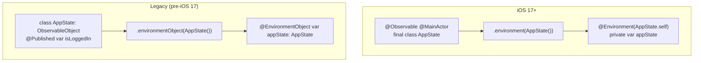

Sources: [swiftui-expert-skill/references/state-management.md:367-424]()

---

## Nested ObservableObject Problem

`ObservableObject` does not propagate changes through nested `ObservableObject` properties. SwiftUI only observes top-level `@Published` changes on the parent; changes deep inside a nested child object go undetected.

**The limitation:**
- A `Parent: ObservableObject` that holds a `@Published var child: Child` (where `Child: ObservableObject`) will not trigger view updates when `child.value` changes.

**Workaround:** Pass the nested object directly to the child view using `@ObservedObject`.

**Note:** This limitation is specific to `ObservableObject`. `@Observable` fully supports nested observed objects — no workaround is needed.

**Diagram: Nested ObservableObject — Problem and Workaround**

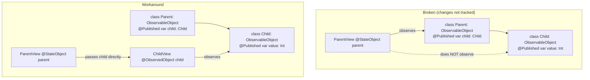

Sources: [swiftui-expert-skill/references/state-management.md:475-507]()

---

## State Privacy Rules

All view-owned state must be `private`. Injected or passed values must not be `private`.

| Property Kind | Private? | Examples |
|---|---|---|
| Created by the view | Yes | `@State`, `@StateObject`, `@AppStorage`, `@Environment` |
| Passed from parent | No | `let title`, `@Binding var isSelected`, `@Bindable var user` |

This convention makes the public API of a view (its initializer parameters) immediately readable, and prevents callers from accidentally supplying initial values to state properties that will be ignored.

Sources: [swiftui-expert-skill/references/state-management.md:449-473]()

---

## Key Principles Summary

1. **Prefer `@Observable` over `ObservableObject`** for all new code.
2. **Mark `@Observable` classes with `@MainActor`** unless default actor isolation is already set project-wide.
3. Use `@State` (not `@StateObject`) with `@Observable` classes.
4. Use `@Bindable` for injected `@Observable` objects that need per-property bindings.
5. **Always mark `@State` and `@StateObject` as `private`.**
6. **Never declare a passed-in value as `@State` or `@StateObject`.**
7. With `@Observable`, nested objects work correctly. With `ObservableObject`, pass nested objects directly to child views via `@ObservedObject`.

Sources: [swiftui-expert-skill/references/state-management.md:509-518](), [swiftui-expert-skill/SKILL.md:42-48]()

---

# Page: View Composition & Structure

# View Composition & Structure

<details>
<summary>Relevant source files</summary>

The following files were used as context for generating this wiki page:

- [swiftui-expert-skill/SKILL.md](swiftui-expert-skill/SKILL.md)
- [swiftui-expert-skill/references/list-patterns.md](swiftui-expert-skill/references/list-patterns.md)
- [swiftui-expert-skill/references/performance-patterns.md](swiftui-expert-skill/references/performance-patterns.md)
- [swiftui-expert-skill/references/sheet-navigation-patterns.md](swiftui-expert-skill/references/sheet-navigation-patterns.md)
- [swiftui-expert-skill/references/view-structure.md](swiftui-expert-skill/references/view-structure.md)

</details>


This page documents SwiftUI best practices for composing, extracting, and structuring views. It covers view identity, modifier usage, struct extraction, container patterns, and layering choices. For performance techniques that go beyond view structure (lazy containers, state update optimization, debugging), see [Performance Patterns](#3.4). For layout sizing and `GeometryReader` usage, see [Layout Best Practices](#3.8).

---

## View Identity and the Diffing Algorithm

SwiftUI maintains a persistent view hierarchy and uses a **diffing algorithm** to determine which views need updating. A view's *identity* determines whether SwiftUI updates an existing view or destroys and recreates it.

Two kinds of identity exist:

| Identity Type | How It Works | Implication |
|---|---|---|
| **Structural identity** | Determined by position in the view hierarchy and type | Conditional branches (`if/else`) create distinct identity slots |
| **Explicit identity** | Set with `.id(_:)` modifier | Forces a new view when the value changes |

When a view is destroyed and recreated (identity changes), any `@State` stored in it is reset, animations are interrupted, and rendering cost increases. Proper composition avoids unnecessary identity changes.

**Sources:** [swiftui-expert-skill/references/view-structure.md:1-6]()

---

## Prefer Modifiers Over Conditional Views

When a condition controls *visibility or appearance* of the **same conceptual view**, use a no-effect modifier rather than branching the view tree.

### When to Use `.opacity` Instead of `if`

Conditional inclusion changes view identity. Modifier-based control preserves it.

[swiftui-expert-skill/references/view-structure.md:11-24]()

**Decision rule:**

```
Is this the same view in two different states?
  → YES: use a modifier (.opacity, .disabled, .foregroundStyle, etc.)
  → NO:  use a conditional (if/else, if let)
```

### When Conditionals Are Correct

[swiftui-expert-skill/references/view-structure.md:26-42]()

Use `if`/`else` or `if let` when the branches represent **fundamentally different views** — different types, different semantic content, or content that should not retain state across the transition.

**Decision diagram: Conditional vs. Modifier**

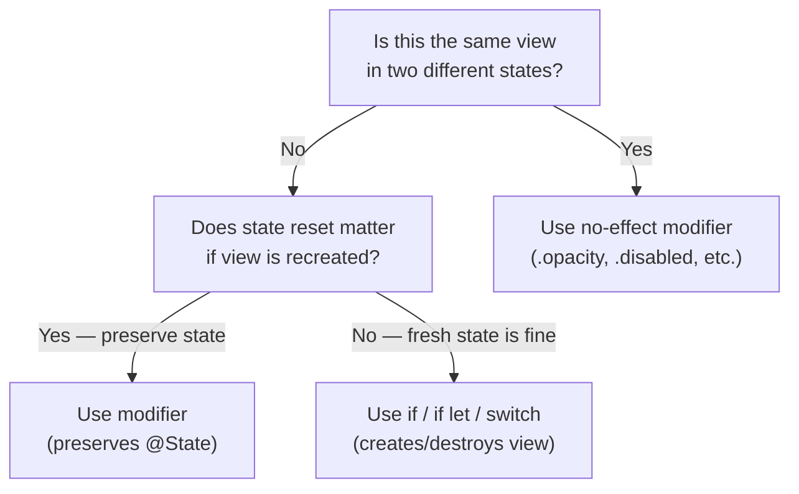

**Sources:** [swiftui-expert-skill/references/view-structure.md:8-42](), [swiftui-expert-skill/SKILL.md:52-53]()

---

## Struct Extraction vs. `@ViewBuilder` Computed Properties

### Why `@ViewBuilder` Functions Cause Unnecessary Work

A `@ViewBuilder` function or computed property **is part of the parent view**. When the parent's `body` re-executes, the function re-executes unconditionally — SwiftUI has no way to skip it.

[swiftui-expert-skill/references/view-structure.md:44-74]()

### Why Separate Structs Can Be Skipped

A separate `struct` conforming to `View` is an independent node in the diffing graph. SwiftUI compares the struct's stored properties before calling `body`. If the struct has no changed inputs, `body` is never called.

[swiftui-expert-skill/references/view-structure.md:76-112]()

**Struct skipping mechanism:**

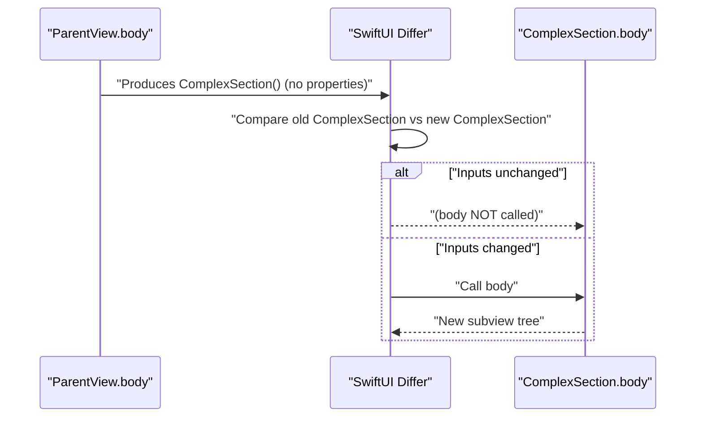

**Sources:** [swiftui-expert-skill/references/view-structure.md:44-112]()

### When `@ViewBuilder` Functions Are Acceptable

Use `@ViewBuilder` functions or computed properties when:

- The section is **small** (few views, no expensive rendering)
- The section contains **no independent state** to isolate
- Re-execution on every parent update is negligible in cost

[swiftui-expert-skill/references/view-structure.md:114-146]()

### Extraction Criteria

Extract to a separate `struct` when any of these apply:

| Condition | Extract to struct? |
|---|---|
| View has multiple logical sections | Yes |
| View contains reusable components | Yes |
| `body` is hard to read | Yes |
| Inputs are independent of parent state | Yes (enables skipping) |
| View is small and stateless | No — `@ViewBuilder` is fine |

[swiftui-expert-skill/references/view-structure.md:148-155]()

---

## Container View Pattern

A container view accepts child content through a generic parameter. The storage type of that content determines whether SwiftUI can diff it.

### Closure-Based Content (Avoid)

Closures cannot be compared for equality. SwiftUI must always call the closure and evaluate its result, preventing any skip optimization.

[swiftui-expert-skill/references/view-structure.md:157-180]()

### `@ViewBuilder let content: Content` (Prefer)

Declaring content as a stored `@ViewBuilder` property of type `Content` (a `View` conforming generic) gives SwiftUI a concrete value it can compare. If the content value is unchanged, SwiftUI can skip rendering it.

[swiftui-expert-skill/references/view-structure.md:182-201]()

**Container pattern comparison:**

```mermaid
flowchart LR
    subgraph bad["Closure-based (avoid)"]
        BC["let content: () -> Content"]
        BCR["content() — always called"]
        BC --> BCR
    end

    subgraph good["@ViewBuilder stored property (prefer)"]
        GC["@ViewBuilder let content: Content"]
        GCR["content — diffable, skippable"]
        GC --> GCR
    end
```

**Sources:** [swiftui-expert-skill/references/view-structure.md:157-201](), [swiftui-expert-skill/SKILL.md:55]()

---

## `ZStack` vs. `overlay` / `background`

Both approaches layer views, but they differ in **layout participation** and **intent expression**.

| Aspect | `overlay` / `background` | `ZStack` |
|---|---|---|
| Layout anchor | Primary view is the anchor; decorator adopts its size | Each child participates independently |
| Implicit size inheritance | Yes — child adopts parent's proposed size | No |
| Expresses intent | Decoration of a primary view | Peer composition |
| When to use | Badges, icons, borders, fill patterns | Multiple peers jointly defining layout |

[swiftui-expert-skill/references/view-structure.md:203-214]()

### Choosing the Right Layering Construct

```mermaid
flowchart TD
    Q1["Is there a clear primary view\nbeing decorated?"]
    Q2["Should the decoration\naffect layout sizing?"]
    A1["Use overlay / background\n(expresses decorative intent)"]
    A2["Use ZStack\n(explicit size participation needed)"]
    A3["Use ZStack\n(peer composition, joint layout)"]

    Q1 -->|"Yes"| Q2
    Q1 -->|"No — peers of equal weight"| A3
    Q2 -->|"No — decoration only"| A1
    Q2 -->|"Yes — must reserve space"| A2
```

### Key Behavioral Difference

In `overlay` and `background`, the child view that lacks an explicit size adopts the size proposed to the **parent**. In `ZStack`, no such inheritance occurs — each child sizes itself independently.

[swiftui-expert-skill/references/view-structure.md:210-214]()

**Sources:** [swiftui-expert-skill/references/view-structure.md:203-267]()

---

## Avoiding Side Effects in `body`

The `body` property must be **pure**: it should only read state and return a view description. It must not:

- Dispatch async work (use `.task` or `.onAppear` instead)
- Mutate state (triggers re-entrant re-renders)
- Create expensive objects (recreated on every evaluation)
- Contain complex business logic (belongs in services/models)

From `SKILL.md` [swiftui-expert-skill/SKILL.md:53]():

> Keep view `body` simple and pure (no side effects or complex logic)

Action handlers should call methods rather than contain inline logic. Business logic belongs in `@Observable` or `ObservableObject` service classes, not in view structs.

**Sources:** [swiftui-expert-skill/SKILL.md:50-58]()

---

## Code Entity Map

The following diagram maps the primary code constructs discussed in this page to their roles in SwiftUI's view composition model.

```mermaid
graph TD
    subgraph "View Struct (struct ... View)"
        body["body: some View"]
        state["@State / @Binding"]
        body --> state
    end

    subgraph "Extraction Targets"
        sep["Separate struct View\n(diffable, skippable)"]
        vb["@ViewBuilder func\n(part of parent, not skippable)"]
    end

    subgraph "Modifiers"
        opacity[".opacity(_:)"]
        overlay[".overlay(alignment:content:)"]
        background[".background(content:)"]
    end

    subgraph "Layering"
        ZStack["ZStack\n(peer composition)"]
        overlayMod[".overlay / .background\n(decoration)"]
    end

    subgraph "Container Pattern"
        closure["let content: () -> Content\n(closure — not diffable)"]
        stored["@ViewBuilder let content: Content\n(stored — diffable)"]
    end

    body -->|"complex section"| sep
    body -->|"simple section"| vb
    body -->|"same view, different state"| opacity
    body -->|"decorate primary view"| overlay
    body -->|"decorate primary view"| background
    body -->|"peer layers"| ZStack
    body -->|"accepts child content"| stored
```

**Sources:** [swiftui-expert-skill/references/view-structure.md:1-276](), [swiftui-expert-skill/SKILL.md:50-58]()

---

## Review Checklist

This checklist mirrors the View Structure section of `SKILL.md` [swiftui-expert-skill/SKILL.md:152-156]():

- [ ] Modifiers used instead of conditionals for state-only changes
- [ ] Complex views extracted to separate `struct` types
- [ ] `@ViewBuilder` functions only used for small, simple sections
- [ ] Container views declare `@ViewBuilder let content: Content`, not `() -> Content`
- [ ] `overlay` / `background` preferred over `ZStack` for decoration
- [ ] `ZStack` used only when peer views jointly define layout
- [ ] `body` contains no side effects, no object creation, no business logic

**Sources:** [swiftui-expert-skill/references/view-structure.md:269-276](), [swiftui-expert-skill/SKILL.md:152-156]()

---

# Page: Performance Patterns

# Performance Patterns

<details>
<summary>Relevant source files</summary>

The following files were used as context for generating this wiki page:

- [swiftui-expert-skill/SKILL.md](swiftui-expert-skill/SKILL.md)
- [swiftui-expert-skill/references/list-patterns.md](swiftui-expert-skill/references/list-patterns.md)
- [swiftui-expert-skill/references/performance-patterns.md](swiftui-expert-skill/references/performance-patterns.md)
- [swiftui-expert-skill/references/sheet-navigation-patterns.md](swiftui-expert-skill/references/sheet-navigation-patterns.md)
- [swiftui-expert-skill/references/view-structure.md](swiftui-expert-skill/references/view-structure.md)

</details>


This page documents the SwiftUI performance techniques encoded in `swiftui-expert-skill/references/performance-patterns.md`. It covers how to reduce unnecessary view updates, structure state dependencies correctly, defer work to avoid blocking the render cycle, and diagnose regressions.

For related topics that affect performance indirectly: view extraction rules are in [View Composition & Structure (3.3)](#3.3), list-specific identity rules are in [List Patterns (3.5)](#3.5), and layout costs from `GeometryReader` nesting are in [Layout Best Practices (3.8)](#3.8).

---

## How SwiftUI Decides to Redraw

SwiftUI re-evaluates a view's `body` when any input it tracks changes. The diffing strategy varies by view type:

**Diffing Algorithm by View Type**

```mermaid
flowchart TD
    A["Parent state changes"] --> B{"Is child a POD view?\n(no property wrappers,\nonly value types)"}
    B -->|"Yes"| C["memcmp comparison\n(fastest path)"]
    B -->|"No"| D{"Does view conform\nto Equatable?"}
    D -->|"Yes + .equatable()"| E["Custom == operator\ncalled"]
    D -->|"No"| F["Reflection-based\ncomparison"]
    C -->|"Equal"| G["body SKIPPED"]
    E -->|"Equal"| G
    F -->|"Always proceeds\nto body"| H["body CALLED"]
    C -->|"Not equal"| H
    E -->|"Not equal"| H
```

Sources: [swiftui-expert-skill/references/performance-patterns.md:107-155]()

---

## Core Principles

The ten numbered techniques in `performance-patterns.md` fall into four categories:

| Category | Techniques | Goal |
|---|---|---|
| Eliminate unnecessary work | Avoid redundant state updates, eliminate unnecessary dependencies | Fewer `body` calls |
| Reduce dependency surface | Pass only needed values, narrow state scope | Smaller update fan-out |
| Defer expensive work | `LazyVStack`/`LazyHStack`, `.task` modifier | On-demand rendering |
| Optimize diffing cost | POD views, `Equatable` conformance | Faster equality checks |

---

## 1. Avoid Redundant State Updates

SwiftUI does not compare values before triggering a `body` re-evaluation when state is assigned. Assigning the same value unconditionally causes a needless redraw.

[swiftui-expert-skill/references/performance-patterns.md:7-20]()

Apply this guard in any `onReceive`, `onChange`, or scroll handler:

```
if self.currentValue != newValue {
    self.currentValue = newValue
}
```

**Hot paths** — scroll handlers, gesture recognizers, preference key callbacks — fire at very high frequency. Gate state changes behind threshold checks rather than updating on every event.

[swiftui-expert-skill/references/performance-patterns.md:23-39]()

The pattern for a scroll-driven title appearance:

```
// Only update when the boolean result changes, not on every offset value
let shouldShow = offset.y <= -32
if shouldShow != shouldShowTitle {
    shouldShowTitle = shouldShow
}
```

Sources: [swiftui-expert-skill/references/performance-patterns.md:5-39]()

---

## 2. Pass Only Required Values to Child Views

Passing an entire model object to a view that needs only one field creates a dependency on all fields in that object.

**Dependency surface comparison**

```mermaid
graph LR
    subgraph "Broad dependency (avoid)"
        AppConfig1["AppConfig\n(theme, fontSize, notifications)"] --> ThemeSelector1["ThemeSelector(config:)"]
        AppConfig1 --> FontSizeSlider1["FontSizeSlider(config:)"]
    end

    subgraph "Narrow dependency (prefer)"
        AppConfig2["AppConfig\n(theme, fontSize, notifications)"]
        AppConfig2 -->|"config.theme"| ThemeSelector2["ThemeSelector(theme:)"]
        AppConfig2 -->|"config.fontSize"| FontSizeSlider2["FontSizeSlider(fontSize:)"]
    end
```

With `ObservableObject`, any `@Published` change triggers all observers of the object. With `@Observable`, the runtime tracks which properties are accessed during `body`, but passing an entire model object still gives the view access to — and therefore a dependency on — more than it needs.

Rule: **pass the specific scalar or value each child view actually reads**.

Sources: [swiftui-expert-skill/references/performance-patterns.md:42-80](), [swiftui-expert-skill/SKILL.md:61-62]()

---

## 3. Keep `body` Pure

`body` should be a **pure, side-effect-free** structural description of state. Any work placed inside `body` runs every time the view is re-evaluated.

### Creating Objects in `body`

Reference types (e.g., `DateFormatter`, `NumberFormatter`) allocated inside `body` are discarded and recreated on every render. Move them to `static` stored properties.

[swiftui-expert-skill/references/performance-patterns.md:274-295]()

```
// Pattern: static stored formatter
private static let dateFormatter: DateFormatter = { ... }()
```

### Heavy Computation in `body`

Sorting, filtering, and other O(n) operations in `body` re-run on every update.

[swiftui-expert-skill/references/performance-patterns.md:297-350]()

Three approaches, in increasing order of correctness:

| Approach | Mechanism |
|---|---|
| `@State` + `.onChange` | Store sorted result; recompute only when source changes |
| Computed property on `@Observable` model | Computed on model, accessed reactively via `@Observable` tracking |
| Model method (`loadItems`) + `.task` | Async fetch; model owns data lifecycle |

### Unnecessary Stored State

Derived values should be computed properties, not stored `@State`. Storing `itemCount` separately from `items` requires manual synchronization and doubles the update surface.

[swiftui-expert-skill/references/performance-patterns.md:352-363]()

Sources: [swiftui-expert-skill/references/performance-patterns.md:273-363](), [swiftui-expert-skill/SKILL.md:53-54]()

---

## 4. Equatable Conformance for Expensive Views

For views with expensive `body` implementations, conform to `Equatable` and apply the `.equatable()` modifier. SwiftUI will call your `==` operator before evaluating `body`.

[swiftui-expert-skill/references/performance-patterns.md:83-104]()

```
struct ExpensiveView: View, Equatable {
    static func == (lhs: Self, rhs: Self) -> Bool {
        lhs.data.id == rhs.data.id
    }
    ...
}
// At call site:
ExpensiveView(data: data).equatable()
```

**Caution**: When you add new stored properties or dependencies to the view, the `==` function must be updated to include them. Stale equality implementations cause missed updates.

Sources: [swiftui-expert-skill/references/performance-patterns.md:83-104]()

---

## 5. POD Views for Fast Diffing

A **POD (Plain Old Data) view** contains only simple value types and no property wrappers. SwiftUI uses `memcmp` to compare POD views, which is significantly faster than reflection-based comparison.

[swiftui-expert-skill/references/performance-patterns.md:107-155]()

**POD wrapper pattern**

```mermaid
graph TD
    Parent["Parent view\nstate changes"] --> FastView["ExpensiveView\n(POD: only let value: Int)"]
    FastView -->|"memcmp: value unchanged"| Skip["body SKIPPED"]
    FastView -->|"memcmp: value changed"| Internal["ExpensiveViewInternal\n(@State private var item: Item?)"]
    Internal --> Body["body CALLED\n(expensive rendering)"]
```

The outer `ExpensiveView` is POD and uses fast `memcmp`. Only when `value` changes does `ExpensiveViewInternal` (which holds the `@State`) get re-evaluated.

This pattern is also closely related to the struct-extraction rule in [View Composition & Structure (3.3)](#3.3): extracted `struct` views with no changing inputs have their `body` skipped automatically.

Sources: [swiftui-expert-skill/references/performance-patterns.md:107-155](), [swiftui-expert-skill/references/view-structure.md:78-106]()

---

## 6. Lazy Loading with `LazyVStack` / `LazyHStack`

`VStack` and `HStack` inside a `ScrollView` create all child views immediately. `LazyVStack` and `LazyHStack` create views on demand as they scroll into the viewport.

[swiftui-expert-skill/references/performance-patterns.md:157-179]()

```mermaid
graph LR
    subgraph "Eager (avoid for large lists)"
        SV1["ScrollView"] --> VS1["VStack"]
        VS1 --> R1["Row 1 (created)"]
        VS1 --> R2["Row 2 (created)"]
        VS1 --> RN1["Row N (created)"]
    end

    subgraph "Lazy (use for large lists)"
        SV2["ScrollView"] --> LVS["LazyVStack"]
        LVS --> V1["Row 1 (created on scroll)"]
        LVS --> V2["Row 2 (created on scroll)"]
        LVS --> VN["Row N (not yet created)"]
    end
```

Use `LazyVStack`/`LazyHStack` when the collection is large enough that upfront creation would cause visible lag. For fixed, small sets, `VStack`/`HStack` is fine and avoids lazy-loading overhead.

Sources: [swiftui-expert-skill/references/performance-patterns.md:157-179](), [swiftui-expert-skill/SKILL.md:66]()

---

## 7. `.task` Modifier Lifecycle

The `.task` modifier attaches an async task to a view's lifetime. The task is:
- **started** when the view appears
- **cancelled** automatically when the view disappears

[swiftui-expert-skill/references/performance-patterns.md:182-199]()

This makes `.task` the correct place to initiate data fetching — it replaces the `onAppear` + manual `Task { }` + cancellation-token pattern:

```
.task {
    data = await fetchData()   // Cancelled if view leaves hierarchy
}
```

Do not place the task's result assignment inside `body`. Keep `body` as a read-only structural description.

Sources: [swiftui-expert-skill/references/performance-patterns.md:182-199]()

---

## 8. Eliminating Unnecessary Dependencies

Narrowing how much state a view accesses directly reduces how often it re-evaluates.

[swiftui-expert-skill/references/performance-patterns.md:223-260]()

**Before and after dependency narrowing**

```mermaid
graph TD
    subgraph "Broad (avoid)"
        AppModel["AppModel\n(@Observable)\nitems, settings, theme"] -->|"@Environment"| ItemRow1["ItemRow\naccesses model.theme.primaryColor\n→ updates on items OR settings changes"]
    end

    subgraph "Narrow (prefer)"
        AppModel2["AppModel\n(@Observable)\nitems, settings, theme"] -->|"themeColor: Color\n(scalar passed by parent)"| ItemRow2["ItemRow\nonly depends on themeColor\n→ updates only when color changes"]
    end
```

Even with `@Observable` (which tracks accessed properties), a view that holds a reference to the entire model object can access additional properties later, widening its tracked set. Passing scalar values to leaf views is the most defensive approach.

Sources: [swiftui-expert-skill/references/performance-patterns.md:223-260](), [swiftui-expert-skill/SKILL.md:61-75]()

---

## 9. Debugging Unexpected Redraws with `Self._printChanges()`

`Self._printChanges()` is a debug-only API that prints the reason a view's `body` was called to the console. Call it as a discarded expression at the top of `body`:

[swiftui-expert-skill/references/performance-patterns.md:202-221]()

```
var body: some View {
    let _ = Self._printChanges()
    ...
}
```

The output identifies which property changed and triggered the re-evaluation. Remove this call before committing — it is a diagnostic tool only.

**When to use it**: When a child view is re-rendering despite seemingly unchanged inputs, `Self._printChanges()` reveals whether the trigger is a property wrapper, an `@Environment` value, or a parent structural change.

Sources: [swiftui-expert-skill/references/performance-patterns.md:202-221](), [swiftui-expert-skill/SKILL.md:75]()

---

## 10. Common Performance Bottlenecks

[swiftui-expert-skill/references/performance-patterns.md:262-271]()

| Bottleneck | Cause | Fix |
|---|---|---|
| View invalidation storms | Broad state changes on a shared `@Observable` or `ObservableObject` | Narrow passed values; split models |
| Unstable list identity | `ForEach` with `id: \.self` or `.indices` | Use `Identifiable` or stable keypath (see [3.5](#3.5)) |
| Heavy work in `body` | Sorting, formatting, decoding inside `body` | Move to model or use `.onChange` cache |
| Layout thrash | Deep stacks, excessive `GeometryReader` nesting | Flatten hierarchy; use `containerRelativeFrame` (see [3.8](#3.8)) |
| Preference chain cost | Unthresholded `onPreferenceChange` | Gate updates by threshold |

For deeper profiling, use the **SwiftUI Instruments template** to identify which views are re-rendering and at what frequency.

Sources: [swiftui-expert-skill/references/performance-patterns.md:262-271](), [swiftui-expert-skill/SKILL.md:63-75]()

---

## Review Checklist

Drawn from the Performance section of `SKILL.md` [swiftui-expert-skill/SKILL.md:157-164]() and the summary in `performance-patterns.md` [swiftui-expert-skill/references/performance-patterns.md:365-377]():

- [ ] State updates check for value changes before assigning
- [ ] Hot paths minimize state updates (threshold gating)
- [ ] Only required values are passed to child views — no large config objects
- [ ] Large lists use `LazyVStack` / `LazyHStack`
- [ ] No object creation (e.g., `DateFormatter`) inside `body`
- [ ] Heavy computation moved out of `body` (model or `.onChange` cache)
- [ ] `body` is side-effect-free
- [ ] Derived state is computed, not stored as `@State`
- [ ] `Self._printChanges()` used to diagnose unexpected updates (removed before commit)
- [ ] Expensive views use `Equatable` conformance + `.equatable()` where appropriate
- [ ] POD view wrappers considered for advanced optimization scenarios

---

# Page: List Patterns

# List Patterns

<details>
<summary>Relevant source files</summary>

The following files were used as context for generating this wiki page:

- [swiftui-expert-skill/SKILL.md](swiftui-expert-skill/SKILL.md)
- [swiftui-expert-skill/references/list-patterns.md](swiftui-expert-skill/references/list-patterns.md)
- [swiftui-expert-skill/references/performance-patterns.md](swiftui-expert-skill/references/performance-patterns.md)
- [swiftui-expert-skill/references/sheet-navigation-patterns.md](swiftui-expert-skill/references/sheet-navigation-patterns.md)
- [swiftui-expert-skill/references/view-structure.md](swiftui-expert-skill/references/view-structure.md)

</details>


This page documents SwiftUI patterns for `ForEach` identity, row composition, `List` customization, and pull-to-refresh. It focuses specifically on the rules encoded in [swiftui-expert-skill/references/list-patterns.md](). For general view composition patterns such as extracting subviews or avoiding `AnyView` in complex hierarchies, see [View Composition & Structure](#3.3). For performance techniques like `LazyVStack` and `LazyHStack`, see [Performance Patterns](#3.4).

---

## ForEach Identity

SwiftUI uses identity to diff list contents, animate insertions and deletions, and preserve per-row state. Providing **stable, unique identity** is the most important correctness requirement for any `ForEach`.

There are three mechanisms for specifying identity, ranked from most to least preferred:

| Mechanism | Syntax | Notes |
|---|---|---|
| `Identifiable` conformance | `ForEach(users)` | Cleanest; ID derived from `id` property |
| Explicit key path | `ForEach(users, id: \.userId)` | Useful when you can't add `Identifiable` |
| `id: \.self` | `ForEach(users, id: \.self)` | Only safe if the type is `Hashable` and values are truly stable |
| `.indices` | `ForEach(users.indices, id: \.self)` | **Unsafe for dynamic content** — do not use |

### Conforming to `Identifiable`

[swiftui-expert-skill/references/list-patterns.md:8-15]()

Use a stable, persistent field as the `id`. Avoid synthesized properties like array positions or object memory addresses.

### The `.indices` Problem

[swiftui-expert-skill/references/list-patterns.md:22-25]()

When the backing array is mutated (insertion, deletion, reordering), indices shift. A view at index `2` after deletion now corresponds to a different element. This can cause:

- Incorrect animations
- Stale data displayed in rows
- Index-out-of-bounds crashes at runtime

**Decision diagram for ForEach identity:**

**ForEach Identity Selection**

```mermaid
flowchart TD
    A["Does the element type\nconform to Identifiable?"] -->|"Yes"| B["ForEach(collection) { item in ... }"]
    A -->|"No"| C["Does it have a stable,\nunique keypath?"]
    C -->|"Yes"| D["ForEach(collection, id: \\.stableProperty) { item in ... }"]
    C -->|"No"| E["Is the type Hashable\nand values immutable?"]
    E -->|"Yes"| F["ForEach(collection, id: \\.self) { item in ... }\n(use with caution)"]
    E -->|"No"| G["Add Identifiable conformance\nor introduce a stable ID field"]
```

Sources: [swiftui-expert-skill/references/list-patterns.md:3-31](), [swiftui-expert-skill/SKILL.md:67]()

---

## Constant View Count Per Element

SwiftUI tracks the number of views produced per `ForEach` element. If this count varies across elements or across renders, identity tracking breaks.

[swiftui-expert-skill/references/list-patterns.md:33-50]()

**Incorrect — variable view count per element:**

The `if/else` branch produces either one or two views depending on `item.isSpecial`, which corrupts the identity map.

**Correct — one view per element:**

Each element maps to exactly one view. Internal branching is delegated to the row view's own `body`.

**Diagram: view count stability requirement**

**ForEach View Count Invariant**

```mermaid
flowchart LR
    subgraph "ForEach(items)"
        E1["item[0]"] --> V1["exactly 1 view"]
        E2["item[1]"] --> V2["exactly 1 view"]
        E3["item[2]"] --> V3["exactly 1 view"]
    end
    subgraph "Anti-pattern"
        B1["item[0] isSpecial=false"] --> C1["1 view (RegularRow)"]
        B2["item[1] isSpecial=true"] --> C2["2 views (SpecialRow + DetailRow)"]
        C2 --> WARN["Identity map corrupted"]
    end
```

Sources: [swiftui-expert-skill/references/list-patterns.md:33-50]()

---

## Avoiding `AnyView` in List Rows

[swiftui-expert-skill/references/list-patterns.md:73-97]()

`AnyView` is a type-erasing wrapper. When used inside `ForEach`, it:

- Hides the concrete type from SwiftUI's diffing algorithm
- Prevents structural identity comparisons
- Increases allocation overhead per row

The correct alternative is to create a single unified row view that handles branching in its own `body`:

| Approach | Identity visible to SwiftUI | Performance |
|---|---|---|
| `AnyView(condition ? ViewA() : ViewB())` | No — type erased | Higher cost per row |
| `ItemRow(item: item)` with branching inside | Yes — concrete struct | Lower cost per row |

The unified `ItemRow` pattern is documented at [swiftui-expert-skill/references/list-patterns.md:86-97]().

**AnyView vs Unified Row view**

```mermaid
flowchart TD
    subgraph "Anti-pattern: AnyView in ForEach"
        FE1["ForEach(items)"] --> AV["AnyView(...)"]
        AV --> SA["SwiftUI diffing: opaque type,\nno structural comparison"]
    end

    subgraph "Correct: Unified row struct"
        FE2["ForEach(items)"] --> IR["ItemRow(item: item)"]
        IR --> BD["ItemRow.body branches\non item.isSpecial"]
        BD --> SA2["SwiftUI diffing: concrete\nstruct, full comparison"]
    end
```

Sources: [swiftui-expert-skill/references/list-patterns.md:73-97](), [swiftui-expert-skill/SKILL.md:70]()

---

## Inline Filtering Anti-Pattern

[swiftui-expert-skill/references/list-patterns.md:53-71]()

Calling `.filter { }` directly inside `ForEach` is evaluated on every `body` call. This has two problems:

1. **Performance**: filtering runs on every render, not just when data changes
2. **Identity instability**: the filtered array's indices shift whenever the source changes, making row identity unreliable

**Preferred approach**: precompute the filtered result and store it in `@State`, updating it reactively via `.onChange(of:)`.

| Pattern | Filtering cost | Identity stability |
|---|---|---|
| `ForEach(items.filter { ... })` | Every `body` call | Unstable |
| `@State var enabledItems` + `.onChange` | Only on `items` change | Stable |

Sources: [swiftui-expert-skill/references/list-patterns.md:53-71]()

---

## Enumerated Sequences

[swiftui-expert-skill/references/list-patterns.md:101-117]()

`Sequence.enumerated()` returns a lazy sequence of `(offset, element)` tuples. `ForEach` requires a `RandomAccessCollection`, so `enumerated()` alone does not compile.

Wrap with `Array(...)` before passing to `ForEach`:

```
ForEach(Array(items.enumerated()), id: \.offset) { index, item in ... }
```

Use `id: \.offset` only when the order is stable and elements are not reordered or deleted dynamically. If items can be inserted or removed, prefer `Identifiable` conformance instead.

Sources: [swiftui-expert-skill/references/list-patterns.md:101-117]()

---

## List Appearance Customization

[swiftui-expert-skill/references/list-patterns.md:119-132]()

`List` applies system default styling (background, separators, row insets). Override with these modifiers:

| Modifier | Effect |
|---|---|
| `.listStyle(.plain)` | Removes grouped appearance |
| `.scrollContentBackground(.hidden)` | Hides default scroll view background |
| `.background(Color.customBackground)` | Applies custom background |
| `.listRowSeparator(.hidden)` | Hides row separator lines |
| `.listRowInsets(EdgeInsets(...))` | Overrides default row padding |
| `.environment(\.defaultMinListRowHeight, 1)` | Allows rows shorter than the system default |

Apply `listRowSeparator` and `listRowInsets` inside the row view or directly on the row, not on the `List` itself — they are per-row modifiers.

Sources: [swiftui-expert-skill/references/list-patterns.md:119-132]()

---

## Pull-to-Refresh

[swiftui-expert-skill/references/list-patterns.md:134-143]()

Add the `.refreshable` modifier to a `List` to enable the system pull-to-refresh UI. The closure must be `async`; SwiftUI automatically manages the loading indicator lifecycle for the duration of the `await`.

```
List(items) { item in
    ItemRow(item: item)
}
.refreshable {
    await loadItems()
}
```

The modifier is available on `List` and `ScrollView`. The async function is called on the main actor by default.

Sources: [swiftui-expert-skill/references/list-patterns.md:134-143]()

---

## Relationship to Other Patterns

**List Patterns module relationships**

```mermaid
flowchart TD
    SK["SKILL.md\n(dispatch layer)"] --> LP["references/list-patterns.md"]

    LP --> FI["ForEach identity\n(Identifiable, keypath, id: \\.self)"]
    LP --> VC["Constant view count\nper element"]
    LP --> AV["AnyView avoidance\nin list rows"]
    LP --> IF["Prefiltered collections\nvs inline .filter"]
    LP --> EN["Array(enumerated())\nwrapping"]
    LP --> LS["List styling modifiers\n(.listRowSeparator, .scrollContentBackground)"]
    LP --> RF[".refreshable { await }"]

    FI --> PP["references/performance-patterns.md\n(LazyVStack, diffing)"]
    AV --> VS["references/view-structure.md\n(view extraction, @ViewBuilder)"]
```

Sources: [swiftui-expert-skill/SKILL.md:14-17](), [swiftui-expert-skill/SKILL.md:166-170]()

---

## Summary Checklist

This checklist mirrors the one in [swiftui-expert-skill/references/list-patterns.md:145-153]() and in the review section of `SKILL.md` at [swiftui-expert-skill/SKILL.md:166-170]().

- [ ] `ForEach` uses `Identifiable` conformance or a stable keypath — never `.indices` for dynamic content
- [ ] Each `ForEach` element produces a constant number of views
- [ ] No `AnyView` wrapping row views — use a unified row struct instead
- [ ] No inline `.filter { }` inside `ForEach` — precompute and store filtered results
- [ ] Enumerated sequences wrapped with `Array(items.enumerated())` before use in `ForEach`
- [ ] Pull-to-refresh implemented with `.refreshable { await ... }`
- [ ] List appearance customized with appropriate per-row and per-list modifiers

---

# Page: Sheet & Navigation Patterns

# Sheet & Navigation Patterns

<details>
<summary>Relevant source files</summary>

The following files were used as context for generating this wiki page:

- [swiftui-expert-skill/SKILL.md](swiftui-expert-skill/SKILL.md)
- [swiftui-expert-skill/references/list-patterns.md](swiftui-expert-skill/references/list-patterns.md)
- [swiftui-expert-skill/references/performance-patterns.md](swiftui-expert-skill/references/performance-patterns.md)
- [swiftui-expert-skill/references/sheet-navigation-patterns.md](swiftui-expert-skill/references/sheet-navigation-patterns.md)
- [swiftui-expert-skill/references/view-structure.md](swiftui-expert-skill/references/view-structure.md)

</details>


This page documents preferred patterns for modal presentation and stack-based navigation in SwiftUI, sourced from [swiftui-expert-skill/references/sheet-navigation-patterns.md](). It covers `.sheet(item:)`, `@Environment(\.dismiss)`, `NavigationStack`, `NavigationPath`, `fullScreenCover`, `popover`, `alert`, and `confirmationDialog`.

For state management patterns that inform how data flows into and out of sheets, see [3.2](#3.2). For view composition rules that apply inside sheet content views, see [3.3](#3.3).

---

## Sheet Presentation

### `.sheet(item:)` vs `.sheet(isPresented:)`

The preferred pattern for model-driven sheets is `.sheet(item:)`. It binds presentation state directly to an optional model value, eliminating the need for a separate Boolean flag.

**Comparison table:**

| Aspect | `.sheet(item:)` | `.sheet(isPresented:)` |
|---|---|---|
| Trigger state | `@State private var selectedItem: Item?` | `@State private var showSheet = false` + `@State private var selectedItem: Item?` |
| State variables needed | 1 | 2 |
| Optional unwrapping in sheet body | Not needed — item is non-optional in closure | Required (`if let selectedItem`) |
| Auto-dismiss on `nil` | Yes | Manual (`selectedItem = nil`) |

The item-driven form is shown in [swiftui-expert-skill/references/sheet-navigation-patterns.md:9-42]().

When the bound optional is set to a non-`nil` value, the sheet is presented. Setting it back to `nil` dismisses it. SwiftUI handles the lifecycle automatically.

**Diagram: Sheet Presentation Data Flow**

```mermaid
flowchart TD
    ParentState["@State private var selectedItem: Item?"]
    ListRow["\"Button in List row\""]
    SheetModifier[".sheet(item: $selectedItem)"]
    SheetView["ItemDetailSheet(item:)"]
    Dismiss["@Environment(\\.dismiss)"]

    ListRow -->|"sets selectedItem = item"| ParentState
    ParentState -->|"non-nil triggers"| SheetModifier
    SheetModifier -->|"passes unwrapped item"| SheetView
    SheetView -->|"calls dismiss()"| Dismiss
    Dismiss -->|"sets selectedItem = nil"| ParentState
```

Sources: [swiftui-expert-skill/references/sheet-navigation-patterns.md:1-43]()

---

### Sheet Ownership: Dismiss and Actions Internally

Sheets should manage their own dismiss logic and async actions. Passing dismiss or save callbacks from the parent creates tight coupling and makes the sheet harder to reuse.

**Preferred: sheet owns its actions**

- Access `@Environment(\.dismiss)` inside the sheet view.
- Access shared state via `@Environment` (e.g., a data store injected into the environment).
- Perform async work (e.g., save) inside the sheet's own methods.

See the complete `EditItemSheet` example at [swiftui-expert-skill/references/sheet-navigation-patterns.md:50-115]().

Key elements of that pattern:

| Code Element | Role |
|---|---|
| `@Environment(\.dismiss) private var dismiss` | Allows the sheet to close itself |
| `@Environment(DataStore.self) private var store` | Injects shared model without callback |
| `@State private var isSaving` | Local async state owned by sheet |
| `ToolbarItem(placement: .cancellationAction)` | Cancel button calls `dismiss()` directly |
| `ToolbarItem(placement: .confirmationAction)` | Save button launches `Task { await save() }` |
| `private func save() async` | Calls store, then calls `dismiss()` |

**Anti-pattern to avoid:** passing `onSave:` and `onCancel:` closures from parent into the sheet. See [swiftui-expert-skill/references/sheet-navigation-patterns.md:93-115]().

**Diagram: Sheet Ownership Pattern (Code Entities)**

```mermaid
classDiagram
    class EditItemSheet {
        +@Environment dismiss
        +@Environment DataStore store
        +@State isSaving Bool
        +@State name String
        +body View
        -save() async
    }
    class DataStore {
        +updateItem(_:name:) async
    }
    class ParentView {
        +@State selectedItem Item?
        +body View
    }

    ParentView --> EditItemSheet : "presents via .sheet(item:)"
    EditItemSheet --> DataStore : "@Environment injection"
    EditItemSheet ..> EditItemSheet : "dismiss() closes self"
```

Sources: [swiftui-expert-skill/references/sheet-navigation-patterns.md:46-118](), [swiftui-expert-skill/SKILL.md:145-148]()

---

## Navigation

### `NavigationStack` with Type-Safe `NavigationLink` Values

The modern navigation API uses `NavigationStack` paired with `.navigationDestination(for:)`. Route values are typed, `Hashable` enums or structs rather than destination view closures embedded in the link itself.

**Structure:**

1. Define a `Hashable` `Route` enum.
2. Use `NavigationLink("Label", value: Route.someCase)` in the view hierarchy.
3. Register a `.navigationDestination(for: Route.self)` handler that switches on the route.

See [swiftui-expert-skill/references/sheet-navigation-patterns.md:122-148]().

| Component | Purpose |
|---|---|
| `NavigationStack` | Owns the navigation stack; wraps the root view |
| `NavigationLink(_, value:)` | Pushes a typed value onto the stack |
| `.navigationDestination(for:)` | Maps typed values to destination views |
| `enum Route: Hashable` | Encodes all navigable destinations |

---

### Programmatic Navigation with `NavigationPath`

When navigation must be triggered from non-link code (e.g., a button action, a deep link handler), pass a `NavigationPath` binding to `NavigationStack`.

See [swiftui-expert-skill/references/sheet-navigation-patterns.md:150-176]().

```
@State private var navigationPath = NavigationPath()
NavigationStack(path: $navigationPath) { … }
navigationPath.append(DetailRoute.item(id: 1))  // push programmatically
```

`NavigationPath` is a type-erased stack, so it can hold values of mixed `Hashable` types. When state restoration is needed, `navigationPath` can be encoded/decoded via `NavigationPath.CodableRepresentation`.

**Diagram: NavigationStack Resolution Flow**

```mermaid
flowchart LR
    ButtonAction["\"Button action / deep link\""]
    NavigationPath["NavigationPath\n.append(DetailRoute.item(id:))"]
    NavigationStack["NavigationStack(path: $navigationPath)"]
    Destination[".navigationDestination(for: DetailRoute.self)"]
    ItemDetailView["ItemDetailView(id:)"]

    ButtonAction -->|"appends route"| NavigationPath
    NavigationPath -->|"bound to"| NavigationStack
    NavigationStack -->|"evaluates top of stack"| Destination
    Destination -->|"switch case .item(let id)"| ItemDetailView
```

Sources: [swiftui-expert-skill/references/sheet-navigation-patterns.md:150-203]()

---

### State Restoration Pattern

For apps that need to persist and restore navigation state, extract the `.navigationDestination` handler into a `@ViewBuilder` helper. The `navigationPath` state can be serialized separately. See [swiftui-expert-skill/references/sheet-navigation-patterns.md:178-203]().

---

## Other Presentation Modifiers

### `fullScreenCover`

Use `.fullScreenCover(isPresented:)` when the presented content must occupy the entire screen with no visible parent behind it. Unlike `.sheet`, it does not allow swipe-to-dismiss by default on iOS.

See [swiftui-expert-skill/references/sheet-navigation-patterns.md:207-222]().

### `popover` with Compact Adaptation

On iPad, `.popover` presents as a floating popover anchored to the source. On iPhone (compact size class), it defaults to a sheet. To suppress the sheet adaptation and force popover behavior, apply `.presentationCompactAdaptation(.popover)` inside the popover content.

See [swiftui-expert-skill/references/sheet-navigation-patterns.md:224-240]().

### `alert`

Use the modern `.alert(_:isPresented:actions:message:)` API. Destructive actions use `role: .destructive`; cancel actions use `role: .cancel`.

See [swiftui-expert-skill/references/sheet-navigation-patterns.md:242-263]().

### `confirmationDialog`

`.confirmationDialog(_:isPresented:actions:)` presents an action sheet on iPhone and a popover on iPad. Use it for multi-choice destructive or significant actions. Structure is analogous to `.alert`.

See [swiftui-expert-skill/references/sheet-navigation-patterns.md:265-281]().

---

## Presentation Modifier Comparison

| Modifier | Use Case | Swipe Dismiss | Compact Adaptation |
|---|---|---|---|
| `.sheet(item:)` | Model-driven modal | Yes (default) | — |
| `.sheet(isPresented:)` | Boolean-driven modal | Yes (default) | — |
| `.fullScreenCover(isPresented:)` | Full-screen modal | No (default) | — |
| `.popover(isPresented:)` | Anchored floating panel | — | Becomes sheet unless `.presentationCompactAdaptation(.popover)` |
| `.alert(_:isPresented:actions:message:)` | Confirmation / info dialog | N/A | N/A |
| `.confirmationDialog(_:isPresented:actions:)` | Multi-action choice | N/A | N/A |

---

## Review Checklist

Drawn from [swiftui-expert-skill/SKILL.md:145-148]() and [swiftui-expert-skill/references/sheet-navigation-patterns.md:283-293]():

- [ ] `.sheet(item:)` used for model-based sheets (not a Boolean + separate optional)
- [ ] Sheets access `@Environment(\.dismiss)` to dismiss themselves
- [ ] Sheets do not receive `onSave` / `onCancel` / `onDismiss` closure props from parent
- [ ] `NavigationStack` used with `.navigationDestination(for:)` for type-safe routing
- [ ] Route types conform to `Hashable`
- [ ] `NavigationPath` used when navigation must be triggered programmatically
- [ ] `fullScreenCover` used only when full-screen coverage is required
- [ ] Popovers apply `.presentationCompactAdaptation(.popover)` when sheet adaptation is undesired
- [ ] Alerts use the `actions:message:` form with explicit `role:` on destructive buttons
- [ ] Navigation state serialized/restored where deep-link or restoration support is required

---

# Page: Scroll Patterns

# Scroll Patterns

<details>
<summary>Relevant source files</summary>

The following files were used as context for generating this wiki page:

- [swiftui-expert-skill/SKILL.md](swiftui-expert-skill/SKILL.md)
- [swiftui-expert-skill/references/scroll-patterns.md](swiftui-expert-skill/references/scroll-patterns.md)

</details>


This page documents the scroll-related APIs and patterns used in SwiftUI, as codified in the skill's reference knowledge base. It covers four distinct areas: programmatic scrolling via `ScrollViewReader`, scroll position tracking via `PreferenceKey`, scroll-based visual effects via `.visualEffect`, and paging/snap behavior via `.scrollTargetBehavior`. For list-specific patterns such as `ForEach` identity and `LazyVStack` usage, see [List Patterns](#3.5). For layout concerns such as `GeometryReader` usage, see [Layout Best Practices](#3.8).

---

## Overview

The scroll patterns reference is the file the agent loads when reviewing or implementing scroll-related SwiftUI code.

**Decision tree entry points** in `SKILL.md`:

- **Review**: Check `references/scroll-patterns.md` per the ScrollView checklist item [swiftui-expert-skill/SKILL.md:149-150]()
- **Implement new feature**: Programmatic scroll logic is validated against stable ID and animation rules

The following diagram maps the four scroll pattern categories to the specific SwiftUI types and modifiers they use.

**Diagram: Scroll Pattern Categories and Code Entities**

```mermaid
graph TD
    SP["scroll-patterns.md"]

    SP --> A["Programmatic Scrolling"]
    SP --> B["Position Tracking"]
    SP --> C["Visual Effects (iOS 17+)"]
    SP --> D["Target Behavior (iOS 17+)"]

    A --> A1["ScrollViewReader"]
    A --> A2["proxy.scrollTo(_:anchor:)"]
    A --> A3["Stable IDs on views (.id(...))"]
    A --> A4["withAnimation + onChange/onAppear"]

    B --> B1["PreferenceKey protocol\n(ScrollOffsetPreferenceKey)"]
    B --> B2["GeometryReader + .preference(key:value:)"]
    B --> B3[".coordinateSpace(name:)"]
    B --> B4[".onPreferenceChange(_:)"]
    B --> B5["Threshold gating (avoid per-frame state)"]

    C --> C1[".visualEffect { content, geometry in ... }"]
    C --> C2["geometry.frame(in: .scrollView)"]

    D --> D1[".scrollTargetLayout()"]
    D --> D2[".scrollTargetBehavior(.paging)"]
    D --> D3[".scrollTargetBehavior(.viewAligned)"]
    D --> D4[".contentMargins(.horizontal, _)"]
    D --> D5[".containerRelativeFrame(.horizontal)"]
```

Sources: [swiftui-expert-skill/references/scroll-patterns.md:1-286]()

---

## ScrollViewReader for Programmatic Scrolling

`ScrollViewReader` provides a `proxy` value of type `ScrollViewProxy` that exposes `scrollTo(_:anchor:)`. This is the correct way to jump to a specific item in a scroll container.

### Key rules

| Rule | Reason |
|---|---|
| Assign stable `.id(...)` to scroll targets | `scrollTo` matches by ID; unstable IDs cause jumps to wrong positions |
| Always wrap `proxy.scrollTo` in `withAnimation` | Prevents jarring instant jumps |
| Use a sentinel view (e.g., `Color.clear`) for top/bottom anchors | Keeps the data model IDs independent of scroll bookmarks |
| Trigger scrolls from `.onChange(of:)` or `.onAppear` | Ensures the scroll view layout is complete before calling `scrollTo` |

### Scroll-to-bottom (chat pattern)

The pattern shown in [swiftui-expert-skill/references/scroll-patterns.md:8-35]() uses a `bottomID` string constant attached to a 1pt `Color.clear` spacer placed after the last `ForEach` row. `onChange(of: messages.count)` fires `proxy.scrollTo(bottomID, anchor: .bottom)`.

### Scroll-to-top (feed pattern)

The pattern in [swiftui-expert-skill/references/scroll-patterns.md:38-70]() uses a `topID` sentinel at the head of the list and a `@State private var scrollToTop: Bool` flag. `onChange(of: scrollToTop)` reads the flag, calls `proxy.scrollTo(topID, anchor: .top)`, then resets the flag to `false`.

**Diagram: ScrollViewReader Data Flow**

```mermaid
sequenceDiagram
    participant State as "@State (messages / scrollToTop)"
    participant Body as "view body"
    participant SVR as "ScrollViewReader"
    participant Proxy as "ScrollViewProxy (proxy)"
    participant SV as "ScrollView content"

    Body->>SVR: "renders ScrollViewReader"
    SVR->>Proxy: "provides proxy to closure"
    SVR->>SV: "renders ScrollView with .id anchors"

    State-->>Body: "onChange fires (count / flag change)"
    Body->>Proxy: "proxy.scrollTo(bottomID / topID, anchor:)"
    Proxy->>SV: "animates scroll position"
```

Sources: [swiftui-expert-skill/references/scroll-patterns.md:3-72]()

---

## Scroll Position Tracking with PreferenceKey

### The problem with direct position storage

Storing a raw `CGFloat` scroll offset in `@State` on every scroll frame causes continuous view re-renders. The bad pattern in [swiftui-expert-skill/references/scroll-patterns.md:78-103]() assigns `scrollPosition = value` inside `onPreferenceChange`, which fires on every pixel of movement.

### Threshold-gated approach

The preferred pattern [swiftui-expert-skill/references/scroll-patterns.md:108-143]() stores only a `Bool` flag (`startAnimation`) and only updates it when the offset crosses a defined threshold (e.g., `< -100`). This dramatically reduces the number of state mutations.

**Diagram: PreferenceKey Scroll Tracking Pipeline**

```mermaid
flowchart LR
    GR["GeometryReader\n(in .background)"]
    PK["ScrollOffsetPreferenceKey\n(PreferenceKey)"]
    OPC[".onPreferenceChange\n(_:perform:)"]
    THRESH{"offset < threshold?"}
    FLAG["@State flag\n(Bool)"]
    NOOP["no state change"]

    GR -->|"geometry.frame(in: .named(scroll)).minY"| PK
    PK -->|".preference(key: value:)"| OPC
    OPC --> THRESH
    THRESH -->|"yes"| FLAG
    THRESH -->|"no"| NOOP
    FLAG -->|"triggers re-render"| VIEW["View update"]
```

### How `ScrollOffsetPreferenceKey` is structured

[swiftui-expert-skill/references/scroll-patterns.md:137-143]() defines:

- `defaultValue: CGFloat = 0`
- `reduce(value:nextValue:)` — overwrites with the child's value (last writer wins, sufficient for a single scroll content view)

### Scroll-based header visibility

[swiftui-expert-skill/references/scroll-patterns.md:147-181]() demonstrates a common pattern:

| Condition | Action |
|---|---|
| `offset < -50` | `withAnimation { showHeader = false }` |
| `offset > 50` | `withAnimation { showHeader = true }` |

The header uses `.transition(.move(edge: .top))`, and the animation is triggered from within `onPreferenceChange`, not from the `GeometryReader` itself.

Sources: [swiftui-expert-skill/references/scroll-patterns.md:74-181]()

---

## Scroll-Based Visual Effects (iOS 17+)

> **Availability**: All `.visualEffect` APIs require **iOS 17 or later**.

`.visualEffect { content, geometry in ... }` lets you apply geometry-driven visual transforms without triggering additional layout passes. This is the correct approach for scroll-driven animations because it avoids state mutation entirely.

### How it differs from `GeometryReader` + `@State`

| Approach | State updates | Layout impact |
|---|---|---|
| `GeometryReader` + `@State` flag | Triggers re-render on threshold cross | Additional layout pass |
| `.visualEffect` closure | No state, reads geometry inline | No extra layout pass |

### Scroll-based opacity

[swiftui-expert-skill/references/scroll-patterns.md:188-207]() reads `geometry.frame(in: .scrollView).minY` to compute an opacity value as an item scrolls off the top of the viewport. The formula `1 + distance / 200` fades the item as `distance` becomes increasingly negative.

### Parallax header

[swiftui-expert-skill/references/scroll-patterns.md:211-232]() applies a vertical `.offset(y:)` proportional to the scroll offset. When `offset > 0` (overscroll), no transform is applied; otherwise the image is shifted upward at half the scroll speed (`-offset * 0.5`). `.clipped()` prevents the image from overflowing its frame.

Sources: [swiftui-expert-skill/references/scroll-patterns.md:183-232]()

---

## Scroll Target Behavior (iOS 17+)

> **Availability**: `.scrollTargetBehavior`, `.scrollTargetLayout`, and `.containerRelativeFrame` require **iOS 17 or later**.

These APIs replace manual paging logic and gesture-based snapping with declarative modifiers.

### API responsibilities

| Modifier | Applied to | Purpose |
|---|---|---|
| `.scrollTargetLayout()` | Inner stack (`LazyHStack`) | Marks the stack's children as scroll targets |
| `.scrollTargetBehavior(.paging)` | `ScrollView` | Full-page paging, each page = scroll container width |
| `.scrollTargetBehavior(.viewAligned)` | `ScrollView` | Snaps to the nearest child view |
| `.containerRelativeFrame(.horizontal)` | Each page child | Sizes each page to the scroll container's width |
| `.contentMargins(.horizontal, _)` | `ScrollView` | Adds leading/trailing insets while keeping snap alignment |

### Paging layout

[swiftui-expert-skill/references/scroll-patterns.md:240-255]() shows the full paging setup: `ScrollView(.horizontal)` wraps a `LazyHStack(spacing: 0)` with `ForEach` children each sized via `.containerRelativeFrame(.horizontal)`. The stack gets `.scrollTargetLayout()`, and the scroll view gets `.scrollTargetBehavior(.paging)`.

### Snap-to-item layout

[swiftui-expert-skill/references/scroll-patterns.md:259-275]() shows fixed-width cards (280pt) in a `LazyHStack(spacing: 16)`. `.scrollTargetLayout()` on the stack and `.scrollTargetBehavior(.viewAligned)` on the scroll view produce snap behavior. `.contentMargins(.horizontal, 20)` creates a peek effect for adjacent cards.

**Diagram: scrollTargetBehavior Modifier Placement**

```mermaid
graph TD
    SV["ScrollView(.horizontal)\n.scrollTargetBehavior(.paging OR .viewAligned)\n.contentMargins(.horizontal, 20)"]
    LHS["LazyHStack\n.scrollTargetLayout()"]
    ITEM["ForEach child view\n.containerRelativeFrame(.horizontal)\nOR .frame(width: 280)"]

    SV --> LHS
    LHS --> ITEM
```

Sources: [swiftui-expert-skill/references/scroll-patterns.md:234-275]()

---

## Review Checklist

The agent uses this checklist when reviewing scroll-related code. It is sourced from [swiftui-expert-skill/SKILL.md:149-150]() and [swiftui-expert-skill/references/scroll-patterns.md:278-286]().

| Check | Detail |
|---|---|
| `ScrollViewReader` uses stable IDs | ID values must not change across renders |
| `scrollTo` wrapped in `withAnimation` | Prevents instant positional jumps |
| `.visualEffect` used for scroll-driven visuals | Avoids state mutations for purely visual changes |
| Scroll position updates are threshold-gated | `onPreferenceChange` should not write state on every frame |
| `PreferenceKey` used for custom position tracking | Direct `GeometryReader` state writes are too frequent |
| `.scrollTargetBehavior(.paging)` for full-page paging | iOS 17+; do not gate if minimum deployment target >= iOS 17 |
| `.scrollTargetBehavior(.viewAligned)` for snap-to-item | Requires `.scrollTargetLayout()` on the inner stack |

Sources: [swiftui-expert-skill/SKILL.md:149-150](), [swiftui-expert-skill/references/scroll-patterns.md:278-286]()

---

# Page: Layout Best Practices

# Layout Best Practices

<details>
<summary>Relevant source files</summary>

The following files were used as context for generating this wiki page:

- [swiftui-expert-skill/SKILL.md](swiftui-expert-skill/SKILL.md)
- [swiftui-expert-skill/references/layout-best-practices.md](swiftui-expert-skill/references/layout-best-practices.md)

</details>


This page covers SwiftUI layout patterns from [swiftui-expert-skill/references/layout-best-practices.md](), including relative sizing with `GeometryReader` and `containerRelativeFrame()`, designing context-agnostic views, container ownership rules, preventing layout thrash, and separating business logic from view code.

For view extraction and the `@ViewBuilder` composition model, see [View Composition & Structure](#3.3). For `ForEach` identity and list-specific layout concerns, see [List Patterns](#3.5). For scroll-related geometry and `PreferenceKey` patterns, see [Scroll Patterns](#3.7).

---

## Relative Layout Over Constants

Hard-coded frame values (`frame(height: 150)`) do not adapt to different screen sizes, orientations, or system features such as the Dynamic Island or status bar height changes during calls.

**Preferred approaches:**

| Approach | iOS Availability | Use Case |
|---|---|---|
| `GeometryReader` | All | Proportional sizing based on parent geometry |
| `containerRelativeFrame(.horizontal)` | iOS 17+ | Width-relative sizing without a full geometry reader |
| `.aspectRatio(contentMode:)` | All | Maintain image or view proportions |

`GeometryReader` provides a `GeometryProxy` whose `.size` property reflects the actual available space at runtime. See [swiftui-expert-skill/references/layout-best-practices.md:7-23]() for the canonical pattern.

`containerRelativeFrame()` (iOS 17+) is the lighter-weight alternative for single-axis proportional sizing. It avoids the full layout-pass overhead of a `GeometryReader`. See [swiftui-expert-skill/references/layout-best-practices.md:143-145]().

**Layout sizing decision flow:**

```mermaid
flowchart TD
    Q1["Need proportional sizing?"]
    Q2["iOS 17+ only?"]
    Q3["Single axis (width or height)?"]
    GR["GeometryReader\n(geometry.size.width/height)"]
    CRF["containerRelativeFrame(.horizontal)\nor containerRelativeFrame(.vertical)"]
    AR[".aspectRatio(contentMode: .fit)\nor .aspectRatio(contentMode: .fill)"]
    FIXED["Avoid: frame(width:height:)\nwith magic numbers"]

    Q1 -- "Yes" --> Q2
    Q1 -- "No, maintain aspect ratio" --> AR
    Q2 -- "Yes" --> Q3
    Q2 -- "No" --> GR
    Q3 -- "Yes" --> CRF
    Q3 -- "No, both axes" --> GR
    Q1 -- "No" --> FIXED
```

Sources: [swiftui-expert-skill/references/layout-best-practices.md:3-23](), [swiftui-expert-skill/references/layout-best-practices.md:130-146](), [swiftui-expert-skill/SKILL.md:177]()

---

## Context-Agnostic Views

Views must not assume how or where they are presented. Referencing `UIScreen.main.bounds` inside a view body is always wrong — it returns the full device screen, ignoring whether the view is inside a sheet, popover, sidebar, or split view.

**Anti-pattern to avoid:**

```swift
// From layout-best-practices.md lines 49-59
Image(user.avatar)
    .frame(width: UIScreen.main.bounds.width)  // Assumes full-screen presentation
```

**Correct pattern:** let the SwiftUI layout system allocate space, and use `.resizable()` with `.aspectRatio(contentMode:)` so the image fills whatever space is offered. See [swiftui-expert-skill/references/layout-best-practices.md:32-62]().

This rule is enforced in the `SKILL.md` review checklist under the Layout section: [swiftui-expert-skill/SKILL.md:178]().

**Where views are legitimately used:**

```mermaid
graph TD
    PV["ProfileCard (View struct)"]
    FS["Full screen NavigationStack destination"]
    SH["Sheet presentation"]
    PO["Popover"]
    EMB["Embedded in HStack/VStack"]
    SW["Split view column"]

    PV --> FS
    PV --> SH
    PV --> PO
    PV --> EMB
    PV --> SW
```

A context-agnostic `ProfileCard` renders correctly in all of these — a context-aware one breaks in at least one.

Sources: [swiftui-expert-skill/references/layout-best-practices.md:27-62](), [swiftui-expert-skill/SKILL.md:58](), [swiftui-expert-skill/SKILL.md:178]()

---

## Container Ownership Rules

The rule is: **a custom view owns its static (non-repeating) container, but the caller owns any lazy or repeating container.**

| Container type | Who owns it | Why |
|---|---|---|
| `HStack`, `VStack`, `ZStack` (static) | The view itself | View defines its own layout axis and alignment |
| `LazyVStack`, `LazyHStack` | The caller | Lazy containers control when children are instantiated; a child view deciding to be lazy is a hidden performance concern for the caller |
| `List` | The caller | Scroll position, refresh behavior, and selection are caller concerns |
| `ForEach` (dynamic items) | The caller | The caller controls identity and data ownership |

**Reference implementation of the ownership split:**

See [swiftui-expert-skill/references/layout-best-practices.md:64-100]() for `HeaderView` (owns its `HStack`) and `FeedView` (caller owns `LazyVStack` + `ForEach`).

**Container ownership diagram:**

```mermaid
graph LR
    subgraph "FeedView (caller)"
        LVS["LazyVStack"]
        FE["ForEach(items)"]
        LVS --> FE
    end
    subgraph "ItemRow (child view)"
        HS["HStack"]
        IMG["Image(...)"]
        TXT["Text(item.title)"]
        HS --> IMG
        HS --> TXT
    end
    FE --> ItemRow
```

Sources: [swiftui-expert-skill/references/layout-best-practices.md:64-100]()

---

## Layout Performance

### Avoiding Layout Thrash

SwiftUI performs a layout pass for every view in the hierarchy. Unnecessarily deep nesting multiplies the number of passes and the work done per frame.

**Anti-pattern:** five levels of alternating `VStack`/`HStack` for a single `Text` view. See [swiftui-expert-skill/references/layout-best-practices.md:110-128]().

**Guideline:** keep hierarchies as flat as the visual design allows. Extract subviews for readability (see [View Composition & Structure](#3.3)), but do not introduce extra container layers with no visual purpose.

### Excessive `GeometryReader` Nesting

`GeometryReader` triggers a layout pass each time its content is re-evaluated. Nesting two `GeometryReader` instances means two cascading layout recalculations.

```mermaid
flowchart TD
    O["Outer GeometryReader\n(layout pass 1)"]
    I["Inner GeometryReader\n(layout pass 2, depends on pass 1)"]
    C["Content\n(layout pass 3)"]
    O --> I --> C
    NOTE["3 layout passes\nfor one piece of content"]
    C -.-> NOTE
```

**Preferred:** use a single `GeometryReader` at the highest necessary level, or switch to `containerRelativeFrame()` (iOS 17+) which avoids a full reader entirely.

See [swiftui-expert-skill/references/layout-best-practices.md:131-146]().

### Threshold-Gating Geometry Updates

`PreferenceKey` listeners and `.onPreferenceChange` callbacks fire on every layout pass. Assigning state on every callback triggers a view update on every pixel change during scrolling.

**Anti-pattern:**
```swift
// Triggers a state update (and re-render) on every layout change
.onPreferenceChange(ViewSizeKey.self) { size in
    currentSize = size
}
```

**Correct pattern:** compare against the current value and apply a minimum change threshold before writing to state. See [swiftui-expert-skill/references/layout-best-practices.md:150-163]().

The threshold value (e.g., `10` points) should reflect how precisely the downstream UI reacts to the size value. A header that only changes layout at a 50-point threshold should gate at 50, not 10.

Sources: [swiftui-expert-skill/references/layout-best-practices.md:103-163](), [swiftui-expert-skill/SKILL.md:73-74]()

---

## Business Logic Separation

Business logic in a view `body` cannot be unit-tested without instantiating the full view hierarchy. The fix is to move logic into a dedicated class — referred to in this codebase as a *service* — and have the view reference it.

**Relationship between view and service:**

```mermaid
classDiagram
    class LoginView {
        -authService: AuthService
        +body: some View
    }
    class AuthService_Observable {
        <<Observable iOS17+>>
        +email: String
        +password: String
        +isValid: Bool
        +login() async throws
    }
    class AuthService_ObservableObject {
        <<ObservableObject iOS16>>
        +email: String (Published)
        +password: String (Published)
        +isValid: Bool
        +login() async throws
    }
    LoginView --> AuthService_Observable : "@State private var (iOS 17+)"
    LoginView --> AuthService_ObservableObject : "@StateObject private var (iOS 16)"
```

The `isValid` computed property and `login()` method live in `AuthService`, not in `LoginView`. Tests can construct `AuthService` directly, set `email` and `password`, and assert on `isValid` or mock `login()` — no view instantiation required.

**iOS version patterns:**

| iOS target | Class annotation | View property wrapper |
|---|---|---|
| iOS 17+ | `@Observable` | `@State private var authService = AuthService()` |
| iOS 16 and earlier | `ObservableObject` + `@Published` | `@StateObject private var authService = AuthService()` |

Full implementation for both variants: [swiftui-expert-skill/references/layout-best-practices.md:165-260]().

**What belongs in a service vs. in a view:**

| Belongs in service/model | Belongs in view |
|---|---|
| Validation logic (`isValid`, `canSubmit`) | Which controls to show (`if authService.isValid`) |
| Network calls, persistence | Navigation triggers (`.sheet`, `.navigationDestination`) |
| Data transformation | Layout and spacing |
| Error handling policy | Error display (alert, inline text) |

> The reference explicitly states this is about testability, not about enforcing MVVM or any other architecture. See [swiftui-expert-skill/references/layout-best-practices.md:260]() and [swiftui-expert-skill/SKILL.md:213-217]().

Sources: [swiftui-expert-skill/references/layout-best-practices.md:165-261](), [swiftui-expert-skill/SKILL.md:34](), [swiftui-expert-skill/SKILL.md:56-57]()

---

## Action Handlers

The same principle that pushes business logic out of views applies to button and gesture handlers. An inline closure in a `Button` action is not independently testable and clutters the `body`.

**Preferred pattern:** `Button("Label", action: service.methodName)` — pass a method reference directly. See [swiftui-expert-skill/references/layout-best-practices.md:265-293]().

**Anti-pattern:** a button closure that reads and writes multiple `@State` properties and calls an API client. This mixes layout (the button exists and is labeled) with behavior (what happens when it is tapped).

Sources: [swiftui-expert-skill/references/layout-best-practices.md:262-295](), [swiftui-expert-skill/SKILL.md:57](), [swiftui-expert-skill/SKILL.md:176]()

---

## Review Checklist

The following items from `SKILL.md`'s Layout section map directly to the topics above:

| Checklist item | Covered in section |
|---|---|
| Avoid layout thrash (deep hierarchies, excessive `GeometryReader`) | Layout Performance |
| Gate frequent geometry updates by thresholds | Layout Performance |
| Business logic in services/models, not in views | Business Logic Separation |
| Action handlers reference methods, not inline logic | Action Handlers |
| Use relative layout (no hard-coded constants) | Relative Layout Over Constants |
| Views work in any context (context-agnostic) | Context-Agnostic Views |

Source: [swiftui-expert-skill/SKILL.md:172-178](), [swiftui-expert-skill/references/layout-best-practices.md:297-308]()

---

# Page: Animation

# Animation

<details>
<summary>Relevant source files</summary>

The following files were used as context for generating this wiki page:

- [swiftui-expert-skill/SKILL.md](swiftui-expert-skill/SKILL.md)
- [swiftui-expert-skill/references/animation-advanced.md](swiftui-expert-skill/references/animation-advanced.md)
- [swiftui-expert-skill/references/animation-basics.md](swiftui-expert-skill/references/animation-basics.md)
- [swiftui-expert-skill/references/animation-transitions.md](swiftui-expert-skill/references/animation-transitions.md)

</details>


This page is an index for the three animation reference files in the SwiftUI expert skill. It covers when to use each animation approach, how the animation system is structured, and how `SKILL.md` routes agents to the correct reference. For details on each topic, see the sub-pages linked below.

---

## Scope

The animation knowledge base covers three distinct layers:

| Sub-page | Reference File | Topic |
|---|---|---|
| [Animation Basics](#3.9.1) | `references/animation-basics.md` | Implicit vs explicit animations, timing curves, performance |
| [Transitions](#3.9.2) | `references/animation-transitions.md` | View insertion/removal, `AnyTransition`, `Animatable` protocol |
| [Advanced Animation](#3.9.3) | `references/animation-advanced.md` | `Transaction`, `phaseAnimator`, `keyframeAnimator`, completion handlers |

---

## How SKILL.md Routes to Animation References

`SKILL.md` references animation files in all three workflow modes (review, improve, implement). The routing is explicit — each workflow step names the relevant file.

**Routing from SKILL.md:**

[swiftui-expert-skill/SKILL.md:18-18]()
[swiftui-expert-skill/SKILL.md:27-27]()
[swiftui-expert-skill/SKILL.md:35-35]()

**Animation decision points in `SKILL.md`'s review checklist:**

[swiftui-expert-skill/SKILL.md:180-188]()

**Animation decision points in `SKILL.md`'s guidelines:**

[swiftui-expert-skill/SKILL.md:77-86]()

---

## Animation System Overview

The following diagram shows how the three reference files map to the SwiftUI animation APIs they document.

**Diagram: Animation Knowledge Base Structure**

```mermaid
graph TD
    SKILL["SKILL.md\n(dispatch layer)"]

    subgraph basics["references/animation-basics.md"]
        AB_IMP["Implicit: .animation(_:value:)"]
        AB_EXP["Explicit: withAnimation"]
        AB_TIMING["Timing: .spring / .easeInOut / .bouncy / .linear"]
        AB_PERF["Performance: transforms vs layout changes"]
    end

    subgraph transitions["references/animation-transitions.md"]
        AT_BUILTIN["Built-in: AnyTransition\n(.opacity / .scale / .slide / .move / .offset)"]
        AT_ASYM["Asymmetric: .asymmetric(insertion:removal:)"]
        AT_CUSTOM_PRE["Custom (pre-iOS 17): ViewModifier + AnyTransition.modifier"]
        AT_CUSTOM_POST["Custom (iOS 17+): Transition protocol"]
        AT_ANIMATABLE["Animatable protocol + animatableData"]
    end

    subgraph advanced["references/animation-advanced.md"]
        AA_TXN["Transaction + withTransaction"]
        AA_TXN_KEY["TransactionKey (iOS 17+)"]
        AA_PHASE["phaseAnimator (iOS 17+)"]
        AA_KF["keyframeAnimator + KeyframeTrack (iOS 17+)"]
        AA_COMP["withAnimation completion handler (iOS 17+)"]
    end

    SKILL -->|"review / improve"| basics
    SKILL -->|"review / improve"| transitions
    SKILL -->|"implement new feature"| advanced
```

Sources: [swiftui-expert-skill/SKILL.md:13-37](), [swiftui-expert-skill/SKILL.md:180-188]()

---

## When to Use Each Approach

The choice between animation styles depends on what is changing and when.

**Diagram: Animation API Decision Flow**

```mermaid
flowchart TD
    Q1{"What is changing?"}
    Q1 -->|"View property (frame, color, opacity)"| Q2
    Q1 -->|"View inserted or removed (if/else, id change)"| TRANS
    Q1 -->|"Multi-step sequence or precise timing"| ADV

    Q2{"What triggers the change?"}
    Q2 -->|"Specific value binding"| IMP[".animation(_:value:)\nreferences/animation-basics.md"]
    Q2 -->|"User event (button tap, gesture)"| EXP["withAnimation\nreferences/animation-basics.md"]

    TRANS{"Custom or built-in?"}
    TRANS -->|"Built-in"| BUILTIN["AnyTransition\n(.slide, .scale, .opacity, .move)\nreferences/animation-transitions.md"]
    TRANS -->|"Custom"| CUST_Q{"iOS version?"}
    CUST_Q -->|"< iOS 17"| PRE17["ViewModifier +\nAnyTransition.modifier(active:identity:)\nreferences/animation-transitions.md"]
    CUST_Q -->|">= iOS 17"| POST17["Transition protocol\nreferences/animation-transitions.md"]

    ADV{"Control style?"}
    ADV -->|"Discrete phases (loop or trigger)"| PHASE["phaseAnimator\nreferences/animation-advanced.md"]
    ADV -->|"Exact timing per property"| KF["keyframeAnimator + KeyframeTrack\nreferences/animation-advanced.md"]
    ADV -->|"Propagate metadata through tree"| TXN["TransactionKey\nreferences/animation-advanced.md"]
```

Sources: [swiftui-expert-skill/references/animation-basics.md:1-75](), [swiftui-expert-skill/references/animation-transitions.md:1-35](), [swiftui-expert-skill/references/animation-advanced.md:1-50]()

---

## Key Rules Shared Across All Animation Topics

These rules appear in `SKILL.md`'s core guidelines and review checklist and apply regardless of which animation API is used.

| Rule | Reason |
|---|---|
| Use `.animation(_:value:)` with a `value` parameter | Parameterless form is deprecated and animates all state changes |
| Use `withAnimation` for event-driven changes | Explicit control over when animations fire |
| Prefer transforms (`.scaleEffect`, `.offset`, `.rotationEffect`) over layout changes (`.frame`, `.padding`) | Transforms are GPU-accelerated; layout changes trigger re-layout passes |
| Place transition animation context outside `if`/conditional structures | Animation modifier inside the conditional is removed with the view on dismissal |
| Implement `animatableData` explicitly on `Animatable` conformances | Omitting it silently falls back to `EmptyAnimatableData`, causing jumps instead of interpolation |
| Use `.transaction(value:)` for completion handlers that must refire | Without `value:`, the completion fires only once |
| Implicit animations override explicit animations | The later modifier in the view tree wins |

Sources: [swiftui-expert-skill/SKILL.md:77-86](), [swiftui-expert-skill/SKILL.md:180-188]()

---

## Sub-page Summaries

### [3.9.1 Animation Basics](#3.9.1)

Covers `.animation(_:value:)`, `withAnimation`, the available timing curves, animation placement rules, selective animation, performance (transforms vs layout), and debugging slow animations.

Reference file: `swiftui-expert-skill/references/animation-basics.md`

---

### [3.9.2 Transitions](#3.9.2)

Covers the distinction between property animations and transitions, built-in `AnyTransition` values, combining and asymmetric transitions, custom transitions via `ViewModifier` (pre-iOS 17) and the `Transition` protocol (iOS 17+), view identity and how it triggers transitions, and the `Animatable` protocol with `animatableData` and `AnimatablePair`.

Reference file: `swiftui-expert-skill/references/animation-transitions.md`

---

### [3.9.3 Advanced Animation](#3.9.3)

Covers the `Transaction` system underlying all SwiftUI animations, `withTransaction`, the `.transaction` modifier, animation precedence, `disablesAnimations`, custom `TransactionKey` for metadata propagation (iOS 17+), `phaseAnimator` for multi-step sequences (iOS 17+), `keyframeAnimator` with `KeyframeTrack` and the four keyframe types (`CubicKeyframe`, `SpringKeyframe`, `LinearKeyframe`, `MoveKeyframe`) (iOS 17+), `KeyframeTimeline` for external value querying, and animation completion handlers via `withAnimation` and `.transaction(value:)`.

Reference file: `swiftui-expert-skill/references/animation-advanced.md`

---

## iOS Version Compatibility Summary

| API | Minimum iOS |
|---|---|
| `.animation(_:value:)` | iOS 15 |
| `withAnimation` | iOS 13 |
| `AnyTransition` built-ins | iOS 13 |
| `Transition` protocol | iOS 17 |
| `phaseAnimator` | iOS 17 |
| `keyframeAnimator` / `KeyframeTrack` | iOS 17 |
| `KeyframeTimeline` | iOS 17 |
| `TransactionKey` | iOS 17 |
| `withAnimation` completion handler | iOS 17 |
| `.transaction(value:)` | iOS 17 |
| `.bouncy` timing curve | iOS 17 |

Sources: [swiftui-expert-skill/references/animation-advanced.md:1-10](), [swiftui-expert-skill/references/animation-basics.md:121-128](), [swiftui-expert-skill/references/animation-transitions.md:127-165]()

---

# Page: Animation Basics

# Animation Basics

<details>
<summary>Relevant source files</summary>

The following files were used as context for generating this wiki page:

- [swiftui-expert-skill/references/animation-advanced.md](swiftui-expert-skill/references/animation-advanced.md)
- [swiftui-expert-skill/references/animation-basics.md](swiftui-expert-skill/references/animation-basics.md)

</details>


This page documents the foundational SwiftUI animation APIs: implicit animations via `.animation(_:value:)`, explicit animations via `withAnimation`, available timing curves, modifier placement rules, performance considerations, and debugging techniques. It covers the content in [swiftui-expert-skill/references/animation-basics.md]().

For multi-step sequences, keyframe animations, and the `Transaction` system, see [Advanced Animation](#3.9.3). For view transitions triggered by identity changes, see [Transitions](#3.9.2).

---

## Core Concepts

Every SwiftUI animation follows the same pipeline: a state change causes the view tree to be re-evaluated, SwiftUI identifies which properties are animatable, and it interpolates those properties over time at approximately 60 fps.

**Key behavioral properties of SwiftUI animations:**

| Property | Behavior |
|---|---|
| Additive | New animations blend with in-progress ones |
| Cancelable | Any animation can be interrupted mid-flight |
| Start state | Always begin from the current rendered state |
| Scope | Apply only to the view subtree where the modifier is placed |

**Animation trigger diagram:**

```mermaid
flowchart TD
    SC["State Change\n(@State, @Observable, etc.)"]
    RE["View Tree Re-evaluation\n(body re-invoked)"]
    DIFF["SwiftUI Diffing\n(compare new tree to render tree)"]
    ANIM["Identify Animatable Properties\n(Animatable protocol conformers)"]
    INTERP["Interpolate Values\n(~60 fps)"]
    RENDER["Render Updated Frames"]

    SC --> RE --> DIFF --> ANIM --> INTERP --> RENDER
```

Sources: [swiftui-expert-skill/references/animation-basics.md:20-31]()

---

## Implicit Animations

Implicit animations use the `.animation(_:value:)` modifier. When the tracked `value` changes, SwiftUI animates all animatable properties on the view that were applied **before** the modifier.

**The `value:` parameter is mandatory.** The parameterless `.animation(_:)` overload is deprecated because it causes unexpected animation of unrelated state changes.

| Form | Status | Behavior |
|---|---|---|
| `.animation(.spring, value: flag)` | ✅ Preferred | Animates only when `flag` changes |
| `.animation(.spring)` | ❌ Deprecated | Animates on any state change |

See: [swiftui-expert-skill/references/animation-basics.md:37-49]()

---

## Explicit Animations

`withAnimation` wraps a state mutation in an animation context. It is the correct approach when an animation is driven by a discrete user event such as a button tap or gesture.

```
withAnimation(.spring) {
    isExpanded.toggle()
}
```
[swiftui-expert-skill/references/animation-basics.md:54-69]()

**Decision guide:**

```mermaid
flowchart TD
    Q["What triggers the animation?"]
    Q --> A["A specific value changing\nin the view tree"]
    Q --> B["A discrete user event\n(tap, gesture, callback)"]
    A --> IMP[".animation(_:value:)\n(Implicit)"]
    B --> EXP["withAnimation { ... }\n(Explicit)"]
```

Sources: [swiftui-expert-skill/references/animation-basics.md:71-73]()

---

## Modifier Placement

The `.animation(_:value:)` modifier only animates properties applied **before** it in the modifier chain. Properties applied after the modifier are not animated.

**Rule:** Place `.animation(_:value:)` after all properties it should animate.

```mermaid
flowchart LR
    subgraph "Correct order"
        P1[".frame(...)"] --> P2[".foregroundStyle(...)"] --> P3[".animation(.default, value: flag)"]
    end
    subgraph "Incorrect order"
        Q1[".animation(.default, value: flag)"] --> Q2[".frame(...)"]
        Q2 -->|"NOT animated"| Q3["Result"]
    end
```

Sources: [swiftui-expert-skill/references/animation-basics.md:78-93]()

---

## Selective Animation

You can animate some properties while suppressing animation on others by chaining multiple `.animation(_:value:)` modifiers, each targeting a different property range.

Passing `nil` as the animation disables animation for properties up to that point:

```
.animation(.spring, value: isExpanded)   // Animate size
.foregroundStyle(...)
.animation(nil, value: isExpanded)       // Don't animate color
```

iOS 17+ introduces a closure-based scoped form that accepts a `KeyPath` to restrict which properties are animated:

```
.animation(.spring) {
    $0.frame(width: isExpanded ? 200 : 100, height: 50)
}
```

Sources: [swiftui-expert-skill/references/animation-basics.md:97-114]()

---

## Timing Curves

### Built-in Curves

| Curve | Best For | Notes |
|---|---|---|
| `.spring` | Interactive UI, most elements | Responds naturally to interruption |
| `.easeInOut` | Appearance/disappearance | Classic ease in and out |
| `.bouncy` | Playful feedback | iOS 17+ only |
| `.linear` | Progress indicators | Feels robotic for UI; avoid generally |

### Parameterized Spring

`.spring(response:dampingFraction:)` gives explicit control over spring behavior. `response` controls duration and `dampingFraction` controls oscillation. For button press feedback, values around `response: 0.3, dampingFraction: 0.7` are typical.

### Modifier Chaining

Timing curves can be further modified:

| Modifier | Effect |
|---|---|
| `.speed(2.0)` | Run animation at 2× speed |
| `.delay(0.5)` | Wait 0.5 seconds before starting |
| `.repeatCount(3, autoreverses: true)` | Repeat with reversal |

Sources: [swiftui-expert-skill/references/animation-basics.md:118-158]()

---

## Animation Performance

### Prefer Transform Modifiers Over Layout Changes

GPU-accelerated transform modifiers are significantly cheaper than layout recalculations. Animated layout changes (`.frame`, `.padding`) trigger full layout passes on every frame.

```mermaid
flowchart LR
    subgraph "GPU-accelerated (fast)"
        T1[".scaleEffect(...)"]
        T2[".offset(...)"]
        T3[".rotationEffect(...)"]
        T4[".opacity(...)"]
    end
    subgraph "Layout-based (expensive)"
        L1[".frame(width:height:)"]
        L2[".padding(...)"]
    end
```

Sources: [swiftui-expert-skill/references/animation-basics.md:163-179]()

### Narrow Animation Scope

Apply `.animation(_:value:)` to the specific subview that changes, not to a parent container. Broad placement causes SwiftUI to evaluate animation on every descendant view.

```mermaid
flowchart TD
    subgraph "Preferred"
        V1["VStack"]
        V1 --> H1["HeaderView\n(not animated)"]
        V1 --> EC1["ExpandableContent\n.animation(.spring, value: isExpanded)"]
        V1 --> F1["FooterView\n(not animated)"]
    end
    subgraph "Avoid"
        V2["VStack\n.animation(.spring, value: isExpanded)"]
        V2 --> H2["HeaderView\n(animated unnecessarily)"]
        V2 --> EC2["ExpandableContent\n(animated)"]
        V2 --> F2["FooterView\n(animated unnecessarily)"]
    end
```

Sources: [swiftui-expert-skill/references/animation-basics.md:182-199]()

### Avoid Animation in Hot Paths

Scroll handlers fire on every frame. Use a threshold check and only call `withAnimation` when a boolean state actually needs to change.

**Pattern:** Gate `withAnimation` behind an equality check so it fires only when crossing a threshold, not on every scroll event.

Sources: [swiftui-expert-skill/references/animation-basics.md:202-220]()

---

## Disabling Animations

| Technique | When to Use |
|---|---|
| `.transaction { $0.animation = nil }` | Suppress animation on a specific view |
| `.transaction { $0.disablesAnimations = true }` | Prevent child views from overriding |
| `.animation(nil, value: flag)` | Stop implicit animation for specific properties |

Avoid the workaround of `.animation(.linear(duration: 0), value:)` — it is semantically misleading and not equivalent to a true no-op.

Sources: [swiftui-expert-skill/references/animation-basics.md:224-238]()

---

## Debugging

Two techniques are useful for inspecting animations:

**Slow-motion inspection:** Wrap the animation in a `#if DEBUG` block with a much lower speed or longer duration to make frame-by-frame behavior visible.

**Value logging with `Animatable`:** A custom `ViewModifier` that conforms to `Animatable` can intercept the interpolated value in real time via its `animatableData` setter. The example in the reference file (`AnimationDebugModifier`) prints the animated value on every frame update.

Sources: [swiftui-expert-skill/references/animation-basics.md:242-266]()

---

## Quick Reference

### API Map

```mermaid
flowchart TD
    subgraph "Implicit"
        IA[".animation(_:value:)\nModifier on View"]
    end
    subgraph "Explicit"
        EA["withAnimation(_:body:)\nGlobal function"]
    end
    subgraph "Disable"
        DA[".transaction { $0.animation = nil }"]
        DB[".transaction { $0.disablesAnimations = true }"]
    end
    subgraph "Timing"
        TC1[".spring"]
        TC2[".easeInOut"]
        TC3[".bouncy  (iOS 17+)"]
        TC4[".linear"]
        TC5[".spring(response:dampingFraction:)"]
    end
    subgraph "Modifiers"
        TM1[".speed(_:)"]
        TM2[".delay(_:)"]
        TM3[".repeatCount(_:autoreverses:)"]
    end

    IA --> TC1
    IA --> TC2
    IA --> TC3
    IA --> TC4
    EA --> TC1
    EA --> TC5
    TC1 --> TM1
    TC1 --> TM2
    TC1 --> TM3
```

### Do / Don't

| Do | Don't |
|---|---|
| Use `.animation(_:value:)` with a `value:` parameter | Use deprecated `.animation(_:)` without `value:` |
| Use `withAnimation` for button taps and gestures | Mutate state in an event handler with no animation context |
| Prefer `.scaleEffect`, `.offset`, `.opacity` for animation | Animate `.frame` or `.padding` in hot paths |
| Scope `.animation` to the specific subview that changes | Apply `.animation` at the root of a large container |
| Gate `withAnimation` behind a threshold check in scroll handlers | Call `withAnimation` on every scroll offset change |
| Use `.transaction { $0.animation = nil }` to suppress animations | Use `.animation(.linear(duration: 0), value:)` as a disable workaround |

Sources: [swiftui-expert-skill/references/animation-basics.md:271-284]()

---

# Page: Transitions

# Transitions

<details>
<summary>Relevant source files</summary>

The following files were used as context for generating this wiki page:

- [swiftui-expert-skill/references/animation-transitions.md](swiftui-expert-skill/references/animation-transitions.md)

</details>


This page covers SwiftUI transitions: the mechanism for animating views as they are **inserted into or removed from** the render tree. This is distinct from property animations, which interpolate values on views that persist across a state change. For implicit and explicit property animations and timing curves, see [Animation Basics](#3.9.1). For the `Transaction` system, `phaseAnimator`, and `keyframeAnimator`, see [Advanced Animation](#3.9.3).

---

## Property Animations vs Transitions

These two mechanisms are often confused because both are driven by animation contexts (`.animation(_:value:)` or `withAnimation`). The distinction is about **view lifetime**.

| Mechanism | Applies when | View exists before state change? | View exists after state change? |
|---|---|---|---|
| Property animation | A value on a persistent view changes | Yes | Yes |
| Transition | A view is conditionally included or excluded | No (insertion) or Yes (removal) | Yes (insertion) or No (removal) |

**Diagram: Property Animation vs Transition Trigger**

```mermaid
flowchart TD
    SC["State change occurs"]
    SC --> Q{"Does the view exist\nboth before AND after?"}
    Q -->|"Yes"| PA["Property animation\n(.animation, withAnimation)"]
    Q -->|"No (inserted or removed)"| TR["Transition\n(.transition modifier)"]
    PA --> EX1["Example: .frame(width: isExpanded ? 200 : 100)"]
    TR --> EX2["Example: if showDetail { DetailView().transition(.scale) }"]
```

Sources: [swiftui-expert-skill/references/animation-transitions.md:15-32]()

---

## Animation Context Requirement

Transitions are **silent without an animation context**. The `.transition()` modifier declares *what* animation to use, but the animation is only triggered when a state change occurs inside a `withAnimation` block or when `.animation(_:value:)` is applied to a container outside the conditional.

**Critical placement rule:** The animation modifier must be placed *outside* the conditional block, because a modifier placed inside is removed from the hierarchy along with the view.

[swiftui-expert-skill/references/animation-transitions.md:38-77]()

**Diagram: Animation Context Placement**

```mermaid
flowchart TD
    subgraph CORRECT1["Correct: .animation on container"]
        A1["VStack { ... }"]
        A1 --> A2[".animation(.spring, value: showDetail)"]
        A2 --> A3["if showDetail { DetailView().transition(.slide) }"]
    end

    subgraph CORRECT2["Correct: withAnimation in action"]
        B1["Button { withAnimation(.spring) { showDetail.toggle() } }"]
        B1 --> B2["if showDetail { DetailView().transition(.scale) }"]
    end

    subgraph WRONG["Wrong: .animation inside conditional"]
        C1["if showDetail {"]
        C1 --> C2["DetailView().transition(.slide)"]
        C2 --> C3[".animation(.spring, value: showDetail)"]
        C3 --> C4["Removed with view on dismissal — no animation"]
    end
```

Sources: [swiftui-expert-skill/references/animation-transitions.md:38-77]()

---

## Built-in Transitions

These are the built-in `AnyTransition` values available in SwiftUI:

| Transition | Effect |
|---|---|
| `.opacity` | Fade in/out (default when no transition is specified) |
| `.scale` | Scale up from center on insert, scale down on removal |
| `.slide` | Slide in from the leading edge |
| `.move(edge:)` | Move in/out from a specified `Edge` |
| `.offset(x:y:)` | Translate by a fixed offset |

Sources: [swiftui-expert-skill/references/animation-transitions.md:79-97]()

---

## Combining Transitions

Multiple transitions can be merged using `.combined(with:)`. All combined transitions run simultaneously.

```swift
// Parallel combination
.transition(.slide.combined(with: .opacity))

// Chained combination
.transition(.scale.combined(with: .opacity).combined(with: .offset(y: 20)))
```

[swiftui-expert-skill/references/animation-transitions.md:89-97]()

---

## Asymmetric Transitions

`.asymmetric(insertion:removal:)` applies a different `AnyTransition` for each direction. This is useful when the natural insert and remove directions feel different — for example, a card sliding in from the top but falling off the bottom.

[swiftui-expert-skill/references/animation-transitions.md:101-123]()

**Diagram: Asymmetric Transition Structure**

```mermaid
flowchart LR
    AT[".asymmetric(...)"]
    AT --> INS["insertion:\n.scale.combined(with: .opacity)"]
    AT --> REM["removal:\n.move(edge: .bottom).combined(with: .opacity)"]
    INS --> VIEW["View inserted into hierarchy"]
    REM --> VIEWR["View removed from hierarchy"]
```

Sources: [swiftui-expert-skill/references/animation-transitions.md:101-123]()

---

## Custom Transitions

### Pre-iOS 17: `ViewModifier` + `AnyTransition.modifier`

Before iOS 17, custom transitions are defined by providing two `ViewModifier` instances: one for the **active** state (appearing or disappearing) and one for the **identity** state (fully present).

The `AnyTransition.modifier(active:identity:)` API interpolates between these two modifier states.

[swiftui-expert-skill/references/animation-transitions.md:128-149]()

Key types involved:

| Type | Role |
|---|---|
| `ViewModifier` (e.g. `BlurModifier`) | Holds the animatable parameter (e.g. `radius: CGFloat`) |
| `AnyTransition.modifier(active:identity:)` | Wraps the pair of modifiers into a transition |
| `extension AnyTransition` | Provides a clean call-site API |

### iOS 17+: `Transition` Protocol

iOS 17 introduced the `Transition` protocol, which replaces the two-modifier pattern with a single type that receives a `TransitionPhase`.

[swiftui-expert-skill/references/animation-transitions.md:151-166]()

`TransitionPhase` has an `isIdentity` property: when `true`, the view is fully in the hierarchy; when `false`, the view is being inserted or removed.

**Diagram: Custom Transition APIs by Approach**

```mermaid
flowchart TD
    subgraph PRE17["Pre-iOS 17"]
        VM["ViewModifier\n(e.g. BlurModifier)"]
        VM --> AM["AnyTransition.modifier(\n  active: BlurModifier(radius: 10),\n  identity: BlurModifier(radius: 0)\n)"]
        AM --> EXT["extension AnyTransition\n  static func blur(...) -> AnyTransition"]
    end

    subgraph IOS17["iOS 17+"]
        TP["Transition protocol\n(e.g. BlurTransition)"]
        TP --> PH["TransitionPhase parameter\n  phase.isIdentity -> Bool"]
        PH --> BODY["func body(content:phase:) -> some View"]
    end

    EXT --> USAGE[".transition(.blur(radius: 10))"]
    BODY --> USAGE2[".transition(BlurTransition(radius: 10))"]
```

Sources: [swiftui-expert-skill/references/animation-transitions.md:128-166]()

---

### Common Mistake: Inline Modifiers Are Not Transitions

Applying `.blur` or `.opacity` directly and gating them on a state variable is **not** a transition. The removal phase will never animate because the modifier is gone from the hierarchy along with the view.

[swiftui-expert-skill/references/animation-transitions.md:168-183]()

---

## View Identity and Transitions

A transition fires whenever SwiftUI considers a view to have a **new identity**. Identity changes happen in two situations:

1. **Different `if`/`else` branches** — each branch produces a view with a distinct structural identity.
2. **Explicit `.id()` change** — applying `.id(someValue)` and changing `someValue` destroys the old view and creates a new one.

When identity changes, SwiftUI does *not* perform a property animation — it performs a transition instead. This means the `.frame` modifier on two separate `if`/`else` branches will transition, not interpolate.

[swiftui-expert-skill/references/animation-transitions.md:187-208]()

**Diagram: Identity Change → Transition vs Same Identity → Property Animation**

```mermaid
flowchart TD
    SC2["State change"]
    SC2 --> ID{"View identity\nthe same?"}
    ID -->|"Yes — same branch, no .id() change"| PROP["Property animation\ninterpolates values"]
    ID -->|"No — different branch or .id() changed"| TRANS["Transition fires\n(insert new, remove old)"]
    TRANS --> MOD[".transition() modifier\ndetermines animation shape"]
    PROP --> ANIM[".animation() or withAnimation\ndetermines timing curve"]
```

Sources: [swiftui-expert-skill/references/animation-transitions.md:187-208]()

---

## The `Animatable` Protocol

The `Animatable` protocol enables custom interpolation of numeric properties during any animation (including those triggered by transitions). Without it, SwiftUI has no way to interpolate intermediate values — it jumps directly to the final state.

### Protocol Shape

```
protocol Animatable {
    associatedtype AnimatableData: VectorArithmetic
    var animatableData: AnimatableData { get set }
}
```

`VectorArithmetic` is the constraint that makes linear interpolation possible. SwiftUI calls the `animatableData` getter/setter at each frame to drive the interpolation.

[swiftui-expert-skill/references/animation-transitions.md:212-223]()

### Single Property

For a single `Double` or `CGFloat` property, `animatableData` is just that value.

[swiftui-expert-skill/references/animation-transitions.md:225-263]()

Key type: `ShakeModifier` — conforms to both `ViewModifier` and `Animatable`. The `shakeCount: Double` property is exposed as `animatableData`.

### Multiple Properties: `AnimatablePair`

For two properties, use `AnimatablePair<A, B>`. For three or more, nest `AnimatablePair` recursively.

[swiftui-expert-skill/references/animation-transitions.md:265-309]()

**Diagram: `AnimatableData` Type Composition**

```mermaid
flowchart TD
    ONE["1 property\nDouble or CGFloat"]
    ONE --> AD1["animatableData: Double"]

    TWO["2 properties\ne.g. scale + rotation"]
    TWO --> AD2["animatableData:\nAnimatablePair<CGFloat, Double>"]

    THREE["3 properties\ne.g. x, y, rotation"]
    THREE --> AD3["animatableData:\nAnimatablePair<AnimatablePair<CGFloat, CGFloat>, Double>"]
```

Sources: [swiftui-expert-skill/references/animation-transitions.md:265-309]()

---

## Quick Reference

### Do

- Place `.transition()` on the conditionally-included view.
- Place `.animation(_:value:)` on a **parent container** outside the `if` block, or use `withAnimation` in the triggering action.
- Implement `animatableData` explicitly on any `ViewModifier` that conforms to `Animatable`.
- Use `AnimatablePair` (nested if needed) for modifiers with more than one animated property.
- Use `.asymmetric(insertion:removal:)` when the natural insert and remove directions differ.
- Prefer the `Transition` protocol (iOS 17+) over `AnyTransition.modifier(active:identity:)` for new code.

### Don't

- Put `.animation()` inside a conditional — it is removed with the view on dismissal.
- Omit `animatableData` from a custom `Animatable` conformance (silent failure: jumps to final value).
- Use inline conditional `.blur` / `.opacity` modifiers as a substitute for a real transition.
- Expect a property animation when view identity changes — SwiftUI will run a transition instead.

Sources: [swiftui-expert-skill/references/animation-transitions.md:313-327]()

---

# Page: Advanced Animation

# Advanced Animation

<details>
<summary>Relevant source files</summary>

The following files were used as context for generating this wiki page:

- [swiftui-expert-skill/references/animation-advanced.md](swiftui-expert-skill/references/animation-advanced.md)
- [swiftui-expert-skill/references/animation-basics.md](swiftui-expert-skill/references/animation-basics.md)

</details>


This page covers the lower-level and iOS 17+ animation APIs in SwiftUI: the `Transaction` system, custom `TransactionKey` metadata propagation, `phaseAnimator` for multi-step sequences, `keyframeAnimator` with `KeyframeTrack`, `KeyframeTimeline` for external value querying, and animation completion handlers.

For foundational animation concepts (`.animation(_:value:)`, `withAnimation`, timing curves), see [Animation Basics](#3.9.1). For view transitions and the `Animatable` protocol, see [Transitions](#3.9.2).

All content derives from [swiftui-expert-skill/references/animation-advanced.md]().

---

## The Transaction System

Every animation in SwiftUI — whether triggered by `.animation(_:value:)` or `withAnimation` — passes through a `Transaction`. A transaction carries the animation configuration and optional metadata through the view tree.

**`withAnimation` is shorthand for `withTransaction`:**

[swiftui-expert-skill/references/animation-advanced.md:17-26]()

The `.transaction` modifier intercepts and mutates the transaction at a specific point in the view tree. It behaves like the deprecated `.animation(_:)` (no value parameter) — it responds to all state changes.

[swiftui-expert-skill/references/animation-advanced.md:29-38]()

### Animation Precedence

Implicit animations override explicit animations when both target the same view. The modifier that appears latest in the view tree wins.

[swiftui-expert-skill/references/animation-advanced.md:41-49]()

| Scenario | Winner |
|---|---|
| `withAnimation(.linear)` + `.animation(.bouncy, value:)` on same view | `.bouncy` (implicit wins) |
| `.transaction { t.disablesAnimations = true }` | No implicit override possible |
| `.transaction { $0.animation = nil }` | Animation fully removed |

Sources: [swiftui-expert-skill/references/animation-advanced.md:41-61]()

---

### Custom TransactionKey (iOS 17+)

`TransactionKey` lets you attach typed metadata to a transaction so that views further down the tree can read it and apply different animations based on context.

**Diagram: TransactionKey propagation flow**

```mermaid
flowchart TD
    A["withTransaction(transaction)"]
    B["transaction.changeSource = \"server\""]
    C["View tree"]
    D[".transaction modifier reads\nt.changeSource"]
    E["\"server\" → .smooth animation"]
    F["other → .bouncy animation"]

    A --> B
    B --> C
    C --> D
    D --> E
    D --> F
```

[swiftui-expert-skill/references/animation-advanced.md:63-92]()

The conformance pattern requires:
- A type conforming to `TransactionKey` with a `defaultValue`
- An extension on `Transaction` exposing a computed property using `self[ChangeSourceKey.self]`

[swiftui-expert-skill/references/animation-advanced.md:67-77]()

Sources: [swiftui-expert-skill/references/animation-advanced.md:63-92]()

---

## Phase Animations (iOS 17+)

`phaseAnimator` cycles through a sequence of discrete values. Each phase transition is a separate, independently configured animation. This replaces manual `DispatchQueue`-chained `withAnimation` calls.

**Diagram: phaseAnimator value/trigger model**

```mermaid
sequenceDiagram
    actor User
    participant State as "trigger: Int"
    participant PA as ".phaseAnimator([0, -10, 10, 0])"
    participant Content as "content.offset(x: offset)"

    User->>State: "trigger += 1"
    State->>PA: "trigger changed"
    PA->>Content: "phase 0 → apply offset 0"
    PA->>Content: "phase 1 → apply offset -10"
    PA->>Content: "phase 2 → apply offset 10"
    PA->>Content: "phase 3 → apply offset 0"
```

Sources: [swiftui-expert-skill/references/animation-advanced.md:96-117]()

### Triggered vs Infinite

| Form | Behavior |
|---|---|
| `.phaseAnimator(phases, trigger: trigger)` | Runs once per `trigger` change |
| `.phaseAnimator(phases)` (no trigger) | Loops continuously |

### Enum Phases

Using a `CaseIterable` enum as the phase type is preferred over raw value arrays. The enum centralizes the mapping from phase to visual properties.

[swiftui-expert-skill/references/animation-advanced.md:119-139]()

Pattern: define computed properties (e.g., `.scale`, `.opacity`) on the enum, then read them in the content closure.

### Per-Phase Timing

The `animation:` trailing closure receives the current phase and returns an `Animation`. This allows each transition to use a different curve.

[swiftui-expert-skill/references/animation-advanced.md:143-154]()

### Anti-Pattern: Manual DispatchQueue Sequencing

[swiftui-expert-skill/references/animation-advanced.md:156-174]()

Prefer `phaseAnimator` over manually chained `DispatchQueue.main.asyncAfter` calls. The manual approach is error-prone and does not respect animation interruption or cancellation.

Sources: [swiftui-expert-skill/references/animation-advanced.md:96-174]()

---

## Keyframe Animations (iOS 17+)

`keyframeAnimator` provides frame-exact timing control over multiple properties simultaneously. Each property is animated by its own `KeyframeTrack`, and all tracks run in parallel.

**Diagram: keyframeAnimator structure**

```mermaid
graph TD
    KA["keyframeAnimator(initialValue: AnimationValues, trigger: trigger)"]
    KC["content closure\n(content, value) → modified view"]
    KF["keyframes closure\nreturns KeyframeTrack sequence"]

    KT1["KeyframeTrack(\\.scale)"]
    KT2["KeyframeTrack(\\.verticalOffset)"]

    SK1["SpringKeyframe(1.2, duration: 0.15)"]
    SK2["SpringKeyframe(0.9, duration: 0.1)"]
    SK3["SpringKeyframe(1.0, duration: 0.15)"]

    LK1["LinearKeyframe(-20, duration: 0.15)"]
    LK2["LinearKeyframe(0, duration: 0.25)"]

    AV["struct AnimationValues\nvar scale: CGFloat\nvar verticalOffset: CGFloat"]

    KA --> KC
    KA --> KF
    KF --> KT1
    KF --> KT2
    KT1 --> SK1 --> SK2 --> SK3
    KT2 --> LK1 --> LK2
    KA -->|"initialValue type"| AV
```

Sources: [swiftui-expert-skill/references/animation-advanced.md:178-208]()

### Keyframe Types

| Type | Interpolation |
|---|---|
| `CubicKeyframe` | Smooth cubic Bézier |
| `LinearKeyframe` | Straight-line (constant rate) |
| `SpringKeyframe` | Spring physics |
| `MoveKeyframe` | Instant jump, no interpolation |

[swiftui-expert-skill/references/animation-advanced.md:213-218]()

### Multiple Synchronized Tracks

Each `KeyframeTrack` targets a different `KeyPath` on the value struct. Tracks run concurrently; their total durations do not need to match.

[swiftui-expert-skill/references/animation-advanced.md:221-262]()

**Anti-pattern**: Replacing `KeyframeTrack` sequences with manual timer-based `withAnimation` chains. The manual approach cannot synchronize multiple properties and does not integrate with SwiftUI's animation system.

### KeyframeTimeline

`KeyframeTimeline` wraps the same keyframe definition used by `keyframeAnimator` but allows querying computed values at arbitrary time offsets outside of the SwiftUI view lifecycle. Useful for testing and for driving non-SwiftUI renderers.

[swiftui-expert-skill/references/animation-advanced.md:264-278]()

`timeline.value(time: 0.25)` returns the interpolated `AnimationValues` struct at 0.25 seconds.

Sources: [swiftui-expert-skill/references/animation-advanced.md:178-278]()

---

## Animation Completion Handlers (iOS 17+)

SwiftUI provides two mechanisms for running code after an animation finishes.

**Diagram: completion handler methods compared**

```mermaid
flowchart TD
    A["withAnimation(.spring) { ... } completion: { ... }"]
    B["One-shot: fires once when animation ends"]

    C[".transaction(value: bounceCount) { t in\nt.animation = .spring\nt.addAnimationCompletion { ... } }"]
    D["Fires on every bounceCount change"]

    E[".transaction { t in t.addAnimationCompletion { ... } }"]
    F["No value: fires ONCE only — avoid"]

    A --> B
    C --> D
    E --> F
```

### `withAnimation` Completion

[swiftui-expert-skill/references/animation-advanced.md:286-296]()

Use when the animation is triggered once and a single post-animation side effect is needed.

### `.transaction(value:)` Completion

[swiftui-expert-skill/references/animation-advanced.md:299-320]()

Use when the same animation is retriggered multiple times (e.g., a bounce counter). The `value:` parameter on `.transaction` causes the modifier to re-execute its closure — and therefore re-register the completion — on each value change.

**Without `value:`**, the completion closure is registered only on the first render pass and never fires again after the initial animation completes.

Sources: [swiftui-expert-skill/references/animation-advanced.md:282-321]()

---

## API Quick Reference

| API | iOS Availability | Purpose |
|---|---|---|
| `Transaction` | All | Underlying animation container |
| `withTransaction` | All | Explicit transaction dispatch |
| `.transaction { }` | All | Intercept/mutate transaction in view tree |
| `TransactionKey` | 17+ | Attach typed metadata to transactions |
| `.phaseAnimator` | 17+ | Multi-step sequential animations |
| `.keyframeAnimator` | 17+ | Precise multi-property timing |
| `KeyframeTrack` | 17+ | Per-property keyframe sequence |
| `CubicKeyframe` | 17+ | Smooth cubic interpolation |
| `SpringKeyframe` | 17+ | Spring physics keyframe |
| `LinearKeyframe` | 17+ | Constant-rate interpolation |
| `MoveKeyframe` | 17+ | Instant value jump |
| `KeyframeTimeline` | 17+ | External keyframe value querying |
| `withAnimation { } completion:` | 17+ | One-shot post-animation callback |
| `.transaction(value:)` + `addAnimationCompletion` | 17+ | Retriggerable post-animation callback |

Sources: [swiftui-expert-skill/references/animation-advanced.md:325-351]()

---

# Page: Image Optimization

# Image Optimization

<details>
<summary>Relevant source files</summary>

The following files were used as context for generating this wiki page:

- [swiftui-expert-skill/SKILL.md](swiftui-expert-skill/SKILL.md)
- [swiftui-expert-skill/references/image-optimization.md](swiftui-expert-skill/references/image-optimization.md)

</details>


This page documents SwiftUI image-loading patterns, off-main-thread decoding, downsampling using Core Graphics thumbnail APIs, and SF Symbol configuration. The material originates from [swiftui-expert-skill/references/image-optimization.md]().

This page focuses on image rendering and memory concerns. For general performance patterns such as `LazyVStack` or `AnyView` avoidance, see [Performance Patterns](#3.4). For list identity strategies that affect how image views are recycled, see [List Patterns](#3.5).

---

## AsyncImage Phase Handling

`AsyncImage` accepts a phase-based closure that covers three discrete states. All three (plus an `@unknown default`) must be handled to avoid silent rendering gaps.

**`AsyncImage` Phase State Machine**

```mermaid
stateDiagram-v2
    [*] --> ".empty": "URL provided"
    ".empty" --> ".success(Image)": "Download succeeds"
    ".empty" --> ".failure(Error)": "Download fails"
    ".success(Image)" --> ".empty": "URL changes"
    ".failure(Error)" --> ".empty": "URL changes"
```

Sources: [swiftui-expert-skill/references/image-optimization.md:1-25]()

### Phase summary

| Phase | Value | Typical UI |
|---|---|---|
| `.empty` | No image yet | `ProgressView()` or color placeholder |
| `.success(let image)` | `Image` ready to display | `.resizable()` + `.aspectRatio()` |
| `.failure` | Network or decode error | System icon, e.g. `"photo"` |
| `@unknown default` | Forward-compatibility catch | `EmptyView()` |

Sources: [swiftui-expert-skill/references/image-optimization.md:6-25]()

### Adding a transition

Attach `.transition(.opacity)` inside the `.success` case and `.animation(_:value:)` on the `AsyncImage` itself. The animation is tied to the `url` value so it only fires when the URL changes, not on every body re-render.

See [swiftui-expert-skill/references/image-optimization.md:62-79]() for the full pattern.

---

## Off-Main-Thread Downsampling

`UIImage(data:)` decodes the full-resolution image on the main thread. In scrollable content this causes frame drops because decoding is CPU-intensive.

The recommended alternative:

1. Use `CGImageSourceCreateWithData` to create a `CGImageSource`.
2. Pass options including `kCGImageSourceThumbnailMaxPixelSize` to cap decoded dimensions.
3. Call `CGImageSourceCreateThumbnailAtIndex` to get a downsampled `CGImage`.
4. Wrap the whole operation in `Task.detached` (or an `actor`) to run off the main thread.

**Downsampling Data Flow**

```mermaid
flowchart TD
    RawData["imageData: Data"]
    MainThread["Main Thread (SwiftUI body)"]
    TaskDetached["Task.detached / actor ImageProcessor"]
    CGSource["CGImageSourceCreateWithData"]
    Options["Options: kCGImageSourceThumbnailMaxPixelSize\nkCGImageSourceCreateThumbnailFromImageAlways\nkCGImageSourceCreateThumbnailWithTransform\nkCGImageSourceShouldCache"]
    CGThumb["CGImageSourceCreateThumbnailAtIndex"]
    UIImageResult["UIImage(cgImage:)"]
    StateUpdate["@State private var image: UIImage?"]
    ImageView["Image(uiImage: image)"]

    RawData --> TaskDetached
    MainThread -->|".task modifier"| TaskDetached
    TaskDetached --> CGSource
    CGSource --> Options
    Options --> CGThumb
    CGThumb --> UIImageResult
    UIImageResult -->|"returned to MainActor"| StateUpdate
    StateUpdate --> ImageView
```

Sources: [swiftui-expert-skill/references/image-optimization.md:98-146]()

### Key Core Graphics options

| Option key | Purpose |
|---|---|
| `kCGImageSourceThumbnailMaxPixelSize` | Maximum pixel dimension of the output image |
| `kCGImageSourceCreateThumbnailFromImageAlways` | Force thumbnail creation even if one is embedded |
| `kCGImageSourceCreateThumbnailWithTransform` | Apply EXIF orientation transform |
| `kCGImageSourceShouldCache` | Control whether decoded pixels are cached by ImageIO |

Sources: [swiftui-expert-skill/references/image-optimization.md:122-135](), [swiftui-expert-skill/references/image-optimization.md:154-165]()

---

## ImageProcessor Actor

The reusable `ImageProcessor` type encapsulates the Core Graphics work behind an `actor` boundary, which serializes concurrent calls and prevents data races.

**`ImageProcessor` Structure**

```mermaid
classDiagram
    class ImageProcessor {
        <<actor>>
        +downsample(data: Data, to targetSize: CGSize) UIImage?
    }

    class ImageView {
        <<View>>
        +imageData: Data
        +targetSize: CGSize
        -image: UIImage? <<@State private>>
        -processor: ImageProcessor
        +body: some View
    }

    ImageView --> ImageProcessor : "awaits downsample"
```

Sources: [swiftui-expert-skill/references/image-optimization.md:151-196]()

`ImageProcessor.downsample(data:to:)` multiplies `targetSize` by `UIScreen.main.scale` before passing it to `kCGImageSourceThumbnailMaxPixelSize`, ensuring the output matches physical pixels on Retina displays.

See [swiftui-expert-skill/references/image-optimization.md:151-172]() for the full actor implementation.

The calling view uses `.task` to run the async call without blocking the main thread:

```
.task {
    image = await processor.downsample(data: imageData, to: targetSize)
}
```

[swiftui-expert-skill/references/image-optimization.md:191-193]()

---

## When to Suggest Downsampling

Downsampling is an **optional** optimization. The agent is instructed to suggest it when `UIImage(data:)` appears in specific contexts, not to apply it automatically.

**Decision Rule**

```mermaid
flowchart TD
    Detect["UIImage(data:) detected in code"]
    ScrollCtx{"Is it inside scrollable\nor grid content?"}
    Suggest["Suggest ImageProcessor / downsampling\nas optional improvement"]
    NoAction["No action needed"]

    Detect --> ScrollCtx
    ScrollCtx -->|"Yes: List, LazyVStack,\nLazyHStack, Grid, ScrollView"| Suggest
    ScrollCtx -->|"No: single static image"| NoAction
```

Sources: [swiftui-expert-skill/references/image-optimization.md:199-207](), [swiftui-expert-skill/SKILL.md:28](), [swiftui-expert-skill/SKILL.md:72]()

Contexts where the optimization is most relevant:

- `List` or `ScrollView` with `LazyVStack` / `LazyHStack`
- Grid layouts (`LazyVGrid`, `LazyHGrid`) with many images
- Image galleries or carousels
- Any case where a large source image is displayed at a small target size

---

## SF Symbols

SF Symbols are vector assets provided by the system and referenced by name via `Image(systemName:)`. Three rendering modes control how color is applied.

**SF Symbol Rendering Modes**

```mermaid
flowchart LR
    Symbol["Image(systemName:)"]
    Monochrome[".monochrome\n(default, single foreground color)"]
    Hierarchical[".hierarchical\n(opacity layers, one foreground color)"]
    Multicolor[".multicolor\n(fixed system palette)"]
    Palette[".palette\n(caller-specified per-layer colors)"]

    Symbol --> Monochrome
    Symbol --> Hierarchical
    Symbol --> Multicolor
    Symbol --> Palette
```

Sources: [swiftui-expert-skill/references/image-optimization.md:209-243]()

Apply rendering mode with `.symbolRenderingMode(_:)` before `.foregroundStyle(_:)`.

### `symbolEffect` (iOS 17+)

The `.symbolEffect(_:)` modifier animates SF Symbols using built-in behaviors:

| Effect | Symbol type | Behavior |
|---|---|---|
| `.variableColor` | Variable color symbols | Cycles through color layers |
| `.bounce` | Any | One-shot bounce animation |
| `.pulse` | Any | Continuous opacity pulse |
| `.rotate` | Any | Continuous rotation |

See [swiftui-expert-skill/references/image-optimization.md:227-230]() for usage.

---

## Summary Checklist

| Concern | Requirement |
|---|---|
| `AsyncImage` phase handling | Handle `.empty`, `.success`, `.failure`, and `@unknown default` |
| Transition on image load | Attach `.transition()` in `.success` case; bind `.animation(_:value:)` to URL |
| Main-thread decoding | Never call `UIImage(data:)` directly in hot paths; use `Task.detached` or `ImageProcessor` |
| Downsampling dimensions | Scale `targetSize` by `UIScreen.main.scale` to match physical pixels |
| `kCGImageSourceShouldCache` | Set `false` in `ImageProcessor` when memory is a concern |
| Downsampling trigger | Suggest only when `UIImage(data:)` appears in scrollable/grid contexts |
| SF Symbol rendering | Use `.symbolRenderingMode(_:)` appropriate to the symbol's layer structure |
| SF Symbol animation | Use `.symbolEffect(_:)` for continuous or one-shot animations (iOS 17+) |

Sources: [swiftui-expert-skill/references/image-optimization.md:245-256](), [swiftui-expert-skill/SKILL.md:72]()

---

# Page: Liquid Glass (iOS 26+)

# Liquid Glass (iOS 26+)

<details>
<summary>Relevant source files</summary>

The following files were used as context for generating this wiki page:

- [swiftui-expert-skill/SKILL.md](swiftui-expert-skill/SKILL.md)
- [swiftui-expert-skill/references/liquid-glass.md](swiftui-expert-skill/references/liquid-glass.md)

</details>


This page documents the iOS 26+ Liquid Glass SwiftUI APIs: the modifier, style options, container, button styles, morphing transitions, modifier ordering, and fallback strategies. It covers usage guidance and correctness rules drawn from the agent's reference material.

For the agent workflow rules that govern *when* to adopt Liquid Glass (only on explicit user request), see the Skill Structure page ([3.1](#3.1)). For general view composition rules that apply to glass views, see View Composition & Structure ([3.3](#3.3)).

---

## Availability Requirement

All Liquid Glass APIs require **iOS 26 or later**. Every usage site must be gated with an `#available` check and provide a `Material`-based fallback.

[swiftui-expert-skill/references/liquid-glass.md:7-17]()

```
if #available(iOS 26, *) {
    // Liquid Glass implementation
} else {
    // Fallback using Material
}
```

The agent's review checklist in `SKILL.md` explicitly flags missing `#available` guards as a defect.

[swiftui-expert-skill/SKILL.md:191-195]()

Sources: `swiftui-expert-skill/references/liquid-glass.md`, `swiftui-expert-skill/SKILL.md`

---

## Core API Map

**Diagram: Liquid Glass API Surface**

```mermaid
graph TD
    LG["Liquid Glass (iOS 26+)"]

    LG --> MODIFIER[".glassEffect modifier"]
    LG --> CONTAINER["GlassEffectContainer"]
    LG --> BSTYLE["Button Styles\n(.glass / .glassProminent)"]
    LG --> MORPH["Morphing Transitions\n(glassEffectID + @Namespace)"]

    MODIFIER --> STYLE["GlassEffectStyle"]
    STYLE --> S1[".regular"]
    STYLE --> S2[".prominent"]
    STYLE --> S3[".tint(Color)"]
    STYLE --> S4[".interactive()"]

    MODIFIER --> SHAPE["Shape Parameter\n(.rect / .circle / .capsule\n/ .rect(cornerRadius:))"]
```

Sources: `swiftui-expert-skill/references/liquid-glass.md:19-145`

---

## `.glassEffect` Modifier

The primary modifier for applying a glass surface to a view.

**Signature** (from [swiftui-expert-skill/references/liquid-glass.md:26-27]()):

```
.glassEffect(_ style: GlassEffectStyle = .regular, in shape: some Shape = .rect)
```

### Shape Options

| Shape Argument | Result |
|---|---|
| `.rect` (default) | Rectangular glass, no rounding |
| `.rect(cornerRadius: 16)` | Rounded rectangle |
| `.circle` | Circular glass |
| `.capsule` | Pill-shaped glass |

[swiftui-expert-skill/references/liquid-glass.md:38-52]()

### Modifier Order

**Critical rule**: `.glassEffect()` must be applied *after* all layout and visual modifiers.

**Diagram: Correct vs Incorrect Modifier Order**

```mermaid
flowchart LR
    subgraph correct["Correct Order"]
        direction TB
        A1[".font(.headline)"] --> A2[".foregroundStyle(.primary)"] --> A3[".padding()"] --> A4[".glassEffect()"]
    end
    subgraph wrong["Wrong Order"]
        direction TB
        B1[".glassEffect()"] --> B2[".padding()"] --> B3[".font(.headline)"]
    end
```

[swiftui-expert-skill/references/liquid-glass.md:178-193]()

Sources: `swiftui-expert-skill/references/liquid-glass.md`

---

## `GlassEffectStyle`

`GlassEffectStyle` is a chainable value type with the following options:

| Option | Purpose |
|---|---|
| `.regular` | Standard glass appearance |
| `.prominent` | Higher contrast, more visible |
| `.tint(Color)` | Adds a color tint overlay |
| `.interactive()` | Enables touch/hover response |

These options can be combined via chaining:

[swiftui-expert-skill/references/liquid-glass.md:57-84]()

For example: `.regular.tint(.blue).interactive()` applies a tinted, interactive glass.

**Rule**: Only apply `.interactive()` to elements that actually respond to user input (buttons, tappable views, focusable elements). Do not use it on static content.

[swiftui-expert-skill/SKILL.md:93-94]()

Sources: `swiftui-expert-skill/references/liquid-glass.md:54-84`, `swiftui-expert-skill/SKILL.md:88-95`

---

## `GlassEffectContainer`

`GlassEffectContainer` is a layout container that groups multiple glass-effect views so that their visual surfaces are rendered together correctly.

**Key rules:**

- Wrap any group of sibling glass views inside a `GlassEffectContainer`.
- The `spacing:` parameter on the container should match the actual spacing used in the inner layout (e.g., the `HStack`'s `spacing:` value).
- Do not nest `GlassEffectContainer` unnecessarily.

[swiftui-expert-skill/references/liquid-glass.md:86-115]()

**Diagram: GlassEffectContainer Layout Model**

```mermaid
graph TD
    GEC["GlassEffectContainer(spacing: N)"]
    GEC --> HS["HStack(spacing: N)"]
    HS --> V1["GlassView1\n.glassEffect()"]
    HS --> V2["GlassView2\n.glassEffect()"]
    HS --> V3["GlassView3\n.glassEffect()"]

    NOTE["spacing on container\nmust match HStack spacing"]
    GEC -.->|"requirement"| NOTE
```

[swiftui-expert-skill/references/liquid-glass.md:102-115]()

Sources: `swiftui-expert-skill/references/liquid-glass.md:86-115`

---

## Glass Button Styles

Two built-in `ButtonStyle` values apply glass appearance automatically:

| Style | Usage |
|---|---|
| `.glass` | Standard glass button |
| `.glassProminent` | Higher-visibility glass button |

[swiftui-expert-skill/references/liquid-glass.md:119-128]()

For custom control over shape and interactivity, apply `.glassEffect(.regular.interactive(), in: .capsule)` directly to the button's label view instead of using a button style.

[swiftui-expert-skill/references/liquid-glass.md:131-141]()

Sources: `swiftui-expert-skill/references/liquid-glass.md:119-141`

---

## Morphing Transitions

Glass surfaces can morph smoothly between different states (e.g., collapsed → expanded) using `glassEffectID(_:in:)` combined with `@Namespace`.

**Requirements** ([swiftui-expert-skill/references/liquid-glass.md:169-174]()):

1. Both views (before and after the state change) must declare the **same** `glassEffectID` string.
2. Both must reference the **same** `@Namespace` instance.
3. Both must be inside a `GlassEffectContainer`.
4. An `.animation` modifier must be applied to the container or a parent.

**Diagram: Morphing Transition Data Flow**

```mermaid
sequenceDiagram
    participant State as "@State isExpanded"
    participant Container as "GlassEffectContainer"
    participant ViewA as "CompactCard\n.glassEffectID(\"card\", in: animation)"
    participant ViewB as "ExpandedCard\n.glassEffectID(\"card\", in: animation)"
    participant NS as "@Namespace animation"

    State->>Container: "isExpanded toggles"
    Container->>NS: "resolve shared glassEffectID"
    NS-->>ViewA: "identity: card"
    NS-->>ViewB: "identity: card"
    Container->>ViewA: "remove (if expanded)"
    Container->>ViewB: "insert (if expanded)"
    NS-->>Container: "morph between shapes"
```

[swiftui-expert-skill/references/liquid-glass.md:144-174]()

Sources: `swiftui-expert-skill/references/liquid-glass.md:144-174`

---

## Fallback Strategies

When `iOS 26` is not available, the standard approach is to use `Material` backgrounds, which are the closest pre-existing equivalent.

### Material Options for Fallback

| Material | Opacity Level |
|---|---|
| `.ultraThinMaterial` | Closest to glass appearance |
| `.thinMaterial` | Slightly more opaque |
| `.regularMaterial` | Standard blur |
| `.thickMaterial` | More opaque |
| `.ultraThickMaterial` | Most opaque |

[swiftui-expert-skill/references/liquid-glass.md:309-327]()

### `glassEffectWithFallback` Extension Pattern

The reference file defines a reusable `@ViewBuilder` extension on `View` named `glassEffectWithFallback(_:in:fallbackMaterial:)` that encapsulates the `#available` check. This avoids repeating the conditional at every call site.

[swiftui-expert-skill/references/liquid-glass.md:329-346]()

The extension's signature accepts a `GlassEffectStyle`, a `Shape`, and a `Material`, all with defaults matching the most common usage.

Sources: `swiftui-expert-skill/references/liquid-glass.md:309-346`

---

## Review Checklist

The agent applies this checklist when reviewing code that uses Liquid Glass APIs.

[swiftui-expert-skill/SKILL.md:190-195]()  
[swiftui-expert-skill/references/liquid-glass.md:368-376]()

| Check | Rule |
|---|---|
| `#available(iOS 26, *)` guard present | Required at every usage site |
| Fallback with `Material` provided | Required for older iOS |
| Glass views wrapped in `GlassEffectContainer` | Required when multiple sibling glass views exist |
| `.glassEffect()` applied after layout/visual modifiers | Critical ordering rule |
| `.interactive()` only on user-interactable elements | Do not apply to static content |
| `glassEffectID` with `@Namespace` used for morphing | Required for morph transitions |
| Container `spacing:` matches layout `spacing:` | Ensures correct glass rendering |
| Consistent shapes and corner radii across feature | Design consistency |

Sources: `swiftui-expert-skill/SKILL.md:190-195`, `swiftui-expert-skill/references/liquid-glass.md:368-376`

---

## Adoption Policy

The agent's workflow explicitly states that Liquid Glass should **only be adopted when explicitly requested by the user**. It is never automatically suggested during a generic "improve" workflow.

[swiftui-expert-skill/SKILL.md:29]()  
[swiftui-expert-skill/SKILL.md:88-89]()

When implementing a new feature and the user has requested glass effects, the agent applies glass modifiers *after* establishing the layout and appearance modifiers, consistent with the modifier order rule above.

[swiftui-expert-skill/SKILL.md:36-37]()

Sources: `swiftui-expert-skill/SKILL.md:29`, `swiftui-expert-skill/SKILL.md:88-95`

---

# Page: Claude Plugin Integration

# Claude Plugin Integration

<details>
<summary>Relevant source files</summary>

The following files were used as context for generating this wiki page:

- [.claude-plugin/marketplace.json](.claude-plugin/marketplace.json)
- [.claude-plugin/plugin.json](.claude-plugin/plugin.json)

</details>


This page explains how the `swiftui-expert-skill` is packaged as a Claude plugin — covering the two manifest files, their relationship to each other and to the Anthropics marketplace schema, how discoverability keywords are structured, and how versioning is managed across both files.

For a detailed field-by-field breakdown of each manifest, see [Marketplace Manifest](#4.1) and [Plugin Definition](#4.2). For the automation that keeps versions synchronized on release, see [Release Workflow](#5.1).

---

## Overview

Two JSON files in the `.claude-plugin/` directory register the skill with the Claude ecosystem:

| File | Role |
|---|---|
| `.claude-plugin/plugin.json` | Plugin identity: name, keywords, `skills[]` array pointing to implementation |
| `.claude-plugin/marketplace.json` | Marketplace manifest: wraps `plugin.json` fields inside a `plugins[]` array, adds schema validation, owner, and marketplace-specific metadata |

`marketplace.json` is what the Claude Marketplace reads. It nests the plugin definition inline within its `plugins[]` array, effectively combining both concerns into one JSON document for submission. `plugin.json` serves as the standalone plugin definition used when the skill is installed directly via Claude Code without the marketplace.

**Registration Hierarchy**

```mermaid
graph TD
    SCH["\"anthropics/claude-code\nmarketplace.schema.json\n(external validation)\""]
    MJ["\".claude-plugin/marketplace.json\"\nname: swiftui-expert-skill\nversion: 1.2.0"]
    PJ["\".claude-plugin/plugin.json\"\nname: swiftui-expert\nversion: 1.2.0"]
    SKILL["\"swiftui-expert-skill/\"\n(SKILL.md + references/)"]

    SCH -->|"validates structure of"| MJ
    MJ -->|"plugins[] array mirrors fields from"| PJ
    PJ -->|"skills[] array points to"| SKILL
```

Sources: [.claude-plugin/marketplace.json:1-45](), [.claude-plugin/plugin.json:1-27]()

---

## Manifest Relationship

`marketplace.json` does not reference `plugin.json` by file path. Instead, the plugin fields defined in `plugin.json` are duplicated inside the `plugins[0]` object in `marketplace.json`. Both files must be kept in sync — particularly `version`, `name`, `description`, `author`, and `keywords`.

**Field Mapping Between the Two Files**

The following diagram shows which fields exist in which file and where they overlap.

```mermaid
graph LR
    subgraph mj[".claude-plugin/marketplace.json"]
        MJ_SCHEMA["\"$schema\""]
        MJ_NAME["\"name: swiftui-expert-skill\""]
        MJ_VERSION["\"version: 1.2.0\""]
        MJ_OWNER["\"owner{}\""]
        MJ_META["\"metadata.description\""]
        MJ_PLUGINS["\"plugins[]\""]
    end

    subgraph pj[".claude-plugin/plugin.json"]
        PJ_NAME["\"name: swiftui-expert\""]
        PJ_VERSION["\"version: 1.2.0\""]
        PJ_DESC["\"description\""]
        PJ_AUTHOR["\"author{}\""]
        PJ_REPO["\"repository\""]
        PJ_LICENSE["\"license\""]
        PJ_KEYWORDS["\"keywords[]\""]
        PJ_SKILLS["\"skills[]\""]
    end

    subgraph embedded["plugins[0] inside marketplace.json"]
        E_NAME["\"name: swiftui-expert\""]
        E_VERSION["\"version: 1.2.0\""]
        E_DESC["\"description\""]
        E_AUTHOR["\"author{}\""]
        E_REPO["\"repository\""]
        E_LICENSE["\"license\""]
        E_KEYWORDS["\"keywords[], tags[]\""]
        E_SOURCE["\"source: ./\""]
    end

    MJ_PLUGINS -->|"contains"| embedded
    PJ_NAME -.->|"mirrors"| E_NAME
    PJ_VERSION -.->|"mirrors"| E_VERSION
    PJ_DESC -.->|"mirrors"| E_DESC
    PJ_AUTHOR -.->|"mirrors"| E_AUTHOR
    PJ_KEYWORDS -.->|"subset appears in"| E_KEYWORDS
```

Sources: [.claude-plugin/marketplace.json:1-45](), [.claude-plugin/plugin.json:1-27]()

---

## Schema Validation

`marketplace.json` includes a `$schema` field pointing to the external Anthropics validation schema:

```
https://raw.githubusercontent.com/anthropics/claude-code/refs/heads/main/marketplace/marketplace.schema.json
```

[.claude-plugin/marketplace.json:2]()

This schema is maintained by Anthropic and defines the required structure for marketplace submissions. The `$schema` field enables editors and CI tools to validate the manifest against it automatically.

Sources: [.claude-plugin/marketplace.json:2]()

---

## Discoverability via Keywords

Both files carry a `keywords` list. `marketplace.json`'s embedded plugin entry also includes a `tags` field, which mirrors `keywords` exactly at the current version.

**Keyword Coverage**

| Keyword | In `plugin.json` | In `marketplace.json` plugins[0] |
|---|---|---|
| `swift` | ✓ | ✓ |
| `swiftui` | ✓ | ✓ |
| `ios` | ✓ | ✓ |
| `apple` | ✓ | ✓ |
| `state-management` | ✓ | ✓ |
| `performance` | ✓ | ✓ |
| `liquid-glass` | ✓ | ✓ |
| `view-composition` | ✓ | — |
| `navigation` | ✓ | — |
| `lists` | ✓ | — |
| `sheets` | ✓ | — |

`plugin.json` carries four additional keywords (`view-composition`, `navigation`, `lists`, `sheets`) that are not present in the marketplace entry. These broaden the match surface when the plugin is installed directly and queried locally.

Sources: [.claude-plugin/plugin.json:11-23](), [.claude-plugin/marketplace.json:24-41]()

---

## The `source` Field

Inside `marketplace.json`'s `plugins[0]` object, the `source` field is set to `"./"` [.claude-plugin/marketplace.json:42](). This tells the Claude Marketplace where to find the plugin implementation relative to the manifest file. Because both files reside in `.claude-plugin/` and the skill directory `swiftui-expert-skill/` is at the repository root, a `source` of `"./"` resolves to the repository root — which contains both the `.claude-plugin/` directory and the `swiftui-expert-skill/` directory.

`plugin.json` uses a `skills` array instead, with the value `"./swiftui-expert-skill"` [.claude-plugin/plugin.json:24-26](), pointing directly to the skill subdirectory.

---

## Versioning

Both `plugin.json` and `marketplace.json` carry independent `version` fields, and the `plugins[0]` entry inside `marketplace.json` carries its own `version` as well. All three must match.

| Location | Field path | Current value |
|---|---|---|
| `plugin.json` | `.version` | `1.2.0` |
| `marketplace.json` | `.version` | `1.2.0` |
| `marketplace.json` | `.plugins[0].version` | `1.2.0` |

The release workflow handles all three updates atomically using `jq`. See [Release Workflow](#5.1) for implementation details.

Sources: [.claude-plugin/plugin.json:3](), [.claude-plugin/marketplace.json:4](), [.claude-plugin/marketplace.json:17]()

---

## Runtime Loading Flow

When a developer installs the plugin via the Claude Marketplace, the marketplace resolves the skill implementation as follows:

```mermaid
sequenceDiagram
    participant CM as "Claude Marketplace"
    participant MJ as ".claude-plugin/marketplace.json"
    participant PJ as ".claude-plugin/plugin.json"
    participant SKILL as "swiftui-expert-skill/"

    CM->>MJ: "Read manifest ($schema validated)"
    MJ-->>CM: "plugins[] array with source: ./"
    CM->>PJ: "Load plugin definition (name, keywords, skills[])"
    PJ-->>CM: "skills: [./swiftui-expert-skill]"
    CM->>SKILL: "Load SKILL.md as agent entrypoint"
    SKILL-->>CM: "Workflow decision tree + reference routing"
```

Sources: [.claude-plugin/marketplace.json:1-45](), [.claude-plugin/plugin.json:1-27]()

---

# Page: Marketplace Manifest

# Marketplace Manifest

<details>
<summary>Relevant source files</summary>

The following files were used as context for generating this wiki page:

- [.claude-plugin/marketplace.json](.claude-plugin/marketplace.json)

</details>


This page documents every field in `.claude-plugin/marketplace.json`, which is the top-level entry point for registering the `swiftui-expert-skill` in the Claude marketplace. The manifest wraps the plugin definition in a discoverable envelope validated against the Anthropics schema.

For the inner plugin definition (`plugin.json`) that the `plugins[]` array wraps, see [Plugin Definition](#4.2). For a broader overview of how the two files relate to each other and to the skill implementation, see [Claude Plugin Integration](#4).

---

## Role of marketplace.json

`marketplace.json` serves two purposes:

1. **Marketplace registration** — It is the file the Claude marketplace reads to index and display the skill. It carries the top-level identity (`name`, `version`, `owner`) independently of the embedded plugin entry.
2. **Schema validation** — The `$schema` field points to the Anthropics-maintained JSON Schema, allowing editors and CI pipelines to validate the file's structure before it is published.

The file lives at `.claude-plugin/marketplace.json` and is kept in sync with `plugin.json` by the release workflow (see [Release Workflow](#5.1)).

Sources: [.claude-plugin/marketplace.json:1-45]()

---

## File Structure Overview

**Diagram: marketplace.json top-level structure**

```mermaid
graph TD
    MJ[".claude-plugin/marketplace.json"]
    SCH["$schema\n(Anthropics schema URL)"]
    NAME["name: swiftui-expert-skill"]
    VER["version: 1.2.0"]
    OWN["owner\n{name, email}"]
    META["metadata\n{description}"]
    PLUG["plugins[]\n(array, one entry)"]
    PJ["plugin.json fields\n(embedded inline)"]

    MJ --> SCH
    MJ --> NAME
    MJ --> VER
    MJ --> OWN
    MJ --> META
    MJ --> PLUG
    PLUG --> PJ
```

Sources: [.claude-plugin/marketplace.json:1-45]()

---

## Top-Level Fields

| Field | Value | Purpose |
|---|---|---|
| `$schema` | Anthropics schema URL | Enables JSON Schema validation |
| `name` | `swiftui-expert-skill` | Marketplace-level identifier for the skill |
| `version` | `1.2.0` | Semver string kept in sync with `plugin.json` |
| `owner.name` | `Antoine van der Lee` | Human-readable owner name |
| `owner.email` | `contact@avanderlee.com` | Contact address for the skill owner |
| `metadata.description` | See below | Short summary shown in marketplace listings |

### `$schema`

[.claude-plugin/marketplace.json:2]()

Points to the raw JSON Schema file hosted in the `anthropics/claude-code` repository. This is an external URL and is **not** a local file. Editors that support JSON Schema (VS Code, JetBrains IDEs) will auto-validate field names and types against this schema when the file is open.

### `name`

[.claude-plugin/marketplace.json:3]()

`"swiftui-expert-skill"` — the marketplace-level identifier. This is distinct from the plugin-level `name` field (`"swiftui-expert"`) nested inside `plugins[0]`. The marketplace uses this top-level name as the primary lookup key.

### `version`

[.claude-plugin/marketplace.json:4]()

Follows semantic versioning (`MAJOR.MINOR.PATCH`). This field and the `plugins[0].version` field [.claude-plugin/marketplace.json:17]() are both updated atomically by the release workflow using `jq`. They must remain identical; see [Release Workflow](#5.1) for the exact `jq` command sequence.

### `owner`

[.claude-plugin/marketplace.json:5-8]()

An object with `name` and `email` sub-fields. This is the top-level skill owner, separate from the `author` object inside `plugins[0]` [.claude-plugin/marketplace.json:18-21](). Both carry the same values in the current manifest, but structurally they represent different levels: `owner` is the marketplace registrant, `author` is the plugin implementor.

### `metadata.description`

[.claude-plugin/marketplace.json:9-11]()

```
"SwiftUI best practices for state management, view composition, performance, and iOS 26+ Liquid Glass."
```

This is the human-facing description used in marketplace listings. It summarises the four major topic domains the skill covers. The `plugins[0].description` field carries a slightly more detailed variant [.claude-plugin/marketplace.json:15]().

---

## The `plugins[]` Array

[.claude-plugin/marketplace.json:12-44]()

The `plugins` field is an array that currently holds exactly one entry. Each entry is an inline plugin definition equivalent in structure to `plugin.json`. The marketplace uses this array to enumerate all plugins bundled with the skill.

**Diagram: plugins[0] field map to code entities**

```mermaid
graph LR
    subgraph "plugins[0] in marketplace.json"
        N["name:\nswiftui-expert"]
        D["description:\nExpert SwiftUI guidance..."]
        R["repository:\ngithub.com/avanderlee/SwiftUI-Agent-Skill"]
        V["version: 1.2.0"]
        A["author:\n{name, email}"]
        L["license: MIT"]
        C["category: development"]
        K["keywords[]"]
        T["tags[]"]
        S["source: ./"]
    end

    S -->|"resolves to"| IMPL["swiftui-expert-skill/\n(SKILL.md + references/)"]
    K -->|"indexed by"| CM["Claude Marketplace"]
    T -->|"indexed by"| CM
```

Sources: [.claude-plugin/marketplace.json:13-43]()

### `plugins[0]` Fields

| Field | Value | Notes |
|---|---|---|
| `name` | `swiftui-expert` | Plugin identifier, distinct from top-level `name` |
| `description` | `"Expert SwiftUI guidance..."` | Longer than `metadata.description` |
| `repository` | GitHub URL | Points to the public repository |
| `version` | `1.2.0` | Must match top-level `version` |
| `author.name` | `Antoine van der Lee` | Plugin implementor |
| `author.email` | `contact@avanderlee.com` | Plugin implementor contact |
| `license` | `MIT` | SPDX identifier |
| `category` | `development` | Marketplace category filter |
| `keywords` | See below | Used for search indexing |
| `tags` | Same as `keywords` | Duplicate set; both are used |
| `source` | `"./"` | Relative path to the implementation root |

### `keywords` and `tags`

[.claude-plugin/marketplace.json:24-41]()

Both arrays contain the same seven values:

| Term | Domain |
|---|---|
| `swift` | Language |
| `swiftui` | Framework |
| `ios` | Platform |
| `apple` | Ecosystem |
| `state-management` | Skill topic (see [State Management](#3.2)) |
| `performance` | Skill topic (see [Performance Patterns](#3.4)) |
| `liquid-glass` | Skill topic (see [Liquid Glass](#3.11)) |

Having identical values in both `keywords` and `tags` is intentional — the Anthropics marketplace schema treats them as separate indexing fields and may use them differently for search ranking vs. label display.

### `source`

[.claude-plugin/marketplace.json:42]()

`"source": "./"` tells the Claude toolchain where the skill implementation lives relative to the manifest file. Because `marketplace.json` is in `.claude-plugin/` and the implementation is in `swiftui-expert-skill/` at the repository root, the effective resolution path is the **repository root**, not a subdirectory.

> **Note:** The `source` field allows the manifest and implementation to be co-located in a monorepo. Setting it to `"./"` means the Claude runtime treats the directory containing `marketplace.json` as the skill root. The actual skill entry point (`SKILL.md`) is then located by the `skills[]` array in the embedded plugin definition (see [Plugin Definition](#4.2)).

Sources: [.claude-plugin/marketplace.json:42]()

---

## Validation and Schema Relationship

**Diagram: Schema validation chain**

```mermaid
flowchart LR
    SCH["anthropics/claude-code\nmarketplace.schema.json\n(external)"]
    MJ[".claude-plugin/marketplace.json\n$schema field"]
    EDITOR["Editor / CI tooling"]
    CM["Claude Marketplace"]

    SCH -->|"defines structure for"| MJ
    EDITOR -->|"fetches schema, validates"| MJ
    CM -->|"reads and indexes"| MJ
```

Sources: [.claude-plugin/marketplace.json:2]()

The `$schema` URL at line 2 is the only external dependency in this file. The schema is not vendored locally. If the Anthropics schema evolves with breaking changes, the manifest may need to be updated. The release workflow does not validate against the schema automatically — that is left to editor tooling and any pre-merge checks contributors run locally.

---

## Versioning Behaviour

The release workflow updates `version` in two locations within this file:

| JSON path | Line | Updated by |
|---|---|---|
| `.version` | [.claude-plugin/marketplace.json:4]() | `jq` step 5 in `release.yml` |
| `.plugins[0].version` | [.claude-plugin/marketplace.json:17]() | Same `jq` step |

Both values must be identical at all times. After a release, the commit pushed to `main` will reflect the same version in both `marketplace.json` and `plugin.json`. See [Release Workflow](#5.1) for full details on the `jq` write pattern.

Sources: [.claude-plugin/marketplace.json:4](), [.claude-plugin/marketplace.json:17]()

---

# Page: Plugin Definition

# Plugin Definition

<details>
<summary>Relevant source files</summary>

The following files were used as context for generating this wiki page:

- [.claude-plugin/plugin.json](.claude-plugin/plugin.json)

</details>


This page documents every field in [`.claude-plugin/plugin.json`](.claude-plugin/plugin.json), the inner plugin descriptor that establishes the identity, authorship, discoverability metadata, and skill registration for the `swiftui-expert` plugin. For the outer wrapper that the Claude marketplace reads first, see the Marketplace Manifest ([4.1](#4.1)). For the skill implementation that `plugin.json` points to, see SwiftUI Reference Content ([3](#3)).

---

## File Role

`plugin.json` is the canonical plugin descriptor. The marketplace manifest ([`.claude-plugin/marketplace.json`](.claude-plugin/marketplace.json)) wraps it inside a `plugins[]` array, but `plugin.json` itself is the definition that carries identity, author contact, repository reference, keyword taxonomy, and the `skills[]` pointer.

**Plugin Definition Structural Overview**

```mermaid
graph TD
    PJ[".claude-plugin/plugin.json"]

    subgraph identity["Plugin Identity"]
        NAME["name: swiftui-expert"]
        VER["version: 1.2.0"]
        DESC["description: expert guidance string"]
    end

    subgraph authorship["Authorship & Repository"]
        AUTHOR["author.name: Antoine van der Lee"]
        EMAIL["author.email: contact@avanderlee.com"]
        REPO["repository: github.com/avanderlee/SwiftUI-Agent-Skill"]
        LIC["license: MIT"]
    end

    subgraph discovery["Discoverability"]
        KW["keywords[]"]
    end

    subgraph registration["Skill Registration"]
        SKILLS["skills[]\n./swiftui-expert-skill"]
        IMPL["swiftui-expert-skill/\n(SKILL.md + references/)"]
        SKILLS -->|"resolves to"| IMPL
    end

    PJ --> identity
    PJ --> authorship
    PJ --> discovery
    PJ --> registration
```

Sources: [`.claude-plugin/plugin.json:1-27`]()

---

## Plugin Identity Fields

[`.claude-plugin/plugin.json:1-4`]()

| Field | Value | Purpose |
|---|---|---|
| `name` | `swiftui-expert` | Machine identifier used for installation and CLI invocation |
| `version` | `1.2.0` | Semantic version; kept in sync with `marketplace.json` by the release workflow (see [5.1](#5.1)) |
| `description` | `"Expert SwiftUI guidance for state management, view composition, performance, and iOS 26+ Liquid Glass adoption."` | Human-readable summary shown in marketplace listings |

The `name` value `swiftui-expert` is distinct from the skill directory name `swiftui-expert-skill`. The plugin name is the top-level identifier; the skill directory is one item registered under `skills[]`.

Sources: [`.claude-plugin/plugin.json:2-4`]()

---

## Author & Repository Metadata

[`.claude-plugin/plugin.json:5-9`]()

The `author` object is a nested structure with two sub-fields:

```
author.name  → "Antoine van der Lee"
author.email → "contact@avanderlee.com"
```

The `repository` field is a flat string pointing to the canonical GitHub URL. This is not nested under `author`; it is a sibling field at the top level of the JSON object.

| Field | Type | Value |
|---|---|---|
| `author.name` | string | `Antoine van der Lee` |
| `author.email` | string | `contact@avanderlee.com` |
| `repository` | string | `https://github.com/avanderlee/SwiftUI-Agent-Skill` |
| `license` | string | `MIT` |

Sources: [`.claude-plugin/plugin.json:5-10`]()

---

## Keyword Taxonomy

[`.claude-plugin/plugin.json:11-23`]()

The `keywords` array contains 11 strings. They serve two purposes: Claude marketplace indexing and surfacing the plugin when developers search for relevant topics.

**Keyword to Domain Mapping**

```mermaid
graph LR
    subgraph platform["Platform / Language"]
        KW1["swift"]
        KW2["swiftui"]
        KW3["ios"]
        KW4["apple"]
    end

    subgraph topics["SwiftUI Domain Topics"]
        KW5["state-management"]
        KW6["performance"]
        KW7["view-composition"]
        KW8["navigation"]
        KW9["lists"]
        KW10["sheets"]
    end

    subgraph ios26["iOS 26+ Specific"]
        KW11["liquid-glass"]
    end

    PLUGIN[".claude-plugin/plugin.json\nkeywords[]"]

    PLUGIN --> platform
    PLUGIN --> topics
    PLUGIN --> ios26
```

Each keyword maps to one or more reference files in the skill:

| Keyword | Corresponding Reference Topic |
|---|---|
| `state-management` | `swiftui-expert-skill/references/state-management.md` |
| `performance` | `swiftui-expert-skill/references/performance-patterns.md` |
| `view-composition` | `swiftui-expert-skill/references/view-structure.md`, `layout-best-practices.md` |
| `navigation` | `swiftui-expert-skill/references/sheet-navigation-patterns.md` |
| `lists` | `swiftui-expert-skill/references/list-patterns.md` |
| `sheets` | `swiftui-expert-skill/references/sheet-navigation-patterns.md` |
| `liquid-glass` | `swiftui-expert-skill/references/liquid-glass.md` |
| `swift`, `swiftui`, `ios`, `apple` | Platform-level indexing; no single file mapping |

Sources: [`.claude-plugin/plugin.json:11-23`]()

---

## Skills Array

[`.claude-plugin/plugin.json:24-26`]()

The `skills` field is an array of relative path strings. Currently it contains exactly one entry:

```
"skills": [
  "./swiftui-expert-skill"
]
```

This path resolves relative to the location of `plugin.json` itself, pointing to the `swiftui-expert-skill/` directory which contains `SKILL.md` and the `references/` subdirectory.

**Skills Pointer Resolution**

```mermaid
graph LR
    PJ[".claude-plugin/plugin.json\nskills: ./swiftui-expert-skill"]
    DIR["swiftui-expert-skill/"]
    SK["swiftui-expert-skill/SKILL.md\n(agent dispatch layer)"]
    REFS["swiftui-expert-skill/references/\n(12 topic .md files)"]

    PJ -->|"resolves path"| DIR
    DIR --> SK
    DIR --> REFS
```

The `./` prefix makes the path relative. Because `plugin.json` lives in `.claude-plugin/`, the resolved path from the repository root is `swiftui-expert-skill/`. The skill implementation itself is documented in detail in [3.1](#3.1).

Sources: [`.claude-plugin/plugin.json:24-26`]()

---

## Relationship to marketplace.json

`plugin.json` does not reference `marketplace.json` directly. The dependency runs the other way: `marketplace.json` embeds the contents of `plugin.json` inside its `plugins[]` array. Both files carry a `version` field, and the release workflow ([5.1](#5.1)) updates both atomically via `jq` during a release. This ensures the version string is always identical across both files.

| Field | `plugin.json` | `marketplace.json` |
|---|---|---|
| `name` | `swiftui-expert` | `swiftui-expert-skill` (outer manifest name) |
| `version` | `1.2.0` | `1.2.0` (kept in sync) |
| `skills[]` | `./swiftui-expert-skill` | inherited via `plugins[]` wrapper |
| `$schema` | absent | present (Anthropics schema URL) |

Sources: [`.claude-plugin/plugin.json:1-27`]()

---

# Page: Automation & Maintenance

# Automation & Maintenance

<details>
<summary>Relevant source files</summary>

The following files were used as context for generating this wiki page:

- [.github/workflows/release.yml](.github/workflows/release.yml)
- [.github/workflows/sync-readme-references.yml](.github/workflows/sync-readme-references.yml)

</details>


This page covers the two GitHub Actions workflows that automate repository upkeep: version releasing and documentation consistency. These workflows operate independently and are triggered by different events. For details on the plugin manifests that the release workflow modifies, see [Claude Plugin Integration](#4). For details on the reference files that the sync workflow monitors, see [SwiftUI Reference Content](#3).

---

## Overview

The repository contains two workflows under `.github/workflows/`. Each targets a distinct maintenance concern:

| Workflow file | Trigger | What it automates |
|---|---|---|
| `release.yml` | Manual (`workflow_dispatch`) | Validates, bumps version in JSON manifests, commits, and creates a GitHub release |
| `sync-readme-references.yml` | PR modifying `references/**` | Regenerates the reference structure block in `README.md` via a Node.js script |

Neither workflow depends on the other, and they write to different files.

---

## Workflow Responsibilities

**Responsibility diagram: workflows and the files they touch**

```mermaid
flowchart TD
    subgraph triggers["Triggers"]
        WD["workflow_dispatch\n(developer inputs version)"]
        PR["pull_request\n(paths: swiftui-expert-skill/references/**)"]
    end

    subgraph workflows["Workflow Files"]
        REL[".github/workflows/release.yml"]
        SYNC[".github/workflows/sync-readme-references.yml"]
    end

    subgraph scripts["Scripts"]
        SJS[".github/scripts/sync-readme.js"]
    end

    subgraph outputs["Modified Files"]
        PJ[".claude-plugin/plugin.json\n(.version field)"]
        MJ[".claude-plugin/marketplace.json\n(.version + .plugins[0].version)"]
        README["README.md\n(REFERENCE STRUCTURE block)"]
    end

    WD --> REL
    PR --> SYNC
    SYNC --> SJS
    REL -->|"jq bump"| PJ
    REL -->|"jq bump"| MJ
    SJS -->|"regenerate block"| README
```

Sources: [.github/workflows/release.yml:1-115](), [.github/workflows/sync-readme-references.yml:1-41]()

---

## Release Workflow (`release.yml`)

Triggered manually via `workflow_dispatch` with a single required input: `version` (e.g. `1.2.0`). The workflow runs only on `main` [.github/workflows/release.yml:16]().

The workflow enforces three validation gates before making any changes:

1. **Semver format check** — rejects anything that does not match `^[0-9]+\.[0-9]+\.[0-9]+$` [.github/workflows/release.yml:34-37]()
2. **Tag uniqueness check** — fails if the git tag already exists [.github/workflows/release.yml:43-46]()
3. **Version ordering check** — rejects a version that is not strictly higher than the latest semver tag [.github/workflows/release.yml:52-69]()

After validation, `jq` rewrites:
- `.version` in `.claude-plugin/plugin.json` [.github/workflows/release.yml:75]()
- `.version` and `.plugins[0].version` in `.claude-plugin/marketplace.json` [.github/workflows/release.yml:87]()

Both writes use a safe `tmp`-file pattern: the new JSON is written to a `.tmp` file, size-checked (`-s`), then moved over the original. This prevents truncation on failure [.github/workflows/release.yml:75-93]().

After a `git commit` and `git push` to `main`, the workflow uses `softprops/action-gh-release@v2` with `generate_release_notes: true` to create the GitHub release [.github/workflows/release.yml:111-114]().

**Full release workflow step sequence:**

```mermaid
flowchart TD
    A["workflow_dispatch\n(inputs.version)"] --> B["Checkout main\n(fetch-depth: 0, fetch-tags: true)"]
    B --> C["Validate semver\n regex: ^[0-9]+\\.[0-9]+\\.[0-9]+$"]
    C -->|"invalid"| FAIL1["exit 1"]
    C -->|"valid"| D["Fail if tag exists\n git rev-parse refs/tags/VERSION"]
    D -->|"exists"| FAIL2["exit 1"]
    D -->|"absent"| E["Fail if version not higher\n sort -V comparison"]
    E -->|"not higher"| FAIL3["exit 1"]
    E -->|"higher"| F["Bump plugin.json\n jq .version = v"]
    F --> G["Bump marketplace.json\n jq .version + .plugins[0].version = v"]
    G --> H["git diff guard\n check changes exist"]
    H -->|"no diff"| FAIL4["exit 1"]
    H -->|"diff present"| I["git commit + push\n Bump version to VERSION"]
    I --> J["softprops/action-gh-release@v2\n generate_release_notes: true"]
```

Sources: [.github/workflows/release.yml:1-115]()

---

## README Sync Workflow (`sync-readme-references.yml`)

Triggered on any pull request that modifies files under `swiftui-expert-skill/references/**` [.github/workflows/sync-readme-references.yml:5-6]().

A fork-exclusion guard prevents the workflow from running on PRs from forks (which cannot push back to the repository):

```
if: github.event.pull_request.head.repo.full_name == github.repository
```

[.github/workflows/sync-readme-references.yml:10]()

The workflow checks out the **PR branch** (not `main`) using `github.head_ref` [.github/workflows/sync-readme-references.yml:17-18](), sets up Node 20, and runs `.github/scripts/sync-readme.js`. That script scans the `references/` directory and regenerates a delimited block in `README.md` bounded by HTML comment markers (`BEGIN REFERENCE STRUCTURE` / `END REFERENCE STRUCTURE`).

Before committing, `git diff --quiet README.md` guards against an empty commit [.github/workflows/sync-readme-references.yml:30-33](). If the file changed, the workflow commits with the message `chore: sync README references [skip ci]` — the `[skip ci]` tag prevents an infinite workflow trigger loop [.github/workflows/sync-readme-references.yml:39]().

**Full sync workflow step sequence:**

```mermaid
flowchart TD
    A["pull_request\n paths: swiftui-expert-skill/references/**"] --> B["Fork exclusion check\n head.repo == github.repository"]
    B -->|"fork PR"| SKIP["job skipped"]
    B -->|"own repo PR"| C["Checkout PR branch\n ref: github.head_ref"]
    C --> D["Setup Node 20"]
    D --> E["node .github/scripts/sync-readme.js\n reads references/, rewrites README.md block"]
    E --> F["git diff --quiet README.md"]
    F -->|"no diff"| G["exit 0 (up to date)"]
    F -->|"diff detected"| H["git add README.md\n git commit -m chore: sync README references skip ci\n git push"]
```

Sources: [.github/workflows/sync-readme-references.yml:1-41]()

---

## Subpages

Detailed documentation for each workflow is available on dedicated pages:

- **[Release Workflow](#5.1)** — covers all validation gates, the `jq` bump pattern, the safe `tmp`-file write, and `softprops/action-gh-release` configuration.
- **[README Sync Workflow](#5.2)** — covers the paths filter, fork exclusion, `sync-readme.js` logic, HTML comment markers, the `git diff` guard, and `[skip ci]` conventions.

---

# Page: Release Workflow

# Release Workflow

<details>
<summary>Relevant source files</summary>

The following files were used as context for generating this wiki page:

- [.claude-plugin/marketplace.json](.claude-plugin/marketplace.json)
- [.claude-plugin/plugin.json](.claude-plugin/plugin.json)
- [.github/workflows/release.yml](.github/workflows/release.yml)

</details>


## Purpose

This page documents the manual release process implemented in [`.github/workflows/release.yml`](.github/workflows/release.yml:1-115)(). It covers the trigger mechanism, the three validation gates, the `jq`-based version-bumping steps for both manifest files, the safe write pattern used to avoid data loss, and the final GitHub release creation.

For an overview of both CI/CD workflows in this repository, see the parent page [Automation & Maintenance](#5). For the other automated workflow that keeps README documentation in sync, see [README Sync Workflow](#5.2).

---

## Overview

The release workflow is triggered **manually** via `workflow_dispatch`. A developer inputs a target version string, and the workflow validates it, bumps the version in both JSON manifests, commits the change to `main`, and creates a tagged GitHub release with auto-generated release notes.

**Diagram: Release Workflow — Trigger to Completion**

```mermaid
flowchart TD
    DEV["Developer: inputs version\n(e.g. 1.2.0)"]
    WD["workflow_dispatch\n.github/workflows/release.yml"]
    V1["Step: Validate version input\n(semver regex check)"]
    V2["Step: Fail if tag already exists\n(git rev-parse)"]
    V3["Step: Fail if version not higher\n(git tag -l + sort -V)"]
    B1["Step: Bump plugin.json version\n(jq .version = v)"]
    B2["Step: Bump marketplace.json versions\n(jq .version + .plugins[0].version)"]
    C1["Step: Commit and push version bump\n(git commit + git push to main)"]
    R1["Step: Create tag and GitHub release\n(softprops/action-gh-release@v2)"]

    DEV --> WD --> V1 --> V2 --> V3 --> B1 --> B2 --> C1 --> R1
```

Sources: [`.github/workflows/release.yml:1-115`](.github/workflows/release.yml:1-115)()

---

## Trigger & Permissions

The workflow fires only on `workflow_dispatch` — there is no automatic trigger. It requires one input:

| Input | Type | Required | Description |
|---|---|---|---|
| `version` | `string` | Yes | The semantic version to release, e.g. `1.2.0` |

The job runs only when the current branch is `refs/heads/main` [`.github/workflows/release.yml:16`](.github/workflows/release.yml:16)(). This prevents accidental releases from feature branches.

The workflow requires `contents: write` permission [`.github/workflows/release.yml:11-12`](.github/workflows/release.yml:11-12)() to push commits and create GitHub releases.

The checkout step uses `fetch-depth: 0` and `fetch-tags: true` [`.github/workflows/release.yml:24-28`](.github/workflows/release.yml:24-28)() so that the full tag history is available for version comparison in the validation gates.

Sources: [`.github/workflows/release.yml:1-28`](.github/workflows/release.yml:1-28)()

---

## Validation Gates

Three sequential checks must pass before any file is modified. Any failure exits with code `1` and halts the workflow.

**Diagram: Validation Gate Logic**

```mermaid
flowchart TD
    INPUT["inputs.version\n(e.g. '1.2.0')"]

    G1{"Matches regex\n^[0-9]+.[0-9]+.[0-9]+$?"}
    G2{"git rev-parse\ntag exists?"}
    G3{"sort -V:\nVERSION > latest_tag?"}

    FAIL1["exit 1: Invalid semver format"]
    FAIL2["exit 1: Tag already exists"]
    FAIL3["exit 1: Version not higher than latest"]
    PASS["Proceed to version bump steps"]

    INPUT --> G1
    G1 -->|"no"| FAIL1
    G1 -->|"yes"| G2
    G2 -->|"yes"| FAIL2
    G2 -->|"no"| G3
    G3 -->|"no"| FAIL3
    G3 -->|"yes"| PASS
```

Sources: [`.github/workflows/release.yml:30-69`](.github/workflows/release.yml:30-69)()

### Gate 1 — Semver Format

[`.github/workflows/release.yml:31-37`](.github/workflows/release.yml:31-37)()

The input string is matched against the regex `^[0-9]+\.[0-9]+\.[0-9]+$`. Anything other than three dot-separated integers (e.g. `1.2.0-beta`) fails immediately.

### Gate 2 — Tag Uniqueness

[`.github/workflows/release.yml:39-46`](.github/workflows/release.yml:39-46)()

`git rev-parse -q --verify "refs/tags/$VERSION"` checks whether the tag already exists in the repository. If it does, the workflow refuses to overwrite an existing release.

### Gate 3 — Version Ordering

[`.github/workflows/release.yml:48-69`](.github/workflows/release.yml:48-69)()

`git tag -l '[0-9]*.[0-9]*.[0-9]*' --sort=-v:refname | head -n 1` retrieves the highest existing semver tag. The new version is compared using `sort -V` to confirm it is strictly greater than the current latest. If no existing semver tags are found, this gate passes unconditionally.

---

## Version Bumping

After all three validation gates pass, `jq` is used to update version strings in both manifest files. Neither file is modified in-place; a safe tmp-file pattern is used to prevent data loss.

**Diagram: File Mutation — Targets and Fields**

```mermaid
flowchart LR
    VER["inputs.version\n(shell env: VERSION)"]
    JQ1["jq --arg v VERSION\n'.version = v'"]
    JQ2["jq --arg v VERSION\n'.version = v | .plugins[0].version = v'"]

    PJ[".claude-plugin/plugin.json\nfield: .version"]
    MJ[".claude-plugin/marketplace.json\nfields: .version\n        .plugins[0].version"]

    TMP1[".claude-plugin/plugin.json.tmp"]
    TMP2[".claude-plugin/marketplace.json.tmp"]

    VER --> JQ1 --> TMP1
    TMP1 -->|"mv if non-empty"| PJ
    VER --> JQ2 --> TMP2
    TMP2 -->|"mv if non-empty"| MJ
```

Sources: [`.github/workflows/release.yml:71-93`](.github/workflows/release.yml:71-93)()

### Bumping `plugin.json`

[`.github/workflows/release.yml:71-81`](.github/workflows/release.yml:71-81)()

```
jq --arg v "$VERSION" '.version = $v' .claude-plugin/plugin.json > .claude-plugin/plugin.json.tmp
```

Only the top-level `.version` field in `.claude-plugin/plugin.json` is updated.

### Bumping `marketplace.json`

[`.github/workflows/release.yml:83-93`](.github/workflows/release.yml:83-93)()

```
jq --arg v "$VERSION" '.version = $v | .plugins[0].version = $v' .claude-plugin/marketplace.json > .claude-plugin/marketplace.json.tmp
```

Two fields are updated in `.claude-plugin/marketplace.json`:
- `.version` — the top-level marketplace entry version
- `.plugins[0].version` — the version inside the embedded plugin definition

After the current version of these files, both fields hold the same version string (e.g. `1.2.0`). See [`.claude-plugin/marketplace.json:3,17`](.claude-plugin/marketplace.json:3-17)().

### Safe Write Pattern

For each file, `jq` writes output to a `.tmp` sibling file. The workflow then checks `[ -s <file>.tmp ]` (non-zero size) before executing `mv`. If `jq` produces an empty file — indicating a failure — the step exits with an error rather than silently truncating the original. This pattern is applied identically to both files.

| File written | Temp file | Fields updated |
|---|---|---|
| `.claude-plugin/plugin.json` | `plugin.json.tmp` | `.version` |
| `.claude-plugin/marketplace.json` | `marketplace.json.tmp` | `.version`, `.plugins[0].version` |

Sources: [`.github/workflows/release.yml:71-93`](.github/workflows/release.yml:71-93)()

---

## Commit & Push

[`.github/workflows/release.yml:95-108`](.github/workflows/release.yml:95-108)()

Before committing, the step runs `git diff --quiet` on both modified files. If no diff is detected (meaning the files were already at the target version), the step fails with an explanatory message.

The bot identity is set via:
- `user.name`: `github-actions[bot]`
- `user.email`: `github-actions[bot]@users.noreply.github.com`

Both files are staged and committed with the message `Bump version to $VERSION`, then pushed directly to `main`.

---

## GitHub Release Creation

[`.github/workflows/release.yml:110-114`](.github/workflows/release.yml:110-114)()

The final step uses the `softprops/action-gh-release@v2` action:

| Parameter | Value |
|---|---|
| `tag_name` | `inputs.version` (the new version string) |
| `generate_release_notes` | `true` |

The action creates a new Git tag at the current `HEAD` of `main` (which is now the version-bump commit) and publishes a GitHub release with automatically generated release notes based on commits since the previous tag.

Sources: [`.github/workflows/release.yml:110-115`](.github/workflows/release.yml:110-115)()

---

## End-to-End Step Summary

| Step | Key Command/Action | Failure Condition |
|---|---|---|
| Validate version input | `[[ "$VERSION" =~ ^[0-9]+\.[0-9]+\.[0-9]+$ ]]` | Format mismatch |
| Fail if tag already exists | `git rev-parse -q --verify "refs/tags/$VERSION"` | Tag found |
| Fail if version not higher | `sort -V` comparison vs. `git tag -l` | New ≤ latest |
| Bump `plugin.json` | `jq .version = $v` → tmp → mv | Empty tmp file |
| Bump `marketplace.json` | `jq .version + .plugins[0].version = $v` → tmp → mv | Empty tmp file |
| Commit and push | `git add`, `git commit`, `git push` | No diff detected |
| Create GitHub release | `softprops/action-gh-release@v2` | Action failure |

Sources: [`.github/workflows/release.yml:1-115`](.github/workflows/release.yml:1-115)()

---

# Page: README Sync Workflow

# README Sync Workflow

<details>
<summary>Relevant source files</summary>

The following files were used as context for generating this wiki page:

- [.github/scripts/sync-readme.js](.github/scripts/sync-readme.js)
- [.github/workflows/sync-readme-references.yml](.github/workflows/sync-readme-references.yml)

</details>


## Purpose & Scope

This page documents the `sync-readme-references.yml` GitHub Actions workflow and the `sync-readme.js` Node.js script it invokes. Together, they ensure the reference file listing in `README.md` stays synchronized whenever the `swiftui-expert-skill/references/` directory changes.

This page covers only the README sync automation. For the release workflow that bumps version numbers in `plugin.json` and `marketplace.json`, see [Release Workflow](#5.1). For an overview of both workflows together, see [Automation & Maintenance](#5).

---

## How It Fits Into the CI/CD Picture

**Workflow trigger diagram: sync-readme-references.yml**

```mermaid
flowchart TD
    PR["Pull Request\n(any branch)"]
    PATHS["paths filter:\nswiftui-expert-skill/references/**"]
    FORK["if: head.repo.full_name == github.repository\n(fork exclusion)"]
    CHECKOUT["actions/checkout@v4\n(ref: github.head_ref)"]
    NODE["actions/setup-node@v4\n(node-version: 20)"]
    SCRIPT["node .github/scripts/sync-readme.js"]
    DIFF["git diff --quiet README.md"]
    NOOP["exit 0\n(no changes)"]
    COMMIT["git commit -m\nchore: sync README references [skip ci]"]
    PUSH["git push\n(to PR branch)"]

    PR -->|"triggers"| PATHS
    PATHS -->|"passes filter"| FORK
    FORK -->|"non-fork PR only"| CHECKOUT
    CHECKOUT --> NODE
    NODE --> SCRIPT
    SCRIPT --> DIFF
    DIFF -->|"README unchanged"| NOOP
    DIFF -->|"README changed"| COMMIT
    COMMIT --> PUSH
```

Sources: [.github/workflows/sync-readme-references.yml:1-41]()

---

## Workflow File: `sync-readme-references.yml`

File: [.github/workflows/sync-readme-references.yml:1-41]()

### Trigger

The workflow fires on the `pull_request` event, but only when the changed files match the path glob `swiftui-expert-skill/references/**`.

```yaml
on:
  pull_request:
    paths:
      - "swiftui-expert-skill/references/**"
```

This means: adding, renaming, or deleting any `.md` file inside the `references/` directory will trigger the workflow. Changes to `SKILL.md`, `README.md`, or anything else in the repository do not trigger it.

### Fork Exclusion

The job has an `if` condition at [.github/workflows/sync-readme-references.yml:10]():

```
if: github.event.pull_request.head.repo.full_name == github.repository
```

This prevents the job from running on PRs submitted from forks. Forked repositories do not have access to `secrets.GITHUB_TOKEN` with write permissions, so a push attempt would fail. The condition short-circuits execution entirely for fork PRs.

### Steps Summary

| Step | Action | Detail |
|---|---|---|
| Checkout | `actions/checkout@v4` | Checks out the PR's head branch (`github.head_ref`), not `main` |
| Setup Node | `actions/setup-node@v4` | Installs Node.js 20 |
| Sync README structure | `node .github/scripts/sync-readme.js` | Rebuilds the reference block in `README.md` |
| Commit README update | inline shell | Guards against empty commits; pushes with `[skip ci]` |

Sources: [.github/workflows/sync-readme-references.yml:14-40]()

### The `[skip ci]` Commit Convention

The commit message is `chore: sync README references [skip ci]`. The `[skip ci]` token instructs GitHub Actions not to re-trigger workflows on this automated commit. Without it, the push back to the PR branch could trigger another workflow run in a feedback loop.

Sources: [.github/workflows/sync-readme-references.yml:39]()

### Empty-Commit Guard

Before committing, the shell step runs:

```sh
if git diff --quiet README.md; then
  echo "README is up to date."
  exit 0
fi
```

This compares the working tree against the index. If `sync-readme.js` produced no net change to `README.md` (e.g., the file listing was already correct), the step exits cleanly without creating an empty commit.

Sources: [.github/workflows/sync-readme-references.yml:29-33]()

---

## Script: `sync-readme.js`

File: [.github/scripts/sync-readme.js:1-57]()

This is a standalone Node.js script with no npm dependencies. It uses only the built-in `fs` and `path` modules.

### What It Does

**sync-readme.js data flow diagram**

```mermaid
flowchart LR
    subgraph inputs["Inputs"]
        README_IN["README.md\n(read)"]
        REFS_DIR["swiftui-expert-skill/references/\n(readdir)"]
    end

    subgraph script["sync-readme.js"]
        FIND_MARKERS["locate\nstartMarker / endMarker"]
        PARSE_DESCS["parse existing descriptions\nMap(filename -> description)"]
        SCAN_FILES["scan .md files\n(sorted alphabetically)"]
        BUILD_BLOCK["rebuild fenced block\n(preserve descriptions)"]
        WRITE_CHECK["updatedReadme !== readme ?"]
    end

    subgraph output["Output"]
        README_OUT["README.md\n(written only if changed)"]
    end

    README_IN --> FIND_MARKERS
    FIND_MARKERS --> PARSE_DESCS
    REFS_DIR --> SCAN_FILES
    PARSE_DESCS --> BUILD_BLOCK
    SCAN_FILES --> BUILD_BLOCK
    BUILD_BLOCK --> WRITE_CHECK
    WRITE_CHECK -->|"yes"| README_OUT
    WRITE_CHECK -->|"no"| NOOP2["no write"]
```

Sources: [.github/scripts/sync-readme.js:1-57]()

### HTML Comment Markers

The script uses two HTML comment strings as delimiters to locate the managed block inside `README.md`:

```
<!-- BEGIN REFERENCE STRUCTURE -->
<!-- END REFERENCE STRUCTURE -->
```

These are defined as constants at [.github/scripts/sync-readme.js:8-9]():

```js
const startMarker = "<!-- BEGIN REFERENCE STRUCTURE -->";
const endMarker   = "<!-- END REFERENCE STRUCTURE -->";
```

If either marker is missing or `endIndex < startIndex`, the script throws an error rather than silently corrupting the file ([.github/scripts/sync-readme.js:15-17]()).

### Description Preservation

The script parses the existing block to extract per-file descriptions before replacing it. This is done at [.github/scripts/sync-readme.js:22-27]():

```js
const match = line.match(/^\s+([a-z0-9-]+\.md)\s+-\s+(.*)$/i);
if (match) {
  descriptions.set(match[1], match[2].trim());
}
```

The regex matches lines of the form `    filename.md - human-readable description`. Descriptions are stored in a `Map<string, string>`. When rebuilding the block, any file whose name exists in the map gets its description appended; new files without a description are listed without one.

This ensures that manually-authored descriptions in `README.md` are not lost when a new reference file is added.

### Output Block Format

The rebuilt block is a fenced `text` code block:

```
<!-- BEGIN REFERENCE STRUCTURE -->
```text
swiftui-expert-skill/
  SKILL.md
  references/
    animation-advanced.md - description if present
    animation-basics.md - description if present
    ...
```
<!-- END REFERENCE STRUCTURE -->
```

Files are sorted alphabetically by `String.prototype.localeCompare` ([.github/scripts/sync-readme.js:31-32]()).

Sources: [.github/scripts/sync-readme.js:29-57]()

---

## Data Flow: PR Branch to README

**End-to-end sequence diagram**

```mermaid
sequenceDiagram
    actor Dev as "Developer"
    participant GH as "GitHub (PR event)"
    participant WF as "sync-readme-references.yml"
    participant JS as "sync-readme.js"
    participant FS as "README.md"

    Dev->>GH: "Open PR modifying references/*.md"
    GH->>WF: "pull_request event (paths match)"
    WF->>WF: "Check fork exclusion (if condition)"
    WF->>WF: "actions/checkout@v4 (ref: head_ref)"
    WF->>WF: "actions/setup-node@v4 (node 20)"
    WF->>JS: "node .github/scripts/sync-readme.js"
    JS->>FS: "fs.readFileSync(readmePath)"
    JS->>JS: "locate BEGIN/END markers"
    JS->>JS: "parse existing descriptions into Map"
    JS->>JS: "fs.readdirSync(referencesDir) -> sort"
    JS->>JS: "rebuild fenced block"
    JS->>FS: "fs.writeFileSync (if changed)"
    WF->>WF: "git diff --quiet README.md"
    alt "README changed"
        WF->>GH: "git commit + push [skip ci]"
    else "README unchanged"
        WF->>WF: "exit 0 (no commit)"
    end
```

Sources: [.github/workflows/sync-readme-references.yml:1-41](), [.github/scripts/sync-readme.js:1-57]()

---

## Key Invariants

| Property | Detail |
|---|---|
| Workflow trigger | `pull_request` + `paths: swiftui-expert-skill/references/**` only |
| Fork safety | `if: head.repo.full_name == github.repository` blocks fork PRs |
| Marker requirement | Both `<!-- BEGIN REFERENCE STRUCTURE -->` and `<!-- END REFERENCE STRUCTURE -->` must exist in `README.md` |
| Description preservation | Existing per-file descriptions in the block are retained via regex parse into a `Map` |
| File ordering | Reference files are sorted alphabetically (`localeCompare`) |
| Empty-commit protection | `git diff --quiet` prevents spurious commits |
| Re-trigger prevention | `[skip ci]` on the automated commit message |
| Node version | Node.js 20, no external npm packages |

Sources: [.github/workflows/sync-readme-references.yml:1-41](), [.github/scripts/sync-readme.js:1-57]()

---

# Page: Contributing

# Contributing

<details>
<summary>Relevant source files</summary>

The following files were used as context for generating this wiki page:

- [.github/FUNDING.yml](.github/FUNDING.yml)
- [.github/copilot-instructions.md](.github/copilot-instructions.md)
- [.gitignore](.gitignore)
- [AGENTS.md](AGENTS.md)
- [CONTRIBUTING.md](CONTRIBUTING.md)
- [LICENSE](LICENSE)

</details>


This page covers the process and standards for contributing to the `swiftui-expert-skill` repository. It explains the three supported editing workflows, content quality rules, language conventions, and the automated checks that run on pull requests. For context on how the skill content is structured internally, see [Skill Structure](#3.1). For how releases are cut after merging, see [Release Workflow](#5.1).

---

## Editing Workflows

There are three supported paths for making changes to skill content.

### Workflow Comparison

| Workflow | Tool Required | Primary Targets | Best For |
|---|---|---|---|
| `skill-creator` skill | Claude with skill-creator | `SKILL.md`, `references/*.md` | Proposing changes in plain language |
| Claude (no skill-creator) | Any Claude instance | `SKILL.md`, `references/*.md` | Targeted edits with AI assistance |
| Manual Markdown editing | Text editor | Any `.md` file | Precise, reviewable diffs |

**Diagram: Editing Workflow Entry Points**

```mermaid
flowchart TD
    CONTRIB["Contributor"]

    CONTRIB --> WF1["Workflow 1\nskill-creator skill"]
    CONTRIB --> WF2["Workflow 2\nClaude (direct)"]
    CONTRIB --> WF3["Workflow 3\nManual edit"]

    WF1 --> |"generates/refines"| SKILL["swiftui-expert-skill/SKILL.md"]
    WF1 --> |"generates/refines"| REFS["swiftui-expert-skill/references/*.md"]
    WF2 --> |"edits directly"| SKILL
    WF2 --> |"edits directly"| REFS
    WF3 --> |"edits directly"| SKILL
    WF3 --> |"edits directly"| REFS
    WF3 --> |"edits directly"| README["README.md"]

    SKILL --> PR["Pull Request"]
    REFS --> PR
    README --> PR

    PR --> SYNC[".github/workflows/sync-readme-references.yml\n(auto-syncs README if references/ changed)"]
```

Sources: [CONTRIBUTING.md:11-23]()

### Skill-Creator Workflow

The `skill-creator` skill lets you describe a change in plain language and have it generate or refine `SKILL.md` and the reference files. After generation, review the output for SwiftUI accuracy and consistency before opening a PR.

### Claude (Direct) Workflow

Edit `swiftui-expert-skill/SKILL.md` or any file under `swiftui-expert-skill/references/` directly in a Claude session. This is suitable when you have a clear, scoped change in mind and do not need the full skill-creator generation loop.

### Manual Markdown Workflow

Edit `.md` files directly in any text editor. When editing:

- Keep headings consistent with the existing file structure in `swiftui-expert-skill/references/`.
- Do not reformat checklists or frontmatter in `SKILL.md` unless fixing a compliance issue.
- If you add or rename a file under `swiftui-expert-skill/references/`, the `README.md` reference block is automatically updated by the sync workflow on your PR — you do not need to edit `README.md` manually. See [README Sync Workflow](#5.2) for details.

Sources: [CONTRIBUTING.md:17-23](), [CONTRIBUTING.md:46-48]()

---

## Types of Contributions

[CONTRIBUTING.md:25-31]() lists the accepted contribution categories:

| Category | Examples |
|---|---|
| Correctness fixes | Fix wrong property wrapper usage, fix incorrect API names |
| Modern API additions | Add iOS 17+ / iOS 26+ patterns, flag deprecated APIs |
| Checklist improvements | Clarify review checklist steps in `SKILL.md` |
| Reference expansions | Add new SwiftUI patterns to `references/*.md` |
| Documentation | Improve `README.md` or `CONTRIBUTING.md` clarity |

---

## Content Quality Standards

The rules below apply to all content in `swiftui-expert-skill/SKILL.md` and `swiftui-expert-skill/references/`. They are enforced during PR review via `.github/copilot-instructions.md`.

**Diagram: Content Inclusion Decision Tree**

```mermaid
flowchart TD
    Q1{"Is this SwiftUI-specific?"}
    Q2{"Is this a fact, not an opinion?"}
    Q3{"Can an AI agent act on it\n(no tool walkthroughs)?"}
    Q4{"Is this about correctness\nor patterns, not style?"}
    INCLUDE["✅ Include"]
    EXCLUDE["❌ Exclude"]

    Q1 -->|"No"| EXCLUDE
    Q1 -->|"Yes"| Q2
    Q2 -->|"No (architecture, opinions)"| EXCLUDE
    Q2 -->|"Yes"| Q3
    Q3 -->|"No (Instruments steps, IDE steps)"| EXCLUDE
    Q3 -->|"Yes"| Q4
    Q4 -->|"No (formatting, naming conventions)"| EXCLUDE
    Q4 -->|"Yes"| INCLUDE
```

Sources: [AGENTS.md:126-133](), [CONTRIBUTING.md:33-37]()

### SwiftUI Scope

The skill is **SwiftUI-only**. Do not add:

- Swift concurrency deep dives (actors, `Sendable`, structured concurrency) — unless they directly concern a SwiftUI API like `.task`
- UIKit patterns, except where bridging is strictly required
- Backend or server-side Swift patterns
- General Swift language features unrelated to SwiftUI view behavior

Sources: [AGENTS.md:7-13]()

### No Architectural Mandates

Do not prescribe specific architectures. Contributions must not enforce:

- MVVM, MVC, VIPER, or any named pattern
- View model class requirements
- Folder or project structure
- Dependency injection or coordinator/router patterns

Separating business logic for testability is acceptable as a *suggestion*, not a requirement.

Sources: [AGENTS.md:24-32]()

### No Tool-Specific Instructions

Do not provide step-by-step usage of any external tool. Prohibited:

- Xcode Instruments profiling walkthroughs
- IDE-specific feature guides
- Debugger usage steps

Mentioning that profiling with Instruments is possible is acceptable; providing instructions is not.

Sources: [AGENTS.md:34-41]()

### No Formatting or Linting Rules

Do not add property ordering requirements, whitespace rules, naming conventions, or code organization mandates as requirements. These may appear only as optional suggestions for readability.

Sources: [AGENTS.md:14-23]()

### API Modernity

Prefer current, non-deprecated APIs. Flag deprecated APIs explicitly. Examples of preferred modern equivalents:

| Deprecated / Older | Preferred Modern |
|---|---|
| `NavigationView` | `NavigationStack` |
| `foregroundColor()` | `foregroundStyle()` |
| `@ObservedObject` (as source of truth) | `@StateObject` or `@Observable` |
| `ObservableObject` + `@Published` | `@Observable` macro (iOS 17+) |

Sources: [.github/copilot-instructions.md:32-33]()

---

## Language Conventions

The `AGENTS.md` file defines exactly when to use prescriptive versus suggestive language. All contributions must follow this convention.

**Diagram: Language Convention Rules**

```mermaid
flowchart LR
    subgraph "AGENTS.md Language Rules"
        CORRECT["Correctness Issue\n(will cause bugs or API misuse)"]
        OPTIONAL["Optional Optimization\n(performance, style preference)"]
    end

    CORRECT --> |"use"| ALWAYS["'Always' / 'Never'"]
    OPTIONAL --> |"use"| CONSIDER["'Consider' / 'Suggest'"]

    ALWAYS --> EX1["'Always mark @State as private'"]
    ALWAYS --> EX2["'Never use .indices for dynamic ForEach'"]
    CONSIDER --> EX3["'Consider downsampling images\nwhen using UIImage(data:)'"]
    CONSIDER --> EX4["'Consider Equatable conformance\nfor expensive views'"]
```

Sources: [AGENTS.md:45-62]()

### Quick Reference

| Situation | Correct Phrasing | Incorrect Phrasing |
|---|---|---|
| Correctness / will cause bugs | "Always use `stable id` for `ForEach`" | "You should use stable id" |
| Anti-pattern | "Never use `.indices` for dynamic content" | "Avoid using `.indices` if possible" |
| Performance optimization | "Consider downsampling images" | "Always downsample images" |
| Optional suggestion | "Consider extracting into a sub-view" | "You must extract views" |

Sources: [AGENTS.md:46-54]()

---

## Pull Request Review Checklist

The `.github/copilot-instructions.md` file defines the automated review focus used by GitHub Copilot on PRs. Contributors should self-check against the same criteria before opening a PR.

**Diagram: PR Review Check Areas**

```mermaid
flowchart TD
    PR["Pull Request"]

    PR --> C1["Format Compliance\nSKILL.md has valid YAML frontmatter\nname: <=64 chars, lowercase/hyphens only\ndescription: <=1024 chars with trigger conditions"]
    PR --> C2["Progressive Disclosure\nSKILL.md is a dispatch layer\nDeep content lives in references/*.md\nReferences are linked from SKILL.md"]
    PR --> C3["SwiftUI Correctness\nModern API usage\nAvailability gating for iOS 26+ APIs\nCorrect property wrapper semantics"]
    PR --> C4["Scope Constraints\nNo architecture mandates\nNo tooling walkthroughs\nNo non-SwiftUI content"]
    PR --> C5["Script Safety\nGitHub Actions avoid network surprises\nScripts write only within repo"]

    C1 --> PASS["Approved"]
    C2 --> PASS
    C3 --> PASS
    C4 --> PASS
    C5 --> PASS
```

Sources: [.github/copilot-instructions.md:36-66]()

### Common Issues Flagged by Copilot Review

| Issue | File Affected | Flag Reason |
|---|---|---|
| Missing or invalid YAML frontmatter | `swiftui-expert-skill/SKILL.md` | Format compliance |
| `name` contains uppercase, underscores, or spaces | `swiftui-expert-skill/SKILL.md` | Format compliance |
| `description` is vague (e.g., "helps with SwiftUI") | `swiftui-expert-skill/SKILL.md` | No trigger conditions |
| `SKILL.md` duplicates large reference content | `swiftui-expert-skill/SKILL.md` | Progressive disclosure violation |
| Reference file not linked from `SKILL.md` | `swiftui-expert-skill/references/*.md` | Agent cannot discover it |
| Architecture prescription or project structure mandate | Any `references/*.md` | Scope violation |
| Step-by-step tool walkthrough | Any `references/*.md` | Scope violation |
| iOS 26+ API without `#available` guard | Any `references/*.md` | SwiftUI correctness |

Sources: [.github/copilot-instructions.md:58-67]()

---

## Pull Request Process

[CONTRIBUTING.md:40-44]() defines the standard PR flow:

1. Fork the repository (or branch if you have write access).
2. Make changes in a focused scope — one topic or fix per PR is preferred.
3. Ensure `SKILL.md` and the affected reference files remain consistent with each other.
4. Open a PR with a short summary of what changed and why.

When a PR modifies files under `swiftui-expert-skill/references/`, the `sync-readme-references.yml` workflow automatically updates the reference block in `README.md` and commits it back to the PR branch. No manual `README.md` edits are needed in that case.

Sources: [CONTRIBUTING.md:40-48](), [.github/workflows/sync-readme-references.yml]()

---

## Development Environment

No special build tooling is required to contribute content changes. Standard Markdown editing is sufficient.

The `.gitignore` file reveals the environment assumptions:

| Ignored Pattern | Tool |
|---|---|
| `xcuserdata/`, `*.xcworkspace` | Xcode |
| `.build/` | Swift Package Manager |
| `Carthage/Build/` | Carthage |
| `node_modules/` | Node.js (used only by `.github/scripts/sync-readme.js`) |
| `fastlane/` artifacts | Fastlane |

Node.js is only needed if you are modifying `.github/scripts/sync-readme.js`. The sync script runs automatically in CI; local execution is not required for content contributions.

Sources: [.gitignore:1-66](), [CONTRIBUTING.md:46-47]()

---

## License

Contributions are accepted under the MIT License. See [LICENSE:1-21]().

Sources: [LICENSE:1-21](), [CONTRIBUTING.md:53-54]()