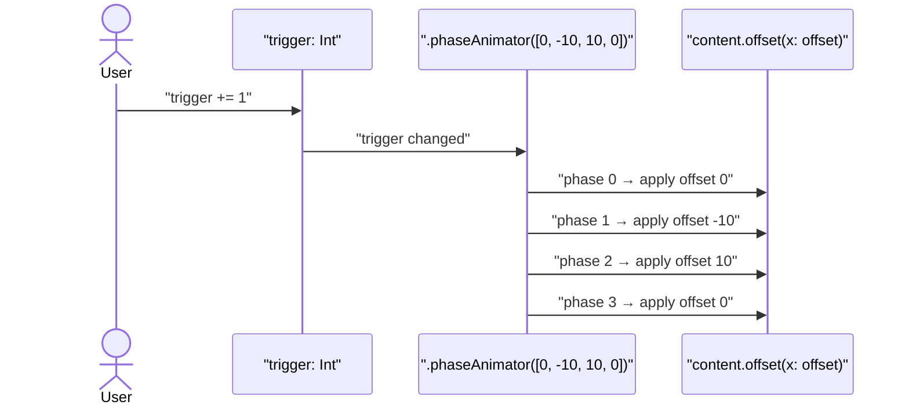
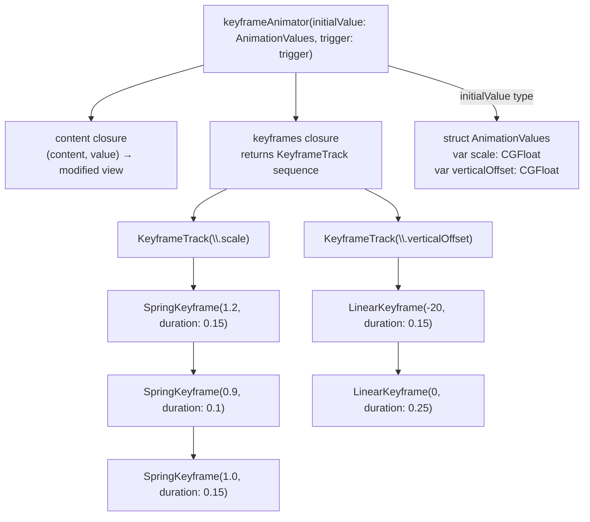
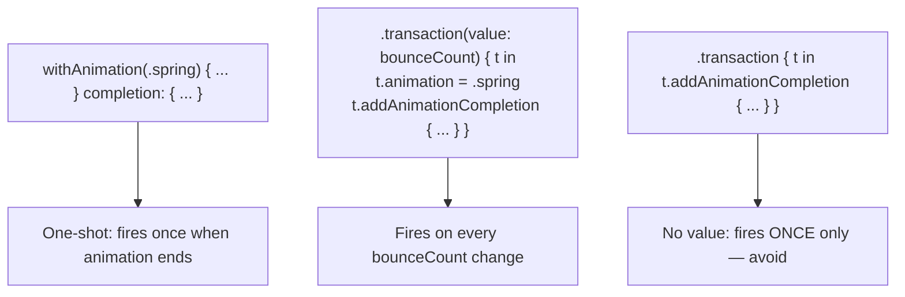

<!-- source: DeepWiki mcp.deepwiki.com · repo AvdLee/SwiftUI-Agent-Skill · extra page Advanced Animation · fetched 2026-10-26 -->

# Advanced Animation

<details>
<summary>Relevant source files</summary>

The following files were used as context for generating this wiki page:

- [swiftui-expert-skill/references/animation-advanced.md](swiftui-expert-skill/references/animation-advanced.md)
- [swiftui-expert-skill/references/animation-basics.md](swiftui-expert-skill/references/animation-basics.md)

</details>


This page covers the lower-level and iOS 17+ animation APIs in SwiftUI: the `Transaction` system, custom `TransactionKey` metadata propagation, `phaseAnimator` for multi-step sequences, `keyframeAnimator` with `KeyframeTrack`, `KeyframeTimeline` for external value querying, and animation completion handlers.

For foundational animation concepts (`.animation(_:value:)`, `withAnimation`, timing curves), see [Animation Basics](#3.9.1). For view transitions and the `Animatable` protocol, see [Transitions](#3.9.2).

All content derives from [swiftui-expert-skill/references/animation-advanced.md]().

---

## The Transaction System

Every animation in SwiftUI — whether triggered by `.animation(_:value:)` or `withAnimation` — passes through a `Transaction`. A transaction carries the animation configuration and optional metadata through the view tree.

**`withAnimation` is shorthand for `withTransaction`:**

[swiftui-expert-skill/references/animation-advanced.md:17-26]()

The `.transaction` modifier intercepts and mutates the transaction at a specific point in the view tree. It behaves like the deprecated `.animation(_:)` (no value parameter) — it responds to all state changes.

[swiftui-expert-skill/references/animation-advanced.md:29-38]()

### Animation Precedence

Implicit animations override explicit animations when both target the same view. The modifier that appears latest in the view tree wins.

[swiftui-expert-skill/references/animation-advanced.md:41-49]()

| Scenario | Winner |
|---|---|
| `withAnimation(.linear)` + `.animation(.bouncy, value:)` on same view | `.bouncy` (implicit wins) |
| `.transaction { t.disablesAnimations = true }` | No implicit override possible |
| `.transaction { $0.animation = nil }` | Animation fully removed |

Sources: [swiftui-expert-skill/references/animation-advanced.md:41-61]()

---

### Custom TransactionKey (iOS 17+)

`TransactionKey` lets you attach typed metadata to a transaction so that views further down the tree can read it and apply different animations based on context.

**Diagram: TransactionKey propagation flow**

```mermaid
flowchart TD
    A["withTransaction(transaction)"]
    B["transaction.changeSource = \"server\""]
    C["View tree"]
    D[".transaction modifier reads\nt.changeSource"]
    E["\"server\" → .smooth animation"]
    F["other → .bouncy animation"]

    A --> B
    B --> C
    C --> D
    D --> E
    D --> F
```

[swiftui-expert-skill/references/animation-advanced.md:63-92]()

The conformance pattern requires:
- A type conforming to `TransactionKey` with a `defaultValue`
- An extension on `Transaction` exposing a computed property using `self[ChangeSourceKey.self]`

[swiftui-expert-skill/references/animation-advanced.md:67-77]()

Sources: [swiftui-expert-skill/references/animation-advanced.md:63-92]()

---

## Phase Animations (iOS 17+)

`phaseAnimator` cycles through a sequence of discrete values. Each phase transition is a separate, independently configured animation. This replaces manual `DispatchQueue`-chained `withAnimation` calls.

**Diagram: phaseAnimator value/trigger model**



Sources: [swiftui-expert-skill/references/animation-advanced.md:96-117]()

### Triggered vs Infinite

| Form | Behavior |
|---|---|
| `.phaseAnimator(phases, trigger: trigger)` | Runs once per `trigger` change |
| `.phaseAnimator(phases)` (no trigger) | Loops continuously |

### Enum Phases

Using a `CaseIterable` enum as the phase type is preferred over raw value arrays. The enum centralizes the mapping from phase to visual properties.

[swiftui-expert-skill/references/animation-advanced.md:119-139]()

Pattern: define computed properties (e.g., `.scale`, `.opacity`) on the enum, then read them in the content closure.

### Per-Phase Timing

The `animation:` trailing closure receives the current phase and returns an `Animation`. This allows each transition to use a different curve.

[swiftui-expert-skill/references/animation-advanced.md:143-154]()

### Anti-Pattern: Manual DispatchQueue Sequencing

[swiftui-expert-skill/references/animation-advanced.md:156-174]()

Prefer `phaseAnimator` over manually chained `DispatchQueue.main.asyncAfter` calls. The manual approach is error-prone and does not respect animation interruption or cancellation.

Sources: [swiftui-expert-skill/references/animation-advanced.md:96-174]()

---

## Keyframe Animations (iOS 17+)

`keyframeAnimator` provides frame-exact timing control over multiple properties simultaneously. Each property is animated by its own `KeyframeTrack`, and all tracks run in parallel.

**Diagram: keyframeAnimator structure**



Sources: [swiftui-expert-skill/references/animation-advanced.md:178-208]()

### Keyframe Types

| Type | Interpolation |
|---|---|
| `CubicKeyframe` | Smooth cubic Bézier |
| `LinearKeyframe` | Straight-line (constant rate) |
| `SpringKeyframe` | Spring physics |
| `MoveKeyframe` | Instant jump, no interpolation |

[swiftui-expert-skill/references/animation-advanced.md:213-218]()

### Multiple Synchronized Tracks

Each `KeyframeTrack` targets a different `KeyPath` on the value struct. Tracks run concurrently; their total durations do not need to match.

[swiftui-expert-skill/references/animation-advanced.md:221-262]()

**Anti-pattern**: Replacing `KeyframeTrack` sequences with manual timer-based `withAnimation` chains. The manual approach cannot synchronize multiple properties and does not integrate with SwiftUI's animation system.

### KeyframeTimeline

`KeyframeTimeline` wraps the same keyframe definition used by `keyframeAnimator` but allows querying computed values at arbitrary time offsets outside of the SwiftUI view lifecycle. Useful for testing and for driving non-SwiftUI renderers.

[swiftui-expert-skill/references/animation-advanced.md:264-278]()

`timeline.value(time: 0.25)` returns the interpolated `AnimationValues` struct at 0.25 seconds.

Sources: [swiftui-expert-skill/references/animation-advanced.md:178-278]()

---

## Animation Completion Handlers (iOS 17+)

SwiftUI provides two mechanisms for running code after an animation finishes.

**Diagram: completion handler methods compared**



### `withAnimation` Completion

[swiftui-expert-skill/references/animation-advanced.md:286-296]()

Use when the animation is triggered once and a single post-animation side effect is needed.

### `.transaction(value:)` Completion

[swiftui-expert-skill/references/animation-advanced.md:299-320]()

Use when the same animation is retriggered multiple times (e.g., a bounce counter). The `value:` parameter on `.transaction` causes the modifier to re-execute its closure — and therefore re-register the completion — on each value change.

**Without `value:`**, the completion closure is registered only on the first render pass and never fires again after the initial animation completes.

Sources: [swiftui-expert-skill/references/animation-advanced.md:282-321]()

---

## API Quick Reference

| API | iOS Availability | Purpose |
|---|---|---|
| `Transaction` | All | Underlying animation container |
| `withTransaction` | All | Explicit transaction dispatch |
| `.transaction { }` | All | Intercept/mutate transaction in view tree |
| `TransactionKey` | 17+ | Attach typed metadata to transactions |
| `.phaseAnimator` | 17+ | Multi-step sequential animations |
| `.keyframeAnimator` | 17+ | Precise multi-property timing |
| `KeyframeTrack` | 17+ | Per-property keyframe sequence |
| `CubicKeyframe` | 17+ | Smooth cubic interpolation |
| `SpringKeyframe` | 17+ | Spring physics keyframe |
| `LinearKeyframe` | 17+ | Constant-rate interpolation |
| `MoveKeyframe` | 17+ | Instant value jump |
| `KeyframeTimeline` | 17+ | External keyframe value querying |
| `withAnimation { } completion:` | 17+ | One-shot post-animation callback |
| `.transaction(value:)` + `addAnimationCompletion` | 17+ | Retriggerable post-animation callback |

Sources: [swiftui-expert-skill/references/animation-advanced.md:325-351]()

---

