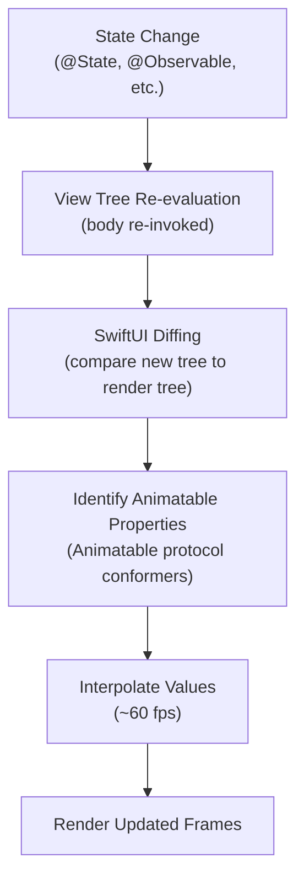
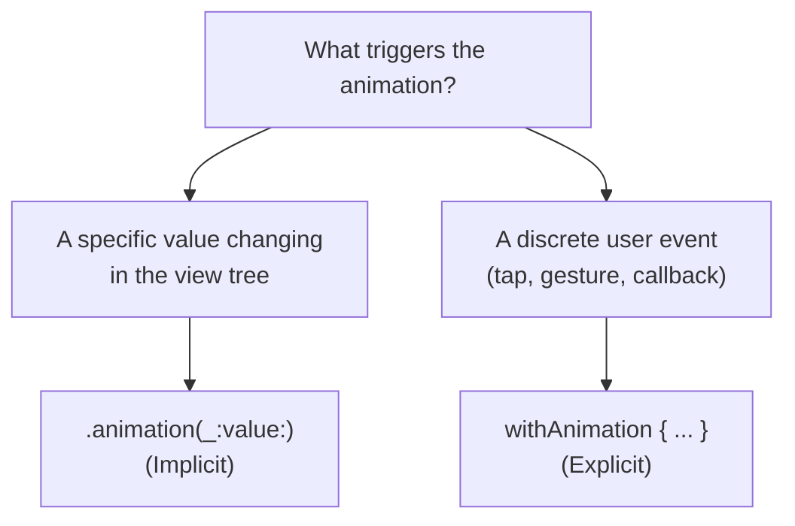
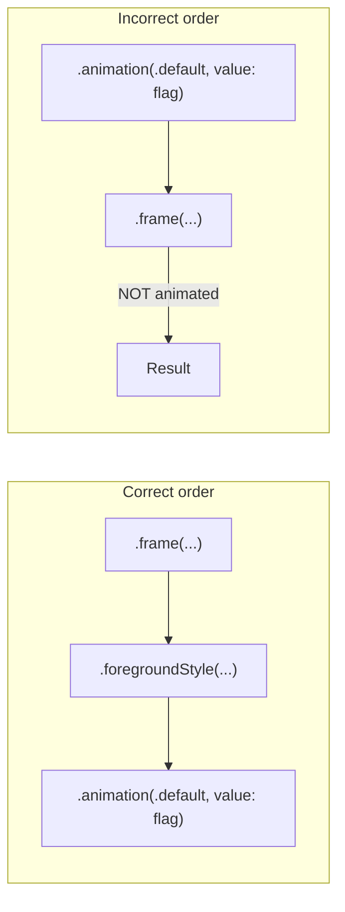
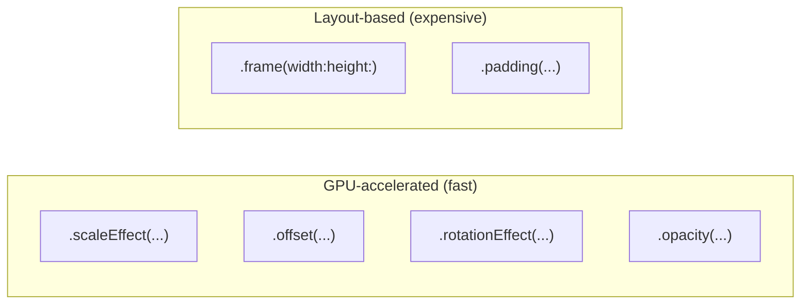
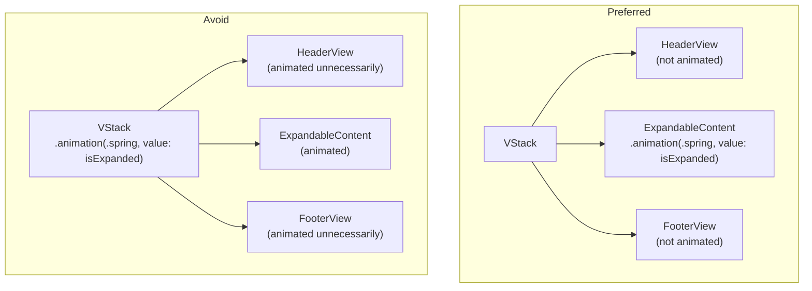
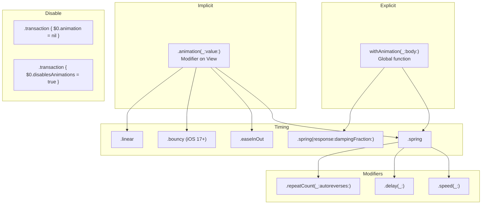

<!-- source: DeepWiki mcp.deepwiki.com · repo AvdLee/SwiftUI-Agent-Skill · extra page Animation Basics · fetched 2026-10-26 -->

# Animation Basics

<details>
<summary>Relevant source files</summary>

The following files were used as context for generating this wiki page:

- [swiftui-expert-skill/references/animation-advanced.md](swiftui-expert-skill/references/animation-advanced.md)
- [swiftui-expert-skill/references/animation-basics.md](swiftui-expert-skill/references/animation-basics.md)

</details>


This page documents the foundational SwiftUI animation APIs: implicit animations via `.animation(_:value:)`, explicit animations via `withAnimation`, available timing curves, modifier placement rules, performance considerations, and debugging techniques. It covers the content in [swiftui-expert-skill/references/animation-basics.md]().

For multi-step sequences, keyframe animations, and the `Transaction` system, see [Advanced Animation](#3.9.3). For view transitions triggered by identity changes, see [Transitions](#3.9.2).

---

## Core Concepts

Every SwiftUI animation follows the same pipeline: a state change causes the view tree to be re-evaluated, SwiftUI identifies which properties are animatable, and it interpolates those properties over time at approximately 60 fps.

**Key behavioral properties of SwiftUI animations:**

| Property | Behavior |
|---|---|
| Additive | New animations blend with in-progress ones |
| Cancelable | Any animation can be interrupted mid-flight |
| Start state | Always begin from the current rendered state |
| Scope | Apply only to the view subtree where the modifier is placed |

**Animation trigger diagram:**



Sources: [swiftui-expert-skill/references/animation-basics.md:20-31]()

---

## Implicit Animations

Implicit animations use the `.animation(_:value:)` modifier. When the tracked `value` changes, SwiftUI animates all animatable properties on the view that were applied **before** the modifier.

**The `value:` parameter is mandatory.** The parameterless `.animation(_:)` overload is deprecated because it causes unexpected animation of unrelated state changes.

| Form | Status | Behavior |
|---|---|---|
| `.animation(.spring, value: flag)` | ✅ Preferred | Animates only when `flag` changes |
| `.animation(.spring)` | ❌ Deprecated | Animates on any state change |

See: [swiftui-expert-skill/references/animation-basics.md:37-49]()

---

## Explicit Animations

`withAnimation` wraps a state mutation in an animation context. It is the correct approach when an animation is driven by a discrete user event such as a button tap or gesture.

```
withAnimation(.spring) {
    isExpanded.toggle()
}
```
[swiftui-expert-skill/references/animation-basics.md:54-69]()

**Decision guide:**



Sources: [swiftui-expert-skill/references/animation-basics.md:71-73]()

---

## Modifier Placement

The `.animation(_:value:)` modifier only animates properties applied **before** it in the modifier chain. Properties applied after the modifier are not animated.

**Rule:** Place `.animation(_:value:)` after all properties it should animate.



Sources: [swiftui-expert-skill/references/animation-basics.md:78-93]()

---

## Selective Animation

You can animate some properties while suppressing animation on others by chaining multiple `.animation(_:value:)` modifiers, each targeting a different property range.

Passing `nil` as the animation disables animation for properties up to that point:

```
.animation(.spring, value: isExpanded)   // Animate size
.foregroundStyle(...)
.animation(nil, value: isExpanded)       // Don't animate color
```

iOS 17+ introduces a closure-based scoped form that accepts a `KeyPath` to restrict which properties are animated:

```
.animation(.spring) {
    $0.frame(width: isExpanded ? 200 : 100, height: 50)
}
```

Sources: [swiftui-expert-skill/references/animation-basics.md:97-114]()

---

## Timing Curves

### Built-in Curves

| Curve | Best For | Notes |
|---|---|---|
| `.spring` | Interactive UI, most elements | Responds naturally to interruption |
| `.easeInOut` | Appearance/disappearance | Classic ease in and out |
| `.bouncy` | Playful feedback | iOS 17+ only |
| `.linear` | Progress indicators | Feels robotic for UI; avoid generally |

### Parameterized Spring

`.spring(response:dampingFraction:)` gives explicit control over spring behavior. `response` controls duration and `dampingFraction` controls oscillation. For button press feedback, values around `response: 0.3, dampingFraction: 0.7` are typical.

### Modifier Chaining

Timing curves can be further modified:

| Modifier | Effect |
|---|---|
| `.speed(2.0)` | Run animation at 2× speed |
| `.delay(0.5)` | Wait 0.5 seconds before starting |
| `.repeatCount(3, autoreverses: true)` | Repeat with reversal |

Sources: [swiftui-expert-skill/references/animation-basics.md:118-158]()

---

## Animation Performance

### Prefer Transform Modifiers Over Layout Changes

GPU-accelerated transform modifiers are significantly cheaper than layout recalculations. Animated layout changes (`.frame`, `.padding`) trigger full layout passes on every frame.



Sources: [swiftui-expert-skill/references/animation-basics.md:163-179]()

### Narrow Animation Scope

Apply `.animation(_:value:)` to the specific subview that changes, not to a parent container. Broad placement causes SwiftUI to evaluate animation on every descendant view.



Sources: [swiftui-expert-skill/references/animation-basics.md:182-199]()

### Avoid Animation in Hot Paths

Scroll handlers fire on every frame. Use a threshold check and only call `withAnimation` when a boolean state actually needs to change.

**Pattern:** Gate `withAnimation` behind an equality check so it fires only when crossing a threshold, not on every scroll event.

Sources: [swiftui-expert-skill/references/animation-basics.md:202-220]()

---

## Disabling Animations

| Technique | When to Use |
|---|---|
| `.transaction { $0.animation = nil }` | Suppress animation on a specific view |
| `.transaction { $0.disablesAnimations = true }` | Prevent child views from overriding |
| `.animation(nil, value: flag)` | Stop implicit animation for specific properties |

Avoid the workaround of `.animation(.linear(duration: 0), value:)` — it is semantically misleading and not equivalent to a true no-op.

Sources: [swiftui-expert-skill/references/animation-basics.md:224-238]()

---

## Debugging

Two techniques are useful for inspecting animations:

**Slow-motion inspection:** Wrap the animation in a `#if DEBUG` block with a much lower speed or longer duration to make frame-by-frame behavior visible.

**Value logging with `Animatable`:** A custom `ViewModifier` that conforms to `Animatable` can intercept the interpolated value in real time via its `animatableData` setter. The example in the reference file (`AnimationDebugModifier`) prints the animated value on every frame update.

Sources: [swiftui-expert-skill/references/animation-basics.md:242-266]()

---

## Quick Reference

### API Map



### Do / Don't

| Do | Don't |
|---|---|
| Use `.animation(_:value:)` with a `value:` parameter | Use deprecated `.animation(_:)` without `value:` |
| Use `withAnimation` for button taps and gestures | Mutate state in an event handler with no animation context |
| Prefer `.scaleEffect`, `.offset`, `.opacity` for animation | Animate `.frame` or `.padding` in hot paths |
| Scope `.animation` to the specific subview that changes | Apply `.animation` at the root of a large container |
| Gate `withAnimation` behind a threshold check in scroll handlers | Call `withAnimation` on every scroll offset change |
| Use `.transaction { $0.animation = nil }` to suppress animations | Use `.animation(.linear(duration: 0), value:)` as a disable workaround |

Sources: [swiftui-expert-skill/references/animation-basics.md:271-284]()

---

