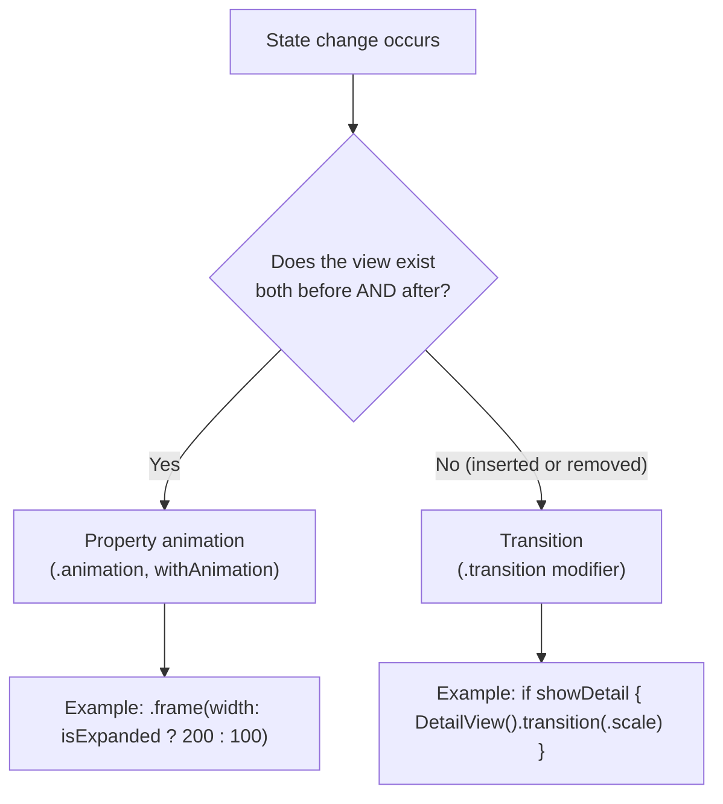
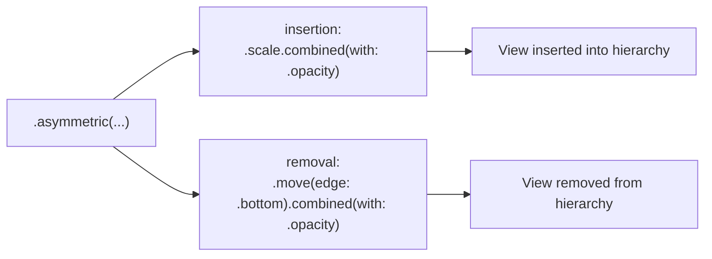
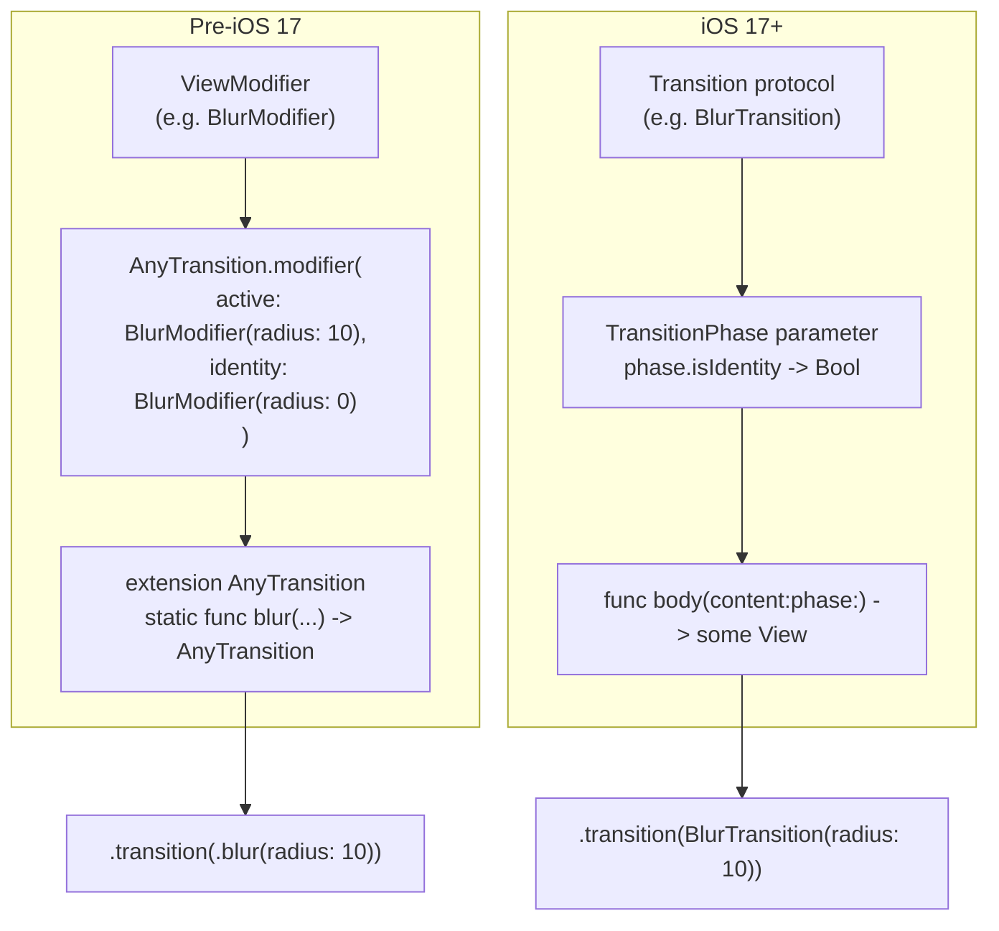
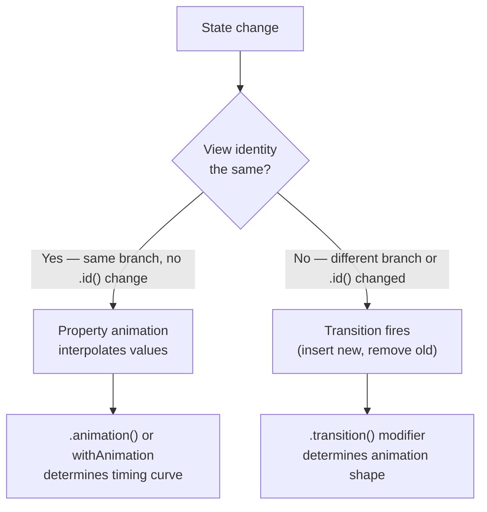
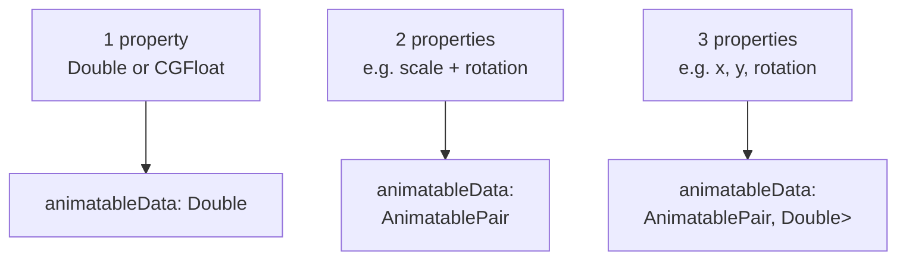

<!-- source: DeepWiki mcp.deepwiki.com · repo AvdLee/SwiftUI-Agent-Skill · extra page Transitions · fetched 2026-10-26 -->

# Transitions

<details>
<summary>Relevant source files</summary>

The following files were used as context for generating this wiki page:

- [swiftui-expert-skill/references/animation-transitions.md](swiftui-expert-skill/references/animation-transitions.md)

</details>


This page covers SwiftUI transitions: the mechanism for animating views as they are **inserted into or removed from** the render tree. This is distinct from property animations, which interpolate values on views that persist across a state change. For implicit and explicit property animations and timing curves, see [Animation Basics](#3.9.1). For the `Transaction` system, `phaseAnimator`, and `keyframeAnimator`, see [Advanced Animation](#3.9.3).

---

## Property Animations vs Transitions

These two mechanisms are often confused because both are driven by animation contexts (`.animation(_:value:)` or `withAnimation`). The distinction is about **view lifetime**.

| Mechanism | Applies when | View exists before state change? | View exists after state change? |
|---|---|---|---|
| Property animation | A value on a persistent view changes | Yes | Yes |
| Transition | A view is conditionally included or excluded | No (insertion) or Yes (removal) | Yes (insertion) or No (removal) |

**Diagram: Property Animation vs Transition Trigger**



Sources: [swiftui-expert-skill/references/animation-transitions.md:15-32]()

---

## Animation Context Requirement

Transitions are **silent without an animation context**. The `.transition()` modifier declares *what* animation to use, but the animation is only triggered when a state change occurs inside a `withAnimation` block or when `.animation(_:value:)` is applied to a container outside the conditional.

**Critical placement rule:** The animation modifier must be placed *outside* the conditional block, because a modifier placed inside is removed from the hierarchy along with the view.

[swiftui-expert-skill/references/animation-transitions.md:38-77]()

**Diagram: Animation Context Placement**

```mermaid
flowchart TD
    subgraph CORRECT1["Correct: .animation on container"]
        A1["VStack { ... }"]
        A1 --> A2[".animation(.spring, value: showDetail)"]
        A2 --> A3["if showDetail { DetailView().transition(.slide) }"]
    end

    subgraph CORRECT2["Correct: withAnimation in action"]
        B1["Button { withAnimation(.spring) { showDetail.toggle() } }"]
        B1 --> B2["if showDetail { DetailView().transition(.scale) }"]
    end

    subgraph WRONG["Wrong: .animation inside conditional"]
        C1["if showDetail {"]
        C1 --> C2["DetailView().transition(.slide)"]
        C2 --> C3[".animation(.spring, value: showDetail)"]
        C3 --> C4["Removed with view on dismissal — no animation"]
    end
```



Sources: [swiftui-expert-skill/references/animation-transitions.md:38-77]()

---

## Built-in Transitions

These are the built-in `AnyTransition` values available in SwiftUI:

| Transition | Effect |
|---|---|
| `.opacity` | Fade in/out (default when no transition is specified) |
| `.scale` | Scale up from center on insert, scale down on removal |
| `.slide` | Slide in from the leading edge |
| `.move(edge:)` | Move in/out from a specified `Edge` |
| `.offset(x:y:)` | Translate by a fixed offset |

Sources: [swiftui-expert-skill/references/animation-transitions.md:79-97]()

---

## Combining Transitions

Multiple transitions can be merged using `.combined(with:)`. All combined transitions run simultaneously.

```swift
// Parallel combination
.transition(.slide.combined(with: .opacity))

// Chained combination
.transition(.scale.combined(with: .opacity).combined(with: .offset(y: 20)))
```

[swiftui-expert-skill/references/animation-transitions.md:89-97]()

---

## Asymmetric Transitions

`.asymmetric(insertion:removal:)` applies a different `AnyTransition` for each direction. This is useful when the natural insert and remove directions feel different — for example, a card sliding in from the top but falling off the bottom.

[swiftui-expert-skill/references/animation-transitions.md:101-123]()

**Diagram: Asymmetric Transition Structure**



Sources: [swiftui-expert-skill/references/animation-transitions.md:101-123]()

---

## Custom Transitions

### Pre-iOS 17: `ViewModifier` + `AnyTransition.modifier`

Before iOS 17, custom transitions are defined by providing two `ViewModifier` instances: one for the **active** state (appearing or disappearing) and one for the **identity** state (fully present).

The `AnyTransition.modifier(active:identity:)` API interpolates between these two modifier states.

[swiftui-expert-skill/references/animation-transitions.md:128-149]()

Key types involved:

| Type | Role |
|---|---|
| `ViewModifier` (e.g. `BlurModifier`) | Holds the animatable parameter (e.g. `radius: CGFloat`) |
| `AnyTransition.modifier(active:identity:)` | Wraps the pair of modifiers into a transition |
| `extension AnyTransition` | Provides a clean call-site API |

### iOS 17+: `Transition` Protocol

iOS 17 introduced the `Transition` protocol, which replaces the two-modifier pattern with a single type that receives a `TransitionPhase`.

[swiftui-expert-skill/references/animation-transitions.md:151-166]()

`TransitionPhase` has an `isIdentity` property: when `true`, the view is fully in the hierarchy; when `false`, the view is being inserted or removed.

**Diagram: Custom Transition APIs by Approach**



Sources: [swiftui-expert-skill/references/animation-transitions.md:128-166]()

---

### Common Mistake: Inline Modifiers Are Not Transitions

Applying `.blur` or `.opacity` directly and gating them on a state variable is **not** a transition. The removal phase will never animate because the modifier is gone from the hierarchy along with the view.

[swiftui-expert-skill/references/animation-transitions.md:168-183]()

---

## View Identity and Transitions

A transition fires whenever SwiftUI considers a view to have a **new identity**. Identity changes happen in two situations:

1. **Different `if`/`else` branches** — each branch produces a view with a distinct structural identity.
2. **Explicit `.id()` change** — applying `.id(someValue)` and changing `someValue` destroys the old view and creates a new one.

When identity changes, SwiftUI does *not* perform a property animation — it performs a transition instead. This means the `.frame` modifier on two separate `if`/`else` branches will transition, not interpolate.

[swiftui-expert-skill/references/animation-transitions.md:187-208]()

**Diagram: Identity Change → Transition vs Same Identity → Property Animation**



Sources: [swiftui-expert-skill/references/animation-transitions.md:187-208]()

---

## The `Animatable` Protocol

The `Animatable` protocol enables custom interpolation of numeric properties during any animation (including those triggered by transitions). Without it, SwiftUI has no way to interpolate intermediate values — it jumps directly to the final state.

### Protocol Shape

```
protocol Animatable {
    associatedtype AnimatableData: VectorArithmetic
    var animatableData: AnimatableData { get set }
}
```

`VectorArithmetic` is the constraint that makes linear interpolation possible. SwiftUI calls the `animatableData` getter/setter at each frame to drive the interpolation.

[swiftui-expert-skill/references/animation-transitions.md:212-223]()

### Single Property

For a single `Double` or `CGFloat` property, `animatableData` is just that value.

[swiftui-expert-skill/references/animation-transitions.md:225-263]()

Key type: `ShakeModifier` — conforms to both `ViewModifier` and `Animatable`. The `shakeCount: Double` property is exposed as `animatableData`.

### Multiple Properties: `AnimatablePair`

For two properties, use `AnimatablePair<A, B>`. For three or more, nest `AnimatablePair` recursively.

[swiftui-expert-skill/references/animation-transitions.md:265-309]()

**Diagram: `AnimatableData` Type Composition**



Sources: [swiftui-expert-skill/references/animation-transitions.md:265-309]()

---

## Quick Reference

### Do

- Place `.transition()` on the conditionally-included view.
- Place `.animation(_:value:)` on a **parent container** outside the `if` block, or use `withAnimation` in the triggering action.
- Implement `animatableData` explicitly on any `ViewModifier` that conforms to `Animatable`.
- Use `AnimatablePair` (nested if needed) for modifiers with more than one animated property.
- Use `.asymmetric(insertion:removal:)` when the natural insert and remove directions differ.
- Prefer the `Transition` protocol (iOS 17+) over `AnyTransition.modifier(active:identity:)` for new code.

### Don't

- Put `.animation()` inside a conditional — it is removed with the view on dismissal.
- Omit `animatableData` from a custom `Animatable` conformance (silent failure: jumps to final value).
- Use inline conditional `.blur` / `.opacity` modifiers as a substitute for a real transition.
- Expect a property animation when view identity changes — SwiftUI will run a transition instead.

Sources: [swiftui-expert-skill/references/animation-transitions.md:313-327]()

---

