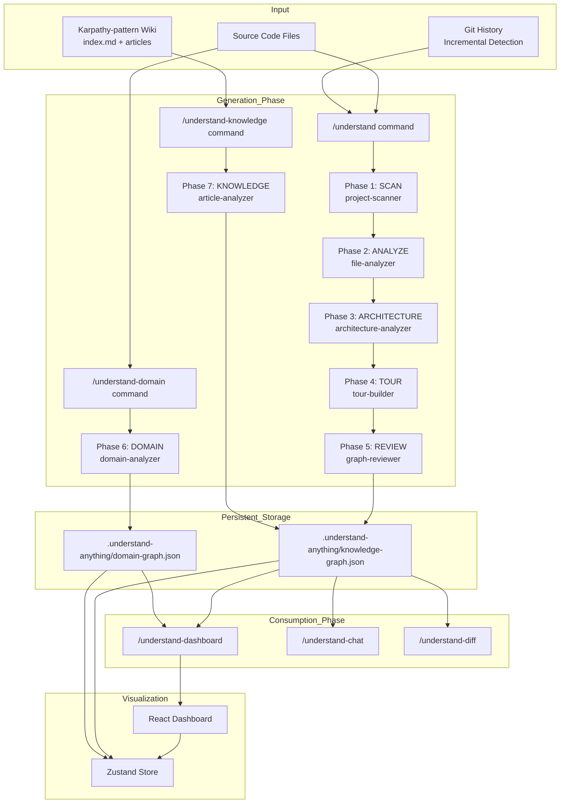

<!-- source: DeepWiki mcp.deepwiki.com · repo Lum1104/Understand-Anything · page 1 Overview · fetched 2026-10-26 -->

# Overview

Relevant source files

The following files were used as context for generating this wiki page:

- [.claude-plugin/marketplace.json](.claude-plugin/marketplace.json)
- [.claude-plugin/plugin.json](.claude-plugin/plugin.json)
- [.copilot-plugin/plugin.json](.copilot-plugin/plugin.json)
- [.cursor-plugin/plugin.json](.cursor-plugin/plugin.json)
- [README.md](README.md)
- [READMEs/README.es-ES.md](READMEs/README.es-ES.md)
- [READMEs/README.ja-JP.md](READMEs/README.ja-JP.md)
- [READMEs/README.ko-KR.md](READMEs/README.ko-KR.md)
- [READMEs/README.tr-TR.md](READMEs/README.tr-TR.md)
- [READMEs/README.zh-CN.md](READMEs/README.zh-CN.md)
- [READMEs/README.zh-TW.md](READMEs/README.zh-TW.md)
- [install.ps1](install.ps1)
- [install.sh](install.sh)
- [understand-anything-plugin/.claude-plugin/plugin.json](understand-anything-plugin/.claude-plugin/plugin.json)
- [understand-anything-plugin/package.json](understand-anything-plugin/package.json)

This document introduces the Understand Anything project, explaining what it does, its core value proposition, and the main components of the system. It provides a high-level map of how the codebase is organized and how data flows through the system during analysis and visualization.

**Sources:** [README.md:1-170](), [understand-anything-plugin/package.json:1-21]()

## What Understand Anything Does

Understand Anything is a multi-platform plugin (supporting [Claude Code](https://docs.anthropic.com/en/docs/claude-code), Cursor, Copilot, and more) that combines **LLM intelligence** with **static analysis** to turn any codebase or knowledge base into an interactive knowledge graph. The system extracts files, functions, classes, and their relationships, then presents them through a web-based dashboard with search, filtering, and natural language querying capabilities. [README.md:43-48](), [README.md:173-182]()

The plugin provides eight core skill commands:

| Command | Purpose | Primary Users |
|---------|---------|---------------|
| `/understand` | Generate knowledge graph via multi-agent analysis | All users (entry point) |
| `/understand-dashboard` | Launch interactive visualization | All users |
| `/understand-chat` | Natural language Q&A about codebase | PMs, junior developers |
| `/understand-diff` | Analyze change impact before commit | Experienced developers, code reviewers |
| `/understand-explain` | Deep-dive explanations of specific files/functions | Junior developers, onboarding |
| `/understand-onboard` | Generate onboarding guides | Team leads, documentation writers |
| `/understand-domain` | Extract business domain logic and flows | PMs, Architects |
| `/understand-knowledge` | Analyze Karpathy-pattern LLM wikis | Researchers, knowledge managers |

The system targets three user personas: **Junior Developers** (guided learning), **Product Managers & Designers** (high-level logic), and **AI-Assisted Developers** (deep context for reasoning). [README.md:82-89](), [README.md:141-159]()

**Sources:** [README.md:52-100](), [README.md:104-170](), [.cursor-plugin/plugin.json:12-14]()

## System Component Map

The following diagram maps the conceptual components of Understand Anything to their actual code locations in the repository.

**Diagram: Component to Code Entity Mapping**

```mermaid
graph TB
    subgraph "Plugin_Distribution"
        marketplace[".claude-plugin/marketplace.json<br/>version: 2.7.6"]
        pluginPkg["@understand-anything/skill<br/>understand-anything-plugin/package.json"]
        cursorPlugin[".cursor-plugin/plugin.json"]
        copilotPlugin[".copilot-plugin/plugin.json"]
    end
    
    subgraph "Analysis_Engine"
        corePkg["@understand-anything/core<br/>workspace dependency"]
        persistence["persistence module<br/>Graph I/O & Config"]
        registry["PluginRegistry<br/>Language support"]
    end
    
    subgraph "Multi-Agent_Pipeline"
        agentsDir["understand-anything-plugin/agents/<br/>Specialized Agents"]
        projectScanner["project-scanner"]
        fileAnalyzer["file-analyzer"]
        archAnalyzer["architecture-analyzer"]
        tourBuilder["tour-builder"]
        graphReviewer["graph-reviewer"]
        domainAnalyzer["domain-analyzer"]
        articleAnalyzer["article-analyzer"]
    end
    
    subgraph "Skill_Commands"
        skillsDir["understand-anything-plugin/skills/<br/>Skill Definitions"]
        understandSkill["understand.md"]
        dashboardSkill["understand-dashboard.md"]
        chatSkill["understand-chat.md"]
        diffSkill["understand-diff.md"]
        explainSkill["understand-explain.md"]
        onboardSkill["understand-onboard.md"]
        domainSkill["understand-domain.md"]
        knowledgeSkill["understand-knowledge.md"]
    end
    
    subgraph "Visualization_UI"
        dashboardPkg["@understand-anything/dashboard<br/>React Dashboard"]
        graphView["GraphView component"]
        domainView["DomainGraphView component"]
        store["useDashboardStore<br/>Zustand state"]
    end
    
    subgraph "Data_Artifacts"
        knowledgeGraph[".understand-anything/knowledge-graph.json"]
        domainGraph[".understand-anything/domain-graph.json"]
        intermediateDir[".understand-anything/intermediate/"]
    end
    
    marketplace --> pluginPkg
    pluginPkg --> corePkg
    pluginPkg --> dashboardPkg
    
    understandSkill --> agentsDir
    domainSkill --> domainAnalyzer
    knowledgeSkill --> articleAnalyzer
    
    projectScanner --> intermediateDir
    fileAnalyzer --> intermediateDir
    domainAnalyzer --> domainGraph
    graphReviewer --> knowledgeGraph
    
    corePkg --> persistence
    corePkg --> registry
    
    skillsDir --> understandSkill
    skillsDir --> dashboardSkill
    
    dashboardPkg --> graphView
    dashboardPkg --> domainView
    dashboardPkg --> store
    
    graphView --> store
    domainView --> store
```

**Sources:** [.claude-plugin/marketplace.json:1-15](), [understand-anything-plugin/package.json:1-21](), [.cursor-plugin/plugin.json:1-15](), [.copilot-plugin/plugin.json:1-14]()

## Core Data Flow

The system follows a generate-once, query-many pattern. The `/understand` command orchestrates agents to produce `knowledge-graph.json`, while `/understand-domain` produces `domain-graph.json`. Both are consumed by the dashboard and specific skills.

**Diagram: Data Flow Through the System**

**Sources:** [README.md:113-169](), [README.md:62-67](), [README.md:137-145]()

## Knowledge Graph Structure

The central data artifact is `.understand-anything/knowledge-graph.json`. The graph is structured into:

| Component | Description |
|-----------|-------------|
| **Nodes** | 16 types including `file`, `function`, `class`, `module`, `concept`, `endpoint`, `service`, `table`, and `flow`. [README.md:57-59]() |
| **Edges** | 29 types representing imports, calls, inheritance, data flow, etc. |
| **Layers** | Architectural groupings (API, Service, Data, UI, Utility) with color-coding. [README.md:92-94]() |
| **Tours** | Auto-generated walkthroughs ordered by dependency ranking. [README.md:72-74]() |

The system also extracts business domain knowledge into `domain-graph.json`, mapping code logic to high-level business processes (Domains -> Flows -> Steps). [README.md:61-63]()

**Sources:** [README.md:57-99](), [README.md:113-136]()

## User Entry Points

Users interact with Understand Anything through specialized skill commands. The dashboard provides a multi-view layout:
1. **Structure View**: Visualizes the technical architecture (files/functions). [README.md:57-59]()
2. **Domain View**: Visualizes business logic flows. [README.md:61-63]()
3. **Knowledge View**: Visualizes community clustering in wikis. [README.md:65-67]()

The UI features a dark luxury theme and adapts based on three persona modes: **Junior**, **Experienced**, and **PM**. [README.md:86-89]()

**Sources:** [README.md:52-100](), [README.md:137-145]()

## Repository Structure

The codebase is organized as a pnpm monorepo:

- **`understand-anything-plugin/`**: The core workspace containing the plugin. [understand-anything-plugin/package.json:1-15]()
    - **`packages/core`**: Shared analysis engine (types, persistence, search, schema). [understand-anything-plugin/package.json:12-12]()
    - **`packages/dashboard`**: React + TypeScript web dashboard.
    - **`skills/`**: Markdown-based skill definitions for Claude Code and Cursor. [.cursor-plugin/plugin.json:13-13]()
    - **`agents/`**: JSON-based agent definitions for the analysis pipeline. [.cursor-plugin/plugin.json:14-14]()
- **`.claude-plugin/`**: Plugin manifest and marketplace metadata. [.claude-plugin/marketplace.json:1-15]()
- **`.cursor-plugin/`**: Auto-discovery configuration for Cursor. [.cursor-plugin/plugin.json:1-15]()
- **`.copilot-plugin/`**: Configuration for VS Code + GitHub Copilot. [.copilot-plugin/plugin.json:1-14]()

**Sources:** [README.md:173-212](), [understand-anything-plugin/package.json:1-21]()

## Key Implementation Details

1. **Multi-Agent Coordination**: The pipeline uses specialized agents (e.g., `project-scanner`, `file-analyzer`) that coordinate to build the graph. [README.md:113-119]()
2. **Deterministic Parsing**: The knowledge base analysis uses a deterministic parser for `index.md` before LLM agents extract implicit relationships. [README.md:65-67]()
3. **Cross-Platform Compatibility**: Supports native Claude Code installation as well as auto-discovery in Cursor, VS Code + GitHub Copilot, and various CLI environments via `install.sh`. [README.md:173-234]()
4. **Fuzzy & Semantic Search**: Combines traditional fuzzy search with semantic search for meaning-based queries. [README.md:76-78]()

**Sources:** [README.md:52-100](), [README.md:173-234](), [.claude-plugin/plugin.json:1-18]()

---

