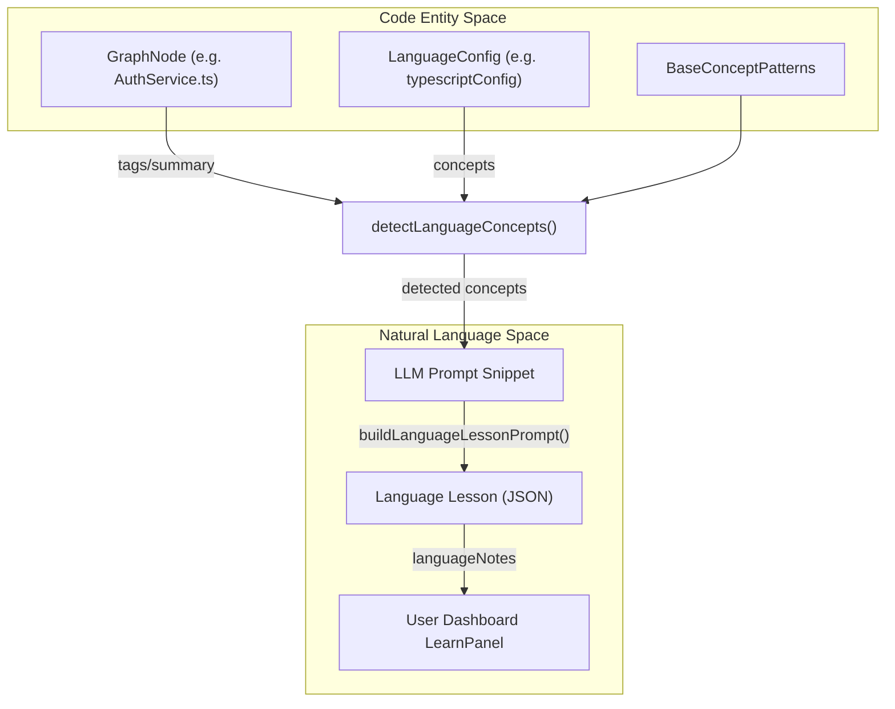
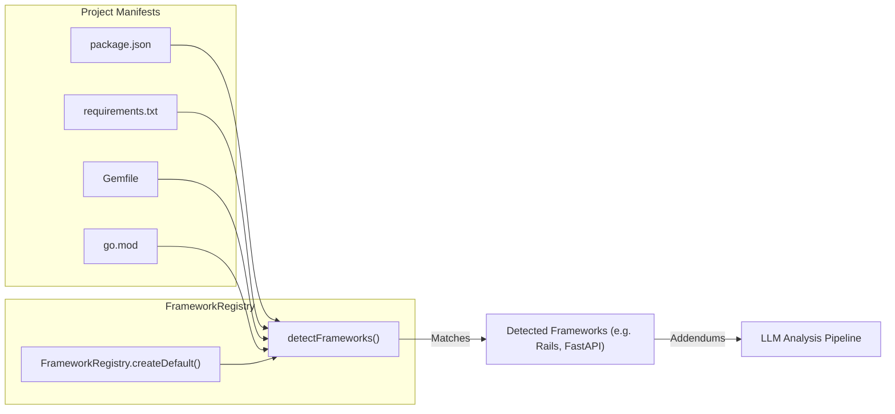

<!-- source: DeepWiki mcp.deepwiki.com · repo Lum1104/Understand-Anything · page 10 Language and Framework Support · fetched 2026-10-26 -->

# Language and Framework Support

Relevant source files

The following files were used as context for generating this wiki page:

- [understand-anything-plugin/packages/core/src/__tests__/framework-registry.test.ts](understand-anything-plugin/packages/core/src/__tests__/framework-registry.test.ts)
- [understand-anything-plugin/packages/core/src/languages/configs/csharp.ts](understand-anything-plugin/packages/core/src/languages/configs/csharp.ts)
- [understand-anything-plugin/packages/core/src/languages/configs/go.ts](understand-anything-plugin/packages/core/src/languages/configs/go.ts)
- [understand-anything-plugin/packages/core/src/languages/configs/java.ts](understand-anything-plugin/packages/core/src/languages/configs/java.ts)
- [understand-anything-plugin/packages/core/src/languages/configs/javascript.ts](understand-anything-plugin/packages/core/src/languages/configs/javascript.ts)
- [understand-anything-plugin/packages/core/src/languages/configs/php.ts](understand-anything-plugin/packages/core/src/languages/configs/php.ts)
- [understand-anything-plugin/packages/core/src/languages/configs/python.ts](understand-anything-plugin/packages/core/src/languages/configs/python.ts)
- [understand-anything-plugin/packages/core/src/languages/configs/ruby.ts](understand-anything-plugin/packages/core/src/languages/configs/ruby.ts)
- [understand-anything-plugin/packages/core/src/languages/configs/rust.ts](understand-anything-plugin/packages/core/src/languages/configs/rust.ts)
- [understand-anything-plugin/packages/core/src/languages/configs/typescript.ts](understand-anything-plugin/packages/core/src/languages/configs/typescript.ts)
- [understand-anything-plugin/packages/core/src/languages/framework-registry.ts](understand-anything-plugin/packages/core/src/languages/framework-registry.ts)
- [understand-anything-plugin/packages/core/src/languages/frameworks/django.ts](understand-anything-plugin/packages/core/src/languages/frameworks/django.ts)
- [understand-anything-plugin/packages/core/src/languages/frameworks/express.ts](understand-anything-plugin/packages/core/src/languages/frameworks/express.ts)
- [understand-anything-plugin/packages/core/src/languages/frameworks/fastapi.ts](understand-anything-plugin/packages/core/src/languages/frameworks/fastapi.ts)
- [understand-anything-plugin/packages/core/src/languages/frameworks/flask.ts](understand-anything-plugin/packages/core/src/languages/frameworks/flask.ts)
- [understand-anything-plugin/packages/core/src/languages/frameworks/gin.ts](understand-anything-plugin/packages/core/src/languages/frameworks/gin.ts)
- [understand-anything-plugin/packages/core/src/languages/frameworks/nextjs.ts](understand-anything-plugin/packages/core/src/languages/frameworks/nextjs.ts)
- [understand-anything-plugin/packages/core/src/languages/frameworks/rails.ts](understand-anything-plugin/packages/core/src/languages/frameworks/rails.ts)

The Understand Anything system is designed to provide deep, context-aware analysis across a wide variety of programming languages and web frameworks. This is achieved through a modular registry system that injects language-specific concepts, file patterns, and framework-specific heuristics into the analysis pipeline.

By combining structural analysis (AST-based) with LLM-driven semantic understanding, the system can explain not just *what* code does, but how it utilizes specific language idioms and framework patterns.

### Language and Framework Registries

The core of the multi-language system resides in two primary registries: the `LanguageRegistry` and the `FrameworkRegistry`. These registries manage configurations that guide the `file-analyzer` and `architecture-analyzer` agents.

*   **LanguageRegistry**: Maps file extensions and filenames to language IDs and configurations. It handles normalization and provides lookup methods like `getForFile` and `getByExtension` [understand-anything-plugin/packages/core/src/languages/language-registry.ts:9-53](). It currently supports 40 built-in language configs.
*   **FrameworkRegistry**: Detects frameworks by scanning manifest files (like `package.json`, `requirements.txt`, or `Gemfile`) for specific keywords [understand-anything-plugin/packages/core/src/languages/framework-registry.ts:9-86](). It allows registration of `FrameworkConfig` objects that map framework components to architectural layers [understand-anything-plugin/packages/core/src/languages/frameworks/django.ts:23-35]().

### Language-Specific Context Injection

When the system analyzes a component, it doesn't just treat it as generic code. It uses the `LanguageConfig` to detect specific concepts and injects these into the LLM prompts to generate "Language Lessons".

#### Concept Detection Flow

Sources: [understand-anything-plugin/packages/core/src/analyzer/language-lesson.ts:69-93](), [understand-anything-plugin/packages/core/src/analyzer/language-lesson.ts:112-155]()

### Supported Languages

The system includes extensive language configurations. Each configuration defines:
1.  **Extensions**: Which files belong to the language (e.g., `.rb` and `.rake` for Ruby) [understand-anything-plugin/packages/core/src/languages/configs/ruby.ts:6-6]().
2.  **Concepts**: Language-specific idioms like "Ownership" for Rust, "Goroutines" for Go, or "Dunder methods" for Python [understand-anything-plugin/packages/core/src/languages/configs/rust.ts:11-24](), [understand-anything-plugin/packages/core/src/languages/configs/go.ts:11-21](), [understand-anything-plugin/packages/core/src/languages/configs/python.ts:11-23]().
3.  **File Patterns**: Heuristics for identifying entry points (e.g., `main.go` for Go), tests, and configuration files [understand-anything-plugin/packages/core/src/languages/configs/go.ts:22-27]().

| Category | Supported Languages (Partial List) |
| :--- | :--- |
| **Mainstream Code** | TypeScript, JavaScript, Python, Go, Rust, Java, C++, C#, Ruby, PHP, Swift, Kotlin |
| **System & Scripting** | C, Lua, Shell, PowerShell, Batch, Makefile |
| **Data & Config** | JSON, YAML, TOML, XML, CSV, SQL, GraphQL, Protobuf |
| **DevOps & Infrastructure** | Dockerfile, Docker Compose, Kubernetes, Terraform, GitHub Actions |

For a detailed breakdown of each language's configuration, including `treeSitter` WASM mappings, see **[Language Configurations](#10.1)**.

### Framework Support

Framework support extends the base language analysis by identifying architectural patterns specific to web and application frameworks. The `FrameworkRegistry` uses `detectFrameworks` to match manifest content against known `detectionKeywords` [understand-anything-plugin/packages/core/src/languages/framework-registry.ts:45-74]().

#### Framework Detection Architecture

Sources: [understand-anything-plugin/packages/core/src/languages/framework-registry.ts:45-74](), [understand-anything-plugin/packages/core/src/__tests__/framework-registry.test.ts:108-112]()

The system maps framework-specific directories to architectural layers via `layerHints`. For example, in **Django**, `serializers` are mapped to the `api` layer, while `migrations` are mapped to `data` [understand-anything-plugin/packages/core/src/languages/frameworks/django.ts:23-35](). Similarly, **Express** maps `middleware` to the `middleware` layer [understand-anything-plugin/packages/core/src/languages/frameworks/express.ts:18-25]().

For details on how framework-specific prompts are constructed and which frameworks are supported, see **[Framework Addendums](#10.2)**.

### Plugin Integration

The `PluginRegistry` bridges the gap between language configurations and the actual analysis logic. It selects the appropriate `AnalyzerPlugin` (such as the `TreeSitterPlugin`) based on the language detected for a given file [understand-anything-plugin/packages/core/src/plugins/registry.ts:43-47]().

*   **Structural Analysis**: Uses Tree-sitter to extract functions, classes, and imports. Many configs specify their specific Tree-sitter WASM package (e.g., `tree-sitter-php` for PHP) [understand-anything-plugin/packages/core/src/languages/configs/php.ts:7-10]().
*   **Non-Code Support**: Specialized configs handle non-code file types like `Dockerfile`, `Jenkinsfile`, or `.env` variants through filename matching rather than just extensions.

Sources: [understand-anything-plugin/packages/core/src/plugins/registry.ts:11-75](), [understand-anything-plugin/packages/core/src/languages/language-registry.ts:9-53](), [understand-anything-plugin/packages/core/src/languages/framework-registry.ts:88-100]()

---

