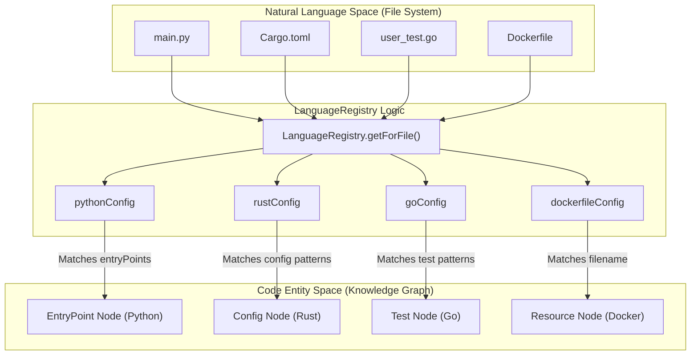
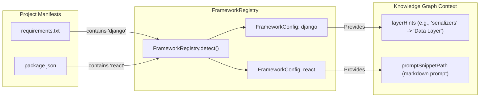

<!-- source: DeepWiki mcp.deepwiki.com · repo Lum1104/Understand-Anything · page 10.1 Language Configurations · fetched 2026-10-26 -->

# Language Configurations

Relevant source files

The following files were used as context for generating this wiki page:

- [understand-anything-plugin/packages/core/src/__tests__/language-registry.test.ts](understand-anything-plugin/packages/core/src/__tests__/language-registry.test.ts)
- [understand-anything-plugin/packages/core/src/languages/configs/batch.ts](understand-anything-plugin/packages/core/src/languages/configs/batch.ts)
- [understand-anything-plugin/packages/core/src/languages/configs/cpp.ts](understand-anything-plugin/packages/core/src/languages/configs/cpp.ts)
- [understand-anything-plugin/packages/core/src/languages/configs/csharp.ts](understand-anything-plugin/packages/core/src/languages/configs/csharp.ts)
- [understand-anything-plugin/packages/core/src/languages/configs/css.ts](understand-anything-plugin/packages/core/src/languages/configs/css.ts)
- [understand-anything-plugin/packages/core/src/languages/configs/csv.ts](understand-anything-plugin/packages/core/src/languages/configs/csv.ts)
- [understand-anything-plugin/packages/core/src/languages/configs/docker-compose.ts](understand-anything-plugin/packages/core/src/languages/configs/docker-compose.ts)
- [understand-anything-plugin/packages/core/src/languages/configs/dockerfile.ts](understand-anything-plugin/packages/core/src/languages/configs/dockerfile.ts)
- [understand-anything-plugin/packages/core/src/languages/configs/env.ts](understand-anything-plugin/packages/core/src/languages/configs/env.ts)
- [understand-anything-plugin/packages/core/src/languages/configs/github-actions.ts](understand-anything-plugin/packages/core/src/languages/configs/github-actions.ts)
- [understand-anything-plugin/packages/core/src/languages/configs/go.ts](understand-anything-plugin/packages/core/src/languages/configs/go.ts)
- [understand-anything-plugin/packages/core/src/languages/configs/graphql.ts](understand-anything-plugin/packages/core/src/languages/configs/graphql.ts)
- [understand-anything-plugin/packages/core/src/languages/configs/html.ts](understand-anything-plugin/packages/core/src/languages/configs/html.ts)
- [understand-anything-plugin/packages/core/src/languages/configs/index.ts](understand-anything-plugin/packages/core/src/languages/configs/index.ts)
- [understand-anything-plugin/packages/core/src/languages/configs/java.ts](understand-anything-plugin/packages/core/src/languages/configs/java.ts)
- [understand-anything-plugin/packages/core/src/languages/configs/jenkinsfile.ts](understand-anything-plugin/packages/core/src/languages/configs/jenkinsfile.ts)
- [understand-anything-plugin/packages/core/src/languages/configs/json-schema.ts](understand-anything-plugin/packages/core/src/languages/configs/json-schema.ts)
- [understand-anything-plugin/packages/core/src/languages/configs/kubernetes.ts](understand-anything-plugin/packages/core/src/languages/configs/kubernetes.ts)
- [understand-anything-plugin/packages/core/src/languages/configs/openapi.ts](understand-anything-plugin/packages/core/src/languages/configs/openapi.ts)
- [understand-anything-plugin/packages/core/src/languages/configs/php.ts](understand-anything-plugin/packages/core/src/languages/configs/php.ts)
- [understand-anything-plugin/packages/core/src/languages/configs/python.ts](understand-anything-plugin/packages/core/src/languages/configs/python.ts)
- [understand-anything-plugin/packages/core/src/languages/configs/ruby.ts](understand-anything-plugin/packages/core/src/languages/configs/ruby.ts)
- [understand-anything-plugin/packages/core/src/languages/configs/rust.ts](understand-anything-plugin/packages/core/src/languages/configs/rust.ts)
- [understand-anything-plugin/skills/understand/languages/css.md](understand-anything-plugin/skills/understand/languages/css.md)
- [understand-anything-plugin/skills/understand/languages/dockerfile.md](understand-anything-plugin/skills/understand/languages/dockerfile.md)
- [understand-anything-plugin/skills/understand/languages/graphql.md](understand-anything-plugin/skills/understand/languages/graphql.md)
- [understand-anything-plugin/skills/understand/languages/html.md](understand-anything-plugin/skills/understand/languages/html.md)
- [understand-anything-plugin/skills/understand/languages/json.md](understand-anything-plugin/skills/understand/languages/json.md)
- [understand-anything-plugin/skills/understand/languages/markdown.md](understand-anything-plugin/skills/understand/languages/markdown.md)
- [understand-anything-plugin/skills/understand/languages/protobuf.md](understand-anything-plugin/skills/understand/languages/protobuf.md)
- [understand-anything-plugin/skills/understand/languages/shell.md](understand-anything-plugin/skills/understand/languages/shell.md)
- [understand-anything-plugin/skills/understand/languages/sql.md](understand-anything-plugin/skills/understand/languages/sql.md)
- [understand-anything-plugin/skills/understand/languages/terraform.md](understand-anything-plugin/skills/understand/languages/terraform.md)
- [understand-anything-plugin/skills/understand/languages/yaml.md](understand-anything-plugin/skills/understand/languages/yaml.md)

The `Language Configurations` system provides a structured way for the **Understand Anything** engine to recognize, parse, and categorize source code across different programming environments. These configurations define the "rules of engagement" for the `file-analyzer` agent, specifying everything from file extensions and entry point patterns to core language concepts that should be highlighted during analysis.

## 1. Configuration Schema

All language configurations are governed by a strict Zod schema to ensure consistency across the monorepo. This schema defines how the system identifies files, which Tree-sitter grammars to load, and what architectural patterns to look for.

### LanguageConfig Definition
The `LanguageConfig` type is defined in [understand-anything-plugin/packages/core/src/languages/types.ts:26-34](). It consists of:
*   **`id`**: A unique string identifier (e.g., "typescript") [understand-anything-plugin/packages/core/src/languages/types.ts:27-27]().
*   **`displayName`**: The human-readable name used in the Dashboard [understand-anything-plugin/packages/core/src/languages/types.ts:28-28]().
*   **`extensions`**: An array of file extensions associated with the language [understand-anything-plugin/packages/core/src/languages/types.ts:29-29]().
*   **`filenames`**: Optional specific filenames (e.g., `Dockerfile`, `Jenkinsfile`) [understand-anything-plugin/packages/core/src/languages/types.ts:30-30]().
*   **`treeSitter`**: Optional configuration for loading WebAssembly (WASM) grammars [understand-anything-plugin/packages/core/src/languages/types.ts:31-31]().
*   **`concepts`**: A list of language-specific features (e.g., "RAII", "Goroutines") used to guide the LLM during explanation generation [understand-anything-plugin/packages/core/src/languages/types.ts:32-32]().
*   **`filePatterns`**: A set of standard naming conventions for entry points, barrels, tests, and configuration files [understand-anything-plugin/packages/core/src/languages/types.ts:33-33]().

### Tree-Sitter Integration
For languages with active AST parsing support, the `treeSitter` block specifies the WASM package and file to be loaded. For example, the C++ configuration points to `tree-sitter-cpp` [understand-anything-plugin/packages/core/src/languages/configs/cpp.ts:7-10](), while C# uses `tree-sitter-c-sharp` [understand-anything-plugin/packages/core/src/languages/configs/csharp.ts:7-10]().

**Sources:**
* [understand-anything-plugin/packages/core/src/languages/types.ts:1-50]()
* [understand-anything-plugin/packages/core/src/languages/configs/cpp.ts:1-30]()
* [understand-anything-plugin/packages/core/src/languages/configs/csharp.ts:1-30]()

---

## 2. Supported Languages and Patterns

The system includes pre-defined configurations for 40 built-in languages and formats [understand-anything-plugin/packages/core/src/__tests__/language-registry.test.ts:55-56](). Each configuration tailors the analysis behavior to specific idioms.

### Major Programming Languages
The registry handles diverse languages from systems programming to high-level scripting.

| Language | Extensions | Key Concepts | Notable Patterns |
| :--- | :--- | :--- | :--- |
| **Python** | `.py`, `.pyi` | Decorators, Dunder methods, Dataclasses [understand-anything-plugin/packages/core/src/languages/configs/python.ts:11-23]() | `manage.py`, `__init__.py` [understand-anything-plugin/packages/core/src/languages/configs/python.ts:27-34]() |
| **Go** | `.go` | Goroutines, Channels, Defer/Panic [understand-anything-plugin/packages/core/src/languages/configs/go.ts:11-21]() | `main.go`, `go.mod` [understand-anything-plugin/packages/core/src/languages/configs/go.ts:23-26]() |
| **Rust** | `.rs` | Ownership, Lifetimes, Traits [understand-anything-plugin/packages/core/src/languages/configs/rust.ts:11-24]() | `Cargo.toml`, `mod.rs` [understand-anything-plugin/packages/core/src/languages/configs/rust.ts:27-29]() |
| **Java** | `.java` | Generics, Annotations, Streams [understand-anything-plugin/packages/core/src/languages/configs/java.ts:11-22]() | `pom.xml`, `build.gradle` [understand-anything-plugin/packages/core/src/languages/configs/java.ts:31-31]() |
| **C++** | `.cpp`, `.cc`, `.hpp` | RAII, Smart pointers, Templates [understand-anything-plugin/packages/core/src/languages/configs/cpp.ts:6-22]() | `CMakeLists.txt`, `Makefile` [understand-anything-plugin/packages/core/src/languages/configs/cpp.ts:27-27]() |
| **Ruby** | `.rb`, `.rake` | Mixins, Metaprogramming, DSLs [understand-anything-plugin/packages/core/src/languages/configs/ruby.ts:6-21]() | `Gemfile`, `Rakefile`, `config.ru` [understand-anything-plugin/packages/core/src/languages/configs/ruby.ts:23-27]() |
| **PHP** | `.php` | Traits, Attributes, Magic methods [understand-anything-plugin/packages/core/src/languages/configs/php.ts:6-22]() | `composer.json`, `artisan` [understand-anything-plugin/packages/core/src/languages/configs/php.ts:24-28]() |

### Non-Code and Infrastructure
Configurations for non-code files allow the system to detect environment variables, container logic, and build pipelines [understand-anything-plugin/packages/core/src/__tests__/language-registry.test.ts:96-117]().

*   **Dockerfile**: Matches `Dockerfile` or `.dockerignore` [understand-anything-plugin/packages/core/src/__tests__/language-registry.test.ts:126-126]().
*   **Env**: Matches `.env`, `.env.local`, and `.env.production` [understand-anything-plugin/packages/core/src/__tests__/language-registry.test.ts:142-145]().
*   **Docker Compose**: Matches `docker-compose.yml`, `docker-compose.yaml`, and `compose.yml` [understand-anything-plugin/packages/core/src/__tests__/language-registry.test.ts:135-138]().
*   **CSS**: Key concepts include Box Model, Flexbox, and Grid [understand-anything-plugin/skills/understand/languages/css.md:7-9]().
*   **Shell**: Key concepts include Shebang Line, Pipes, and Exit Codes [understand-anything-plugin/skills/understand/languages/shell.md:5-11]().

**Sources:**
* [understand-anything-plugin/packages/core/src/languages/configs/index.ts:44-87]()
* [understand-anything-plugin/packages/core/src/languages/configs/python.ts:1-45]()
* [understand-anything-plugin/packages/core/src/languages/configs/rust.ts:1-32]()
* [understand-anything-plugin/packages/core/src/__tests__/language-registry.test.ts:51-146]()
* [understand-anything-plugin/skills/understand/languages/css.md:1-15]()
* [understand-anything-plugin/skills/understand/languages/shell.md:1-15]()

---

## 3. Data Flow: From Files to Entities

The `LanguageRegistry` is responsible for mapping file paths to their corresponding `LanguageConfig` [understand-anything-plugin/packages/core/src/languages/language-registry.ts:2-2](). This resolution enables the analyzer to apply the correct extraction rules.

### Language Configuration Resolution Flow
Title: Resolution of Code Entities via Language Configs

**Sources:**
* [understand-anything-plugin/packages/core/src/__tests__/language-registry.test.ts:21-27]()
* [understand-anything-plugin/packages/core/src/languages/configs/python.ts:24-43]()
* [understand-anything-plugin/packages/core/src/languages/configs/go.ts:22-27]()
* [understand-anything-plugin/packages/core/src/languages/configs/rust.ts:25-30]()

---

## 4. Framework Detection and Registry

Beyond base languages, the system uses a `FrameworkRegistry` to detect specific frameworks (e.g., React, Django) by scanning manifest files and keywords [understand-anything-plugin/packages/core/src/languages/types.ts:51-60]().

### FrameworkRegistry Logic
1.  **Detection**: The `detectFrameworks` method scans files like `package.json` or `requirements.txt` for `detectionKeywords` [understand-anything-plugin/packages/core/src/languages/types.ts:55-56]().
2.  **Prompt Injection**: Detected frameworks provide a `promptSnippetPath`, which the `file-analyzer` uses to inject framework-specific context into LLM prompts [understand-anything-plugin/packages/core/src/languages/types.ts:57-57]().
3.  **Layer Hints**: Frameworks can provide `layerHints` to help the `architecture-analyzer` categorize files into layers like "UI", "API", or "Data" [understand-anything-plugin/packages/core/src/languages/types.ts:59-59]().

### Framework to Code Entity Mapping
Title: Framework Context Injection into Entity Space

**Sources:**
* [understand-anything-plugin/packages/core/src/languages/types.ts:51-63]()
* [understand-anything-plugin/packages/core/src/__tests__/language-registry.test.ts:1-50]()

---

