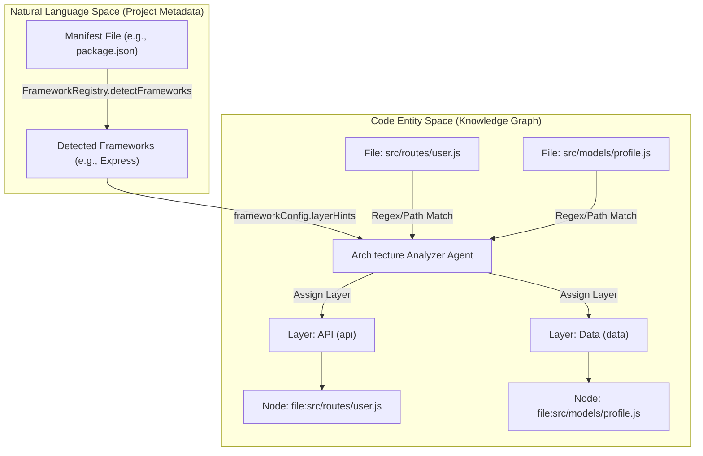
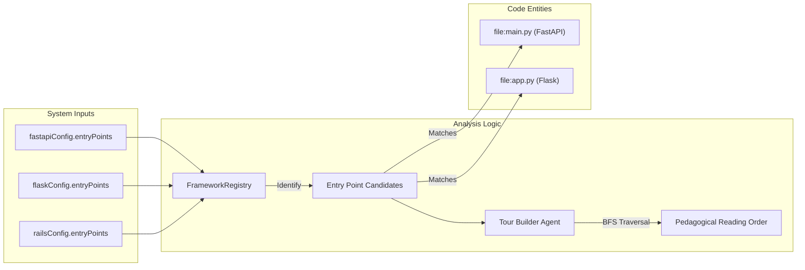

<!-- source: DeepWiki mcp.deepwiki.com · repo Lum1104/Understand-Anything · page 10.2 Framework Addendums · fetched 2026-10-26 -->

# Framework Addendums

Relevant source files

The following files were used as context for generating this wiki page:

- [understand-anything-plugin/packages/core/src/__tests__/framework-registry.test.ts](understand-anything-plugin/packages/core/src/__tests__/framework-registry.test.ts)
- [understand-anything-plugin/packages/core/src/__tests__/language-lesson.test.ts](understand-anything-plugin/packages/core/src/__tests__/language-lesson.test.ts)
- [understand-anything-plugin/packages/core/src/analyzer/graph-builder.test.ts](understand-anything-plugin/packages/core/src/analyzer/graph-builder.test.ts)
- [understand-anything-plugin/packages/core/src/analyzer/graph-builder.ts](understand-anything-plugin/packages/core/src/analyzer/graph-builder.ts)
- [understand-anything-plugin/packages/core/src/languages/configs/javascript.ts](understand-anything-plugin/packages/core/src/languages/configs/javascript.ts)
- [understand-anything-plugin/packages/core/src/languages/configs/typescript.ts](understand-anything-plugin/packages/core/src/languages/configs/typescript.ts)
- [understand-anything-plugin/packages/core/src/languages/framework-registry.ts](understand-anything-plugin/packages/core/src/languages/framework-registry.ts)
- [understand-anything-plugin/packages/core/src/languages/frameworks/django.ts](understand-anything-plugin/packages/core/src/languages/frameworks/django.ts)
- [understand-anything-plugin/packages/core/src/languages/frameworks/express.ts](understand-anything-plugin/packages/core/src/languages/frameworks/express.ts)
- [understand-anything-plugin/packages/core/src/languages/frameworks/fastapi.ts](understand-anything-plugin/packages/core/src/languages/frameworks/fastapi.ts)
- [understand-anything-plugin/packages/core/src/languages/frameworks/flask.ts](understand-anything-plugin/packages/core/src/languages/frameworks/flask.ts)
- [understand-anything-plugin/packages/core/src/languages/frameworks/gin.ts](understand-anything-plugin/packages/core/src/languages/frameworks/gin.ts)
- [understand-anything-plugin/packages/core/src/languages/frameworks/nextjs.ts](understand-anything-plugin/packages/core/src/languages/frameworks/nextjs.ts)
- [understand-anything-plugin/packages/core/src/languages/frameworks/rails.ts](understand-anything-plugin/packages/core/src/languages/frameworks/rails.ts)
- [understand-anything-plugin/packages/dashboard/public/knowledge-graph.json](understand-anything-plugin/packages/dashboard/public/knowledge-graph.json)
- [understand-anything-plugin/skills/understand-chat/SKILL.md](understand-anything-plugin/skills/understand-chat/SKILL.md)
- [understand-anything-plugin/skills/understand-diff/SKILL.md](understand-anything-plugin/skills/understand-diff/SKILL.md)
- [understand-anything-plugin/skills/understand-explain/SKILL.md](understand-anything-plugin/skills/understand-explain/SKILL.md)
- [understand-anything-plugin/skills/understand-onboard/SKILL.md](understand-anything-plugin/skills/understand-onboard/SKILL.md)
- [understand-anything-plugin/skills/understand/frameworks/django.md](understand-anything-plugin/skills/understand/frameworks/django.md)

Framework Addendums are specialized configuration objects and prompt extensions that augment the core analysis engine's ability to understand codebase-specific patterns. While the base language analyzers handle syntax and generic imports, Framework Addendums provide the semantic "glue" needed to correctly categorize files into architectural layers, identify entry points, and guide the LLM's pedagogical narrative during tour generation.

## Framework Configuration Schema

Each framework is defined by a `FrameworkConfig` object. These configurations are used by the `FrameworkRegistry` to detect the presence of specific technologies from manifest files and by the `Architecture Analyzer` to map directory structures to logical layers.

### Key Configuration Properties
- **`id` & `displayName`**: Unique identifiers and human-readable names for the framework (e.g., `id: "rails"`, `displayName: "Ruby on Rails"`) [[understand-anything-plugin/packages/core/src/languages/frameworks/rails.ts:4-5]]().
- **`languages`**: An array of language IDs supported by the framework (e.g., `["javascript", "typescript"]` for Express) [[understand-anything-plugin/packages/core/src/languages/frameworks/express.ts:6]]().
- **`detectionKeywords`**: Strings searched within manifest files to confirm framework usage (e.g., `"django"` for Django or `"flask"` for Flask) [[understand-anything-plugin/packages/core/src/languages/frameworks/django.ts:7]](), [[understand-anything-plugin/packages/core/src/languages/frameworks/flask.ts:8]]().
- **`manifestFiles`**: The specific project files where the registry should look for dependencies (e.g., `Gemfile`, `go.mod`, `package.json`, `requirements.txt`) [[understand-anything-plugin/packages/core/src/languages/frameworks/rails.ts:14]](), [[understand-anything-plugin/packages/core/src/languages/frameworks/fastapi.ts:14]]().
- **`layerHints`**: A mapping of directory/filename patterns to architectural layer labels (e.g., mapping `blueprints` to `api` in Flask) [[understand-anything-plugin/packages/core/src/languages/frameworks/flask.ts:23-30]]().
- **`entryPoints`**: Common filenames that serve as the start of execution for that specific framework (e.g., `app.py`, `run.py` for Flask) [[understand-anything-plugin/packages/core/src/languages/frameworks/flask.ts:22]]().

**Sources:** [[understand-anything-plugin/packages/core/src/languages/frameworks/rails.ts:3-28]](), [[understand-anything-plugin/packages/core/src/languages/frameworks/flask.ts:3-31]](), [[understand-anything-plugin/packages/core/src/languages/frameworks/django.ts:3-36]]()

---

## Framework Registry Implementation

The `FrameworkRegistry` class manages the lifecycle of framework configurations. It provides methods for registration, lookup, and automated detection based on file contents.

### Core Methods
- **`register(config)`**: Adds a framework to the internal maps, preventing duplicates [[understand-anything-plugin/packages/core/src/__tests__/framework-registry.test.ts:9]]().
- **`detectFrameworks(manifests)`**: Iterates through registered frameworks and checks if any `detectionKeywords` exist within the provided `manifests` (a map of filename to content) [[understand-anything-plugin/packages/core/src/__tests__/framework-registry.test.ts:28-34]]().
- **`getForLanguage(langId)`**: Returns all frameworks associated with a specific language (e.g., returning `django`, `flask`, and `fastapi` for `python`) [[understand-anything-plugin/packages/core/src/__tests__/framework-registry.test.ts:17-19]]().
- **`createDefault()`**: Static factory method that initializes a registry with built-in frameworks including React, Next.js, Vue, Express, Django, FastAPI, Flask, Gin, Rails, and Spring [[understand-anything-plugin/packages/core/src/__tests__/framework-registry.test.ts:109-111]]().

**Sources:** [[understand-anything-plugin/packages/core/src/__tests__/framework-registry.test.ts:1-124]](), [[understand-anything-plugin/packages/core/src/languages/frameworks/express.ts:1-26]](), [[understand-anything-plugin/packages/core/src/languages/frameworks/nextjs.ts:1-23]]()

---

## Detection and Layer Mapping

The framework addendums bridge the gap between raw file paths and the "Code Entity Space" by providing heuristics that the analysis agents use to build the Knowledge Graph.

### Framework-to-Layer Mapping Table

| Framework | Directory/Pattern | Assigned Layer | Source |
| :--- | :--- | :--- | :--- |
| **Django** | `views`, `serializers`, `urls` | `api` | [[django.ts:24-27]]() |
| **Django** | `models`, `migrations` | `data` | [[django.ts:25-29]]() |
| **Next.js** | `app`, `pages`, `components` | `ui` | [[nextjs.ts:16-19]]() |
| **FastAPI** | `routers`, `api` | `api` | [[fastapi.ts:18-23]]() |
| **Flask** | `blueprints`, `views` | `api` | [[flask.ts:24-25]]() |
| **Rails** | `controllers` | `api` | [[rails.ts:18]]() |
| **Express** | `routes` | `api` | [[express.ts:19]]() |
| **Express** | `db`, `models` | `data` | [[express.ts:21-24]]() |

### Data Flow: Discovery to Layering

The following diagram illustrates how framework definitions inform the transition from raw disk files to structured architectural layers.

**Framework Detection and Layering Flow**

**Sources:** [[understand-anything-plugin/packages/core/src/languages/frameworks/express.ts:18-25]](), [[understand-anything-plugin/packages/core/src/languages/frameworks/django.ts:23-35]]()

---

## Structural Signals and Entry Points

Framework addendums provide the analysis pipeline with "Entry Point Candidates." These are critical for determining the starting point of the BFS (Breadth-First Search) traversal that defines the reading order of the codebase.

### Entry Point Identification
The `FrameworkConfig` explicitly lists standard entry points for each ecosystem:
- **FastAPI**: `main.py`, `app.py` [[understand-anything-plugin/packages/core/src/languages/frameworks/fastapi.ts:16]]().
- **Flask**: `app.py`, `run.py`, `wsgi.py` [[understand-anything-plugin/packages/core/src/languages/frameworks/flask.ts:22]]().
- **Rails**: `config.ru`, `bin/rails` [[understand-anything-plugin/packages/core/src/languages/frameworks/rails.ts:16]]().
- **Next.js**: `src/app/layout.tsx`, `pages/_app.tsx` [[understand-anything-plugin/packages/core/src/languages/frameworks/nextjs.ts:11-12]]().

**Entry Point Resolution Diagram**

**Sources:** [[understand-anything-plugin/packages/core/src/languages/frameworks/fastapi.ts:16]](), [[understand-anything-plugin/packages/core/src/languages/frameworks/flask.ts:22]](), [[understand-anything-plugin/packages/core/src/languages/frameworks/rails.ts:16]]()

---

## Prompt Snippets

Every framework configuration includes a `promptSnippetPath` [[understand-anything-plugin/packages/core/src/languages/frameworks/flask.ts:21]](). This path points to a Markdown file containing framework-specific instructions for the LLM agents.

### Django Case Study: `django.md`
The `django.md` addendum [[understand-anything-plugin/skills/understand/frameworks/django.md:1-68]]() instructs the LLM to:
- **Identify Canonical Roles**: Maps `serializers.py` to `serialization` tags and `models.py` to `data-model` [[understand-anything-plugin/skills/understand/frameworks/django.md:18-19]]().
- **Detect Implicit Edges**: Create `calls` edges from `urls.py` to views, and `subscribes`/`publishes` edges for Django Signals [[understand-anything-plugin/skills/understand/frameworks/django.md:37-41]]().
- **Apply Specialized Layers**: Specifically defines `layer:api`, `layer:data`, `layer:service`, and `layer:middleware` for the Django ecosystem [[understand-anything-plugin/skills/understand/frameworks/django.md:51-58]]().
- **Capture Language Lessons**: Explains concepts like "Fat models vs. thin views" and "Django ORM lazy evaluation" [[understand-anything-plugin/skills/understand/frameworks/django.md:63-64]]().

These snippets help the LLM recognize framework-specific decorators (like `@receiver` for signals) and understand how a `Serializer` connects to a `Model` via the `Meta` class even without explicit function calls in the source code [[understand-anything-plugin/skills/understand/frameworks/django.md:39-45]]().

**Sources:** [[understand-anything-plugin/packages/core/src/languages/frameworks/flask.ts:21]](), [[understand-anything-plugin/skills/understand/frameworks/django.md:1-68]](), [[understand-anything-plugin/packages/core/src/languages/frameworks/django.ts:21]]()

---

