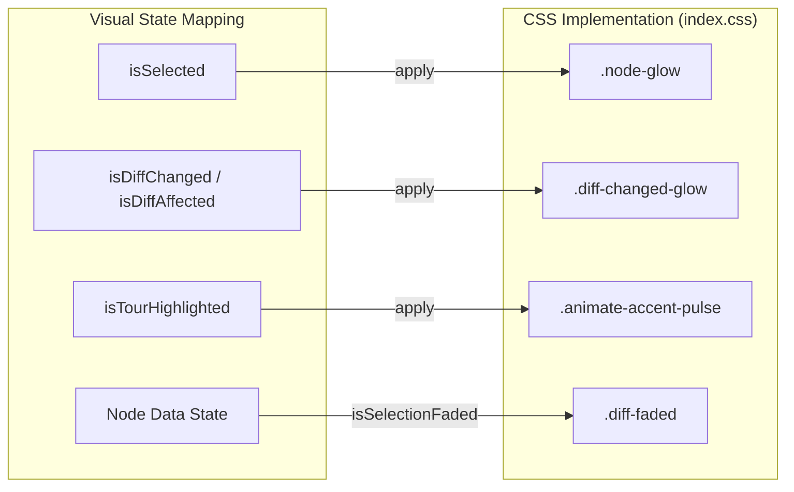

<!-- source: DeepWiki mcp.deepwiki.com · repo Lum1104/Understand-Anything · page 11 Design and Visual System · fetched 2026-10-26 -->

# Design and Visual System

<details>
<summary>Relevant source files</summary>

The following files were used as context for generating this wiki page:

- [homepage/src/components/Features.astro](homepage/src/components/Features.astro)
- [homepage/src/components/Footer.astro](homepage/src/components/Footer.astro)
- [homepage/src/components/Hero.astro](homepage/src/components/Hero.astro)
- [homepage/src/components/Install.astro](homepage/src/components/Install.astro)
- [homepage/src/components/Problem.astro](homepage/src/components/Problem.astro)
- [understand-anything-plugin/packages/dashboard/src/components/CodeViewer.tsx](understand-anything-plugin/packages/dashboard/src/components/CodeViewer.tsx)
- [understand-anything-plugin/packages/dashboard/src/components/KeyboardShortcutsHelp.tsx](understand-anything-plugin/packages/dashboard/src/components/KeyboardShortcutsHelp.tsx)
- [understand-anything-plugin/packages/dashboard/src/components/LayerLegend.tsx](understand-anything-plugin/packages/dashboard/src/components/LayerLegend.tsx)
- [understand-anything-plugin/packages/dashboard/src/components/LearnPanel.tsx](understand-anything-plugin/packages/dashboard/src/components/LearnPanel.tsx)
- [understand-anything-plugin/packages/dashboard/src/components/SearchBar.tsx](understand-anything-plugin/packages/dashboard/src/components/SearchBar.tsx)
- [understand-anything-plugin/packages/dashboard/src/hooks/useKeyboardShortcuts.ts](understand-anything-plugin/packages/dashboard/src/hooks/useKeyboardShortcuts.ts)
- [understand-anything-plugin/packages/dashboard/src/index.css](understand-anything-plugin/packages/dashboard/src/index.css)
- [understand-anything-plugin/packages/dashboard/src/themes/presets.ts](understand-anything-plugin/packages/dashboard/src/themes/presets.ts)
- [understand-anything-plugin/pnpm-workspace.yaml](understand-anything-plugin/pnpm-workspace.yaml)

</details>


**Purpose**: This document describes the visual design system used across Understand Anything's user-facing components. It covers the dark luxury theme, color palette, typography, theme engine, and visual consistency across the interactive dashboard and the marketing homepage.

For detailed technical implementation of these systems, see the following child pages:
- [Dashboard Visual Design](#11.1) — Document the dark luxury theme tokens, `ThemePreset`/`AccentSwatch` system, `theme-engine.ts`, `ThemePicker` component, TailwindCSS v4 configuration, and component styling.
- [Homepage Design](#11.2) — Document the Astro-based marketing homepage, its components (`Hero`, `Features`, `Install`), CSS design tokens, self-hosted fonts, and scroll-reveal animations.

---

## Overview

Understand Anything implements a cohesive "dark luxury" design language characterized by deep blacks (`#0a0a0a`), warm gold accents (`#d4a574`), and sophisticated typography. The system is designed to be adaptive, supporting multiple color presets and accent swatches while maintaining a consistent structural feel.

| Application | Technology | Style Implementation |
|------------|------------|---------------------|
| **Dashboard** | React + Vite | TailwindCSS v4 with CSS variables in `index.css` [understand-anything-plugin/packages/dashboard/src/index.css:1-86]() |
| **Homepage** | Astro static site | CSS custom properties + scoped component styles [homepage/src/components/Hero.astro:89-122]() |

The dashboard uses a dedicated theme engine to dynamically inject CSS variables into the document root based on user selection or project metadata, allowing for real-time accent color shifts [understand-anything-plugin/packages/dashboard/src/themes/presets.ts:173-184]().

**Sources**: [understand-anything-plugin/packages/dashboard/src/index.css:1-86](), [homepage/src/components/Hero.astro:89-122](), [understand-anything-plugin/packages/dashboard/src/themes/presets.ts:173-184]()

---

## Color Palette and Theme Presets

### Core Color System
The design system defines a hierarchical color palette. In the dashboard, these are implemented using TailwindCSS v4 `@theme` tokens [understand-anything-plugin/packages/dashboard/src/index.css:5-20]().

```mermaid
graph TB
    subgraph "Theme Configuration Space"
        Config["ThemeConfig (presetId, accentId)"]
        Preset["ThemePreset (isDark, colors)"]
        Swatch["AccentSwatch (accent, accentDim)"]
    end

    subgraph "CSS Variable Space (index.css)"
        Root["--color-root<br/>#0a0a0a"]
        Surface["--color-surface<br/>#111111"]
        Panel["--color-panel<br/>#141414"]
        Accent["--color-accent<br/>(Dynamic)"]
    end

    Config -->|lookup| Preset
    Config -->|lookup| Swatch
    Preset -->|applyTheme()| Root
    Preset -->|applyTheme()| Surface
    Swatch -->|applyTheme()| Accent
```

**Sources**: [understand-anything-plugin/packages/dashboard/src/themes/presets.ts:25-54](), [understand-anything-plugin/packages/dashboard/src/index.css:5-20]()

### Theme Presets
The system includes several built-in presets defined in `presets.ts` [understand-anything-plugin/packages/dashboard/src/themes/presets.ts:25-171]():
- **Dark Gold**: The signature luxury theme with `#0a0a0a` root.
- **Dark Ocean**: A deep blue-tinted dark mode (`#0a0e14`).
- **Dark Forest**: A deep green-tinted dark mode (`#0a100a`).
- **Dark Rose**: A deep red-tinted dark mode (`#100a0a`).
- **Light Minimal**: A clean, paper-like light mode (`#f5f3f0`).

### Semantic Colors
- **Node Types**: Specific colors are assigned to graph entities, such as `file` (`--color-node-file`), `function` (`--color-node-function`), and `class` (`--color-node-class`) [understand-anything-plugin/packages/dashboard/src/index.css:26-40]().
- **Knowledge Types**: Specialized colors for knowledge-base entities like `article` (`--color-node-article`) and `claim` (`--color-node-claim`) [understand-anything-plugin/packages/dashboard/src/index.css:41-46]().
- **Layers**: The `LAYER_PALETTE` provides a distinct set of 7 colors for architectural layer visualization, used by `LayerLegend` and cluster nodes [understand-anything-plugin/packages/dashboard/src/components/LayerLegend.tsx:5-13]().

---

## Typography System

The system uses a three-tier font stack to balance elegance with technical clarity.

| Tier | Font Family | Usage |
|------|-------------|-------|
| **Headings** | `DM Serif Display` | Project titles and section headers [understand-anything-plugin/packages/dashboard/src/index.css:82]() |
| **Body** | `Inter` | Primary UI text and descriptions [understand-anything-plugin/packages/dashboard/src/index.css:84]() |
| **Technical** | `JetBrains Mono` | Code snippets and keyboard shortcuts [understand-anything-plugin/packages/dashboard/src/index.css:83]() |

**Sources**: [understand-anything-plugin/packages/dashboard/src/index.css:82-86]()

---

## Visual Effects and Interactivity

### Atmosphere and Texture
- **Noise Overlay**: A persistent, low-opacity (3%) SVG turbulence filter applied via the `.noise-overlay` utility to add organic texture [understand-anything-plugin/packages/dashboard/src/index.css:104-115]().
- **Glassmorphism**: `.glass` and `.glass-heavy` utility classes provide backdrop-blur effects for floating panels like the `SearchBar` dropdown and `KeyboardShortcutsHelp` [understand-anything-plugin/packages/dashboard/src/index.css:118-130]().

### Animations
The system includes specialized animations for guiding user attention:
- **accentPulse**: An infinite pulse effect used to highlight nodes in active tour steps [understand-anything-plugin/packages/dashboard/src/index.css:171-178]().
- **fadeSlideIn**: Used for entry animations of dashboard panels [understand-anything-plugin/packages/dashboard/src/index.css:151-160]().

### Visual Feedback in UI
The dashboard components map internal state to CSS classes for visual feedback:



**Sources**: [understand-anything-plugin/packages/dashboard/src/index.css:181-212]()

---

## Component Styling Patterns

The system emphasizes a "Panel-based" layout. Components like `LearnPanel` and `CodeViewer` share common styling traits:
- **Borders**: Subtle borders using `var(--color-border-subtle)` or `var(--glass-border)` [understand-anything-plugin/packages/dashboard/src/index.css:23, 57]().
- **Headers**: Small, uppercase, tracked-out typography for section labels, often colored with `var(--color-accent)` or `var(--color-text-muted)` [understand-anything-plugin/packages/dashboard/src/components/CodeViewer.tsx:148-157](), [understand-anything-plugin/packages/dashboard/src/components/LearnPanel.tsx:160-162]().
- **Keyboard Shortcuts**: Standardized `.kbd` styling for shortcut keys, supporting both Mac (⌘) and PC (Ctrl) symbols [understand-anything-plugin/packages/dashboard/src/hooks/useKeyboardShortcuts.ts:52-71](), [understand-anything-plugin/packages/dashboard/src/index.css:133-148]().
- **Scrollbars**: Custom-themed thin scrollbars that match the dark luxury palette [understand-anything-plugin/packages/dashboard/src/index.css:224-237]().

For details on how these patterns are applied to specific dashboard features, see [Dashboard Visual Design](#11.1).

**Sources**: [understand-anything-plugin/packages/dashboard/src/components/CodeViewer.tsx:148-157](), [understand-anything-plugin/packages/dashboard/src/index.css:224-237](), [understand-anything-plugin/packages/dashboard/src/hooks/useKeyboardShortcuts.ts:52-71]()

---

