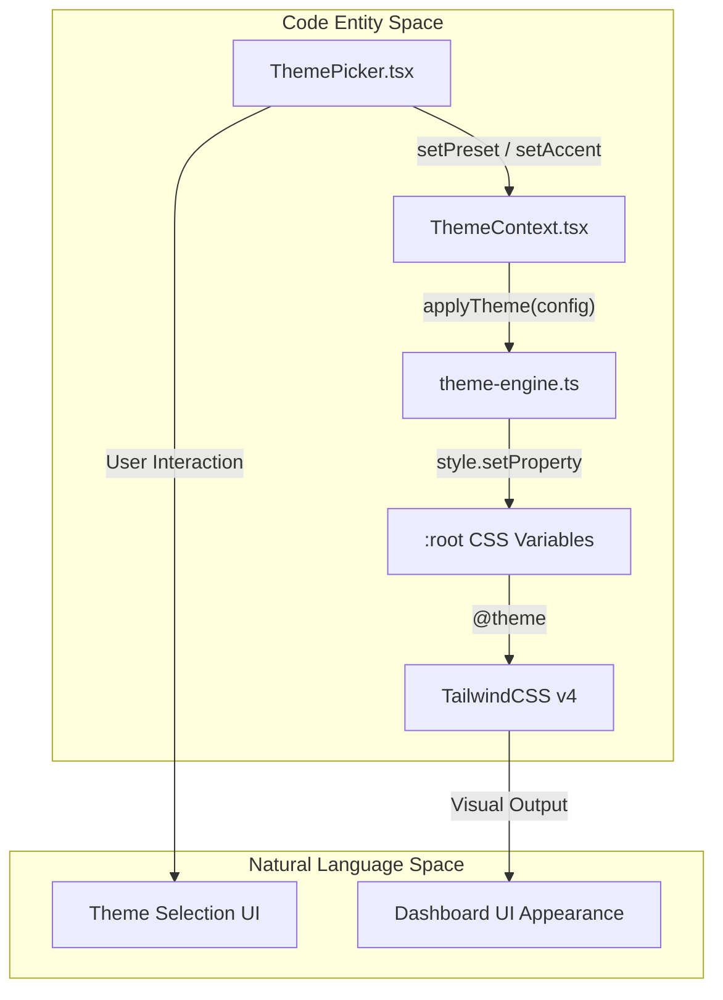
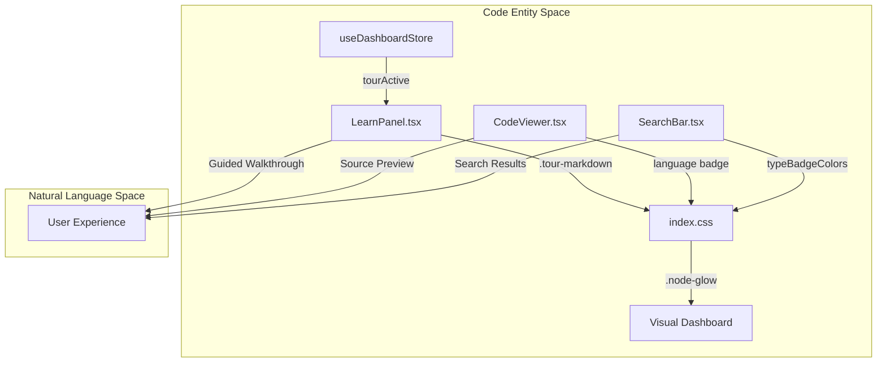

<!-- source: DeepWiki mcp.deepwiki.com · repo Lum1104/Understand-Anything · page 11.1 Dashboard Visual Design · fetched 2026-10-26 -->

# Dashboard Visual Design

Relevant source files

The following files were used as context for generating this wiki page:

- [understand-anything-plugin/packages/dashboard/src/components/CodeViewer.tsx](understand-anything-plugin/packages/dashboard/src/components/CodeViewer.tsx)
- [understand-anything-plugin/packages/dashboard/src/components/KeyboardShortcutsHelp.tsx](understand-anything-plugin/packages/dashboard/src/components/KeyboardShortcutsHelp.tsx)
- [understand-anything-plugin/packages/dashboard/src/components/LayerLegend.tsx](understand-anything-plugin/packages/dashboard/src/components/LayerLegend.tsx)
- [understand-anything-plugin/packages/dashboard/src/components/LearnPanel.tsx](understand-anything-plugin/packages/dashboard/src/components/LearnPanel.tsx)
- [understand-anything-plugin/packages/dashboard/src/components/SearchBar.tsx](understand-anything-plugin/packages/dashboard/src/components/SearchBar.tsx)
- [understand-anything-plugin/packages/dashboard/src/components/ThemePicker.tsx](understand-anything-plugin/packages/dashboard/src/components/ThemePicker.tsx)
- [understand-anything-plugin/packages/dashboard/src/hooks/useKeyboardShortcuts.ts](understand-anything-plugin/packages/dashboard/src/hooks/useKeyboardShortcuts.ts)
- [understand-anything-plugin/packages/dashboard/src/index.css](understand-anything-plugin/packages/dashboard/src/index.css)
- [understand-anything-plugin/packages/dashboard/src/themes/ThemeContext.tsx](understand-anything-plugin/packages/dashboard/src/themes/ThemeContext.tsx)
- [understand-anything-plugin/packages/dashboard/src/themes/index.ts](understand-anything-plugin/packages/dashboard/src/themes/index.ts)
- [understand-anything-plugin/packages/dashboard/src/themes/presets.ts](understand-anything-plugin/packages/dashboard/src/themes/presets.ts)
- [understand-anything-plugin/packages/dashboard/src/themes/theme-engine.ts](understand-anything-plugin/packages/dashboard/src/themes/theme-engine.ts)
- [understand-anything-plugin/packages/dashboard/src/themes/types.ts](understand-anything-plugin/packages/dashboard/src/themes/types.ts)
- [understand-anything-plugin/pnpm-workspace.yaml](understand-anything-plugin/pnpm-workspace.yaml)

This page documents the visual identity and implementation of the Understand Anything dashboard. The dashboard utilizes a "dark luxury" aesthetic characterized by a deep charcoal and gold palette, sophisticated typography, and glassmorphism effects. The design is implemented using TailwindCSS v4 with a custom theme engine that supports dynamic presets and accent swatches.

## Theme Configuration and Design Tokens

The visual system is built on a custom theme defined within the TailwindCSS v4 `@theme` block. This configuration establishes the base color hierarchy, typography, and node-specific coloring used across all React components.

### Color Palette
The palette is divided into functional groups to maintain semantic consistency across the UI. Base tokens are defined in `index.css` and overridden dynamically by the theme engine.

| Token | Default Hex/Value | Purpose |
| :--- | :--- | :--- |
| `--color-root` | `#0a0a0a` | Primary background of the application [understand-anything-plugin/packages/dashboard/src/index.css:7-7]() |
| `--color-surface` | `#111111` | Secondary background for headers and sidebars [understand-anything-plugin/packages/dashboard/src/index.css:8-8]() |
| `--color-elevated` | `#1a1a1a` | Background for hovered items and cards [understand-anything-plugin/packages/dashboard/src/index.css:9-9]() |
| `--color-accent` | `#d4a574` | Primary accent color (default: Gold) [understand-anything-plugin/packages/dashboard/src/index.css:13-13]() |
| `--color-text-primary` | `#f5f0eb` | Main content text [understand-anything-plugin/packages/dashboard/src/index.css:18-18]() |
| `--color-text-muted` | `#6b5f53` | Low-priority labels and hints [understand-anything-plugin/packages/dashboard/src/index.css:20-20]() |

### Typography
The system uses a tri-font strategy to balance readability with a premium feel:
*   **Serif**: `DM Serif Display` is used for headings and branding [understand-anything-plugin/packages/dashboard/src/index.css:82-82]().
*   **Sans**: `Inter` is the default font for UI elements and body text [understand-anything-plugin/packages/dashboard/src/index.css:84-84]().
*   **Mono**: `JetBrains Mono` is used for code snippets and keyboard shortcut indicators [understand-anything-plugin/packages/dashboard/src/index.css:83-83]().

Sources: [understand-anything-plugin/packages/dashboard/src/index.css:5-86](), [understand-anything-plugin/packages/dashboard/src/themes/presets.ts:32-53]()

## Theme Engine and Presets

The dashboard features a sophisticated theme engine that allows users to switch between presets and customize accent colors via the `ThemePicker` component [understand-anything-plugin/packages/dashboard/src/components/ThemePicker.tsx:6-40]().

### Preset System
Presets are defined as `ThemePreset` objects containing base colors and a collection of `AccentSwatch` options [understand-anything-plugin/packages/dashboard/src/themes/types.ts:16-23](). 

*   **Dark Gold**: The signature luxury theme [understand-anything-plugin/packages/dashboard/src/themes/presets.ts:25-54]().
*   **Dark Ocean/Forest/Rose**: Dark variations with themed backgrounds [understand-anything-plugin/packages/dashboard/src/themes/presets.ts:55-141]().
*   **Light Minimal**: A high-contrast light mode for bright environments [understand-anything-plugin/packages/dashboard/src/themes/presets.ts:143-171]().

### Dynamic Theme Application
The `applyTheme` function injects CSS variables directly into the document root. It derives secondary values (like glass backgrounds and glow effects) from the chosen accent color [understand-anything-plugin/packages/dashboard/src/themes/theme-engine.ts:10-31](). The `ThemeProvider` manages the lifecycle of these changes and persists them to `localStorage` [understand-anything-plugin/packages/dashboard/src/themes/ThemeContext.tsx:62-69]().

Title: Theme Data Flow

Sources: [understand-anything-plugin/packages/dashboard/src/themes/theme-engine.ts:1-56](), [understand-anything-plugin/packages/dashboard/src/themes/ThemeContext.tsx:1-106](), [understand-anything-plugin/packages/dashboard/src/components/ThemePicker.tsx:1-180]()

## Visual Effects and Utilities

To enhance the "luxury" feel, the dashboard employs several advanced CSS techniques including noise overlays and glassmorphism.

### Glassmorphism and Noise
*   **Noise Overlay**: A subtle SVG-based noise texture is applied globally via `.noise-overlay` to provide tactile depth [understand-anything-plugin/packages/dashboard/src/index.css:104-115]().
*   **.glass / .glass-heavy**: Utility classes providing backdrop blur (12px-16px) and semi-transparent borders [understand-anything-plugin/packages/dashboard/src/index.css:118-130]().

### Custom Scrollbars and Keyboards
*   **Scrollbars**: Customized with low-opacity accent colors for the thumb [understand-anything-plugin/packages/dashboard/src/index.css:224-237]().
*   **Keyboard Shortcuts**: Styled via the `.kbd` class using JetBrains Mono and accent borders [understand-anything-plugin/packages/dashboard/src/index.css:133-148](). The `KeyboardShortcutsHelp` component uses these to display available actions [understand-anything-plugin/packages/dashboard/src/components/KeyboardShortcutsHelp.tsx:80-91]().

## Component Styling Logic

### Node and Edge Visualization
Graph nodes are styled based on their type using specific color tokens defined in the theme [understand-anything-plugin/packages/dashboard/src/index.css:26-46]().
*   **File**: Blue-grey (`--color-node-file`) [understand-anything-plugin/packages/dashboard/src/index.css:27-27]()
*   **Function**: Green (`--color-node-function`) [understand-anything-plugin/packages/dashboard/src/index.css:28-28]()
*   **Class**: Purple (`--color-node-class`) [understand-anything-plugin/packages/dashboard/src/index.css:29-29]()

The `SearchBar` component maps these types to specific Tailwind classes for result badges [understand-anything-plugin/packages/dashboard/src/components/SearchBar.tsx:5-22]().

### Architectural Layers
The `LAYER_PALETTE` provides a distinct set of colors for architectural grouping, used by `LayerLegend` and cluster nodes to visually separate system domains [understand-anything-plugin/packages/dashboard/src/components/LayerLegend.tsx:5-13]().

### Diff Overlay Styling
When change analysis is active, specific glow effects highlight impact:
*   **Changed**: Red glow (`.diff-changed-glow`) [understand-anything-plugin/packages/dashboard/src/index.css:199-201]().
*   **Affected**: Amber glow (`.diff-affected-glow`) [understand-anything-plugin/packages/dashboard/src/index.css:203-205]().
*   **Unrelated**: Dimmed via `.diff-faded` [understand-anything-plugin/packages/dashboard/src/index.css:208-212]().

### Animation System
*   `fadeSlideIn`: Used for content appearing in panels [understand-anything-plugin/packages/dashboard/src/index.css:151-160]().
*   `accentPulse`: Periodic glow for active tour steps [understand-anything-plugin/packages/dashboard/src/index.css:171-178]().

Title: Dashboard Component Styling Mapping

Sources: [understand-anything-plugin/packages/dashboard/src/components/LearnPanel.tsx:120-155](), [understand-anything-plugin/packages/dashboard/src/components/CodeViewer.tsx:147-157](), [understand-anything-plugin/packages/dashboard/src/components/SearchBar.tsx:144-170](), [understand-anything-plugin/packages/dashboard/src/index.css:181-212]()

---

