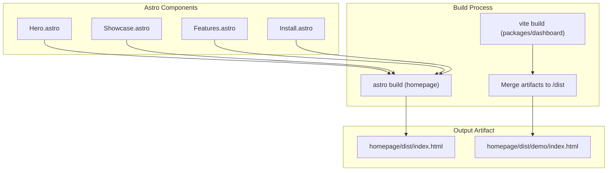
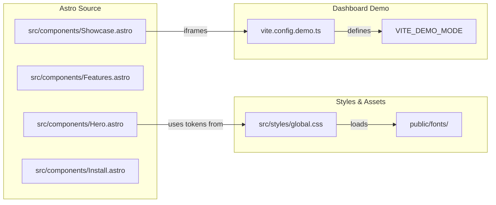

<!-- source: DeepWiki mcp.deepwiki.com · repo Lum1104/Understand-Anything · page 11.2 Homepage Design · fetched 2026-10-26 -->

# Homepage Design

Relevant source files

The following files were used as context for generating this wiki page:

- [READMEs/README.ru-RU.md](READMEs/README.ru-RU.md)
- [homepage/astro.config.mjs](homepage/astro.config.mjs)
- [homepage/public/CNAME](homepage/public/CNAME)
- [homepage/src/components/CommunityVideo.astro](homepage/src/components/CommunityVideo.astro)
- [homepage/src/components/Features.astro](homepage/src/components/Features.astro)
- [homepage/src/components/Footer.astro](homepage/src/components/Footer.astro)
- [homepage/src/components/Hero.astro](homepage/src/components/Hero.astro)
- [homepage/src/components/Install.astro](homepage/src/components/Install.astro)
- [homepage/src/components/Nav.astro](homepage/src/components/Nav.astro)
- [homepage/src/components/Problem.astro](homepage/src/components/Problem.astro)
- [homepage/src/components/Showcase.astro](homepage/src/components/Showcase.astro)
- [homepage/src/layouts/Layout.astro](homepage/src/layouts/Layout.astro)
- [homepage/src/pages/index.astro](homepage/src/pages/index.astro)
- [homepage/src/styles/global.css](homepage/src/styles/global.css)
- [understand-anything-plugin/packages/dashboard/vite.config.demo.ts](understand-anything-plugin/packages/dashboard/vite.config.demo.ts)

The **Understand Anything** project includes a cinematic, scroll-driven marketing homepage designed to attract new users and provide a high-level overview of the system's capabilities. Built using **Astro**, the site is optimized for performance with zero-JS framework overhead, utilizing vanilla JavaScript for scroll-triggered animations and self-hosted assets to ensure accessibility and reliability across different regions [homepage/src/layouts/Layout.astro:9-21](), [homepage/src/styles/global.css:1-32]().

## Architecture and Deployment

The homepage is structured as a Static Site Generated (SSG) project located within the `homepage/` directory of the monorepo. It serves as the entry point for the project's web presence and hosts the live demo of the dashboard [homepage/astro.config.mjs:5-7](), [homepage/src/components/Hero.astro:34-34]().

### Build and Deployment Pipeline
The deployment is automated via a GitHub Actions workflow that triggers on pushes to the `main` branch when changes are detected in the `homepage/`, `packages/dashboard/`, or `packages/core/` paths.

| Stage | Description |
| :--- | :--- |
| **Install** | Sets up Node.js 22 and pnpm, installing workspace dependencies. |
| **Build Core** | Compiles `@understand-anything/core` to ensure the dashboard has access to updated schemas and types. |
| **Build Demo** | Runs `build:demo` for the dashboard, using `vite.config.demo.ts` to inject `VITE_DEMO_MODE` and set the base path to `/demo/` [understand-anything-plugin/packages/dashboard/vite.config.demo.ts:7-19](). |
| **Build Home** | Executes `pnpm build` within the `homepage` directory. |
| **Merge** | Copies the dashboard's `dist` folder into `homepage/dist/demo` to create a unified deployment artifact. |
| **Deploy** | Uploads the merged artifact to GitHub Pages. |

**Sources:** [understand-anything-plugin/packages/dashboard/vite.config.demo.ts:1-49](), [homepage/astro.config.mjs:1-7]()

## Visual Design System

The homepage adopts a "Dark Luxury" aesthetic that mirrors the dashboard's visual identity. This is achieved through a consistent set of CSS design tokens and custom typography defined in a global stylesheet [homepage/src/styles/global.css:34-53]().

### Design Tokens
The system uses CSS custom properties to manage the color palette and typography, ensuring a consistent look across the hero, features, and install sections [homepage/src/styles/global.css:35-53]().

| Token | Typical Value | Description |
| :--- | :--- | :--- |
| `--bg` | `#0a0a0a` | Deep black background [homepage/src/styles/global.css:36-36](). |
| `--surface` | `#141414` | Card and component surface color [homepage/src/styles/global.css:37-37](). |
| `--accent` | `#d4a574` | Gold primary accent used for CTAs and icons [homepage/src/styles/global.css:39-39](). |
| `--text` | `#e8e2d8` | Warm white primary text [homepage/src/styles/global.css:41-41](). |
| `--font-heading`| `DM Serif Display` | Cinematic serif for headlines [homepage/src/styles/global.css:50-50](). |
| `--gradient` | `linear-gradient(...)` | Rose gold to gold sweep [homepage/src/styles/global.css:45-48](). |

### Self-Hosted Assets
To ensure performance and reliability, the site utilizes self-hosted images and fonts. The Hero section uses a background image `hero.jpg` with a gradient overlay to maintain text readability [homepage/src/components/Hero.astro:7-10](). Fonts like **DM Serif Display**, **Inter**, and **JetBrains Mono** are served directly from the `/fonts/` directory [homepage/src/styles/global.css:2-32]().

**Sources:** [homepage/src/styles/global.css:1-127](), [homepage/src/components/Hero.astro:100-122]()

## Page Structure and Components

The homepage is organized into sequential Astro components designed to lead the user from value proposition to installation [homepage/src/pages/index.astro:13-21]().

### 1. Hero Section (`Hero.astro`)
The entry point presents the core value proposition: "Understand Anything" [homepage/src/components/Hero.astro:15-17](). It provides immediate links to the installation section, the live demo, and social channels like Discord and GitHub [homepage/src/components/Hero.astro:32-45](). It also includes an enterprise contact link and a Substack subscription toggle [homepage/src/components/Hero.astro:51-84]().

### 2. Feature Cards (`Features.astro`)
A grid highlighting six key capabilities of the system using a `features` data array [homepage/src/components/Features.astro:2-33]():
- **Interactive Knowledge Graph**: Hierarchical drill-down and clustering.
- **Beyond Code Analysis**: Support for 26+ file types.
- **Smart Filtering & Search**: Fuzzy and semantic search.
- **Export & Share**: PNG, SVG, or JSON exports.
- **Dependency Path Finder**: Shortest path between components.
- **Guided Tours**: AI-generated walkthroughs.

### 3. Showcase & Community Video (`Showcase.astro`, `CommunityVideo.astro`)
- **Showcase**: Embeds the live demo of the dashboard within a macOS-style frame [homepage/src/components/Showcase.astro:18-33](). It uses an `iframe` to load the dashboard built via the `build:demo` command [homepage/src/components/Showcase.astro:26-32]().
- **Community Video**: Features a walkthrough video tour by Better Stack, embedded from YouTube [homepage/src/components/CommunityVideo.astro:7-37]().

### 4. Install Section (`Install.astro`)
Provides a terminal-style code block demonstrating installation via the Claude Code marketplace [homepage/src/components/Install.astro:4-19](). It includes a client-side script for copying the installation snippet to the clipboard [homepage/src/components/Install.astro:24-38]().

### 5. Footer (`Footer.astro`)
Contains repository links, license information, and the project tagline: "Graphs that teach. Built for AI coding assistants." [homepage/src/components/Footer.astro:7-23]().

**Sources:** [homepage/src/components/Hero.astro:1-86](), [homepage/src/components/Features.astro:1-48](), [homepage/src/components/Showcase.astro:1-44](), [homepage/src/components/CommunityVideo.astro:1-37](), [homepage/src/components/Install.astro:1-22](), [homepage/src/components/Footer.astro:1-23]()

## Interactions and Animations

The homepage utilizes a "Reveal" effect and noise textures to create a premium feel.

### Scroll-Reveal Implementation
Components use the `.reveal` class in conjunction with a CSS animation `fadeSlideUp` [homepage/src/styles/global.css:87-104](). An `IntersectionObserver` in the main index file triggers the `visible` class when elements enter the viewport [homepage/src/pages/index.astro:25-37](). The features grid specifically uses a modulo-based delay logic `reveal-delay-${(i % 2) + 1}` to stagger the appearance of cards [homepage/src/components/Features.astro:39-39]().

### Noise Texture
A fixed SVG turbulence filter is applied to the `body::before` pseudo-element to provide a subtle grain/noise texture across the entire site [homepage/src/styles/global.css:76-84]().

### Visual and Logical Mapping

The following diagram illustrates how the homepage components relate to the underlying codebase and the build process.

**Homepage Visual Pipeline**

**Sources:** [homepage/src/components/Showcase.astro:2-4](), [homepage/src/pages/index.astro:1-22](), [understand-anything-plugin/packages/dashboard/vite.config.demo.ts:1-7]()

### Component Directory Mapping
This diagram maps the logical homepage sections to their physical file locations and their relationship with the dashboard demo.

**Homepage Component Mapping**

**Sources:** [homepage/src/styles/global.css:1-53](), [homepage/src/components/Showcase.astro:26-32](), [understand-anything-plugin/packages/dashboard/vite.config.demo.ts:17-19](), [homepage/src/components/Hero.astro:135-145]()

---

