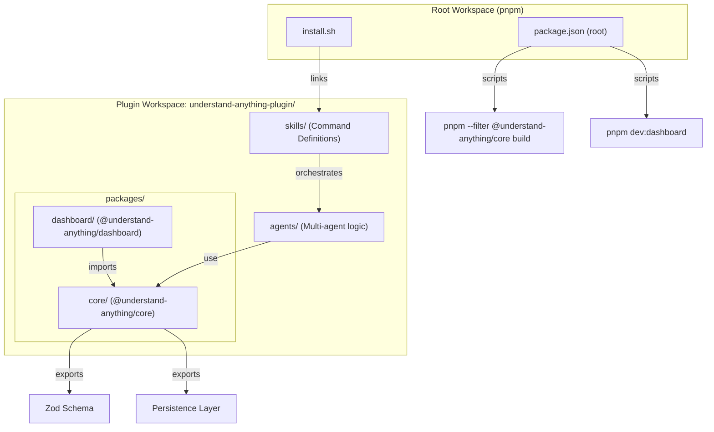
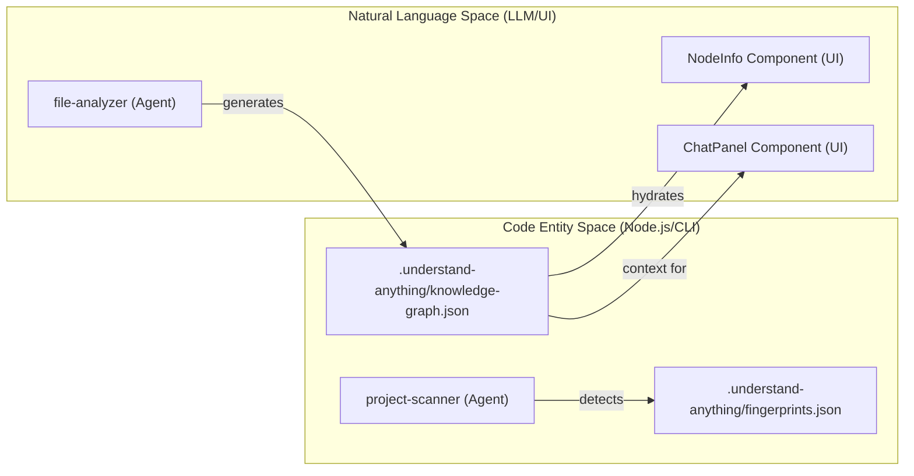

<!-- source: DeepWiki mcp.deepwiki.com · repo Lum1104/Understand-Anything · page 12 Development Guide · fetched 2026-10-26 -->

# Development Guide

<details>
<summary>Relevant source files</summary>

The following files were used as context for generating this wiki page:

- [.github/workflows/ci.yml](.github/workflows/ci.yml)
- [README.md](README.md)
- [READMEs/README.es-ES.md](READMEs/README.es-ES.md)
- [READMEs/README.ja-JP.md](READMEs/README.ja-JP.md)
- [READMEs/README.ko-KR.md](READMEs/README.ko-KR.md)
- [READMEs/README.tr-TR.md](READMEs/README.tr-TR.md)
- [READMEs/README.zh-CN.md](READMEs/README.zh-CN.md)
- [READMEs/README.zh-TW.md](READMEs/README.zh-TW.md)
- [install.ps1](install.ps1)
- [install.sh](install.sh)
- [package.json](package.json)

</details>


This document provides guidance for developers working on the Understand Anything codebase itself. It covers the development environment setup, build processes, testing infrastructure, and coding conventions used throughout the project.

For information about using the plugin to analyze codebases, see [Getting Started](#2). For architectural details about how the system works, see [System Architecture](#3).

## Overview

The Understand Anything codebase is organized as a **pnpm monorepo** [package.json:28](). The root workspace coordinates builds and testing across all packages, while the `understand-anything-plugin/` directory contains the core analysis engine, dashboard application, and plugin implementations for platforms like Claude Code and Cursor [README.md:46-47]().

Development requires familiarity with:
- **TypeScript 5.7+** in strict mode with ESM modules [package.json:4-40]()
- **pnpm workspaces** for dependency management and build orchestration [package.json:28-31]()
- **Vitest** for unit and integration testing [package.json:32-42]()
- **Multi-agent pipelines** using specialized agents for scanning and analysis [README.md:119]()
- **Tree-sitter** for multi-language static analysis [package.json:48-58]()

Title: Workspace Structure and Package Flow

Sources: [package.json:28-35](), [install.sh:25-43](), [README.md:119]()

## Prerequisites

Before starting development, ensure you have the following tools installed:

| Tool | Version | Purpose |
|------|---------|---------|
| Node.js | ≥ 22 | Runtime environment [package.json:30-32] (CI uses v22) |
| pnpm | ≥ 10.6.2 | Package manager (pinned via packageManager) [package.json:28]() |
| TypeScript | ^5.7.0 | Type checking and compilation [package.json:40]() |
| Git | Any recent | Version control and staleness detection [README.md:119]() |

The project enforces ESM modules and strict type checking across all packages [package.json:4]().

Sources: [package.json:4-42](), [.github/workflows/ci.yml:30-35]()

## Development Environment Layout

The codebase follows a structure where the root manages shared dev-dependencies and orchestration, while logic is encapsulated in the plugin sub-tree:

```
understand-anything/                    # Root workspace
├── package.json                        # Root build/test scripts [package.json:29-35]
├── install.sh / install.ps1            # Cross-platform installation scripts [install.sh:1-10]
├── .github/workflows/                  # CI/CD pipelines [ci.yml:1-20]
├── understand-anything-plugin/         # Main plugin workspace
│   ├── packages/
│   │   ├── core/                       # @understand-anything/core (Analyzer, Search, Schema)
│   │   └── dashboard/                  # @understand-anything/dashboard (React/Vite UI)
│   ├── agents/                         # Agent definitions (project-scanner, etc.)
│   └── skills/                         # Skill command definitions (/understand, etc.)
```

Sources: [package.json:1-61](), [install.sh:1-20](), [.github/workflows/ci.yml:1-51]()

## Code Entity to Visual Space Mapping

A critical part of development is ensuring that the data produced by the multi-agent pipeline in the "Code Entity Space" is correctly visualized in the dashboard.

Title: Data Flow from Analysis to Visualization

Sources: [README.md:116-119](), [README.md:130-136](), [package.json:17-25]()

## Common Development Commands

The root `package.json` provides scripts to manage the entire monorepo.

| Command | Action |
|---------|--------|
| `pnpm install` | Install all dependencies across the monorepo [package.json:35] |
| `pnpm build` | Build all packages in the correct order [package.json:31] |
| `pnpm test` | Run all Vitest tests [package.json:32] |
| `pnpm dev:dashboard` | Start the dashboard development server [package.json:33] |
| `pnpm lint` | Run ESLint across the project [package.json:34] |

Sources: [package.json:29-35](), [.github/workflows/ci.yml:34-51]()

## Testing and CI

### Testing Infrastructure
The project uses **Vitest** for testing core logic, search engines, and schema validation [package.json:32](). The CI pipeline ensures that both `@understand-anything/core` and the broader skill logic are tested on every push to `main` or pull request [.github/workflows/ci.yml:46-51]().

### Continuous Integration
The GitHub Actions workflow performs the following steps to ensure code quality:
1. Installs dependencies using `pnpm install` [.github/workflows/ci.yml:35]()
2. Lints the codebase [.github/workflows/ci.yml:38]()
3. Builds the core package [.github/workflows/ci.yml:41]()
4. Runs tests for both core and skills [.github/workflows/ci.yml:46-51]()

Sources: [.github/workflows/ci.yml:1-51](), [package.json:32]()

## Next Steps

For detailed instructions on specific development tasks, refer to the following child pages:

- **[Development Setup](#12.1)** — Guide to cloning the repo, installing dependencies with pnpm, and setting up the environment.
- **[Build Process](#12.2)** — Explanation of build scripts, TypeScript compilation order, and Vite configurations.
- **[Testing](#12.3)** — Documentation for the Vitest infrastructure and test patterns across packages.
- **[Code Conventions](#12.4)** — TypeScript strict mode, ESM module standards, and project-wide coding guidelines.

---

