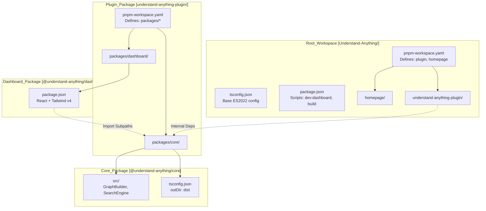
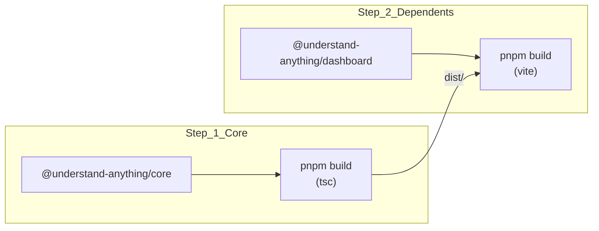

<!-- source: DeepWiki mcp.deepwiki.com · repo Lum1104/Understand-Anything · page 12.1 Development Setup · fetched 2026-10-26 -->

# Development Setup

<details>
<summary>Relevant source files</summary>

The following files were used as context for generating this wiki page:

- [.github/workflows/ci.yml](.github/workflows/ci.yml)
- [.gitignore](.gitignore)
- [.npmrc](.npmrc)
- [package.json](package.json)
- [pnpm-workspace.yaml](pnpm-workspace.yaml)
- [tsconfig.json](tsconfig.json)

</details>


This page provides instructions for setting up a local development environment to work on the Understand Anything codebase. It covers cloning the repository, installing dependencies, understanding the monorepo structure, and running the dashboard locally.

---

## Prerequisites

Before beginning, ensure you have the following tools installed:

| Tool | Minimum Version | Purpose |
|------|----------------|---------|
| **Node.js** | 22.x | JavaScript runtime [tsconfig.json:3]() [.github/workflows/ci.yml:30]() |
| **pnpm** | 10.6.2 | Package manager pinned via `packageManager` [package.json:28]() |
| **Git** | Any recent version | Version control |

The project uses modern TypeScript features targeting `ES2022` with `ESNext` modules and strict type checking [tsconfig.json:3-7]().

**Sources:** [package.json:28](), [tsconfig.json:3-7](), [.github/workflows/ci.yml:30]()

---

## Cloning the Repository

Clone the repository from GitHub:

```bash
git clone https://github.com/Lum1104/Understand-Anything.git
cd Understand-Anything
```

The repository uses a monorepo structure with `pnpm` workspaces [pnpm-workspace.yaml:1-5]().

---

## Repository Structure

### Directory Layout

The following diagram shows the complete directory structure and key configuration files, mapping the logical components to their physical locations.

**Code Entity Mapping: Repository Layout**


**Sources:** [pnpm-workspace.yaml:1-5](), [package.json:1-11](), [tsconfig.json:1-16]()

### Package Overview

| Package | Location | Purpose |
|---------|----------|---------|
| `@understand-anything/core` | `understand-anything-plugin/packages/core/` | Shared analysis engine, Zod schemas, persistence, and search. |
| `@understand-anything/dashboard` | `understand-anything-plugin/packages/dashboard/` | React web dashboard for graph visualization. |
| `understand-anything-plugin` | `understand-anything-plugin/` | The main plugin containing skills and agents. |
| `homepage` | `homepage/` | Astro-based marketing and documentation site [pnpm-workspace.yaml:4](). |

**Sources:** [pnpm-workspace.yaml:1-5](), [package.json:30-33]()

---

## Installing Dependencies

From the repository root, run:

```bash
pnpm install
```

This command performs the following operations:
1. **Workspace Resolution**: Identifies packages in the workspace hierarchy [pnpm-workspace.yaml:1-5]().
2. **Dependency Linking**: Links internal packages like `@understand-anything/core` to dependents.
3. **Binary Handling**: Manages built dependencies like `tree-sitter` parsers for various languages [package.json:44-60]().

**Sources:** [package.json:28, 44-60](), [pnpm-workspace.yaml:1-5]()

---

## Development Workflow

### Build Sequence

The project requires a specific build order because the dashboard and skills depend on the core library. The `prepare` script in the root ensures core is built first [package.json:30]().

**Code Entity Mapping: Build Pipeline**


1. **Build Core**: `pnpm --filter @understand-anything/core build` [package.json:30]()
2. **Build All**: `pnpm build` (runs recursively across all packages) [package.json:31]()

**Sources:** [package.json:30-31](), [.github/workflows/ci.yml:40-45]()

### Running the Dashboard Locally

To start the dashboard in development mode with hot-reloading:

```bash
pnpm dev:dashboard
```

This command starts the Vite development server for the dashboard package [package.json:33]().

**Sources:** [package.json:33]()

---

## Testing and Verification

### Running Tests
Execute the test suite using Vitest. The CI pipeline runs tests for both the core and skill components [.github/workflows/ci.yml:46-50]().

```bash
pnpm test
```

**Sources:** [package.json:32](), [.github/workflows/ci.yml:46-50]()

---

## IDE Configuration

### TypeScript Settings
The project enforces strict mode across all packages [tsconfig.json:7](). Key settings include:
- `target: "ES2022"`: For modern runtime features [tsconfig.json:3]().
- `moduleResolution: "bundler"`: For modern package resolution [tsconfig.json:6]().
- `declaration: true`: Generates `.d.ts` files for workspace linking [tsconfig.json:12]().
- `strict: true`: Mandatory type safety [tsconfig.json:7]().

**Sources:** [tsconfig.json:1-15]()

### Git Configuration
The project ignores build artifacts, local environment files, and the `.understand-anything` data directory [.gitignore:1-7]().

**Sources:** [.gitignore:1-20]()

---

