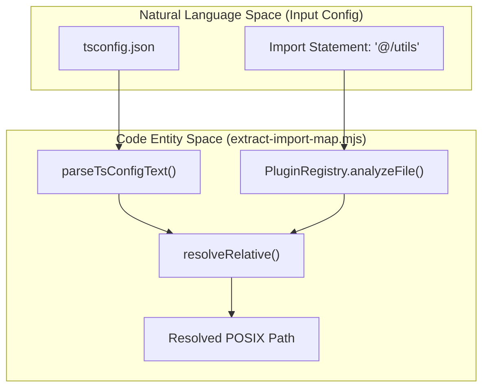
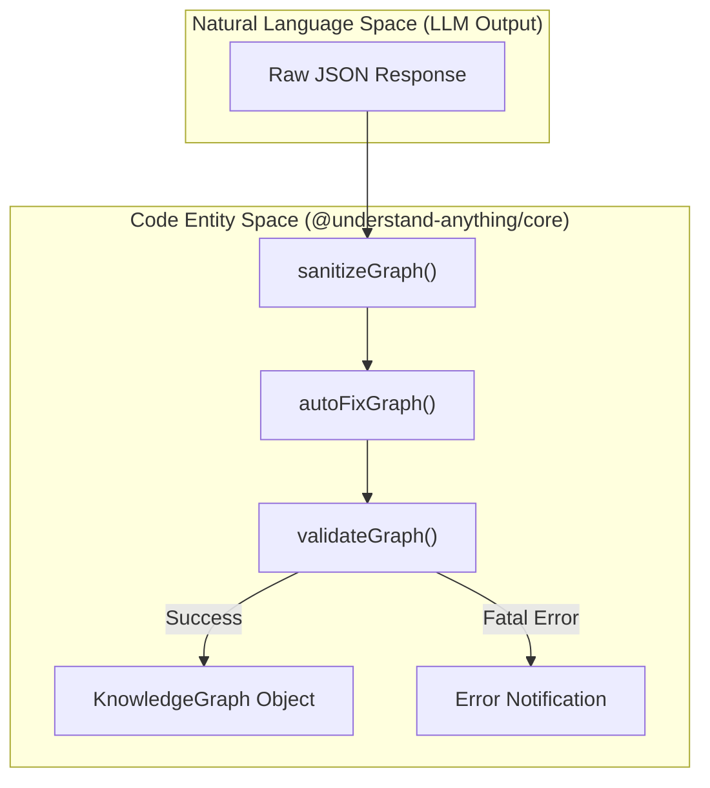
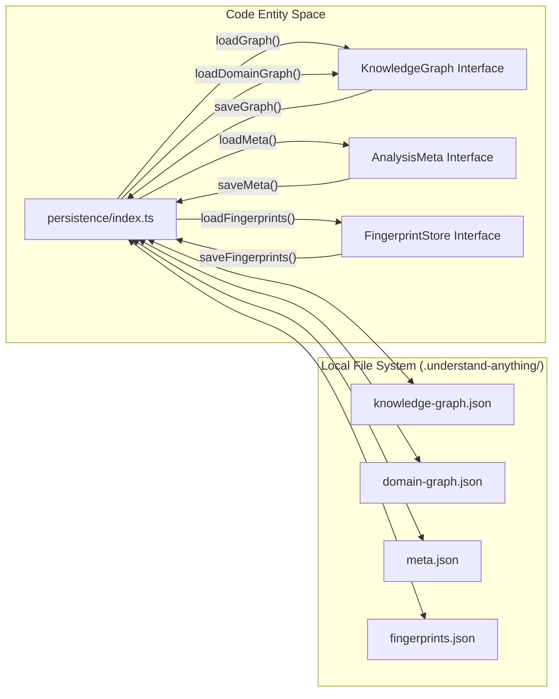

<!-- source: DeepWiki mcp.deepwiki.com · repo Lum1104/Understand-Anything · page 12.3 Testing · fetched 2026-10-26 -->

# Testing

Relevant source files

The following files were used as context for generating this wiki page:

- [tests/skill/understand/test_compute_batches.test.mjs](tests/skill/understand/test_compute_batches.test.mjs)
- [tests/skill/understand/test_extract_import_map.test.mjs](tests/skill/understand/test_extract_import_map.test.mjs)
- [tests/skill/understand/test_merge_batch_graphs.py](tests/skill/understand/test_merge_batch_graphs.py)
- [tests/skill/understand/test_scan_project.test.mjs](tests/skill/understand/test_scan_project.test.mjs)
- [understand-anything-plugin/packages/core/vitest.config.ts](understand-anything-plugin/packages/core/vitest.config.ts)
- [understand-anything-plugin/skills/understand/compute-batches.mjs](understand-anything-plugin/skills/understand/compute-batches.mjs)
- [understand-anything-plugin/skills/understand/extract-import-map.mjs](understand-anything-plugin/skills/understand/extract-import-map.mjs)

The Understand Anything project utilizes a robust testing infrastructure centered around **Vitest**. The test suite is distributed across `packages/core/__tests__` for library logic and `tests/skill/` for end-to-end integration tests of the CLI skills. These tests ensure the reliability of the multi-agent pipeline, deterministic path resolution, and graph integrity.

## Test Infrastructure and Organization

The testing environment is configured for ESM-first development. Tests are organized into two primary tiers:

1.  **Core Library Tests**: Located in `packages/core/src/__tests__`, focusing on schema validation, persistence, and the plugin registry.
2.  **Skill Integration Tests**: Located in `tests/skill/understand/`, these use `spawnSync` to execute the CLI scripts (e.g., `scan-project.mjs`, `compute-batches.mjs`) against temporary file trees to verify end-to-end behavior.

| Test File | Focus Area | Key Symbols Tested |
| :--- | :--- | :--- |
| `test_scan_project.test.mjs` | Language detection & file walking | `scan-project.mjs` |
| `test_extract_import_map.test.mjs` | Import resolution & tsconfig aliases | `extract-import-map.mjs` |
| `test_compute_batches.test.mjs` | Louvain clustering & symbol extraction | `compute-batches.mjs` |
| `test_merge_batch_graphs.py` | Test-to-production file linking | `is_test_path`, `production_candidates` |
| `plugin-registry.test.ts` | Analyzer dispatching logic | `PluginRegistry`, `analyzeFile` |

**Sources:** [understand-anything-plugin/packages/core/vitest.config.ts:1-7](), [tests/skill/understand/test_scan_project.test.mjs:16-20](), [tests/skill/understand/test_extract_import_map.test.mjs:8-9]()

---

## Skill-Level Integration Testing

The `/understand` command is tested by orchestrating its constituent scripts against real-world directory structures created in `tmpdir()`.

### Project Scanning and Language Detection
Tests in `test_scan_project.test.mjs` verify that `scan-project.mjs` correctly identifies file categories (code, docs, config) and maps extensions to language IDs [tests/skill/understand/test_scan_project.test.mjs:107-162](). It specifically validates the fallback from `git ls-files` to a manual directory walker when Git is unavailable [tests/skill/understand/test_scan_project.test.mjs:28-44]().

### Import Resolution and Alias Mapping
The `extract-import-map.mjs` script is tested for its ability to resolve complex pathing logic without an LLM.

**Import Resolution Data Flow**

**Sources:** [understand-anything-plugin/skills/understand/extract-import-map.mjs:149-177](), [tests/skill/understand/test_extract_import_map.test.mjs:94-125]()

### Batching and Community Detection
Tests in `test_compute_batches.test.mjs` ensure that `compute-batches.mjs` produces deterministic batches using the Louvain algorithm [tests/skill/understand/test_compute_batches.test.mjs:64-80](). It also verifies the "Group A-E" logic for non-code files, ensuring Dockerfiles and CI configs are clustered semantically [understand-anything-plugin/skills/understand/compute-batches.mjs:131-180]().

---

## Schema Validation and Normalization

The system employs a multi-stage validation pipeline to handle the inherent noise of LLM-generated JSON. Tests in `schema.test.ts` verify that the system can recover from common structural errors or "hallucinated" types.

### Validation Pipeline Flow
The following diagram illustrates how raw LLM output is transformed into a valid `KnowledgeGraph` entity.

**LLM Output to Validated Entity Flow**

**Sources:** [understand-anything-plugin/packages/core/src/schema.ts:148-194](), [understand-anything-plugin/packages/core/src/__tests__/schema.test.ts:61-110]()

---

## Persistence and Path Sanitization

Tests in `persistence.test.ts` ensure that sensitive local environment data is never persisted and that different graph types are stored in their respective files within `.understand-anything/`.

### Persistence Data Flow
This diagram shows how the `Persistence` layer bridges the local file system with the internal graph representation.

**File System to Persistence Layer Mapping**

**Sources:** [understand-anything-plugin/packages/core/src/persistence/index.ts:7-11](), [understand-anything-plugin/packages/core/src/persistence/persistence.test.ts:77-115]()

---

## Test-to-Production Linking

The `merge-batch-graphs.py` script contains a deterministic linker to associate test files with their production counterparts. This is tested in `test_merge_batch_graphs.py`.

### Path Classification Rules
The `is_test_path` function is tested against various language conventions [tests/skill/understand/test_merge_batch_graphs.py:65-148]():
*   **JS/TS**: Detects `.test.ts`, `.spec.tsx`, and files within `__tests__`.
*   **Go**: Detects `_test.go` suffixes.
*   **Python**: Detects `test_*.py` and `*_test.py`.
*   **Java/Kotlin**: Detects `*Test.java` and `*IT.java` in `src/test/`.

### Candidate Resolution
The `production_candidates` function is tested to ensure it correctly "guesses" the production file by stripping test infixes or walking out of test directories [tests/skill/understand/test_merge_batch_graphs.py:151-188](). For example, `src/foo/__tests__/X.test.ts` should resolve to `src/foo/X.ts`.

**Sources:** [tests/skill/understand/test_merge_batch_graphs.py:33-43](), [tests/skill/understand/test_merge_batch_graphs.py:151-188]()

---

## Plugin and Language Registry

Tests in `plugin-registry.test.ts` verify the orchestration of different analyzer plugins.
*   **Priority:** Confirms that later plugin registrations for the same language take priority [understand-anything-plugin/packages/core/src/__tests__/plugin-registry.test.ts:85-92]().
*   **Delegation:** Ensures `analyzeFile` and `resolveImports` are correctly delegated to the plugin associated with the file's extension [understand-anything-plugin/packages/core/src/__tests__/plugin-registry.test.ts:94-106]().
*   **Language Detection:** Validates that `getLanguageForFile` correctly maps extensions (e.g., `.tsx` to `typescript`) using the `LanguageRegistry` [understand-anything-plugin/packages/core/src/__tests__/plugin-registry.test.ts:143-149]().

**Sources:** [understand-anything-plugin/packages/core/src/plugins/registry.ts:11-37](), [understand-anything-plugin/packages/core/src/__tests__/plugin-registry.test.ts:22-60]()

---

