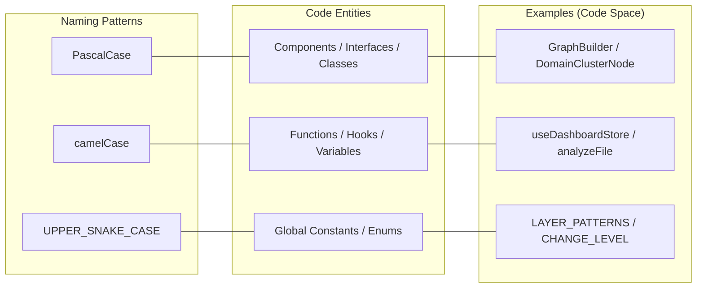

<!-- source: DeepWiki mcp.deepwiki.com · repo Lum1104/Understand-Anything · page 12.4 Code Conventions · fetched 2026-10-26 -->

# Code Conventions

<details>
<summary>Relevant source files</summary>

The following files were used as context for generating this wiki page:

- [.github/ISSUE_TEMPLATE/bug_report.yml](.github/ISSUE_TEMPLATE/bug_report.yml)
- [.github/ISSUE_TEMPLATE/config.yml](.github/ISSUE_TEMPLATE/config.yml)
- [.github/ISSUE_TEMPLATE/feature_request.yml](.github/ISSUE_TEMPLATE/feature_request.yml)
- [.github/ISSUE_TEMPLATE/question.yml](.github/ISSUE_TEMPLATE/question.yml)
- [.github/PULL_REQUEST_TEMPLATE.md](.github/PULL_REQUEST_TEMPLATE.md)
- [.github/workflows/ci.yml](.github/workflows/ci.yml)
- [.github/workflows/deploy-homepage.yml](.github/workflows/deploy-homepage.yml)
- [CODE_OF_CONDUCT.md](CODE_OF_CONDUCT.md)
- [CONTRIBUTING.md](CONTRIBUTING.md)
- [SECURITY.md](SECURITY.md)
- [docs/superpowers/plans/2026-03-14-phase1-implementation.md](docs/superpowers/plans/2026-03-14-phase1-implementation.md)
- [docs/superpowers/plans/2026-03-14-phase2-implementation.md](docs/superpowers/plans/2026-03-14-phase2-implementation.md)
- [docs/superpowers/plans/2026-03-14-phase3-implementation.md](docs/superpowers/plans/2026-03-14-phase3-implementation.md)
- [docs/superpowers/plans/2026-03-14-phase4-implementation.md](docs/superpowers/plans/2026-03-14-phase4-implementation.md)
- [docs/superpowers/plans/2026-03-18-multi-platform-simple-implementation.md](docs/superpowers/plans/2026-03-18-multi-platform-simple-implementation.md)
- [docs/superpowers/plans/2026-03-21-language-agnostic-plan.md](docs/superpowers/plans/2026-03-21-language-agnostic-plan.md)
- [docs/superpowers/plans/2026-03-25-dashboard-robustness-impl.md](docs/superpowers/plans/2026-03-25-dashboard-robustness-impl.md)
- [docs/superpowers/plans/2026-03-25-dashboard-robustness-plan.md](docs/superpowers/plans/2026-03-25-dashboard-robustness-plan.md)
- [docs/superpowers/plans/2026-03-26-theme-system-implementation.md](docs/superpowers/plans/2026-03-26-theme-system-implementation.md)
- [docs/superpowers/plans/2026-03-27-token-reduction-impl.md](docs/superpowers/plans/2026-03-27-token-reduction-impl.md)
- [homepage/public/images/overview-domain.gif](homepage/public/images/overview-domain.gif)
- [homepage/public/images/overview-structural.gif](homepage/public/images/overview-structural.gif)
- [package.json](package.json)

</details>


This document outlines the TypeScript conventions, module system standards, naming patterns, and coding practices enforced across all packages in the Understand Anything codebase. These conventions ensure consistency, type safety, and maintainability throughout the monorepo.

---

## TypeScript and Module Configuration

All packages in the monorepo share a common TypeScript configuration that enforces strict type checking and modern ECMAScript standards.

### ESM-Only Architecture
The project is built exclusively using ECMAScript modules (ESM). This is enforced by `"type": "module"` settings in the root `package.json` [package.json:4]() and inherited by packages in the monorepo.

**Key constraints include:**
- **Node.js Environment**: Native ESM support in Node.js >= 22 is required for development and execution [CONTRIBUTING.md:17]().
- **Dependency Management**: The project uses `pnpm` workspaces to manage cross-package dependencies while maintaining ESM isolation [package.json:28]().
- **Build Pipeline**: Compilation must follow a specific order where `@understand-anything/core` is built before dependent packages like the dashboard or skill implementation [package.json:30](), [.github/workflows/ci.yml:40-44]().

### Strict Type Safety
TypeScript strict mode is enabled globally via the project's `tsconfig.json` (referenced in [package.json:40]()). Guidelines from `CONTRIBUTING.md` reinforce this:
- **No `any`**: Use `unknown` if a type is truly indeterminate [CONTRIBUTING.md:157]().
- **Explicit Types**: Define types for all function parameters and return values [CONTRIBUTING.md:156]().
- **Interfaces vs Types**: Use interfaces for object shapes and type aliases for unions or complex types [CONTRIBUTING.md:158-159]().

**Sources:** [package.json:4-40](), [CONTRIBUTING.md:17-159](), [.github/workflows/ci.yml:40-44]()

---

## Project Conventions and Naming

### File and Directory Naming
The project follows strict casing rules to maintain a clean filesystem hierarchy.

| Entity Type | Convention | Example |
|-------------|------------|---------|
| Core Logic / Skills | `kebab-case.ts` | `file-analyzer.ts` |
| React Components | `PascalCase.tsx` | `DomainGraphView.tsx` |
| Development Scripts | `kebab-case.mjs` | `generate-large-graph.mjs` |
| Style/Config | `kebab-case.css` | `tailwind.config.ts` |

[CONTRIBUTING.md:182-196](), [package.json:27]()

### Code Entity Naming Standards

Title: Code Entity Naming to Code Space Mapping


**Sources:** [CONTRIBUTING.md:153-174](), [package.json:1-35]()

---

## Design Specs and Implementation Plans

The project utilizes a structured approach for planning major features through the `docs/superpowers/` directory. This ensures that "Natural Language Space" (intent) is mapped to "Code Entity Space" (implementation) before coding begins.

### Plan Format
New features are documented in `docs/superpowers/plans/` using a specific format:
- **Phase-based approach**: Implementation is broken down into manageable phases (e.g., `phase1-implementation.md`, `phase2-implementation.md`) [docs/superpowers/plans/2026-03-14-phase1-implementation.md:1]().
- **Component Mapping**: Plans explicitly list which files in `packages/core` or `packages/dashboard` will be modified.
- **Verification**: Each plan includes specific criteria for success.

**Sources:** [docs/superpowers/plans/2026-03-14-phase1-implementation.md:1](), [docs/superpowers/plans/2026-03-25-dashboard-robustness-plan.md:1]()

---

## Development Utilities

### Large Graph Generator
The `generate-large-graph.mjs` utility (referenced in section 12.4) is a critical development tool for stress-testing the visualization engine. It allows developers to simulate complex codebases without needing a real large-scale project.

Title: Testing Utility Data Flow
```mermaid
graph TD
    subgraph "Development Utility"
        GLG["generate-large-graph.mjs"]
    end

    subgraph "Execution Context"
        P["pnpm dev:dashboard"]
    end

    subgraph "Output Artifact"
        KG["knowledge-graph.json"]
    end

    subgraph "System Consumption"
        CORE["@understand-anything/core"]
        DASH["@understand-anything/dashboard"]
    end

    P --> GLG
    GLG -->| "Generates Mock" | KG
    KG -->| "Validated by" | CORE
    KG -->| "Rendered by" | DASH
```

**Sources:** [package.json:33](), [CONTRIBUTING.md:45-48]()

---

## Contribution and Workflow

### Commit Conventions
Contributors must use structured commit messages to facilitate automated changelog generation and clear history [CONTRIBUTING.md:90-98]():
- `feat:` New features.
- `fix:` Bug fixes.
- `docs:` Documentation.
- `style:` Formatting changes.
- `refactor:` Code restructuring.
- `test:` Testing updates.
- `chore:` Maintenance.

### Pull Request Requirements
Before submission, PRs must pass a checklist including:
- **Linting**: `pnpm lint` [package.json:34](), [CONTRIBUTING.md:76]().
- **Testing**: `pnpm test` covering both core and skill logic [package.json:32](), [CONTRIBUTING.md:71-73]().
- **Build**: Successful compilation of all workspace packages [package.json:31](), [CONTRIBUTING.md:79]().

### CI/CD Integration
The project uses GitHub Actions for Continuous Integration. Every push to `main` and every pull request triggers the CI pipeline which executes linting, building, and testing across the monorepo [.github/workflows/ci.yml:5-10]().

**Sources:** [CONTRIBUTING.md:90-109](), [package.json:29-35](), [.github/workflows/ci.yml:1-51]()

---

