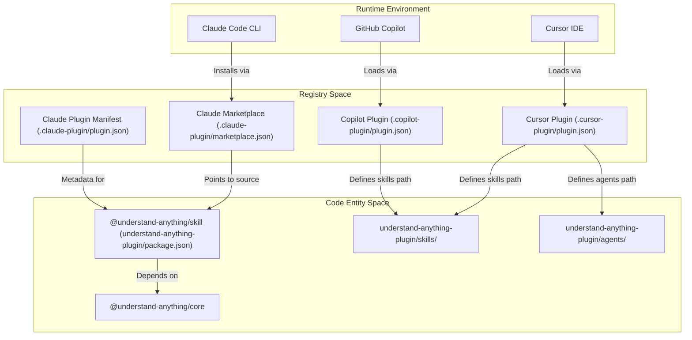
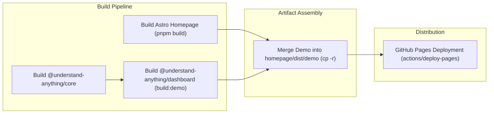

<!-- source: DeepWiki mcp.deepwiki.com · repo Lum1104/Understand-Anything · page 13 Deployment and Distribution · fetched 2026-10-26 -->

# Deployment and Distribution

Relevant source files

The following files were used as context for generating this wiki page:

- [.claude-plugin/marketplace.json](.claude-plugin/marketplace.json)
- [.claude-plugin/plugin.json](.claude-plugin/plugin.json)
- [.copilot-plugin/plugin.json](.copilot-plugin/plugin.json)
- [.cursor-plugin/plugin.json](.cursor-plugin/plugin.json)
- [.github/workflows/deploy-homepage.yml](.github/workflows/deploy-homepage.yml)
- [CONTRIBUTING.md](CONTRIBUTING.md)
- [homepage/public/images/overview-domain.gif](homepage/public/images/overview-domain.gif)
- [homepage/public/images/overview-structural.gif](homepage/public/images/overview-structural.gif)
- [understand-anything-plugin/.claude-plugin/plugin.json](understand-anything-plugin/.claude-plugin/plugin.json)
- [understand-anything-plugin/package.json](understand-anything-plugin/package.json)

This document explains how the Understand Anything plugin is packaged, versioned, and distributed to users through the Claude Code Marketplace, Cursor, and other platforms. It also documents the automated deployment of the promotional homepage and live demo to GitHub Pages.

---

## Overview

The Understand Anything system utilizes a multi-platform distribution strategy to reach developers across different AI-assisted IDEs and environments.

| Component | Distribution Method | Target Audience |
|-----------|-------------------|-----------------|
| **Plugin Package** | Claude Marketplace / Cursor Registry | End users installing the tool via AI CLI or IDE |
| **Installer Scripts** | Platform-specific linking | Users on Gemini, Codex, OpenCode, Pi, etc. |
| **Homepage** | GitHub Pages (`Lum1104.github.io`) | New users discovering the project |
| **Live Demo** | GitHub Pages Subdirectory (`/demo/`) | Users wanting to try the UI without installation |

**Sources**: [.claude-plugin/marketplace.json:1-15](), [.cursor-plugin/plugin.json:1-15](), [.github/workflows/deploy-homepage.yml:60-69]()

---

## Plugin Distribution Architecture

The plugin is distributed as a set of skills and agents. While the source resides in a monorepo, the distribution focuses on the `understand-anything-plugin` directory and the universal `plugin.json` manifests.

### Code-to-System Mapping

**Distribution Architecture Diagram**: This bridges the marketplace metadata files to the internal package structure. The `marketplace.json` file [1-15]() and platform-specific `plugin.json` files [1-18]() act as the entry points for external platforms to locate the `@understand-anything/skill` package [2-3]() and its associated `skills/` and `agents/` directories [13-14]().

**Sources**: [.claude-plugin/marketplace.json:1-15](), [.claude-plugin/plugin.json:1-18](), [.cursor-plugin/plugin.json:1-15](), [.copilot-plugin/plugin.json:1-14](), [understand-anything-plugin/package.json:1-13]()

---

## Version Management

Version synchronization is critical because multiple platform-specific manifests must match the underlying NPM package version to prevent installation failures or update loops. The current production version is `2.7.6`.

For details, see [Version Management](#13.1).

### Version Synchronization Requirements

| File Path | Role | Key Field |
|-----------|------|-----------|
| `understand-anything-plugin/package.json` | Primary NPM Package | `"version": "2.7.6"` |
| `.claude-plugin/plugin.json` | Claude Metadata | `"version": "2.7.6"` |
| `.cursor-plugin/plugin.json` | Cursor Metadata | `"version": "2.7.6"` |
| `.copilot-plugin/plugin.json` | Copilot Metadata | `"version": "2.7.6"` |

**Sources**: [understand-anything-plugin/package.json:3](), [.claude-plugin/plugin.json:4](), [.cursor-plugin/plugin.json:5](), [.copilot-plugin/plugin.json:4]()

---

## Homepage and Demo Deployment

The project maintains a high-visibility presence through an Astro-based homepage and a live interactive demo of the dashboard. This is managed via a unified GitHub Actions pipeline that builds the `core` library before assembling the `dashboard` in demo mode.

For details, see [Homepage Deployment](#13.2).

### Deployment Pipeline Flow

**CI/CD Pipeline Diagram**: The build process ensures that the `dashboard` package is compiled with specialized configurations for the web demo, distinct from the local plugin server mode. The workflow uses environment variables for demo data URLs [49-51]().

**Sources**: [.github/workflows/deploy-homepage.yml:39-55](), [understand-anything-plugin/package.json:7-10](), [CONTRIBUTING.md:34-48]()

---

## Build Artifacts and Structure

The distribution consists of the compiled outputs from the pnpm workspace. The `understand-anything-plugin` directory acts as the root for the Claude Code plugin distribution.

### Plugin Structure
When installed, the plugin directory contains:
- **`dist/`**: Compiled TypeScript from the `@understand-anything/skill` package [understand-anything-plugin/package.json:5]().
- **`skills/`**: Command definitions (e.g., `/understand`, `/understand-chat`) [.cursor-plugin/plugin.json:13]().
- **`agents/`**: Multi-agent pipeline definitions [.cursor-plugin/plugin.json:14]().
- **`node_modules/`**: Dependencies, including the local `@understand-anything/core` workspace link [understand-anything-plugin/package.json:12]().

### Build Commands
Before distribution, artifacts must be generated:
- **Skill**: `pnpm build` (runs `tsc`) [understand-anything-plugin/package.json:8]().
- **Core**: `pnpm --filter @understand-anything/core build` [CONTRIBUTING.md:34-37]().
- **Testing**: `pnpm test` (runs `vitest`) [understand-anything-plugin/package.json:9]().

**Sources**: [understand-anything-plugin/package.json:1-21](), [.cursor-plugin/plugin.json:13-14](), [CONTRIBUTING.md:34-43](), [.github/workflows/deploy-homepage.yml:43-47]()

---

