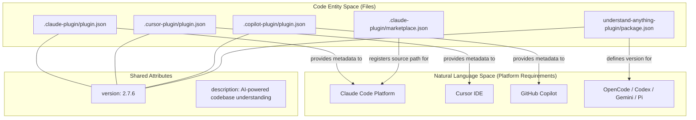
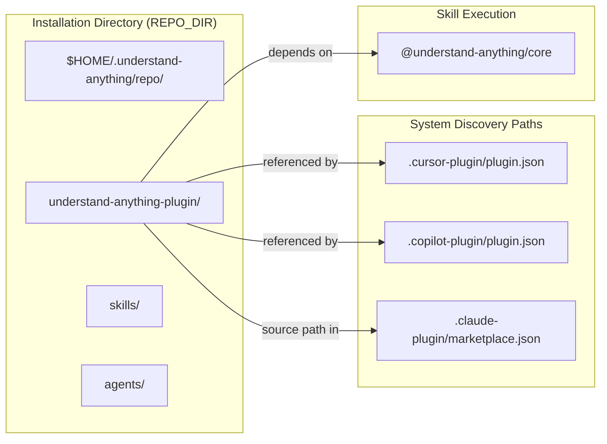

<!-- source: DeepWiki mcp.deepwiki.com · repo Lum1104/Understand-Anything · page 13.1 Version Management · fetched 2026-10-26 -->

# Version Management

Relevant source files

The following files were used as context for generating this wiki page:

- [.claude-plugin/marketplace.json](.claude-plugin/marketplace.json)
- [.claude-plugin/plugin.json](.claude-plugin/plugin.json)
- [.copilot-plugin/plugin.json](.copilot-plugin/plugin.json)
- [.cursor-plugin/plugin.json](.cursor-plugin/plugin.json)
- [README.md](README.md)
- [READMEs/README.es-ES.md](READMEs/README.es-ES.md)
- [READMEs/README.ja-JP.md](READMEs/README.ja-JP.md)
- [READMEs/README.ko-KR.md](READMEs/README.ko-KR.md)
- [READMEs/README.tr-TR.md](READMEs/README.tr-TR.md)
- [READMEs/README.zh-CN.md](READMEs/README.zh-CN.md)
- [READMEs/README.zh-TW.md](READMEs/README.zh-TW.md)
- [install.ps1](install.ps1)
- [install.sh](install.sh)
- [understand-anything-plugin/.claude-plugin/plugin.json](understand-anything-plugin/.claude-plugin/plugin.json)
- [understand-anything-plugin/package.json](understand-anything-plugin/package.json)

## Purpose and Scope

This document explains the version synchronization requirements and multi-platform distribution strategy for the Understand Anything project. To ensure consistent behavior across AI platforms (Claude, Cursor, Copilot, OpenCode, Codex, Gemini, and Pi), the plugin's versioning metadata must be kept in sync across multiple configuration files. This page details the implementation of these metadata files and the data flow between the core packages and platform-specific plugin definitions.

---

## Version Synchronization Requirement

The Understand Anything project utilizes a monorepo structure where the core logic resides in `@understand-anything/core` and the platform-specific skills reside in `understand-anything-plugin`. Strict version alignment (currently `2.7.6`) is required across the following files to ensure marketplace compatibility and correct dependency resolution.

### Core Versioned Files

| File Path | Field | Purpose |
|:---|:---|:---|
| `understand-anything-plugin/package.json` | `version` | Defines the NPM version for the skill package. [understand-anything-plugin/package.json:3]() |
| `.claude-plugin/plugin.json` | `version` | Metadata for the Claude Code platform. [.claude-plugin/plugin.json:4]() |
| `.cursor-plugin/plugin.json` | `version` | Metadata for the Cursor platform. [.cursor-plugin/plugin.json:5]() |
| `.copilot-plugin/plugin.json` | `version` | Metadata for GitHub Copilot. [.copilot-plugin/plugin.json:4]() |
| `understand-anything-plugin/.claude-plugin/plugin.json` | `version` | Internal manifest for Claude within the plugin subdirectory. [understand-anything-plugin/.claude-plugin/plugin.json:4]() |

**Sources**: [understand-anything-plugin/package.json:1-3](), [.claude-plugin/plugin.json:1-4](), [.cursor-plugin/plugin.json:1-5](), [.copilot-plugin/plugin.json:1-4](), [understand-anything-plugin/.claude-plugin/plugin.json:1-4]()

---

## Multi-Platform Distribution Architecture

Understand Anything is distributed as a set of "skills" and "agents" that can be consumed by various LLM-based development tools. While Claude, Cursor, and Copilot use specific `plugin.json` manifests, other platforms like OpenCode, Codex, Gemini, and Pi rely on standardized symlink structures created by the installer.

### Platform Metadata Mapping

The following diagram illustrates how the project bridges the "Natural Language Space" of platform requirements to the "Code Entity Space" of specific configuration files.

**Diagram: Platform Metadata Mapping**

**Sources**: [.claude-plugin/plugin.json:1-4](), [.cursor-plugin/plugin.json:1-5](), [.copilot-plugin/plugin.json:1-4](), [understand-anything-plugin/package.json:1-3](), [.claude-plugin/marketplace.json:1-15]()

---

## Implementation Details

### Claude, Cursor, and Copilot Manifests
These platforms require a `plugin.json` file, but with slightly different schemas and capabilities:
*   **Claude**: Uses `.claude-plugin/plugin.json` for general metadata and `.claude-plugin/marketplace.json` to define the owner and source directory (`./understand-anything-plugin`). [.claude-plugin/plugin.json:1-18](), [.claude-plugin/marketplace.json:1-15]()
*   **Cursor**: Uses `.cursor-plugin/plugin.json` which explicitly defines the paths for `skills` and `agents`. [.cursor-plugin/plugin.json:13-14]()
*   **Copilot**: Uses `.copilot-plugin/plugin.json` with a structure similar to Cursor, pointing to the plugin sub-directories. [.copilot-plugin/plugin.json:12-13]()

### Universal Distribution (OpenCode, Codex, Gemini, Pi)
For platforms without a centralized manifest-driven marketplace, the project uses the `install.sh` (macOS/Linux) and `install.ps1` (Windows) scripts. These scripts automate the discovery mechanism:

1.  **Cloning**: The repository is cloned to a default directory at `$HOME/.understand-anything/repo`. [READMEs/README.zh-CN.md:198]()
2.  **Symlinking**: The installation scripts create symbolic links for specific platforms (e.g., `gemini`, `codex`, `opencode`, `pi`, `vscode`). [READMEs/README.zh-CN.md:200]()
3.  **Discovery**: Platforms like Cursor and VS Code with GitHub Copilot automatically discover the plugin via the presence of `.cursor-plugin/plugin.json` or `.copilot-plugin/plugin.json` when the repository is opened. [READMEs/README.zh-CN.md:206-212]()

**Diagram: Universal Skill Discovery Flow**

**Sources**: [.cursor-plugin/plugin.json:13-14](), [.copilot-plugin/plugin.json:12-13](), [.claude-plugin/marketplace.json:12](), [understand-anything-plugin/package.json:12]()

---

## Package and Workspace Management

The `understand-anything-plugin` package manages its dependencies through the `pnpm` workspace.

*   **Dependency Linking**: The plugin depends on the core package via the `workspace:*` protocol, ensuring it always uses the local compiled version of `@understand-anything/core`. [understand-anything-plugin/package.json:12]()
*   **Build Order**: The plugin's build script runs `tsc` to compile TypeScript definitions and source code into the `dist/` directory. [understand-anything-plugin/package.json:7-8]()

### Versioning Summary Table

| Platform | Manifest File | Version Source | Discovery Method |
|:---|:---|:---|:---|
| **Claude Code** | `.claude-plugin/plugin.json` | `2.7.6` | Marketplace / Local Source |
| **Cursor** | `.cursor-plugin/plugin.json` | `2.7.6` | Local Plugin Directory |
| **Copilot** | `.copilot-plugin/plugin.json` | `2.7.6` | `.copilot-plugin` discovery |
| **Gemini / Codex** | N/A | `package.json` | `install.sh` platform link |
| **OpenCode / Pi** | N/A | `package.json` | `install.sh` platform link |

**Sources**: [understand-anything-plugin/package.json:1-21](), [.claude-plugin/plugin.json:1-18](), [.cursor-plugin/plugin.json:1-15](), [.copilot-plugin/plugin.json:1-14](), [READMEs/README.zh-CN.md:173-234]()

---

