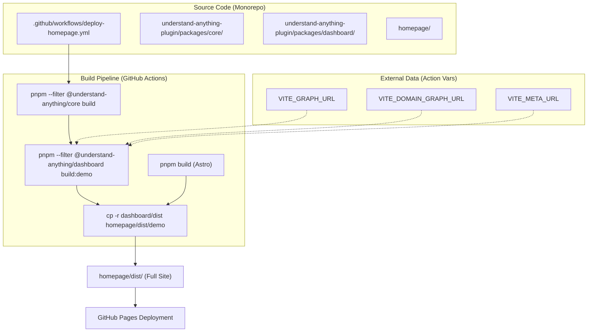
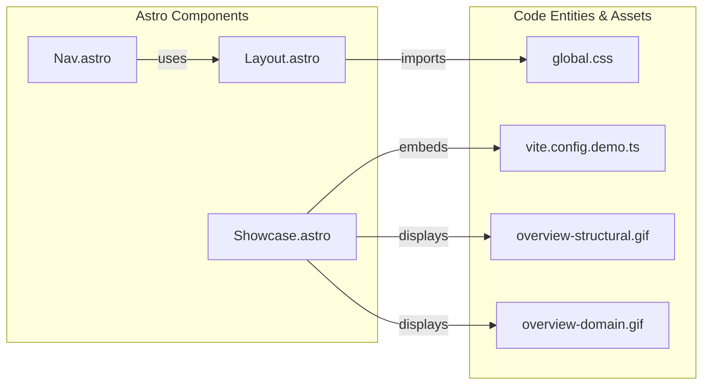

<!-- source: DeepWiki mcp.deepwiki.com · repo Lum1104/Understand-Anything · page 13.2 Homepage Deployment · fetched 2026-10-26 -->

# Homepage Deployment

Relevant source files

The following files were used as context for generating this wiki page:

- [.github/workflows/ci.yml](.github/workflows/ci.yml)
- [.github/workflows/deploy-homepage.yml](.github/workflows/deploy-homepage.yml)
- [CONTRIBUTING.md](CONTRIBUTING.md)
- [homepage/astro.config.mjs](homepage/astro.config.mjs)
- [homepage/public/CNAME](homepage/public/CNAME)
- [homepage/public/images/overview-domain.gif](homepage/public/images/overview-domain.gif)
- [homepage/public/images/overview-structural.gif](homepage/public/images/overview-structural.gif)
- [homepage/src/components/Nav.astro](homepage/src/components/Nav.astro)
- [homepage/src/components/Showcase.astro](homepage/src/components/Showcase.astro)
- [homepage/src/layouts/Layout.astro](homepage/src/layouts/Layout.astro)
- [homepage/src/styles/global.css](homepage/src/styles/global.css)
- [package.json](package.json)
- [understand-anything-plugin/packages/dashboard/vite.config.demo.ts](understand-anything-plugin/packages/dashboard/vite.config.demo.ts)

This document describes the automated deployment pipeline for the Understand Anything homepage and its integrated demo dashboard. The homepage is an Astro-based static site, while the demo dashboard is a specialized build of the React application, both hosted together on GitHub Pages at `understand-anything.com`.

---

## Overview

The deployment infrastructure manages two distinct web entities within the monorepo:
1.  **Marketing Homepage**: An Astro-powered site located in the `homepage/` directory, utilizing a "Dark Luxury" design system with self-hosted fonts and scroll-reveal animations [homepage/src/styles/global.css:1-108]().
2.  **Live Demo Dashboard**: A specialized build of `@understand-anything/dashboard` that consumes static JSON data from remote URLs. This is embedded via an `iframe` in the homepage [homepage/src/components/Showcase.astro:26-32]().

The deployment is handled by the `deploy-homepage.yml` GitHub Actions workflow which synchronizes the builds of the core library, the dashboard, and the Astro frontend [.github/workflows/deploy-homepage.yml:1-11]().

---

## Deployment Architecture

The following diagram illustrates the data flow and build process that bridges the source code to the live GitHub Pages environment.

### Pipeline Data Flow

**Implementation Details:**
- **Core Dependency**: The dashboard depends on the compiled output of `@understand-anything/core`. The CI builds core first [.github/workflows/deploy-homepage.yml:43-44]() to ensure aliases in `vite.config.demo.ts` resolve correctly to `../core/dist/` [understand-anything-plugin/packages/dashboard/vite.config.demo.ts:11-13]().
- **Demo Build**: The dashboard uses `vite.config.demo.ts` which sets the base path to `/demo/` [understand-anything-plugin/packages/dashboard/vite.config.demo.ts:7-7]() and enables `VITE_DEMO_MODE` [understand-anything-plugin/packages/dashboard/vite.config.demo.ts:18-18]().
- **Integration**: The compiled dashboard is moved into the Astro output directory at `homepage/dist/demo` [.github/workflows/deploy-homepage.yml:54-54](). The Astro `Showcase` component calculates the `demoUrl` based on the environment base URL to point to this location [homepage/src/components/Showcase.astro:2-3]().

**Sources:** [.github/workflows/deploy-homepage.yml:39-55](), [understand-anything-plugin/packages/dashboard/vite.config.demo.ts:1-19](), [homepage/src/components/Showcase.astro:1-33]()

---

## CI/CD Pipeline Configuration

### Trigger Conditions
The workflow triggers on pushes to `main` that affect the website or core logic, or via manual dispatch [.github/workflows/deploy-homepage.yml:3-11](). A separate CI workflow runs on pull requests to validate builds and run Vitest suites for `core` and `skill` packages [.github/workflows/ci.yml:1-51]().

### Demo Dashboard Build Strategy
The `vite.config.demo.ts` configuration is optimized for a standalone web deployment:

- **Environment Injection**: It consumes `DEMO_GRAPH_URL`, `DEMO_DOMAIN_GRAPH_URL`, and `DEMO_META_URL` from GitHub Action variables [.github/workflows/deploy-homepage.yml:48-51]().
- **Manual Chunking**: To optimize loading, it splits the bundle into `react-vendor`, `xyflow`, `graph-layout` (dagre/d3), and `markdown` chunks [understand-anything-plugin/packages/dashboard/vite.config.demo.ts:24-43]().

**Sources:** [understand-anything-plugin/packages/dashboard/vite.config.demo.ts:21-46](), [.github/workflows/deploy-homepage.yml:46-52](), [.github/workflows/ci.yml:1-51]()

---

## Homepage Visual System Implementation

The homepage is built with Astro and styled via `global.css`, implementing a "Dark Luxury" aesthetic that mirrors the dashboard's design language.

### Design Tokens and Assets
- **Typography**: Uses self-hosted fonts (`DM Serif Display`, `Inter`, `JetBrains Mono`) to eliminate external CDN dependencies [homepage/src/styles/global.css:1-32]().
- **Color Palette**: Defined via CSS variables including `--bg: #0a0a0a`, `--accent: #d4a574` (Gold), and a rose-gold gradient sweep [homepage/src/styles/global.css:35-48]().
- **Interactive Elements**: Includes a noise texture overlay and a `fadeSlideUp` animation for elements marked with the `.reveal` class [homepage/src/styles/global.css:76-104]().

### Code Entity to UI Mapping

**Sources:** [homepage/src/layouts/Layout.astro:23-25](), [homepage/src/styles/global.css:35-53](), [homepage/src/components/Showcase.astro:7-44]()

---

## Security and Permissions

The deployment uses GitHub's OIDC for secure deployment to GitHub Pages environment.

- **Permissions**: Requires `contents: read`, `pages: write`, and `id-token: write` [.github/workflows/deploy-homepage.yml:13-16]().
- **Concurrency**: The `group: pages` concurrency setting with `cancel-in-progress: true` ensures only the latest commit is deployed if multiple pushes occur rapidly [.github/workflows/deploy-homepage.yml:18-20]().
- **Custom Domain**: The project uses a `CNAME` file to point `understand-anything.com` to the GitHub Pages server [homepage/public/CNAME:1-1](), and the Astro config specifies the site URL [homepage/astro.config.mjs:5-7]().

**Sources:** [.github/workflows/deploy-homepage.yml:13-20](), [homepage/public/CNAME:1-1](), [homepage/astro.config.mjs:5-7]()

---

