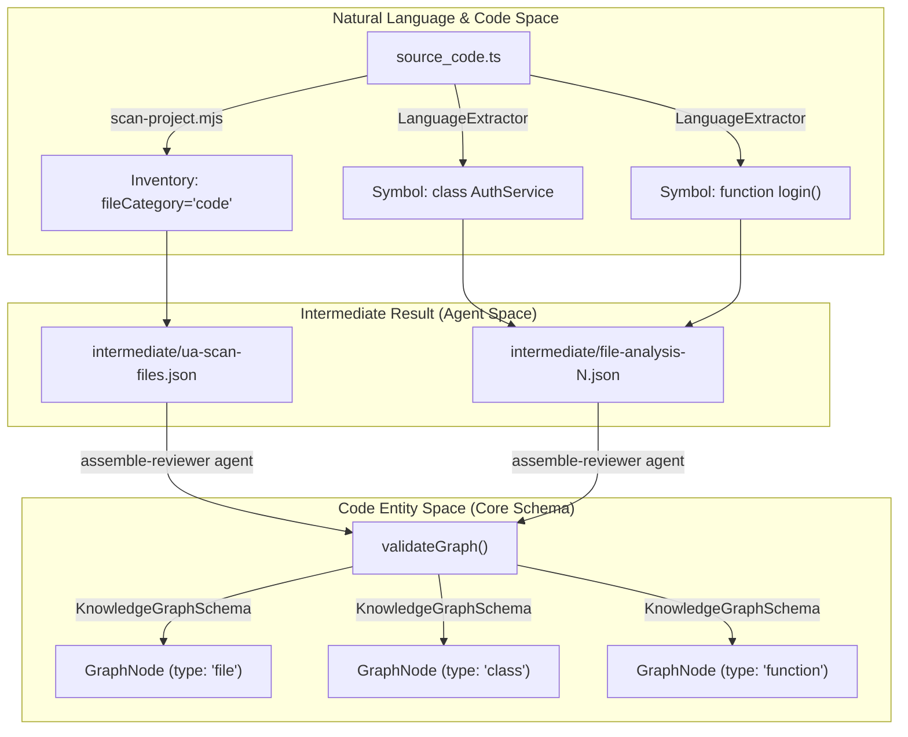
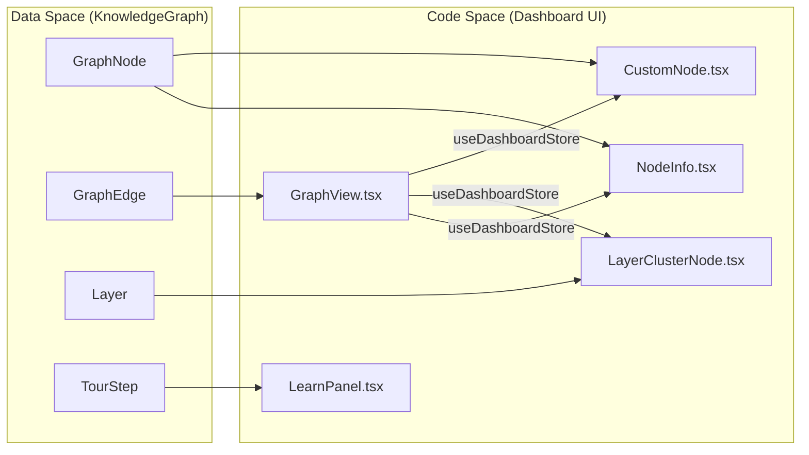

<!-- source: DeepWiki mcp.deepwiki.com · repo Lum1104/Understand-Anything · page 14 Glossary · fetched 2026-10-26 -->

# Glossary

Relevant source files

The following files were used as context for generating this wiki page:

- [CLAUDE.md](CLAUDE.md)
- [README.md](README.md)
- [READMEs/README.es-ES.md](READMEs/README.es-ES.md)
- [READMEs/README.ja-JP.md](READMEs/README.ja-JP.md)
- [READMEs/README.ko-KR.md](READMEs/README.ko-KR.md)
- [READMEs/README.tr-TR.md](READMEs/README.tr-TR.md)
- [READMEs/README.zh-CN.md](READMEs/README.zh-CN.md)
- [READMEs/README.zh-TW.md](READMEs/README.zh-TW.md)
- [eslint.config.mjs](eslint.config.mjs)
- [install.ps1](install.ps1)
- [install.sh](install.sh)
- [scripts/generate-large-graph.mjs](scripts/generate-large-graph.mjs)
- [understand-anything-plugin/agents/architecture-analyzer.md](understand-anything-plugin/agents/architecture-analyzer.md)
- [understand-anything-plugin/agents/article-analyzer.md](understand-anything-plugin/agents/article-analyzer.md)
- [understand-anything-plugin/agents/assemble-reviewer.md](understand-anything-plugin/agents/assemble-reviewer.md)
- [understand-anything-plugin/agents/domain-analyzer.md](understand-anything-plugin/agents/domain-analyzer.md)
- [understand-anything-plugin/agents/graph-reviewer.md](understand-anything-plugin/agents/graph-reviewer.md)
- [understand-anything-plugin/agents/knowledge-graph-guide.md](understand-anything-plugin/agents/knowledge-graph-guide.md)
- [understand-anything-plugin/agents/project-scanner.md](understand-anything-plugin/agents/project-scanner.md)
- [understand-anything-plugin/agents/tour-builder.md](understand-anything-plugin/agents/tour-builder.md)
- [understand-anything-plugin/packages/core/src/__tests__/domain-types.test.ts](understand-anything-plugin/packages/core/src/__tests__/domain-types.test.ts)
- [understand-anything-plugin/packages/core/src/__tests__/plugin-discovery.test.ts](understand-anything-plugin/packages/core/src/__tests__/plugin-discovery.test.ts)
- [understand-anything-plugin/packages/core/src/__tests__/schema.test.ts](understand-anything-plugin/packages/core/src/__tests__/schema.test.ts)
- [understand-anything-plugin/packages/core/src/change-classifier.ts](understand-anything-plugin/packages/core/src/change-classifier.ts)
- [understand-anything-plugin/packages/core/src/plugins/extractors/ruby-extractor.ts](understand-anything-plugin/packages/core/src/plugins/extractors/ruby-extractor.ts)
- [understand-anything-plugin/packages/core/src/plugins/parsers/graphql-parser.ts](understand-anything-plugin/packages/core/src/plugins/parsers/graphql-parser.ts)
- [understand-anything-plugin/packages/core/src/plugins/parsers/sql-parser.ts](understand-anything-plugin/packages/core/src/plugins/parsers/sql-parser.ts)
- [understand-anything-plugin/packages/core/src/plugins/tree-sitter-plugin.ts](understand-anything-plugin/packages/core/src/plugins/tree-sitter-plugin.ts)
- [understand-anything-plugin/packages/core/src/schema.ts](understand-anything-plugin/packages/core/src/schema.ts)
- [understand-anything-plugin/packages/dashboard/src/App.tsx](understand-anything-plugin/packages/dashboard/src/App.tsx)
- [understand-anything-plugin/packages/dashboard/src/components/CustomNode.tsx](understand-anything-plugin/packages/dashboard/src/components/CustomNode.tsx)
- [understand-anything-plugin/packages/dashboard/src/components/GraphView.tsx](understand-anything-plugin/packages/dashboard/src/components/GraphView.tsx)
- [understand-anything-plugin/packages/dashboard/src/components/NodeInfo.tsx](understand-anything-plugin/packages/dashboard/src/components/NodeInfo.tsx)
- [understand-anything-plugin/packages/dashboard/src/store.ts](understand-anything-plugin/packages/dashboard/src/store.ts)

This page provides definitions for codebase-specific terminology, architectural concepts, and technical jargon used throughout the Understand Anything project. It serves as a reference for onboarding engineers to understand the mental model and implementation details of the system.

## Core Concepts

### Knowledge Graph
The central data structure of the project, representing a codebase as a directed graph of entities and their relationships. It is persisted as a JSON file and validated against a strict Zod schema defined in `@understand-anything/core` [understand-anything-plugin/packages/core/src/schema.ts:1-14]().

### Multi-Agent Pipeline
The orchestration of specialized AI agents (Project Scanner, File Analyzer, Architecture Analyzer, Tour Builder, Graph Reviewer, and Domain Analyzer) that collaborate to transform raw source code into a structured Knowledge Graph. These agents communicate by writing intermediate JSON results to the `.understand-anything/intermediate/` directory [understand-anything-plugin/agents/project-scanner.md:56-60]().

### Skill
A command-line capability exposed to the user (e.g., `/understand`, `/understand-chat`, `/understand-domain`). Skills are the primary entry points for user interaction within the Claude Code or Copilot environment [README.md:104-150]().

### Domain Graph
A specialized view of the knowledge graph that extracts business logic, processes, and steps rather than just code structure. It maps "Domains" to "Flows" and "Flows" to "Steps" [understand-anything-plugin/packages/dashboard/src/store.ts:14-17]().

---

## Technical Terms & Jargon

| Term | Definition | Code Pointer |
|:---|:---|:---|
| **Node ID Convention** | Canonical `type:path` or `type:path:name` strings identifying entities uniquely. The system ensures idempotency through strict ID generation | [understand-anything-plugin/packages/dashboard/src/store.ts:74-95]() |
| **Edge Category** | High-level groupings of supported edge types (Structural, Behavioral, Data Flow, Dependencies, Semantic, Infrastructure, Domain, Knowledge) | [understand-anything-plugin/packages/dashboard/src/store.ts:31-40]() |
| **Complexity** | A qualitative metric (`simple`, `moderate`, `complex`) assigned to nodes based on structural density or LLM assessment | [understand-anything-plugin/packages/dashboard/src/store.ts:15-15]() |
| **Layer** | A logical grouping of nodes representing an architectural tier (e.g., "API", "Database"), detected via directory patterns or LLM | [understand-anything-plugin/packages/dashboard/src/store.ts:104-107]() |
| **Tour Step** | A single entry in a guided walkthrough, containing an `order`, `title`, and associated `nodeIds` for highlighting | [understand-anything-plugin/packages/core/src/types.ts:8-9]() |
| **Persona** | A UI state (`non-technical`, `junior`, `experienced`) that filters the level of detail shown in the dashboard | [understand-anything-plugin/packages/dashboard/src/store.ts:12-12]() |
| **Token Gate** | A security mechanism requiring a session token to access local graph data via the dashboard Vite server | [understand-anything-plugin/packages/dashboard/src/App.tsx:70-85]() |
| **Node Category** | High-level UI groupings for filtering (`code`, `config`, `docs`, `infra`, `data`, `domain`, `knowledge`) | [understand-anything-plugin/packages/dashboard/src/store.ts:51-52]() |

**Sources:** [understand-anything-plugin/packages/core/src/schema.ts:1-14](), [understand-anything-plugin/packages/dashboard/src/store.ts:1-95](), [understand-anything-plugin/packages/dashboard/src/App.tsx:70-85]()

---

## Agent Definitions

The system utilizes specialized agents, each with a specific responsibility in the `/understand` pipeline [README.md:116-120]().

### 1. Project Scanner
Scans the directory tree to detect languages and frameworks, providing the foundation for the analysis phase. It uses `scan-project.mjs` for deterministic file enumeration [understand-anything-plugin/agents/project-scanner.md:8-53]().

### 2. File Analyzer
Extracts code structure (functions, classes, and imports) using language-specific extractors to generate the primary nodes and edges of the graph.

### 3. Architecture Analyzer
Identifies high-level patterns and assigns nodes to architectural **Layers** to help users navigate by tier [understand-anything-plugin/agents/architecture-analyzer.md:1-5]().

### 4. Tour Builder
Synthesizes the graph into a linear "Guided Tour" by ranking nodes based on importance (Fan-In/Fan-Out) and logical flow [understand-anything-plugin/agents/tour-builder.md:1-5]().

### 5. Graph Reviewer
A QA agent that validates the final JSON against schema rules and referential integrity [understand-anything-plugin/agents/graph-reviewer.md:1-5]().

### 6. Domain Analyzer
Extracts business-centric entities (Domains, Flows, Steps) to create a logic-first view of the system [understand-anything-plugin/agents/domain-analyzer.md:1-5]().

**Sources:** [understand-anything-plugin/agents/project-scanner.md:1-82](), [README.md:113-158]()

---

## Data Flow: Code to Entity Space

The following diagram illustrates how raw code symbols are transformed into Knowledge Graph entities through the scanning and analysis pipeline.

### Code Extraction to Graph Schema
"This diagram bridges the gap between source code patterns and the formal `KnowledgeGraph` entities used by the dashboard."

**Sources:** [understand-anything-plugin/agents/project-scanner.md:51-82](), [understand-anything-plugin/packages/core/src/schema.ts:1-14](), [understand-anything-plugin/packages/dashboard/src/App.tsx:132-158]()

---

## Dashboard Visualization: Graph State

The dashboard uses React Flow to render the `KnowledgeGraph` data, mapping core types to visual components.

### UI Component Mapping
"Mapping between Knowledge Graph data structures and Dashboard React components."

**Sources:** [understand-anything-plugin/packages/dashboard/src/components/GraphView.tsx:57-62](), [understand-anything-plugin/packages/dashboard/src/store.ts:100-110](), [understand-anything-plugin/packages/dashboard/src/components/CustomNode.tsx:84-138]()

---

## Abbreviations

| Abbreviation | Full Name | Description |
|:---|:---|:---|
| **KG** | Knowledge Graph | The `.understand-anything/knowledge-graph.json` file containing the project model. |
| **AST** | Abstract Syntax Tree | Structural representation of code used for parsing (via Tree-Sitter) [understand-anything-plugin/packages/core/src/plugins/tree-sitter-plugin.ts:1-10](). |
| **LLM** | Large Language Model | The intelligence layer (e.g., Claude) used for generating summaries and explanations [README.md:64-67](). |
| **Zod** | Zod Schema | The TypeScript-first schema declaration and validation library used for KG integrity [understand-anything-plugin/packages/core/src/schema.ts:1-5](). |
| **ELK** | Eclipse Layout Kernel | The layout algorithm used to arrange nodes in the graph visualization [understand-anything-plugin/packages/dashboard/src/components/GraphView.tsx:41-45](). |

**Sources:** [README.md:1-158](), [understand-anything-plugin/packages/core/src/schema.ts:1-14](), [understand-anything-plugin/packages/dashboard/src/components/GraphView.tsx:1-62]()