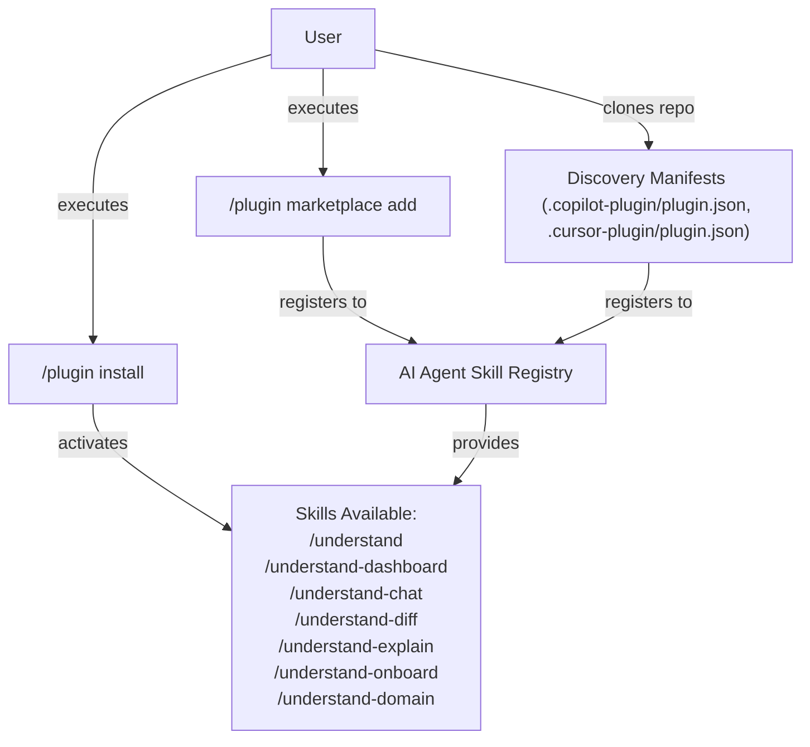
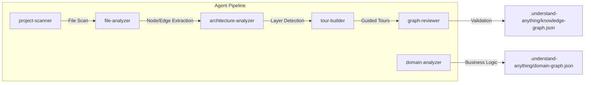
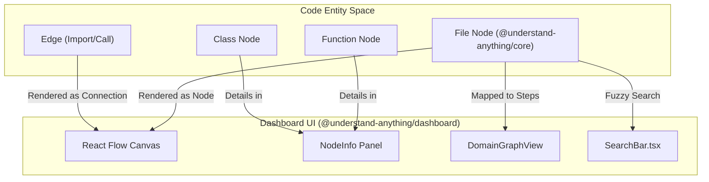

<!-- source: DeepWiki mcp.deepwiki.com · repo Lum1104/Understand-Anything · page 2 Getting Started · fetched 2026-10-26 -->

# Getting Started

<details>
<summary>Relevant source files</summary>

The following files were used as context for generating this wiki page:

- [.claude-plugin/marketplace.json](.claude-plugin/marketplace.json)
- [.claude-plugin/plugin.json](.claude-plugin/plugin.json)
- [.copilot-plugin/plugin.json](.copilot-plugin/plugin.json)
- [.cursor-plugin/plugin.json](.cursor-plugin/plugin.json)
- [.gitignore](.gitignore)
- [.npmrc](.npmrc)
- [README.md](README.md)
- [READMEs/README.es-ES.md](READMEs/README.es-ES.md)
- [READMEs/README.ja-JP.md](READMEs/README.ja-JP.md)
- [READMEs/README.ko-KR.md](READMEs/README.ko-KR.md)
- [READMEs/README.tr-TR.md](READMEs/README.tr-TR.md)
- [READMEs/README.zh-CN.md](READMEs/README.zh-CN.md)
- [READMEs/README.zh-TW.md](READMEs/README.zh-TW.md)
- [install.ps1](install.ps1)
- [install.sh](install.sh)
- [pnpm-workspace.yaml](pnpm-workspace.yaml)
- [tsconfig.json](tsconfig.json)
- [understand-anything-plugin/.claude-plugin/plugin.json](understand-anything-plugin/.claude-plugin/plugin.json)
- [understand-anything-plugin/package.json](understand-anything-plugin/package.json)

</details>


This page guides you through installing the Understand Anything plugin, analyzing your first codebase, and exploring the interactive dashboard. By the end, you'll understand how to use the core commands to generate and query knowledge graphs.

For detailed information about the system architecture, see **System Architecture**. For in-depth documentation of individual skills, see **Skills and Commands**.

---

## Prerequisites

Before installing Understand Anything, ensure you have:

| Requirement | Description |
|-------------|-------------|
| **AI Coding Platform** | Supports Claude Code (Native), Cursor, Codex, OpenCode, VS Code + GitHub Copilot, Gemini CLI, and others [README.md:6-7](), [README.md:224-245]() |
| **Node.js** | Required for running the dashboard and building core packages [understand-anything-plugin/package.json:17-18]() |
| **pnpm** | Required for workspace dependency management and package linking [understand-anything-plugin/package.json:12-12]() |
| **Git** | Required for repository cloning and incremental analysis [README.md:188-191]() |

The plugin analyzes codebases written in any language, with specialized support for 25+ languages and various frameworks like React, Next.js, and Express [README.md:101-103]().

**Sources:** [README.md:1-245](), [understand-anything-plugin/package.json:1-21]()

---

## Installation

### Claude Code (Native)
Execute the following commands in Claude Code to add and install the plugin from the marketplace:

```bash
/plugin marketplace add Lum1104/Understand-Anything
/plugin install understand-anything
```
This registers the plugin and makes the skill commands available [README.md:108-111](), [.claude-plugin/marketplace.json:1-15]().

### VS Code + GitHub Copilot
You can install the plugin for VS Code by cloning the repository. Copilot auto-discovers the plugin via `.copilot-plugin/plugin.json` [.copilot-plugin/plugin.json:1-14]().

1. **Clone the repo**: `git clone https://github.com/Lum1104/Understand-Anything.git`
2. **Open in VS Code**: Open the cloned folder.
3. **Verify**: The extension will be recognized automatically via the manifest [.copilot-plugin/plugin.json:1-14]().

### Other Platforms (Cursor, Codex, Gemini CLI, etc.)
Understand Anything supports a wide range of platforms via installation scripts:

*   **Cursor**: Auto-discovers the plugin via `.cursor-plugin/plugin.json` when the repo is opened [.cursor-plugin/plugin.json:1-15]().
*   **One-line Install**: Supports macOS/Linux and Windows for platforms like Codex and Gemini CLI [README.md:184-203]().

### Installation Data Flow



**Sources:** [README.md:173-234](), [.copilot-plugin/plugin.json:1-14](), [.cursor-plugin/plugin.json:1-15](), [.claude-plugin/marketplace.json:1-15]()

---

## Running Your First Analysis

The `/understand` command orchestrates a multi-agent pipeline to analyze your codebase.

### Basic Usage
Navigate to your project root and execute:

```bash
/understand
```

This initiates an analysis that extracts functions, classes, and dependencies, saving them to `.understand-anything/knowledge-graph.json` [README.md:116-119]().

### Localized Output
You can generate node descriptions and dashboard UI in specific languages using the `--language` flag:

```bash
/understand --language zh
```
Supported languages include `en`, `zh`, `zh-TW`, `ja`, `ko`, and `ru` [README.md:121-128]().

### Business Domain Extraction
To extract high-level business logic (domains, flows, and steps), run:

```bash
/understand-domain
```
This maps code to business processes visualized in the domain view [README.md:155-156]().

### The Multi-Agent Pipeline
The analysis is split across specialized agents defined in the `agents/` directory [understand-anything-plugin/package.json:13-14]() (as referenced in plugin manifests).



**Sources:** [README.md:113-169](), [.cursor-plugin/plugin.json:13-15]()

---

## Exploring the Dashboard

The `/understand-dashboard` command launches a React-based web application to visualize the results [README.md:139-140]().

### Startup Process
1.  **Verification**: Checks for the existence of the knowledge graph in `.understand-anything/` [README.md:119-119]().
2.  **Server**: Starts a local server (Vite-based) to host the dashboard interface [README.md:140-143]().
3.  **Token Security**: Uses TokenGate session security for the dashboard session to prevent unauthorized access.

### Dashboard Features
*   **Interactive Graph**: Visualize files, functions, and classes as nodes [README.md:57-59]().
*   **Layer Visualization**: Automatically groups components into API, Service, Data, and UI layers [README.md:92-93]().
*   **Persona Modes**: Adapts UI detail level for Junior, PM, or Experienced personas [README.md:86-88]().
*   **Search**: Supports Fuzzy and Semantic search for nodes [README.md:76-78]().

### Code Entity to Dashboard Mapping



**Sources:** [README.md:52-100](), [.cursor-plugin/plugin.json:12-15]()

---

## Using Consumer Skills

Once analyzed, you can use specialized commands to query the knowledge graph.

| Command | Purpose |
|---------|---------|
| `/understand-chat` | Ask natural language questions about the codebase [README.md:143-144]() |
| `/understand-diff` | Analyze the impact of current changes on the architecture [README.md:146-147]() |
| `/understand-explain` | Get a deep-dive explanation of a specific file or function [README.md:149-150]() |
| `/understand-onboard` | Generate a structured guide for new team members [README.md:152-153]() |
| `/understand-knowledge` | Analyze a Karpathy-pattern LLM wiki knowledge base [README.md:158-159]() |

**Sources:** [README.md:143-169](), [.cursor-plugin/plugin.json:13-13]()

---

