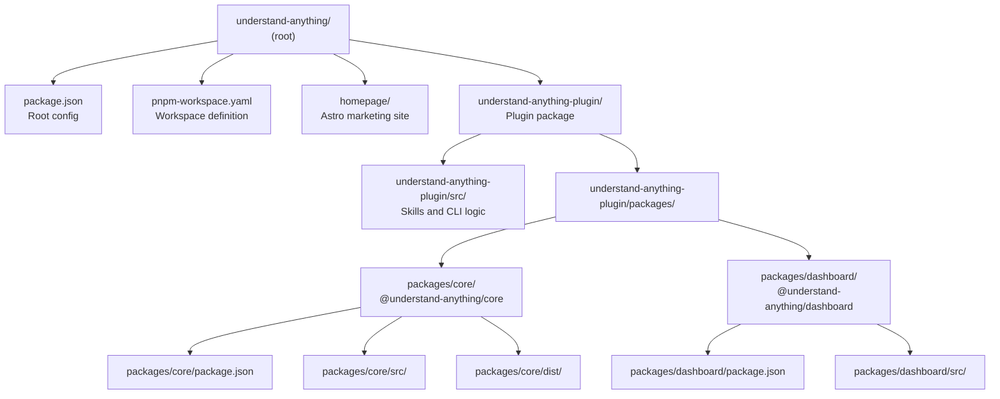
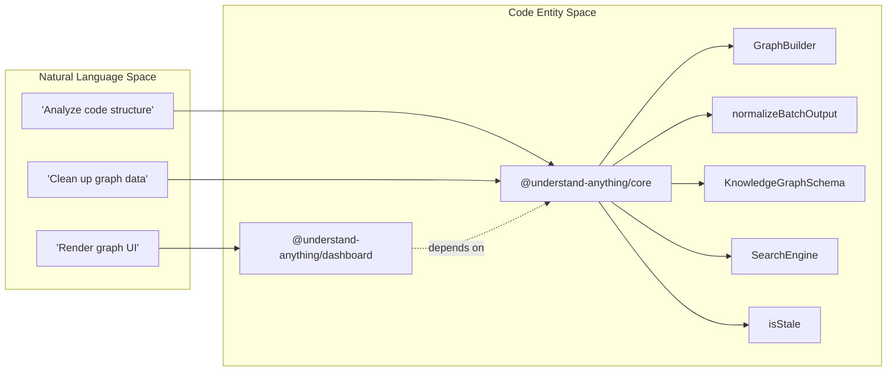

<!-- source: DeepWiki mcp.deepwiki.com · repo Lum1104/Understand-Anything · page 3.1 Monorepo Structure · fetched 2026-10-26 -->

# Monorepo Structure

Relevant source files

The following files were used as context for generating this wiki page:

- [.gitignore](.gitignore)
- [.npmrc](.npmrc)
- [pnpm-workspace.yaml](pnpm-workspace.yaml)
- [tsconfig.json](tsconfig.json)
- [understand-anything-plugin/packages/core/src/__tests__/domain-normalize.test.ts](understand-anything-plugin/packages/core/src/__tests__/domain-normalize.test.ts)
- [understand-anything-plugin/packages/core/src/__tests__/normalize-graph.test.ts](understand-anything-plugin/packages/core/src/__tests__/normalize-graph.test.ts)
- [understand-anything-plugin/packages/core/src/analyzer/normalize-graph.ts](understand-anything-plugin/packages/core/src/analyzer/normalize-graph.ts)
- [understand-anything-plugin/packages/core/src/index.ts](understand-anything-plugin/packages/core/src/index.ts)
- [understand-anything-plugin/packages/core/tsconfig.json](understand-anything-plugin/packages/core/tsconfig.json)
- [understand-anything-plugin/tsconfig.json](understand-anything-plugin/tsconfig.json)

This document details the pnpm workspace configuration, package organization, and dependency management strategy used in Understand Anything. For information about the build pipeline and TypeScript compilation, see [3.2 Build and TypeScript Configuration]().

The repository employs a monorepo architecture managed by pnpm workspaces. It organizes code into specialized packages for the analysis engine, the visualization dashboard, and the agentic plugin layer.

## Workspace Hierarchy

The repository uses a pnpm workspace to manage multiple packages within a single repository, facilitating shared dependencies and local cross-package linking.

### Directory Structure

The following diagram maps the logical system components to their physical code entities within the monorepo.

**System to Code Entity Mapping**

**Sources:** [pnpm-workspace.yaml:1-5](), [understand-anything-plugin/packages/core/package.json:1-5](), [understand-anything-plugin/tsconfig.json:15-17]()

### Dependency Resolution

The monorepo uses pnpm to manage versions across all internal packages. This ensures that `@understand-anything/core` and the dashboard use compatible versions of shared libraries.

| Scope | Key Shared Dependencies |
|-------|-------------------------|
| Development | `typescript`, `vitest` |
| Runtime (Core) | `zod`, `fuse.js`, `web-tree-sitter` |
| Runtime (Dashboard) | `react`, `@xyflow/react`, `zustand` |

The project enforces strict dependency management by disabling shameful hoisting by default in `.npmrc` [ .npmrc:1-3]().

**Sources:** [understand-anything-plugin/packages/core/package.json:39-55](), [.npmrc:1-3]()

## Package Organization

The repository contains primary internal packages that represent the "Code Entity Space" of the system's logic.

**Logic to Package Association**

**Sources:** [understand-anything-plugin/packages/core/src/index.ts:1-125](), [understand-anything-plugin/packages/core/src/analyzer/normalize-graph.ts:202-212]()

### @understand-anything/core
Located in `understand-anything-plugin/packages/core/`, this is the foundational library exported via `index.ts` [understand-anything-plugin/packages/core/src/index.ts:1-125](). It is responsible for:
*   **Schema & Validation**: Defining the `KnowledgeGraphSchema` and providing `validateGraph` and `sanitizeGraph` functions [understand-anything-plugin/packages/core/src/index.ts:3-12]().
*   **Normalization**: The `normalizeBatchOutput` function and `normalizeNodeId` ensure that IDs from various agents follow the canonical `type:path` format [understand-anything-plugin/packages/core/src/analyzer/normalize-graph.ts:64-111]().
*   **Analysis Orchestration**: The `GraphBuilder` class handles the construction of the knowledge graph [understand-anything-plugin/packages/core/src/index.ts:16-16]().
*   **Search Engine**: Providing fuzzy search via `SearchEngine` and vector-based search via `SemanticSearchEngine` [understand-anything-plugin/packages/core/src/index.ts:32-83]().
*   **Staleness Detection**: Functions like `isStale` and `mergeGraphUpdate` manage incremental updates [understand-anything-plugin/packages/core/src/index.ts:33-38]().

### @understand-anything/dashboard
Located in `understand-anything-plugin/packages/dashboard/`, this is a Vite-powered React application. It consumes the knowledge graphs and metadata produced by the core engine. It utilizes the core's types and search utilities to provide an interactive visualization.

**Sources:** [understand-anything-plugin/packages/core/src/index.ts:1-125](), [understand-anything-plugin/packages/core/src/analyzer/normalize-graph.ts:1-111]()

## Dependency Management

Understand Anything uses pnpm's workspace protocols to link packages internally.

### Workspace Linking
The dashboard and the main plugin package depend on `@understand-anything/core`. This allows the UI and the CLI skills to share the same validation logic and data structures.

### Build Pipeline
The monorepo structure dictates a build order where the core library must be compiled to `dist/` before dependent packages can resolve its types and logic.
*   **Core Build**: Outputs to `understand-anything-plugin/packages/core/dist` [understand-anything-plugin/packages/core/tsconfig.json:15-15]().
*   **Plugin Build**: Outputs to `understand-anything-plugin/dist` [understand-anything-plugin/tsconfig.json:15-15]().

**Sources:** [understand-anything-plugin/packages/core/tsconfig.json:15-16](), [understand-anything-plugin/tsconfig.json:15-16]()

## TypeScript Configuration

The monorepo uses a base `tsconfig.json` at the root and specialized configurations in each package to ensure consistency while allowing package-specific overrides.

*   **Root Config**: Defines global compiler options like `target: ES2022`, `module: ESNext`, and `strict: true` [tsconfig.json:1-16]().
*   **Plugin Config**: Sets `rootDir` to `src` and `outDir` to `dist` for the main plugin package [understand-anything-plugin/tsconfig.json:15-17]().
*   **Core Config**: Inherits root settings and defines its own `src` and `dist` paths for the core library [understand-anything-plugin/packages/core/tsconfig.json:1-19]().

**Sources:** [tsconfig.json:1-16](), [understand-anything-plugin/tsconfig.json:1-19](), [understand-anything-plugin/packages/core/tsconfig.json:1-19]()

---

