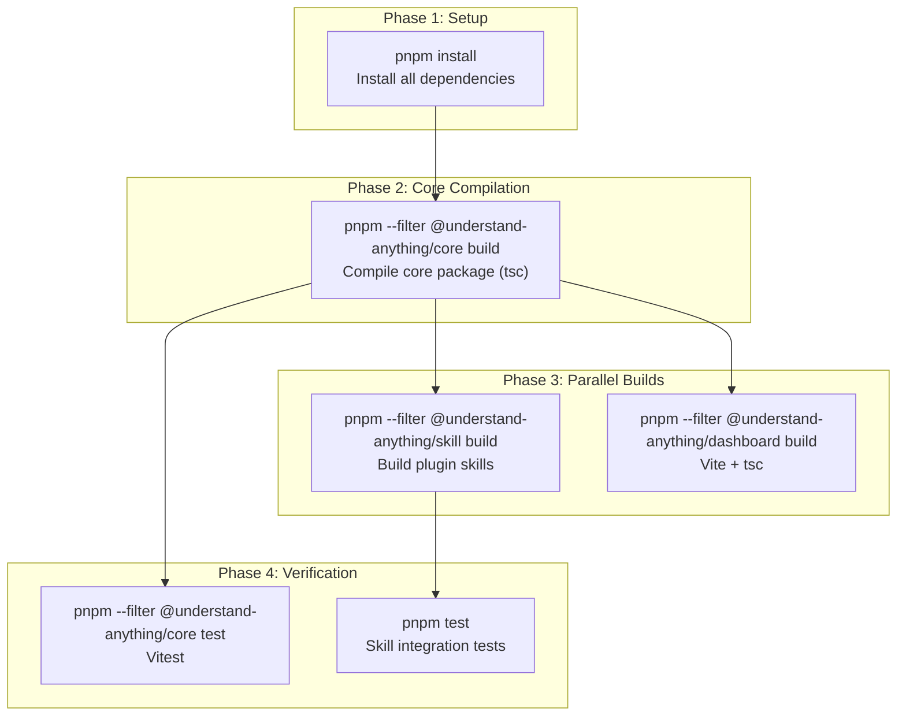
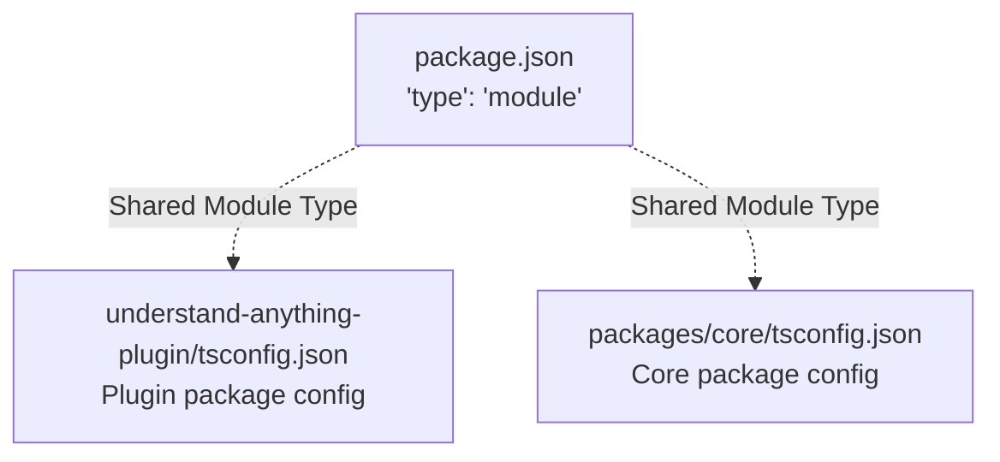
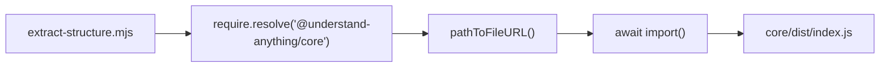

<!-- source: DeepWiki mcp.deepwiki.com · repo Lum1104/Understand-Anything · page 3.2 Build and TypeScript Configuration · fetched 2026-10-26 -->

# Build and TypeScript Configuration

<details>
<summary>Relevant source files</summary>

The following files were used as context for generating this wiki page:

- [.github/workflows/ci.yml](.github/workflows/ci.yml)
- [package.json](package.json)
- [understand-anything-plugin/packages/core/package.json](understand-anything-plugin/packages/core/package.json)
- [understand-anything-plugin/packages/core/tsconfig.json](understand-anything-plugin/packages/core/tsconfig.json)
- [understand-anything-plugin/pnpm-lock.yaml](understand-anything-plugin/pnpm-lock.yaml)
- [understand-anything-plugin/skills/understand/extract-structure.mjs](understand-anything-plugin/skills/understand/extract-structure.mjs)
- [understand-anything-plugin/src/__tests__/extract-structure.test.mjs](understand-anything-plugin/src/__tests__/extract-structure.test.mjs)
- [understand-anything-plugin/tsconfig.json](understand-anything-plugin/tsconfig.json)

</details>


This document explains the build pipeline, TypeScript configuration strategy, and compilation process for the Understand Anything monorepo. It covers how the packages are built in the correct dependency order, the shared TypeScript settings across packages, module resolution strategies, and the ESM-first architecture.

---

## Build Pipeline Overview

The Understand Anything build system uses a coordinated approach where the `@understand-anything/core` package must compile before other packages, since the `dashboard`, the skill components, and internal scripts like `extract-structure.mjs` depend on it. This dependency order is enforced through pnpm scripts at the root level.

### Build Script Hierarchy

The following diagram illustrates how the build process flows from installation to the final bundled assets.

**Build Execution Flow**


**Sources:** [package.json:29-32](), [.github/workflows/ci.yml:34-51]()

### Build Execution Order

| Step | Command | Purpose | Output Location |
|------|---------|---------|-----------------|
| 1 | `pnpm install` | Install dependencies and link workspace packages | `node_modules/` |
| 2 | `pnpm --filter @understand-anything/core build` | Build the core library first to satisfy dependencies | `packages/core/dist/` |
| 3 | `pnpm --filter @understand-anything/skill build` | Build the skill/plugin logic | `dist/` |
| 4 | `pnpm --filter @understand-anything/dashboard build` | Run `tsc` and `vite build` for the React UI | `packages/dashboard/dist/` |

**Sources:** [package.json:29-31](), [.github/workflows/ci.yml:41-44]()

---

## TypeScript Configuration Strategy

The project uses a hierarchical TypeScript configuration: package-specific configurations define local environments while adhering to a consistent set of modern standards (ES2022).

### Configuration Hierarchy

**TSConfig Inheritance**


**Sources:** [package.json:4](), [understand-anything-plugin/tsconfig.json:1-19](), [understand-anything-plugin/packages/core/tsconfig.json:1-19]()

### Shared Compiler Options

All TypeScript packages in the monorepo share the following settings defined in their respective `tsconfig.json` files [understand-anything-plugin/tsconfig.json:2-17](), [understand-anything-plugin/packages/core/tsconfig.json:2-17]():

```json
{
  "compilerOptions": {
    "target": "ES2022",
    "module": "ESNext",
    "lib": ["ES2022"],
    "moduleResolution": "bundler",
    "strict": true,
    "esModuleInterop": true,
    "skipLibCheck": true,
    "forceConsistentCasingInFileNames": true,
    "resolveJsonModule": true,
    "declaration": true,
    "declarationMap": true,
    "sourceMap": true,
    "outDir": "dist",
    "rootDir": "src"
  }
}
```

### Key Configuration Decisions

| Setting | Value | Rationale |
|---------|-------|-----------|
| `"type": "module"` | ESM | The project uses native ESM for all packages to support modern features and dynamic imports [package.json:4]() |
| `target: "ES2022"` | Modern JS | Targets modern Node.js 22+ and browser environments [understand-anything-plugin/packages/core/tsconfig.json:3]() |
| `moduleResolution: "bundler"` | Bundler mode | Optimized for Vite and modern package entry points [understand-anything-plugin/packages/core/tsconfig.json:6]() |
| `strict: true` | Enabled | Enforces strict type checking across the entire monorepo [understand-anything-plugin/packages/core/tsconfig.json:7]() |
| `declaration: true` | Enabled | Generates `.d.ts` files for cross-package type safety [understand-anything-plugin/packages/core/tsconfig.json:12]() |

**Sources:** [package.json:4](), [understand-anything-plugin/packages/core/tsconfig.json:2-17]()

---

## Compilation and Module Resolution

The project exclusively uses ESM modules. Sub-packages declare `"type": "module"` in their `package.json`.

### Dynamic Resolution in Scripts

Internal scripts like `extract-structure.mjs` use dynamic `import()` to load the `@understand-anything/core` package. This requires handling file URL schemes specifically for cross-platform compatibility (Windows vs POSIX).

**Module Resolution Logic**


**Sources:** [understand-anything-plugin/skills/understand/extract-structure.mjs:32-42]()

### Package Exports

The `@understand-anything/core` package uses explicit exports in its `package.json` to define its public API surface, ensuring that consumers can import specific modules like `search` or `schema` with full type support.

```json
"exports": {
  ".": { "types": "./dist/index.d.ts", "default": "./dist/index.js" },
  "./search": { "types": "./dist/search.d.ts", "default": "./dist/search.js" },
  "./types": { "types": "./dist/types.d.ts", "default": "./dist/types.js" },
  "./schema": { "types": "./dist/schema.d.ts", "default": "./dist/schema.js" },
  "./languages": { "types": "./dist/languages/index.d.ts", "default": "./dist/languages/index.js" }
}
```

**Sources:** [understand-anything-plugin/packages/core/package.json:7-28]()

---

## Dependency Management

The project uses `pnpm` workspaces to manage internal dependencies. The `pnpm-lock.yaml` file maintains the link between the root and packages.

### Workspace Protocol

The root `package.json` and internal packages use the `workspace:*` protocol to refer to each other during development, which `pnpm` resolves to local symlinks.

| Consumer | Dependency | Version |
|----------|------------|---------|
| `understand-anything` (root) | `@understand-anything/core` | `workspace:*` |
| `@understand-anything/dashboard` | `@understand-anything/core` | `workspace:*` |

**Sources:** [understand-anything-plugin/pnpm-lock.yaml:11-13](), [understand-anything-plugin/pnpm-lock.yaml:91-93]()

### Native Dependencies

The project relies on several native `tree-sitter` parsers. These are explicitly allowed in the `pnpm.onlyBuiltDependencies` configuration to ensure they are correctly compiled during the installation phase.

**Sources:** [package.json:44-60]()

---

