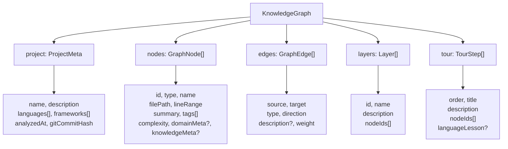
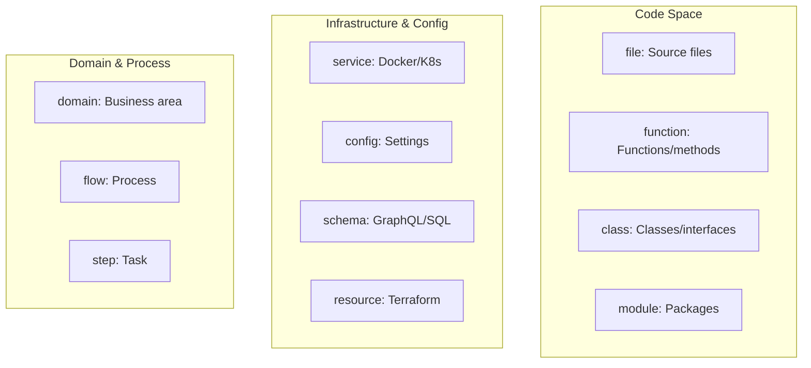
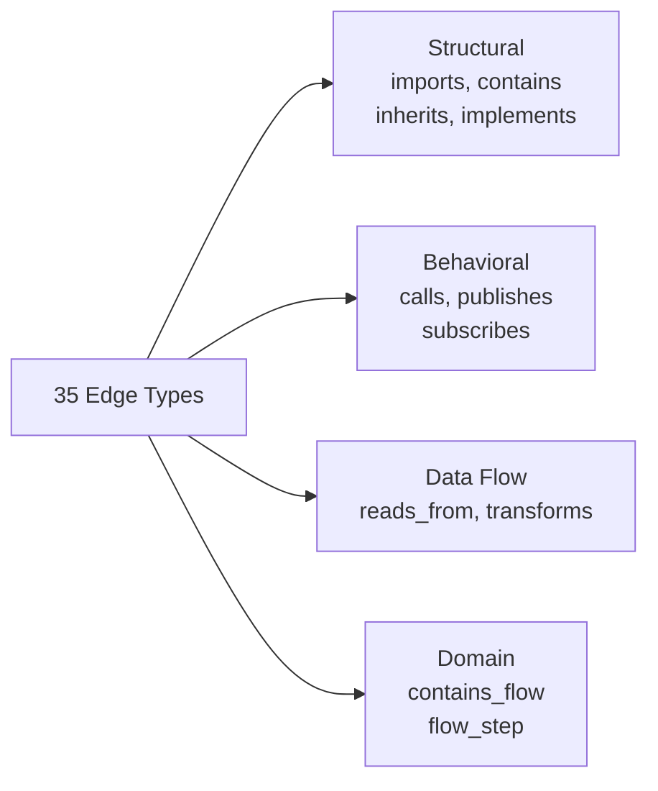

<!-- source: DeepWiki mcp.deepwiki.com · repo Lum1104/Understand-Anything · page 4 Knowledge Graph · fetched 2026-10-26 -->

# Knowledge Graph

Relevant source files

The following files were used as context for generating this wiki page:

- [understand-anything-plugin/packages/core/src/__tests__/domain-types.test.ts](understand-anything-plugin/packages/core/src/__tests__/domain-types.test.ts)
- [understand-anything-plugin/packages/core/src/__tests__/language-lesson.test.ts](understand-anything-plugin/packages/core/src/__tests__/language-lesson.test.ts)
- [understand-anything-plugin/packages/core/src/__tests__/plugin-discovery.test.ts](understand-anything-plugin/packages/core/src/__tests__/plugin-discovery.test.ts)
- [understand-anything-plugin/packages/core/src/__tests__/schema.test.ts](understand-anything-plugin/packages/core/src/__tests__/schema.test.ts)
- [understand-anything-plugin/packages/core/src/analyzer/graph-builder.test.ts](understand-anything-plugin/packages/core/src/analyzer/graph-builder.test.ts)
- [understand-anything-plugin/packages/core/src/analyzer/graph-builder.ts](understand-anything-plugin/packages/core/src/analyzer/graph-builder.ts)
- [understand-anything-plugin/packages/core/src/plugins/tree-sitter-plugin.ts](understand-anything-plugin/packages/core/src/plugins/tree-sitter-plugin.ts)
- [understand-anything-plugin/packages/core/src/schema.ts](understand-anything-plugin/packages/core/src/schema.ts)
- [understand-anything-plugin/packages/dashboard/public/knowledge-graph.json](understand-anything-plugin/packages/dashboard/public/knowledge-graph.json)
- [understand-anything-plugin/skills/understand-chat/SKILL.md](understand-anything-plugin/skills/understand-chat/SKILL.md)
- [understand-anything-plugin/skills/understand-diff/SKILL.md](understand-anything-plugin/skills/understand-diff/SKILL.md)
- [understand-anything-plugin/skills/understand-explain/SKILL.md](understand-anything-plugin/skills/understand-explain/SKILL.md)
- [understand-anything-plugin/skills/understand-onboard/SKILL.md](understand-anything-plugin/skills/understand-onboard/SKILL.md)
- [understand-anything-plugin/skills/understand/frameworks/django.md](understand-anything-plugin/skills/understand/frameworks/django.md)

The knowledge graph is the central data structure that represents an analyzed codebase as a typed, directed graph with metadata. It is serialized as `knowledge-graph.json` and serves as the persistent artifact that powers all downstream features including the interactive dashboard, skill commands, and chat Q&A.

For information about how the knowledge graph is generated by the multi-agent pipeline, see [Multi-Agent Pipeline](#7). For information about how it's visualized in the dashboard, see [Interactive Dashboard](#5).

---

## Overview

The knowledge graph represents a codebase's structure, relationships, and architecture in a machine-readable format. It consists of:

- **Project metadata**: name, languages, frameworks, Git commit hash [packages/core/src/types.ts:81-88]().
- **Nodes**: 16 primary types of entities including code (files, functions), non-code (configs, services), and domain (flows) [packages/core/src/types.ts:2-7]().
- **Edges**: 35 types of relationships between nodes across 8 categories [packages/core/src/schema.ts:3-14]().
- **Layers**: architectural groupings of related files [packages/core/src/types.ts:64-69]().
- **Tour**: guided walkthrough steps for learning the codebase [packages/core/src/types.ts:72-78]().

The graph is generated by the `/understand` command and persisted to `.understand-anything/knowledge-graph.json` at the project root. It is validated on load using Zod schemas to ensure type safety and referential integrity [packages/core/src/schema.ts:1-14]().

**Key characteristics:**

| Property | Value |
|----------|-------|
| Format | JSON |
| Location | `.understand-anything/knowledge-graph.json` |
| Validation | 4-tier pipeline (sanitize, normalize, auto-correct, fatal) [packages/core/src/schema.ts:148-220]() |
| Version | `"1.0.0"` (semver) [packages/core/src/types.ts:92]() |
| Staleness detection | Git commit hash + structural fingerprinting [packages/core/src/types.ts:108-111]() |

Sources: [packages/core/src/types.ts:1-115](), [packages/core/src/schema.ts:1-14]()

---

## Complete Schema Structure

The knowledge graph follows a fixed schema defined using Zod and TypeScript interfaces [packages/core/src/types.ts:91-99]().

**Top-level structure:**
The `KnowledgeGraph` interface ensures that every generated graph includes project metadata and arrays for nodes, edges, architectural layers, and tour steps [packages/core/src/types.ts:91-99]().

For details, see [Schema and Validation](#4.1).

Sources: [packages/core/src/types.ts:39-99](), [packages/core/src/__tests__/schema.test.ts:12-59]()

---

## Node Types and ID Conventions

The graph supports 16 primary node types categorized into code, non-code, and domain entities [packages/core/src/types.ts:2-7](). To handle various LLM outputs, the system normalizes common aliases (e.g., `func` to `function`, `db` to `table`) [packages/core/src/schema.ts:17-75]().

### Node Type Taxonomy

### Node Specifications

| Type | ID Convention | Example ID |
|------|---------------|------------|
| `file` | `file:<path>` | `file:packages/core/src/types.ts` [packages/core/src/analyzer/graph-builder.ts:92]() |
| `function` | `function:<path>:<name>` | `function:packages/core/src/schema.ts:validateGraph` [packages/core/src/analyzer/graph-builder.ts:132]() |
| `class` | `class:<path>:<name>` | `class:packages/core/src/search.ts:SearchEngine` [packages/core/src/analyzer/graph-builder.ts:156]() |
| `domain` | `domain:<kebab-name>` | `domain:order-management` [packages/core/src/__tests__/domain-types.test.ts:17]() |
| `flow` | `flow:<kebab-name>` | `flow:create-order` [packages/core/src/__tests__/domain-types.test.ts:25]() |

For details, see [Nodes and Edges](#4.2).

Sources: [packages/core/src/types.ts:2-7](), [packages/core/src/schema.ts:17-75](), [packages/core/src/analyzer/graph-builder.ts:92-167]()

---

## Edge Types and Relationship Semantics

Edges represent typed, directional relationships. The schema defines 35 canonical edge types across 8 categories [packages/core/src/schema.ts:3-14]().

### Edge Categories

### Edge Semantics in Code
The `GraphBuilder` class provides helper methods to establish common relationships:
- `addImportEdge`: Creates an `imports` edge between files [packages/core/src/analyzer/graph-builder.ts:179-190]().
- `addCallEdge`: Creates a `calls` edge between functions [packages/core/src/analyzer/graph-builder.ts:192-208]().
- `addChildNode`: Creates a `contains` edge between a parent (file/class) and child (function/method) [packages/core/src/analyzer/graph-builder.ts:265-274]().

For details, see [Nodes and Edges](#4.2).

Sources: [packages/core/src/types.ts:10-19](), [packages/core/src/analyzer/graph-builder.ts:179-274]()

---

## Architectural Elements

### Layers
Layers group related nodes into architectural tiers (e.g., "API", "Service"). The `Layer` interface stores a list of `nodeIds` that belong to a specific logical grouping [packages/core/src/types.ts:64-69]().

### Tours
Tours provide guided learning paths. Each `TourStep` includes a title, description, and the `nodeIds` involved in that step [packages/core/src/types.ts:72-78](). Steps can also include a `languageLesson` which explains language-specific patterns (e.g., `async/await` in TypeScript) found in those nodes [packages/core/src/__tests__/language-lesson.test.ts:81-91]().

For details, see [Architectural Layers and Guided Tours](#4.4).

Sources: [packages/core/src/types.ts:64-78](), [packages/core/src/__tests__/language-lesson.test.ts:38-157]()

---

## Validation and Normalization

The system uses a multi-stage pipeline to ensure graph integrity, especially when processing LLM-generated content [packages/core/src/schema.ts:148-220]().

### Normalization and Auto-Fixing
- **Sanitization**: Lowercases enum strings (types, complexity, direction) and converts nulls to empty arrays for `tour` and `layers` [packages/core/src/schema.ts:148-194]().
- **Alias Mapping**: Maps common LLM terms (e.g., `func` -> `function`, `invokes` -> `calls`, `extends` -> `inherits`) to canonical values [packages/core/src/schema.ts:17-125]().
- **Auto-Correction**: Clamps out-of-range weights (must be 0-1) and provides defaults for missing fields like `type` or `complexity` [packages/core/src/schema.ts:196-220]().

### Validation Results
The `validateGraph` function returns a `ValidationResult` which indicates success and lists any `GraphIssue` objects categorized by level (`auto-corrected`, `dropped`, `fatal`) [packages/core/src/__tests__/schema.test.ts:61-130]().

For details, see [Schema and Validation](#4.1).

Sources: [packages/core/src/schema.ts:16-220](), [packages/core/src/__tests__/schema.test.ts:61-231]()

---

## Staleness and Updates

The system tracks codebase changes to enable incremental updates and detect when a graph no longer reflects the source code [packages/core/src/types.ts:108-112]().

- **Staleness Detection**: The system compares the `gitCommitHash` stored in the graph's `ProjectMeta` against the current Git HEAD [packages/core/src/types.ts:81-88]().
- **Incremental Updates**: Updates are performed using structural fingerprinting to determine the level of change (SKIP/PARTIAL/ARCHITECTURE/FULL) and then merging updates into the existing graph.

For details, see [Staleness Detection and Incremental Updates](#4.3).

Sources: [packages/core/src/types.ts:81-112]()

---

