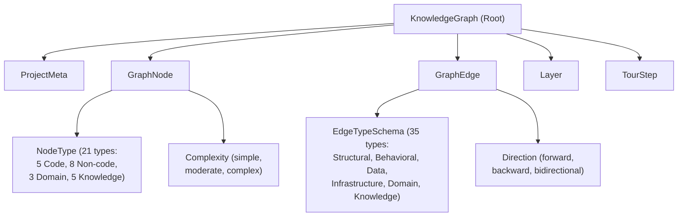
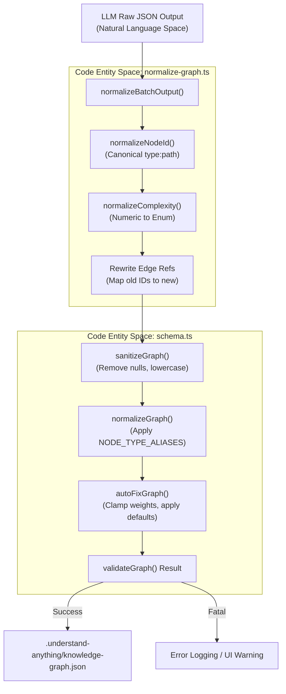

<!-- source: DeepWiki mcp.deepwiki.com · repo Lum1104/Understand-Anything · page 4.1 Schema and Validation · fetched 2026-10-26 -->

# Schema and Validation

Relevant source files

The following files were used as context for generating this wiki page:

- [understand-anything-plugin/packages/core/src/__tests__/domain-normalize.test.ts](understand-anything-plugin/packages/core/src/__tests__/domain-normalize.test.ts)
- [understand-anything-plugin/packages/core/src/__tests__/domain-types.test.ts](understand-anything-plugin/packages/core/src/__tests__/domain-types.test.ts)
- [understand-anything-plugin/packages/core/src/__tests__/normalize-graph.test.ts](understand-anything-plugin/packages/core/src/__tests__/normalize-graph.test.ts)
- [understand-anything-plugin/packages/core/src/__tests__/plugin-discovery.test.ts](understand-anything-plugin/packages/core/src/__tests__/plugin-discovery.test.ts)
- [understand-anything-plugin/packages/core/src/__tests__/schema.test.ts](understand-anything-plugin/packages/core/src/__tests__/schema.test.ts)
- [understand-anything-plugin/packages/core/src/analyzer/normalize-graph.ts](understand-anything-plugin/packages/core/src/analyzer/normalize-graph.ts)
- [understand-anything-plugin/packages/core/src/index.ts](understand-anything-plugin/packages/core/src/index.ts)
- [understand-anything-plugin/packages/core/src/plugins/tree-sitter-plugin.ts](understand-anything-plugin/packages/core/src/plugins/tree-sitter-plugin.ts)
- [understand-anything-plugin/packages/core/src/schema.ts](understand-anything-plugin/packages/core/src/schema.ts)

## Purpose and Scope

This document details the Zod-based schema validation system in the `@understand-anything/core` package that ensures knowledge graph integrity. It covers the schema definitions for all graph data structures, the four-tier validation pipeline (sanitize, normalize aliases, auto-correct, fatal), and the specialized `normalizeBatchOutput` process used during multi-agent analysis.

The validation layer sits between the file system/LLM outputs and the core analysis engine, ensuring that all data conforms to the `KnowledgeGraph` contract before processing.

**Sources:** [understand-anything-plugin/packages/core/src/schema.ts:1-194](), [understand-anything-plugin/packages/core/src/__tests__/schema.test.ts:12-59]()

---

## Overview

The validation system prevents corrupted or incompatible knowledge graph files from causing runtime errors. All graph data loaded from `.understand-anything/knowledge-graph.json` or generated by agents passes through a robust pipeline. This provides:

- **Type safety at runtime** beyond TypeScript's compile-time checks using Zod.
- **Alias Normalization**: Automatically maps common LLM synonyms (e.g., `func` to `function`, `business_process` to `flow`) to canonical types.
- **Auto-Correction**: Clamps out-of-range values (like edge weights) and fills missing required fields with defaults.
- **ID Canonicalization**: Ensures node IDs follow the `type:path` or `type:path:name` format to prevent duplicates and broken links.

**Sources:** [understand-anything-plugin/packages/core/src/schema.ts:17-125](), [understand-anything-plugin/packages/core/src/__tests__/schema.test.ts:123-230]()

---

## Schema Architecture

### Schema Hierarchy

The following diagram shows the Zod schema structure and how schemas compose into the root `KnowledgeGraph` type. Note the inclusion of domain and knowledge-specific types.

**Sources:** [understand-anything-plugin/packages/core/src/types.ts:2-99](), [understand-anything-plugin/packages/core/src/schema.ts:4-14]()

### Core Schema Definitions

| Schema / Interface | Purpose | Key Validations |
|--------------------|---------|----------------|
| `EdgeTypeSchema` | Validates relationship types | Enum of 35 types across 8 categories [understand-anything-plugin/packages/core/src/schema.ts:4-14]() |
| `GraphNode` | Validates node structure | 21 types, optional `domainMeta` and `knowledgeMeta` [understand-anything-plugin/packages/core/src/types.ts:39-51]() |
| `GraphEdge` | Validates edge connections | Source/target strings, weight 0-1, direction enum [understand-anything-plugin/packages/core/src/types.ts:54-61]() |
| `Layer` | Validates logical groupings | ID, name, description, array of node IDs [understand-anything-plugin/packages/core/src/types.ts:64-69]() |
| `TourStep` | Validates guided tours | Order, title, node IDs, optional `languageLesson` [understand-anything-plugin/packages/core/src/types.ts:72-78]() |
| `KnowledgeGraph` | Root structure | Composes all sub-structures with version field [understand-anything-plugin/packages/core/src/types.ts:91-99]() |

**Sources:** [understand-anything-plugin/packages/core/src/types.ts:1-99](), [understand-anything-plugin/packages/core/src/schema.ts:4-14]()

---

## The Four-Tier Validation Pipeline

The `validateGraph` function in `packages/core/src/schema.ts` executes a multi-stage pipeline to transform raw, potentially messy LLM output into a strictly valid graph.

### 1. Sanitize (`sanitizeGraph`)
This stage performs basic data cleanup:
- Converts `null` or `undefined` collections (tour, layers) to empty arrays `[]` [understand-anything-plugin/packages/core/src/schema.ts:152-153]().
- Removes `null` from optional fields like `filePath`, `lineRange`, or `languageNotes` [understand-anything-plugin/packages/core/src/schema.ts:161-163]().
- Lowercases enum-like strings (type, complexity, direction) [understand-anything-plugin/packages/core/src/schema.ts:165-178]().

### 2. Normalize Aliases (`normalizeGraph`)
LLMs often use synonyms. This stage maps them to canonical values:
- **Node Aliases (`NODE_TYPE_ALIASES`)**: `func`/`fn`/`method` → `function`, `interface`/`struct` → `class`, `db`/`database` → `table`, `business_flow` → `flow` [understand-anything-plugin/packages/core/src/schema.ts:17-75]().
- **Edge Aliases (`EDGE_TYPE_ALIASES`)**: `extends` → `inherits`, `invokes` → `calls`, `has_flow` → `contains_flow`, `next_step` → `flow_step` [understand-anything-plugin/packages/core/src/schema.ts:78-125]().
- **Complexity Aliases (`COMPLEXITY_ALIASES`)**: `low`/`easy` → `simple`, `high`/`hard` → `complex` [understand-anything-plugin/packages/core/src/schema.ts:128-136]().

### 3. Auto-Correct (`autoFixGraph`)
This stage attempts to fix invalid data without failing the whole process:
- **Clamping**: Weights > 1.0 are clamped to 1.0; < 0.0 are clamped to 0.0 [understand-anything-plugin/packages/core/src/__tests__/schema.test.ts:101-121]().
- **Defaults**: Missing `type` defaults to `file`; missing `complexity` defaults to `moderate` [understand-anything-plugin/packages/core/src/schema.ts:210-218]().
- **Dangling References**: The pipeline identifies issues where nodes or edges do not meet schema requirements and logs them as `auto-corrected` or `dropped` [understand-anything-plugin/packages/core/src/__tests__/schema.test.ts:84-98]().

### 4. Fatal Validation
If the graph has zero valid nodes after cleaning, or if critical fields in the `project` metadata are missing, the validation returns a fatal error [understand-anything-plugin/packages/core/src/__tests__/schema.test.ts:70-87]().

**Sources:** [understand-anything-plugin/packages/core/src/schema.ts:148-221](), [understand-anything-plugin/packages/core/src/__tests__/schema.test.ts:61-121]()

---

## Batch Normalization and ID Integrity

When processing large batches of LLM-generated nodes, the system uses `normalizeBatchOutput` to ensure ID consistency before final schema validation.

### ID Canonicalization (`normalizeNodeId`)
This function transforms various ID formats into the canonical `type:path` or `type:path:name` format:
- **Double Prefixes**: Strips redundant prefixes like `file:file:src/index.ts` [understand-anything-plugin/packages/core/src/analyzer/normalize-graph.ts:28-49]().
- **Project Prefixes**: Removes project-name prefixes often added by LLMs [understand-anything-plugin/packages/core/src/analyzer/normalize-graph.ts:34-54]().
- **Bare Paths**: Automatically adds the correct prefix based on node type (e.g., `src/main.ts` becomes `file:src/main.ts`) [understand-anything-plugin/packages/core/src/analyzer/normalize-graph.ts:89-108]().
- **Domain Discrimination**: For `step` nodes, it includes the `parentFlowSlug` in the ID to prevent collisions across different business flows [understand-anything-plugin/packages/core/src/analyzer/normalize-graph.ts:78-85]().

### Normalization Logic Flow

The following diagram illustrates how raw LLM data is transformed into a validated `KnowledgeGraph` entity, bridging the gap between Natural Language output and Code Entity space.

**Sources:** [understand-anything-plugin/packages/core/src/analyzer/normalize-graph.ts:202-218](), [understand-anything-plugin/packages/core/src/schema.ts:148-221](), [understand-anything-plugin/packages/core/src/__tests__/schema.test.ts:1-230]()

---

## ValidationResult and Integrity

The `validateGraph` function returns a `ValidationResult` object containing the success status, the cleaned data, and an array of `GraphIssue` objects.

### Integrity Checking Logic
The system distinguishes between "Dropped" items and "Fatal" errors:
- **Dropped Node**: An individual node has an invalid type that cannot be aliased. It is removed from the collection [understand-anything-plugin/packages/core/src/__tests__/schema.test.ts:77-87]().
- **Dropped Edge**: An edge has an invalid `EdgeType` or references a non-existent node. It is removed while the rest of the graph is preserved [understand-anything-plugin/packages/core/src/__tests__/schema.test.ts:89-99]().
- **Fatal**: If "No valid nodes" remain after filtering, or if the `project` metadata is fundamentally broken, the graph is considered unusable [understand-anything-plugin/packages/core/src/__tests__/schema.test.ts:81-83]().

**Sources:** [understand-anything-plugin/packages/core/src/__tests__/schema.test.ts:61-121](), [understand-anything-plugin/packages/core/src/schema.ts:196-221]()

---

## Testing and Verification

The validation logic is verified by a suite of tests in `packages/core/src/__tests__/`:
- `schema.test.ts`: Tests the four-tier pipeline, alias mapping for nodes/edges, and weight clamping [understand-anything-plugin/packages/core/src/__tests__/schema.test.ts:61-230]().
- `normalize-graph.test.ts`: Validates ID canonicalization, double-prefix stripping, and numeric complexity mapping [understand-anything-plugin/packages/core/src/__tests__/normalize-graph.test.ts:9-185]().
- `domain-types.test.ts`: Verifies domain-specific nodes (`domain`, `flow`, `step`) and their unique edge types (`contains_flow`, `flow_step`, `cross_domain`), ensuring `domainMeta` is preserved through the pipeline [understand-anything-plugin/packages/core/src/__tests__/domain-types.test.ts:67-141]().

**Sources:** [understand-anything-plugin/packages/core/src/__tests__/schema.test.ts:1-230](), [understand-anything-plugin/packages/core/src/__tests__/normalize-graph.test.ts:1-185](), [understand-anything-plugin/packages/core/src/__tests__/domain-types.test.ts:1-141]()

---

