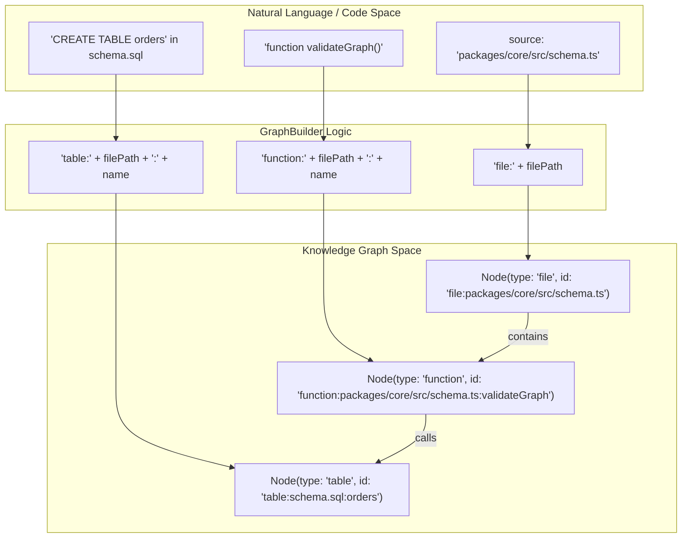
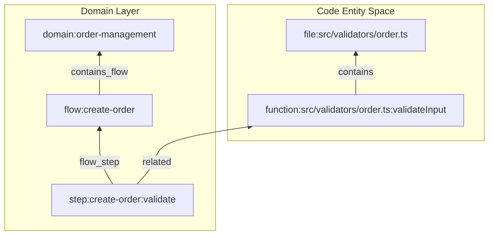

<!-- source: DeepWiki mcp.deepwiki.com · repo Lum1104/Understand-Anything · page 4.2 Nodes and Edges · fetched 2026-10-26 -->

# Nodes and Edges

Relevant source files

The following files were used as context for generating this wiki page:

- [understand-anything-plugin/packages/core/src/__tests__/domain-persistence.test.ts](understand-anything-plugin/packages/core/src/__tests__/domain-persistence.test.ts)
- [understand-anything-plugin/packages/core/src/__tests__/domain-types.test.ts](understand-anything-plugin/packages/core/src/__tests__/domain-types.test.ts)
- [understand-anything-plugin/packages/core/src/__tests__/language-lesson.test.ts](understand-anything-plugin/packages/core/src/__tests__/language-lesson.test.ts)
- [understand-anything-plugin/packages/core/src/__tests__/plugin-discovery.test.ts](understand-anything-plugin/packages/core/src/__tests__/plugin-discovery.test.ts)
- [understand-anything-plugin/packages/core/src/__tests__/schema.test.ts](understand-anything-plugin/packages/core/src/__tests__/schema.test.ts)
- [understand-anything-plugin/packages/core/src/analyzer/graph-builder.test.ts](understand-anything-plugin/packages/core/src/analyzer/graph-builder.test.ts)
- [understand-anything-plugin/packages/core/src/analyzer/graph-builder.ts](understand-anything-plugin/packages/core/src/analyzer/graph-builder.ts)
- [understand-anything-plugin/packages/core/src/persistence/index.ts](understand-anything-plugin/packages/core/src/persistence/index.ts)
- [understand-anything-plugin/packages/core/src/persistence/persistence.test.ts](understand-anything-plugin/packages/core/src/persistence/persistence.test.ts)
- [understand-anything-plugin/packages/core/src/plugins/tree-sitter-plugin.ts](understand-anything-plugin/packages/core/src/plugins/tree-sitter-plugin.ts)
- [understand-anything-plugin/packages/core/src/schema.ts](understand-anything-plugin/packages/core/src/schema.ts)
- [understand-anything-plugin/packages/core/src/types.test.ts](understand-anything-plugin/packages/core/src/types.test.ts)
- [understand-anything-plugin/packages/core/src/types.ts](understand-anything-plugin/packages/core/src/types.ts)
- [understand-anything-plugin/packages/dashboard/public/knowledge-graph.json](understand-anything-plugin/packages/dashboard/public/knowledge-graph.json)
- [understand-anything-plugin/skills/understand-chat/SKILL.md](understand-anything-plugin/skills/understand-chat/SKILL.md)
- [understand-anything-plugin/skills/understand-diff/SKILL.md](understand-anything-plugin/skills/understand-diff/SKILL.md)
- [understand-anything-plugin/skills/understand-explain/SKILL.md](understand-anything-plugin/skills/understand-explain/SKILL.md)
- [understand-anything-plugin/skills/understand-onboard/SKILL.md](understand-anything-plugin/skills/understand-onboard/SKILL.md)
- [understand-anything-plugin/skills/understand/frameworks/django.md](understand-anything-plugin/skills/understand/frameworks/django.md)

This page documents the node and edge structure of the knowledge graph, including the 21 node types, 35 edge types, ID conventions, and relationship semantics that enable rich representation of codebase structure, infrastructure, business domains, and general knowledge.

The graph structure is defined by TypeScript interfaces in `types.ts` and enforced via Zod schemas in `schema.ts` throughout the multi-agent analysis pipeline.

---

## Node Types

The knowledge graph represents entities as 21 distinct node types, capturing code, configuration, documentation, infrastructure, business logic, and research-based knowledge.

### Common Node Properties

All nodes conform to the `GraphNode` interface and include these properties:

| Property | Type | Required | Description |
|----------|------|----------|-------------|
| `id` | `string` | Yes | Unique identifier following `type:path` or `type:path:name` conventions |
| `type` | `NodeType` | Yes | One of the 21 valid types |
| `name` | `string` | Yes | Human-readable display name |
| `filePath` | `string` | No | Relative path from project root (for code/config nodes) |
| `lineRange` | `[number, number]` | No | Start and end line numbers |
| `summary` | `string` | Yes | Brief description of the node's purpose |
| `tags` | `string[]` | Yes | Keywords for categorization and search |
| `complexity` | `enum` | Yes | `simple`, `moderate`, or `complex` |
| `domainMeta` | `DomainMeta` | No | Metadata for domain/flow/step nodes (entry points, rules) |
| `knowledgeMeta`| `KnowledgeMeta`| No | Metadata for article/entity/claim nodes (wikilinks, content) |

**Sources:** [understand-anything-plugin/packages/core/src/types.ts:39-51](), [understand-anything-plugin/packages/core/src/schema.ts:155-170]()

### Categorized Node Types

The system bridges "Natural Language Space" to "Code Entity Space" by mapping detected structures to these specific types across four categories.

#### 1. Structural & Code Nodes (5 Types)
- `file`: Individual source code files.
- `function`: Functions, methods, or async handlers.
- `class`: Classes, interfaces, or structs.
- `module`: Logical packages, namespaces, or directories.
- `concept`: Abstract patterns (e.g., "Dependency Injection") spanning multiple files.

#### 2. Non-Code & Infrastructure Nodes (8 Types)
- `config`: Configuration files (e.g., `tsconfig.json`, `settings.py`).
- `document`: Documentation (e.g., `README.md`, architectural ADRs).
- `service`: Deployable units or external services (e.g., `Dockerfile`, Docker Compose services).
- `table`: Database tables, views, or indexes.
- `endpoint`: API routes (e.g., `GET /api/users`) or message queue listeners.
- `pipeline`: CI/CD workflows, jobs, or data processing stages.
- `schema`: Data definitions (e.g., Protobuf messages, GraphQL types, Enums).
- `resource`: Cloud infrastructure or hardware resources (e.g., Terraform/AWS resources).

#### 3. Domain Nodes (3 Types)
- `domain`: High-level business areas (e.g., "Order Management").
- `flow`: Specific business processes (e.g., "Create Order").
- `step`: Individual actions within a flow (e.g., "Validate Input").

#### 4. Knowledge Nodes (5 Types)
- `article`: Wiki pages or research notes.
- `entity`: Persons, organizations, or specific actors.
- `topic`: Tags, categories, or themes.
- `claim`: Assertions, decisions, or theses.
- `source`: Reference materials, papers, or raw data sources.

**Sources:** [understand-anything-plugin/packages/core/src/types.ts:2-7](), [understand-anything-plugin/packages/core/src/analyzer/graph-builder.ts:39-58]()

---

## Edge Types

Edges represent relationships between nodes. The knowledge graph supports 35 distinct edge types organized into 8 semantic categories.

### Edge Type Categories

| Category | Canonical Types |
|----------|-----------------|
| **Structural** | `imports`, `exports`, `contains`, `inherits`, `implements` |
| **Behavioral** | `calls`, `subscribes`, `publishes`, `middleware` |
| **Data Flow** | `reads_from`, `writes_to`, `transforms`, `validates` |
| **Dependencies**| `depends_on`, `tested_by`, `configures` |
| **Semantic** | `related`, `similar_to` |
| **Infrastructure**| `deploys`, `serves`, `provisions`, `triggers`, `migrates`, `documents`, `routes`, `defines_schema` |
| **Domain** | `contains_flow`, `flow_step`, `cross_domain` |
| **Knowledge** | `cites`, `contradicts`, `builds_on`, `exemplifies`, `categorized_under`, `authored_by` |

**Sources:** [understand-anything-plugin/packages/core/src/types.ts:10-19](), [understand-anything-plugin/packages/core/src/schema.ts:4-14]()

### Normalization and Aliases
The `autoFixGraph` and `sanitizeGraph` functions map common LLM synonyms to canonical types to ensure schema compliance.

| Original Alias | Canonical Type |
|----------------|----------------|
| `interface`, `struct` | `class` |
| `func`, `fn`, `method` | `function` |
| `extends` | `inherits` |
| `invokes`, `invoke` | `calls` |
| `uses`, `requires` | `depends_on` |
| `db`, `database`, `migration`| `table` |
| `next_step` | `flow_step` |

**Sources:** [understand-anything-plugin/packages/core/src/schema.ts:17-125](), [understand-anything-plugin/packages/core/src/__tests__/schema.test.ts:123-231]()

---

## ID Conventions and Construction

The `GraphBuilder` class enforces strict ID conventions to ensure referential integrity. IDs typically follow the format `type:filePath` or `type:filePath:name`.

### ID Prefix Mapping
The internal logic in `GraphBuilder` constructs IDs based on the entity type:

| Node Type | ID Construction Logic | Example ID |
|-----------|-----------|------------|
| `file` | `file:${filePath}` | `file:src/index.ts` |
| `function`| `function:${filePath}:${name}` | `function:src/utils.ts:formatDate` |
| `class` | `class:${filePath}:${name}` | `class:src/models.ts:User` |
| `table` | `${kind}:${filePath}:${name}` | `table:db/schema.sql:users` |
| `service` | `service:${filePath}:${name}` | `service:docker-compose.yml:web` |

**Sources:** [understand-anything-plugin/packages/core/src/analyzer/graph-builder.ts:92-132](), [understand-anything-plugin/packages/core/src/analyzer/graph-builder.ts:234-248]()

### Code to Graph Mapping Logic

The `GraphBuilder` bridges structural analysis results (from tree-sitter or LLMs) into the graph space.

Title: Code to Knowledge Graph Mapping

**Sources:** [understand-anything-plugin/packages/core/src/analyzer/graph-builder.ts:115-152](), [understand-anything-plugin/packages/core/src/analyzer/graph-builder.ts:39-58]()

---

## Relationship Semantics

### Domain-to-Code Mapping
Domain nodes (`domain`, `flow`, `step`) provide a business-logic overlay. `step` nodes often link directly to the code implementation via `filePath`.

Title: Domain Overlay to Code Entity Mapping

**Sources:** [understand-anything-plugin/packages/core/src/types.ts:29-36](), [understand-anything-plugin/packages/core/src/__tests__/domain-persistence.test.ts:20-29]()

### Framework-Specific Semantics
Framework addendums (e.g., Django) inject specific edge patterns during analysis to capture implicit relationships like URL routing or Signal wiring.

- **Django URLs**: `urls.py` --`routes`--> `views.py`
- **Django Signals**: `signals.py` --`subscribes`--> `models.py`
- **Django ORM**: `ModelA` --`depends_on`--> `ModelB` (via ForeignKey)

**Sources:** [understand-anything-plugin/skills/understand/frameworks/django.md:35-46]()

### Validation and Integrity
The `validateGraph` function performs deterministic checks:
1. **Referential Integrity:** Every edge `source` and `target` must exist as a node `id`.
2. **Schema Adherence:** Types must match the `NodeType` and `EdgeType` enums.
3. **Weight Constraints:** Weights are auto-corrected (clamped) between `0.0` and `1.0`.
4. **Required Fields:** Ensures `version`, `project`, `nodes`, and `edges` are present.

**Sources:** [understand-anything-plugin/packages/core/src/schema.ts:148-220](), [understand-anything-plugin/packages/core/src/__tests__/schema.test.ts:89-121]()

---

