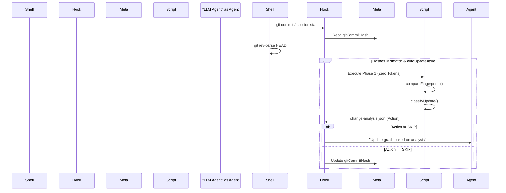

<!-- source: DeepWiki mcp.deepwiki.com · repo Lum1104/Understand-Anything · page 4.3 Staleness Detection and Incremental Updates · fetched 2026-10-26 -->

# Staleness Detection and Incremental Updates

<details>
<summary>Relevant source files</summary>

The following files were used as context for generating this wiki page:

- [eslint.config.mjs](eslint.config.mjs)
- [scripts/generate-large-graph.mjs](scripts/generate-large-graph.mjs)
- [understand-anything-plugin/hooks/auto-update-prompt.md](understand-anything-plugin/hooks/auto-update-prompt.md)
- [understand-anything-plugin/hooks/hooks.json](understand-anything-plugin/hooks/hooks.json)
- [understand-anything-plugin/packages/core/src/__tests__/change-classifier.test.ts](understand-anything-plugin/packages/core/src/__tests__/change-classifier.test.ts)
- [understand-anything-plugin/packages/core/src/__tests__/fingerprint.test.ts](understand-anything-plugin/packages/core/src/__tests__/fingerprint.test.ts)
- [understand-anything-plugin/packages/core/src/change-classifier.ts](understand-anything-plugin/packages/core/src/change-classifier.ts)
- [understand-anything-plugin/packages/core/src/fingerprint.ts](understand-anything-plugin/packages/core/src/fingerprint.ts)
- [understand-anything-plugin/packages/core/src/plugins/extractors/ruby-extractor.ts](understand-anything-plugin/packages/core/src/plugins/extractors/ruby-extractor.ts)
- [understand-anything-plugin/packages/core/src/plugins/parsers/graphql-parser.ts](understand-anything-plugin/packages/core/src/plugins/parsers/graphql-parser.ts)
- [understand-anything-plugin/packages/core/src/plugins/parsers/sql-parser.ts](understand-anything-plugin/packages/core/src/plugins/parsers/sql-parser.ts)
- [understand-anything-plugin/skills/understand/build-fingerprints.mjs](understand-anything-plugin/skills/understand/build-fingerprints.mjs)

</details>


## Purpose and Scope

This section documents how the system detects when a knowledge graph is outdated and performs surgical incremental updates. The system uses a multi-layered approach: Git commit tracking for initial triggers, structural fingerprinting to distinguish between cosmetic and functional changes, and a change classifier to decide the appropriate update strategy (`SKIP`, `PARTIAL_UPDATE`, `ARCHITECTURE_UPDATE`, or `FULL_UPDATE`). This process ensures that the knowledge graph remains synchronized with the code while minimizing LLM token consumption.

Sources: [understand-anything-plugin/packages/core/src/fingerprint.ts:124-130](), [understand-anything-plugin/packages/core/src/change-classifier.ts:15-20](), [understand-anything-plugin/hooks/auto-update-prompt.md:5-6]()

## Fingerprinting and Change Detection

The system uses `FileFingerprint` objects to track the structural state of every file. Unlike a simple file hash, a fingerprint captures the specific signatures of code entities that affect the graph topology.

### Structural Fingerprinting
The `extractFileFingerprint` function [understand-anything-plugin/packages/core/src/fingerprint.ts:79-122]() creates a summary of a file's impact on the knowledge graph:
*   **Content Hash**: A SHA-256 hash of the raw file content used for fast-path comparison [understand-anything-plugin/packages/core/src/fingerprint.ts:70-72]().
*   **Signatures**: Parameter lists, return types, and export status for functions (`FunctionFingerprint`) and classes (`ClassFingerprint`) [understand-anything-plugin/packages/core/src/fingerprint.ts:87-101]().
*   **Dependency Surface**: List of imports (`ImportFingerprint`) and their specific specifiers to track relationship changes [understand-anything-plugin/packages/core/src/fingerprint.ts:103-106]().
*   **Size Tracking**: `totalLines` and per-entity `lineCount` are tracked to detect significant implementation growth even if signatures remain stable [understand-anything-plugin/packages/core/src/fingerprint.ts:110-120]().

### Change Classification (ChangeLevel)
When comparing two fingerprints via `compareFingerprints` [understand-anything-plugin/packages/core/src/fingerprint.ts:131-134](), the system assigns one of three `ChangeLevel` values:

| Level | Description |
| :--- | :--- |
| `NONE` | Content hashes are identical; no changes occurred [understand-anything-plugin/packages/core/src/fingerprint.ts:138-140](). |
| `COSMETIC` | Content changed, but all signatures and imports remain identical (e.g., comment changes or internal logic refactors) [understand-anything-plugin/packages/core/src/fingerprint.ts:241-243](). |
| `STRUCTURAL` | Changes detected in exports, function parameters, class methods, imports, or significant size changes (>50%) [understand-anything-plugin/packages/core/src/fingerprint.ts:152-226](). |

Sources: [understand-anything-plugin/packages/core/src/fingerprint.ts:48-54](), [understand-anything-plugin/packages/core/src/fingerprint.ts:131-245]()

## The Update Decision Matrix

The `classifyUpdate` function [understand-anything-plugin/packages/core/src/change-classifier.ts:21-25]() processes the results of a `ChangeAnalysis` to determine the most efficient update path based on structural change counts and directory impacts.

**Diagram: Update Strategy Selection Logic**

```mermaid
graph TD
    "DecisionStart"["classifyUpdate()"] --> "CheckStructural"{"Any STRUCTURAL<br/>changes?"}
    "CheckStructural" -- "No" --> "SKIP"["Action: SKIP<br/>(Only COSMETIC or NONE)"]
    "CheckStructural" -- "Yes" --> "CheckThresholds"{"Change Count > 30<br/>OR > 50% Project?"}
    
    "CheckThresholds" -- "Yes" --> "FULL_UPDATE"["Action: FULL_UPDATE<br/>(Complete Rebuild)"]
    "CheckThresholds" -- "No" --> "CheckDir"{"New/Deleted<br/>Directories?"}
    
    "CheckDir" -- "Yes" --> "ARCH_UPDATE"["Action: ARCHITECTURE_UPDATE<br/>(Re-run Layer Analysis)"]
    "CheckDir" -- "No" --> "CheckCount"{"Structural Count > 10?"}
    
    "CheckCount" -- "Yes" --> "ARCH_UPDATE"
    "CheckCount" -- "No" --> "PARTIAL"["Action: PARTIAL_UPDATE<br/>(Surgical Merge)"]
```

Sources: [understand-anything-plugin/packages/core/src/change-classifier.ts:26-87]()

### Update Actions Defined
*   **SKIP**: No re-analysis. The system simply updates the `gitCommitHash` in `meta.json` [understand-anything-plugin/packages/core/src/change-classifier.ts:36-42]().
*   **PARTIAL_UPDATE**: Only specific changed files are re-analyzed by the `file-analyzer`. Architecture layers and tours are preserved [understand-anything-plugin/packages/core/src/change-classifier.ts:80-86]().
*   **ARCHITECTURE_UPDATE**: Changed files are re-analyzed, and the `architecture-analyzer` is re-run to update layer groupings and tours [understand-anything-plugin/packages/core/src/change-classifier.ts:67-76]().
*   **FULL_UPDATE**: Triggered when the codebase has changed so significantly (>30 files or >50% of the graph) that a fresh scan is recommended [understand-anything-plugin/packages/core/src/change-classifier.ts:48-61]().

Sources: [understand-anything-plugin/packages/core/src/change-classifier.ts:4-10]()

## Persistence and Baseline Generation

Staleness detection relies on a baseline generated during the initial `/understand` analysis.

### Baseline Creation
During Phase 7 of the main analysis pipeline, `build-fingerprints.mjs` is executed [understand-anything-plugin/skills/understand/build-fingerprints.mjs:5-13](). It initializes a `PluginRegistry` with `TreeSitterPlugin` and all built-in parsers (e.g., `SQLParser`, `GraphQLParser`) to extract structural signatures from every source file [understand-anything-plugin/skills/understand/build-fingerprints.mjs:75-82](). The resulting `FingerprintStore` is saved to `.understand-anything/fingerprints.json` [understand-anything-plugin/skills/understand/build-fingerprints.mjs:84]().

### Directory Layout
| File | Purpose |
| :--- | :--- |
| `meta.json` | Stores the `gitCommitHash` used to trigger staleness checks [understand-anything-plugin/hooks/hooks.json:19](). |
| `fingerprints.json` | Stores the `FingerprintStore` baseline [understand-anything-plugin/skills/understand/build-fingerprints.mjs:7](). |
| `config.json` | Stores `ProjectConfig` including the `autoUpdate` toggle [understand-anything-plugin/hooks/hooks.json:9](). |

Sources: [understand-anything-plugin/skills/understand/build-fingerprints.mjs:1-91](), [understand-anything-plugin/packages/core/src/fingerprint.ts:41-46]()

## Automated Update Hooks

The system integrates with the environment via Git hooks defined in `hooks.json` [understand-anything-plugin/hooks/hooks.json:1-26]().

1.  **PostToolUse**: Triggers when a `git commit`, `merge`, `cherry-pick`, or `rebase` command is executed, provided `autoUpdate` is true [understand-anything-plugin/hooks/hooks.json:3-12]().
2.  **SessionStart**: Triggers on plugin startup if the current `git rev-parse HEAD` does not match the hash in `meta.json` [understand-anything-plugin/hooks/hooks.json:14-23]().

**Diagram: Hook-to-Decision Data Flow**



Sources: [understand-anything-plugin/hooks/hooks.json:9, 19](), [understand-anything-plugin/hooks/auto-update-prompt.md:9-122]()

## Surgical Graph Merging

When performing an incremental update, the system performs surgical operations to maintain graph integrity [understand-anything-plugin/hooks/auto-update-prompt.md:5-6]():

1.  **Exclusion Filtering**: Before checking fingerprints, the system runs `ignore-filter.mjs` to remove files matching `.understandignore` patterns, preventing spurious updates from vendored code or migrations [understand-anything-plugin/hooks/auto-update-prompt.md:40-79]().
2.  **Node Removal**: Nodes belonging to deleted files or files marked for re-analysis are purged from the existing graph.
3.  **Edge Purging**: Any edge where the `source` or `target` ID no longer exists (dangling references) is deleted.
4.  **Injection**: New nodes and edges from the fresh `file-analyzer` batch results are injected.
5.  **Deduplication**: Nodes are deduplicated by ID, and edges are deduplicated by the composite key of `source + target + type`.

Sources: [understand-anything-plugin/hooks/auto-update-prompt.md:40-122](), [understand-anything-plugin/packages/core/src/change-classifier.ts:80-86]()

---

