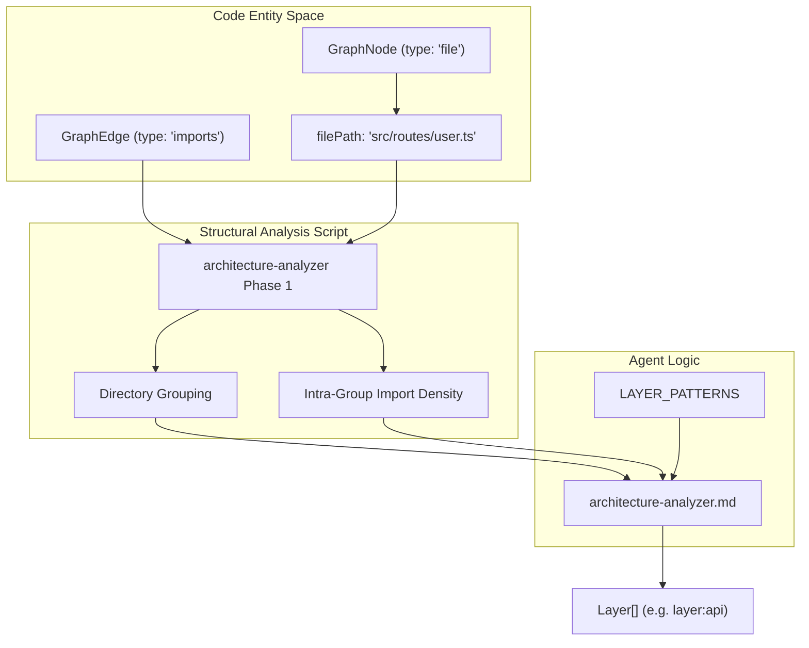
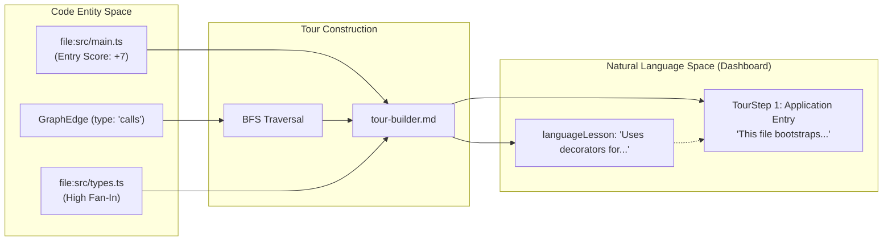

<!-- source: DeepWiki mcp.deepwiki.com · repo Lum1104/Understand-Anything · page 4.4 Architectural Layers and Guided Tours · fetched 2026-10-26 -->

# Architectural Layers and Guided Tours

Relevant source files

The following files were used as context for generating this wiki page:

- [CLAUDE.md](CLAUDE.md)
- [understand-anything-plugin/agents/architecture-analyzer.md](understand-anything-plugin/agents/architecture-analyzer.md)
- [understand-anything-plugin/agents/article-analyzer.md](understand-anything-plugin/agents/article-analyzer.md)
- [understand-anything-plugin/agents/assemble-reviewer.md](understand-anything-plugin/agents/assemble-reviewer.md)
- [understand-anything-plugin/agents/domain-analyzer.md](understand-anything-plugin/agents/domain-analyzer.md)
- [understand-anything-plugin/agents/graph-reviewer.md](understand-anything-plugin/agents/graph-reviewer.md)
- [understand-anything-plugin/agents/knowledge-graph-guide.md](understand-anything-plugin/agents/knowledge-graph-guide.md)
- [understand-anything-plugin/agents/project-scanner.md](understand-anything-plugin/agents/project-scanner.md)
- [understand-anything-plugin/agents/tour-builder.md](understand-anything-plugin/agents/tour-builder.md)
- [understand-anything-plugin/packages/core/src/__tests__/language-lesson.test.ts](understand-anything-plugin/packages/core/src/__tests__/language-lesson.test.ts)
- [understand-anything-plugin/packages/core/src/analyzer/graph-builder.test.ts](understand-anything-plugin/packages/core/src/analyzer/graph-builder.test.ts)
- [understand-anything-plugin/packages/core/src/analyzer/graph-builder.ts](understand-anything-plugin/packages/core/src/analyzer/graph-builder.ts)
- [understand-anything-plugin/packages/core/src/analyzer/layer-detector.ts](understand-anything-plugin/packages/core/src/analyzer/layer-detector.ts)
- [understand-anything-plugin/packages/dashboard/public/knowledge-graph.json](understand-anything-plugin/packages/dashboard/public/knowledge-graph.json)
- [understand-anything-plugin/packages/dashboard/src/components/Breadcrumb.tsx](understand-anything-plugin/packages/dashboard/src/components/Breadcrumb.tsx)
- [understand-anything-plugin/packages/dashboard/src/components/LayerClusterNode.tsx](understand-anything-plugin/packages/dashboard/src/components/LayerClusterNode.tsx)
- [understand-anything-plugin/packages/dashboard/src/components/PortalNode.tsx](understand-anything-plugin/packages/dashboard/src/components/PortalNode.tsx)
- [understand-anything-plugin/packages/dashboard/src/utils/__tests__/edgeAggregation.test.ts](understand-anything-plugin/packages/dashboard/src/utils/__tests__/edgeAggregation.test.ts)
- [understand-anything-plugin/packages/dashboard/src/utils/edgeAggregation.ts](understand-anything-plugin/packages/dashboard/src/utils/edgeAggregation.ts)
- [understand-anything-plugin/skills/understand-chat/SKILL.md](understand-anything-plugin/skills/understand-chat/SKILL.md)
- [understand-anything-plugin/skills/understand-diff/SKILL.md](understand-anything-plugin/skills/understand-diff/SKILL.md)
- [understand-anything-plugin/skills/understand-explain/SKILL.md](understand-anything-plugin/skills/understand-explain/SKILL.md)
- [understand-anything-plugin/skills/understand-onboard/SKILL.md](understand-anything-plugin/skills/understand-onboard/SKILL.md)
- [understand-anything-plugin/skills/understand/frameworks/django.md](understand-anything-plugin/skills/understand/frameworks/django.md)

This page documents the systems for identifying architectural layers and generating pedagogical guided tours within the Understand Anything knowledge graph. These processes transform a raw structural graph of files and functions into a high-level conceptual map of a codebase.

## Architectural Layer Detection

Architectural layers group related components (files, configurations, infrastructure) into logical tiers (e.g., API, Service, Data, UI). Layer detection is performed using a combination of deterministic heuristic patterns and LLM-based semantic interpretation.

### Layer Structure
Each layer is defined by the `Layer` interface:
- `id`: A unique string generated by `toLayerId` (e.g., `layer:api-layer`). [understand-anything-plugin/packages/core/src/analyzer/layer-detector.ts:72-74]()
- `name`: Human-readable name (e.g., "API Layer").
- `description`: A brief summary of the layer's responsibility.
- `nodeIds`: An array of strings referencing the IDs of nodes belonging to this layer.

Sources: [understand-anything-plugin/packages/core/src/types.ts:1-50](), [understand-anything-plugin/packages/core/src/analyzer/layer-detector.ts:1-10]()

### Detection Mechanism
The system employs two primary strategies to categorize nodes into layers:

#### 1. Heuristic Pattern Matching (`LAYER_PATTERNS`)
The `architecture-analyzer` agent and `layer-detector.ts` utilize a comprehensive set of directory patterns to classify files. [understand-anything-plugin/agents/architecture-analyzer.md:105-145](). Key mappings include:
- `routes`, `api`, `controllers`, `endpoints` → **API Layer**
- `services`, `logic`, `usecase`, `domain` → **Service Layer**
- `models`, `db`, `data`, `persistence`, `repository` → **Data Layer**
- `components`, `views`, `pages`, `ui` → **UI Layer**
- `middleware`, `plugins`, `guards` → **Middleware Layer**
- `utils`, `helpers`, `common` → **Utility Layer**
- `infra`, `deploy`, `k8s`, `terraform` → **Infrastructure Layer**

#### 2. LLM-Based Layering
The `architecture-analyzer` agent performs semantic interpretation in Phase 2, using structural insights (like import frequency and intra-group density) to refine layer assignments. [understand-anything-plugin/agents/architecture-analyzer.md:23-103](). It ensures that even non-code files like `Dockerfile` (Infrastructure) or `README.md` (Documentation) are assigned to exactly one layer. [understand-anything-plugin/agents/architecture-analyzer.md:9-14]()

**Diagram: Architecture Analysis Data Flow**

Sources: [understand-anything-plugin/agents/architecture-analyzer.md:16-145](), [understand-anything-plugin/packages/core/src/analyzer/layer-detector.ts:105-144]()

---

## Guided Tour Generation

Tours provide a sequential pedagogical walkthrough of the project. The `tour-builder` agent identifies key entry points and dependency chains to create a logical "reading order."

### TourStep Structure
A `TourStep` consists of:
- `order`: Sequential integer (1-based).
- `title`: Short, engaging title.
- `description`: Explanation of the step's significance.
- `nodeIds`: Array of 1-5 node IDs to highlight. [understand-anything-plugin/agents/knowledge-graph-guide.md:74-80]()
- `languageLesson`: (Optional) Educational note about language-specific patterns.

Sources: [understand-anything-plugin/packages/core/src/types.ts:315-325]()

### Generation Algorithms

#### 1. Importance and Entry Point Detection
The `tour-builder` Phase 1 script computes structural signals:
- **Fan-In Ranking:** Nodes with many incoming edges (e.g., a central `types.ts`) are core dependencies. [understand-anything-plugin/agents/tour-builder.md:55-57]()
- **Entry Point Candidates:** Scoring based on filename (e.g., `index.ts`, `main.go`), root proximity, and high fan-out. [understand-anything-plugin/agents/tour-builder.md:63-77]()

#### 2. BFS Traversal
Starting from the top code entry point, the system performs a Breadth-First Search following `imports` and `calls` edges to reveal the natural "reading order" of the codebase. [understand-anything-plugin/agents/tour-builder.md:79-87]()

**Diagram: Mapping Code Space to Tour Space**

Sources: [understand-anything-plugin/agents/tour-builder.md:24-117](), [understand-anything-plugin/packages/core/src/analyzer/graph-builder.ts:192-208]()

---

## Language-Specific Lessons

The system generates `languageLesson` content by analyzing node metadata against language-specific configurations.

### Lesson Generation Logic
1.  **Detection:** The `tour-builder` identifies language-specific patterns like "generic", "closure", or "decorator" in the code. [understand-anything-plugin/agents/tour-builder.md:19-20]()
2.  **Synthesis:** The agent provides bilingual explanations (English term + local translation) for complex concepts to aid international developers. [understand-anything-plugin/agents/tour-builder.md:16-20]()

### Framework Addendums
Framework-specific patterns are injected into the analysis via markdown addendums (e.g., for Django, React, FastAPI), ensuring the tour correctly identifies framework-specific architectural roles. [understand-anything-plugin/agents/project-scanner.md:46-47]()

---

## Visualizing Layers in the Dashboard

The dashboard represents layers as `LayerClusterNode` components. [understand-anything-plugin/packages/dashboard/src/components/LayerClusterNode.tsx:25-40](). Navigation between layers is handled via `PortalNode` components. [understand-anything-plugin/packages/dashboard/src/components/PortalNode.tsx:16-30]()

### Edge Aggregation for Layers
To prevent visual clutter, edges between layers are aggregated using `aggregateLayerEdges`. [understand-anything-plugin/packages/dashboard/src/utils/edgeAggregation.ts:21-70](). 

- **Intra-container edges:** Edges within the same layer are preserved. [understand-anything-plugin/packages/dashboard/src/utils/edgeAggregation.ts:162-180]()
- **Inter-container edges:** Edges crossing layer boundaries are aggregated into single visual lines with a `count` and list of `edgeTypes`. [understand-anything-plugin/packages/dashboard/src/utils/edgeAggregation.ts:181-206]()

Sources: [understand-anything-plugin/packages/dashboard/src/utils/edgeAggregation.ts:158-208](), [understand-anything-plugin/packages/dashboard/src/components/Breadcrumb.tsx:19-35]()

---

