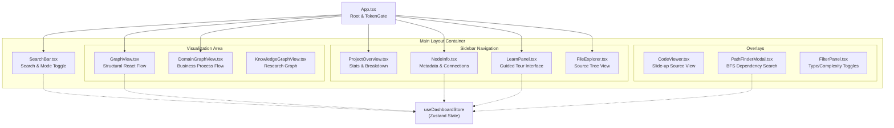
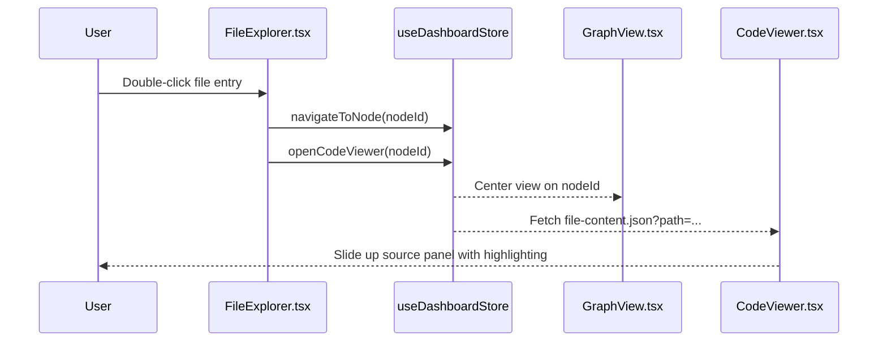

<!-- source: DeepWiki mcp.deepwiki.com · repo Lum1104/Understand-Anything · page 5.1 Dashboard Components · fetched 2026-10-26 -->

# Dashboard Components

Relevant source files

The following files were used as context for generating this wiki page:

- [understand-anything-plugin/packages/dashboard/src/App.tsx](understand-anything-plugin/packages/dashboard/src/App.tsx)
- [understand-anything-plugin/packages/dashboard/src/components/CodeViewer.tsx](understand-anything-plugin/packages/dashboard/src/components/CodeViewer.tsx)
- [understand-anything-plugin/packages/dashboard/src/components/CustomNode.tsx](understand-anything-plugin/packages/dashboard/src/components/CustomNode.tsx)
- [understand-anything-plugin/packages/dashboard/src/components/FileExplorer.tsx](understand-anything-plugin/packages/dashboard/src/components/FileExplorer.tsx)
- [understand-anything-plugin/packages/dashboard/src/components/FilterPanel.tsx](understand-anything-plugin/packages/dashboard/src/components/FilterPanel.tsx)
- [understand-anything-plugin/packages/dashboard/src/components/GraphView.tsx](understand-anything-plugin/packages/dashboard/src/components/GraphView.tsx)
- [understand-anything-plugin/packages/dashboard/src/components/KeyboardShortcutsHelp.tsx](understand-anything-plugin/packages/dashboard/src/components/KeyboardShortcutsHelp.tsx)
- [understand-anything-plugin/packages/dashboard/src/components/LayerLegend.tsx](understand-anything-plugin/packages/dashboard/src/components/LayerLegend.tsx)
- [understand-anything-plugin/packages/dashboard/src/components/LearnPanel.tsx](understand-anything-plugin/packages/dashboard/src/components/LearnPanel.tsx)
- [understand-anything-plugin/packages/dashboard/src/components/MobileBottomNav.tsx](understand-anything-plugin/packages/dashboard/src/components/MobileBottomNav.tsx)
- [understand-anything-plugin/packages/dashboard/src/components/MobileDrawer.tsx](understand-anything-plugin/packages/dashboard/src/components/MobileDrawer.tsx)
- [understand-anything-plugin/packages/dashboard/src/components/MobileLayout.tsx](understand-anything-plugin/packages/dashboard/src/components/MobileLayout.tsx)
- [understand-anything-plugin/packages/dashboard/src/components/NodeInfo.tsx](understand-anything-plugin/packages/dashboard/src/components/NodeInfo.tsx)
- [understand-anything-plugin/packages/dashboard/src/components/NodeTooltip.tsx](understand-anything-plugin/packages/dashboard/src/components/NodeTooltip.tsx)
- [understand-anything-plugin/packages/dashboard/src/components/OnboardingOverlay.tsx](understand-anything-plugin/packages/dashboard/src/components/OnboardingOverlay.tsx)
- [understand-anything-plugin/packages/dashboard/src/components/PathFinderModal.tsx](understand-anything-plugin/packages/dashboard/src/components/PathFinderModal.tsx)
- [understand-anything-plugin/packages/dashboard/src/components/PersonaSelector.tsx](understand-anything-plugin/packages/dashboard/src/components/PersonaSelector.tsx)
- [understand-anything-plugin/packages/dashboard/src/components/ProjectOverview.tsx](understand-anything-plugin/packages/dashboard/src/components/ProjectOverview.tsx)
- [understand-anything-plugin/packages/dashboard/src/components/SearchBar.tsx](understand-anything-plugin/packages/dashboard/src/components/SearchBar.tsx)
- [understand-anything-plugin/packages/dashboard/src/contexts/I18nContext.tsx](understand-anything-plugin/packages/dashboard/src/contexts/I18nContext.tsx)
- [understand-anything-plugin/packages/dashboard/src/hooks/useKeyboardShortcuts.ts](understand-anything-plugin/packages/dashboard/src/hooks/useKeyboardShortcuts.ts)
- [understand-anything-plugin/packages/dashboard/src/index.css](understand-anything-plugin/packages/dashboard/src/index.css)
- [understand-anything-plugin/packages/dashboard/src/locales/en.ts](understand-anything-plugin/packages/dashboard/src/locales/en.ts)
- [understand-anything-plugin/packages/dashboard/src/locales/ja.ts](understand-anything-plugin/packages/dashboard/src/locales/ja.ts)
- [understand-anything-plugin/packages/dashboard/src/locales/ko.ts](understand-anything-plugin/packages/dashboard/src/locales/ko.ts)
- [understand-anything-plugin/packages/dashboard/src/locales/ru.ts](understand-anything-plugin/packages/dashboard/src/locales/ru.ts)
- [understand-anything-plugin/packages/dashboard/src/locales/zh-TW.ts](understand-anything-plugin/packages/dashboard/src/locales/zh-TW.ts)
- [understand-anything-plugin/packages/dashboard/src/locales/zh.ts](understand-anything-plugin/packages/dashboard/src/locales/zh.ts)
- [understand-anything-plugin/packages/dashboard/src/store.ts](understand-anything-plugin/packages/dashboard/src/store.ts)
- [understand-anything-plugin/packages/dashboard/src/themes/presets.ts](understand-anything-plugin/packages/dashboard/src/themes/presets.ts)
- [understand-anything-plugin/pnpm-workspace.yaml](understand-anything-plugin/pnpm-workspace.yaml)

This page documents the React components that make up the `@understand-anything/dashboard` web application. It details the implementation of the visualization layers, sidebar panels, and interactive utilities that form the "dark luxury" analytical interface.

## Overview

The dashboard is a React 19 application built with Vite and Tailwind CSS v4. It is designed as a graph-first exploration tool that bridges high-level architectural patterns with low-level code entities.

- **Main Layout**: A split-view architecture managed in `App.tsx` that coordinates the visualization area and a 360px sidebar [understand-anything-plugin/packages/dashboard/src/App.tsx:97-240]().
- **Graph Area**: Powered by `@xyflow/react`, utilizing `GraphView` for structural code analysis, `DomainGraphView` for business logic, and `KnowledgeGraphView` for research-based knowledge graphs [understand-anything-plugin/packages/dashboard/src/App.tsx:5-7]().
- **Sidebar**: A fixed container hosting contextual tabs: `Info` (defaulting to `ProjectOverview` or `NodeInfo`) and `Files` (the `FileExplorer` tree) [understand-anything-plugin/packages/dashboard/src/App.tsx:116-142]().
- **Interaction Layer**: Includes `SearchBar` (fuzzy/semantic), `FilterPanel`, `ExportMenu`, and `PathFinderModal`.

**Sources**: [understand-anything-plugin/packages/dashboard/src/App.tsx:1-33](), [understand-anything-plugin/packages/dashboard/src/store.ts:99-145]()

## Component Architecture

The following diagram maps the React component hierarchy to the underlying state and data flow logic.

### UI Component to Code Entity Mapping

**Sources**: [understand-anything-plugin/packages/dashboard/src/App.tsx:97-250](), [understand-anything-plugin/packages/dashboard/src/components/GraphView.tsx:57-62](), [understand-anything-plugin/packages/dashboard/src/store.ts:149-180]()

## Core Visualization Components

### GraphView
The `GraphView` component handles the multi-level structural visualization. It switches between an "Overview" (layers as cluster nodes) and "Layer Detail" (individual files/functions) [understand-anything-plugin/packages/dashboard/src/components/GraphView.tsx:57-62]().
- **Node Types**: Maps specific React components to graph node categories: `custom` for standard entities, `layer-cluster` for architectural layers, `portal` for cross-layer links, and `container` for parent files [understand-anything-plugin/packages/dashboard/src/components/GraphView.tsx:57-62]().
- **Auto-Fit**: Includes `TourFitView` to pan/zoom to highlighted tour nodes and `SelectedNodeFitView` to center on search results [understand-anything-plugin/packages/dashboard/src/components/GraphView.tsx:95-179]().
- **Category Mapping**: Maps core `NodeType` (e.g., `file`, `endpoint`, `domain`) to UI filter categories like `code`, `infra`, or `data` [understand-anything-plugin/packages/dashboard/src/components/GraphView.tsx:70-78]().

### CustomNode
The primary visual building block for graph entities.
- **Styling**: Uses CSS variables defined in `index.css` (e.g., `--color-node-file`) to differentiate types [understand-anything-plugin/packages/dashboard/src/components/CustomNode.tsx:8-30]().
- **Visual Feedback**: Applies specialized rings for selection, search highlights, and tour steps [understand-anything-plugin/packages/dashboard/src/components/CustomNode.tsx:99-112]().
- **Diff Mode**: Composes additional styles for changed (`diff-changed-glow`) or affected (`diff-affected-glow`) nodes during impact analysis [understand-anything-plugin/packages/dashboard/src/components/CustomNode.tsx:115-121]().

### CodeViewer
A `prism-react-renderer` based source viewer that slides up from the bottom.
- **Source Fetching**: Requests file content from the local dev server via the `/file-content.json` endpoint, secured by the session `accessToken` [understand-anything-plugin/packages/dashboard/src/components/CodeViewer.tsx:25-28]().
- **Presentation**: Supports a "sidebar" slide-up view or a full-screen "modal" mode [understand-anything-plugin/packages/dashboard/src/components/CodeViewer.tsx:138-140]().
- **Line Highlighting**: Automatically scrolls to and highlights specific ranges if the node contains `lineRange` metadata [understand-anything-plugin/packages/dashboard/src/components/CodeViewer.tsx:122-125]().

**Sources**: [understand-anything-plugin/packages/dashboard/src/components/GraphView.tsx:1-62](), [understand-anything-plugin/packages/dashboard/src/components/CustomNode.tsx:1-138](), [understand-anything-plugin/packages/dashboard/src/components/CodeViewer.tsx:63-140]()

## Sidebar & Info Panels

### NodeInfo
Displays detailed metadata for the currently selected node.
- **Directional Edges**: Maps raw `EdgeType` values (e.g., `calls`, `inherits`) to human-readable labels like "called by" or "inherited by" using the `I18n` context `edgeLabels` [understand-anything-plugin/packages/dashboard/src/components/NodeInfo.tsx:37-44]().
- **Knowledge Meta**: For research graphs, it renders `wikilinks` (outgoing) and `backlinks` (incoming) based on `related` edge types [understand-anything-plugin/packages/dashboard/src/components/NodeInfo.tsx:51-62]().
- **Domain Meta**: Renders business rules, entities, and flow steps for domain-specific nodes [understand-anything-plugin/packages/dashboard/src/components/NodeInfo.tsx:142-160]().

### ProjectOverview
The default sidebar view providing high-level project metrics.
- **Stats**: Displays total counts for nodes, edges, layers, and unique node types [understand-anything-plugin/packages/dashboard/src/components/ProjectOverview.tsx:66-81]().
- **Category Breakdown**: Groups nodes into logical buckets (Code, Config, Docs, Infra, Data, Domain) for a high-level distribution view [understand-anything-plugin/packages/dashboard/src/components/ProjectOverview.tsx:47-55]().

**Sources**: [understand-anything-plugin/packages/dashboard/src/components/NodeInfo.tsx:1-160](), [understand-anything-plugin/packages/dashboard/src/components/ProjectOverview.tsx:1-156]()

## Utility & Mobile Components

### SearchBar
Unified search interface supporting fuzzy and semantic modes.
- **Fuzzy/Semantic**: Toggles between text-based matching and vector-similarity search [understand-anything-plugin/packages/dashboard/src/components/SearchBar.tsx:114-134]().
- **Dropdown**: Shows top 5 results with relevance scores and type badges [understand-anything-plugin/packages/dashboard/src/components/SearchBar.tsx:144-175]().

### OnboardingOverlay
A multi-step guide for first-time users.
- **Steps**: Controlled by `I18n` content, it walks users through the graph, search, and navigation [understand-anything-plugin/packages/dashboard/src/components/OnboardingOverlay.tsx:21-42]().
- **Persistence**: Reports dismissal to the parent `App.tsx` to store the state in `localStorage` [understand-anything-plugin/packages/dashboard/src/components/OnboardingOverlay.tsx:9-12]().

### Mobile Layout
The dashboard adapts to smaller screens via `MobileLayout`, `MobileDrawer`, and `MobileBottomNav`.
- **Navigation**: The bottom nav switches between "Graph", "Info", and "Files" views [understand-anything-plugin/packages/dashboard/src/locales/en.ts:85-89]().
- **Drawer**: Provides access to view toggles, persona selection, and tools on mobile [understand-anything-plugin/packages/dashboard/src/locales/en.ts:90-103]().

**Sources**: [understand-anything-plugin/packages/dashboard/src/components/SearchBar.tsx:1-175](), [understand-anything-plugin/packages/dashboard/src/components/OnboardingOverlay.tsx:1-130](), [understand-anything-plugin/packages/dashboard/src/locales/en.ts:85-103]()

## Data Flow & Interaction

The following diagram illustrates the interaction between the sidebar navigation and the visualization area.

### Interaction Flow: File Selection and Code Preview

**Sources**: [understand-anything-plugin/packages/dashboard/src/components/CodeViewer.tsx:100-115](), [understand-anything-plugin/packages/dashboard/src/components/GraphView.tsx:182-200]()

---

