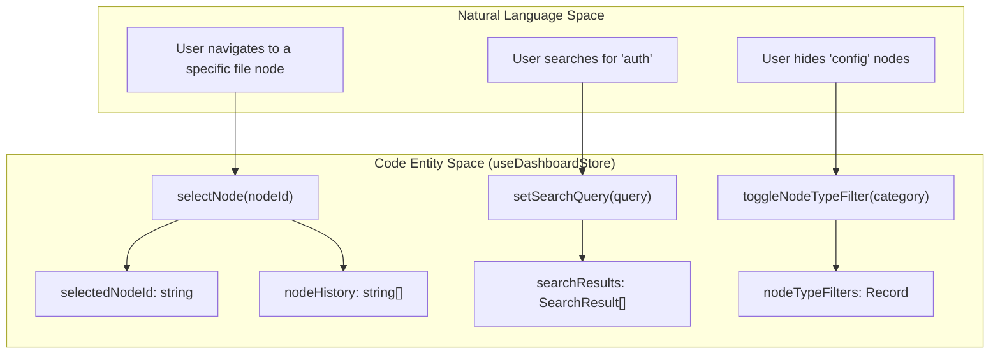
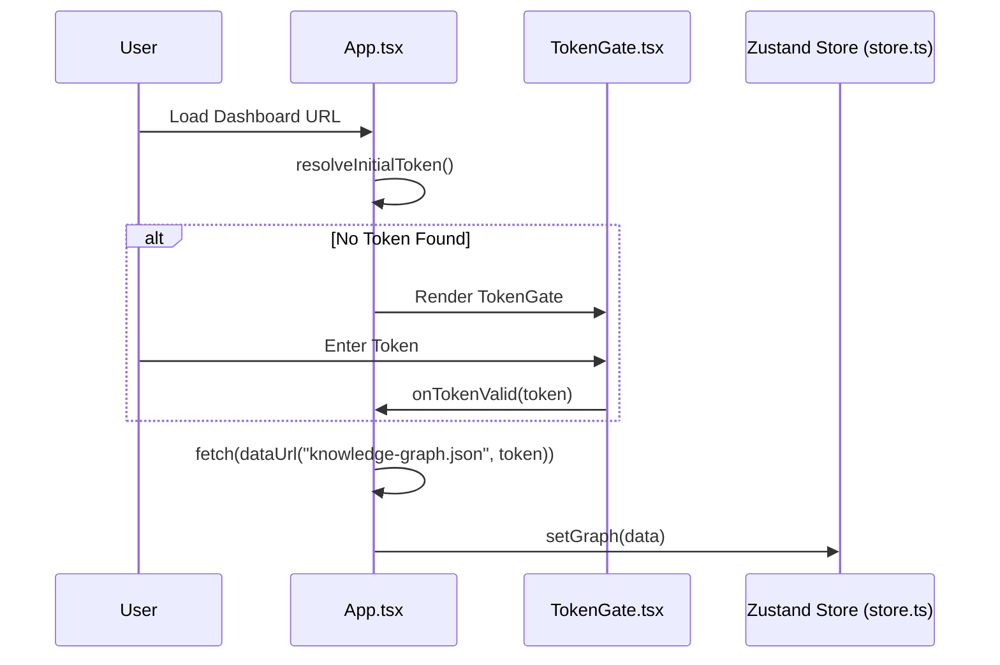

<!-- source: DeepWiki mcp.deepwiki.com · repo Lum1104/Understand-Anything · page 5.2 State Management and Data Flow · fetched 2026-10-26 -->

# State Management and Data Flow

<details>
<summary>Relevant source files</summary>

The following files were used as context for generating this wiki page:

- [understand-anything-plugin/packages/dashboard/src/App.tsx](understand-anything-plugin/packages/dashboard/src/App.tsx)
- [understand-anything-plugin/packages/dashboard/src/components/CustomNode.tsx](understand-anything-plugin/packages/dashboard/src/components/CustomNode.tsx)
- [understand-anything-plugin/packages/dashboard/src/components/GraphView.tsx](understand-anything-plugin/packages/dashboard/src/components/GraphView.tsx)
- [understand-anything-plugin/packages/dashboard/src/components/NodeInfo.tsx](understand-anything-plugin/packages/dashboard/src/components/NodeInfo.tsx)
- [understand-anything-plugin/packages/dashboard/src/components/OnboardingOverlay.tsx](understand-anything-plugin/packages/dashboard/src/components/OnboardingOverlay.tsx)
- [understand-anything-plugin/packages/dashboard/src/components/TokenGate.tsx](understand-anything-plugin/packages/dashboard/src/components/TokenGate.tsx)
- [understand-anything-plugin/packages/dashboard/src/locales/en.ts](understand-anything-plugin/packages/dashboard/src/locales/en.ts)
- [understand-anything-plugin/packages/dashboard/src/locales/index.ts](understand-anything-plugin/packages/dashboard/src/locales/index.ts)
- [understand-anything-plugin/packages/dashboard/src/locales/ja.ts](understand-anything-plugin/packages/dashboard/src/locales/ja.ts)
- [understand-anything-plugin/packages/dashboard/src/locales/ko.ts](understand-anything-plugin/packages/dashboard/src/locales/ko.ts)
- [understand-anything-plugin/packages/dashboard/src/locales/ru.ts](understand-anything-plugin/packages/dashboard/src/locales/ru.ts)
- [understand-anything-plugin/packages/dashboard/src/locales/zh-TW.ts](understand-anything-plugin/packages/dashboard/src/locales/zh-TW.ts)
- [understand-anything-plugin/packages/dashboard/src/locales/zh.ts](understand-anything-plugin/packages/dashboard/src/locales/zh.ts)
- [understand-anything-plugin/packages/dashboard/src/store.ts](understand-anything-plugin/packages/dashboard/src/store.ts)

</details>


This page documents the Zustand-based state management architecture in the `@understand-anything/dashboard` React application. It covers the centralized store structure, the data loading process with TokenGate security, how state flows to UI components, the localization system, and the navigation history system.

## Store Architecture

The dashboard uses **Zustand** as its state management library, providing a centralized store that all components subscribe to. The store is defined in `understand-anything-plugin/packages/dashboard/src/store.ts` and accessed via the `useDashboardStore` hook.

### Store Access Pattern

Components access state using selector functions to minimize re-renders. This pattern is visible in `App.tsx` and `GraphView.tsx`, where components subscribe to specific state slices:

```typescript
// App.tsx
const setGraph = useDashboardStore((s) => s.setGraph);
const setDomainGraph = useDashboardStore((s) => s.setDomainGraph);

// GraphView.tsx
const tourHighlightedNodeIds = useDashboardStore((s) => s.tourHighlightedNodeIds);
const selectedNodeId = useDashboardStore((s) => s.selectedNodeId);
```

**Sources:** [understand-anything-plugin/packages/dashboard/src/store.ts:1-10](), [understand-anything-plugin/packages/dashboard/src/App.tsx:109-111](), [understand-anything-plugin/packages/dashboard/src/components/GraphView.tsx:96-183]()

---

## State Structure

The `DashboardStore` interface defines the application's state and actions, encompassing graph data, navigation context, and UI mode toggles.

| State Slice | Type | Purpose |
|------------|------|---------|
| `graph` | `KnowledgeGraph \| null` | The primary structural knowledge graph. |
| `nodesById` | `Map<string, GraphNode>` | Optimized lookup for node details by ID. |
| `navigationLevel` | `"overview" \| "layer-detail"` | Controls macro (layer) vs micro (node) view depth. |
| `viewMode` | `"structural" \| "domain" \| "knowledge"` | Toggles between technical, business, or wiki views. |
| `persona` | `Persona` | Adapts UI for "non-technical", "junior", or "experienced" users. |
| `nodeHistory` | `string[]` | A stack of visited node IDs for "Back" navigation. |
| `nodeTypeFilters` | `Record<NodeCategory, boolean>` | Toggles visibility for groups like `code`, `infra`, or `data`. |

### State Flow Diagram: Natural Language to Code Entity

This diagram bridges the conceptual "Dashboard State" to the specific code entities in the `useDashboardStore`.



**Sources:** [understand-anything-plugin/packages/dashboard/src/store.ts:100-172](), [understand-anything-plugin/packages/dashboard/src/store.ts:12-18]()

---

## Data Loading and Security

The dashboard loads data from JSON files generated during the analysis phase. Access is protected by a token-based security mechanism.

### TokenGate and Data Resolution
The `TokenGate` component prevents unauthorized access to the graph data. It validates the token by attempting a fetch of the graph files.

1. **Initial Token**: Resolved via `resolveInitialToken` from URL params (`?token=...`) or `sessionStorage`.
2. **Validation**: The `App` component checks if `accessToken` is null. If so, it renders `TokenGate`.
3. **Data URLs**: The `dataUrl` helper appends the valid token to all requests (e.g., `knowledge-graph.json?token=...`).
4. **Demo Mode**: If `VITE_DEMO_MODE` is true, the system skips token validation and uses environment-defined URLs.



**Sources:** [understand-anything-plugin/packages/dashboard/src/App.tsx:37-85](), [understand-anything-plugin/packages/dashboard/src/App.tsx:87-106](), [understand-anything-plugin/packages/dashboard/src/App.tsx:132-163]()

---

## I18n and Localization System

The dashboard supports 6 locales: English (`en`), Chinese (`zh`), Traditional Chinese (`zh-TW`), Japanese (`ja`), Korean (`ko`), and Russian (`ru`).

### Implementation
- **Context**: Managed via `I18nContext.tsx`.
- **Provider**: Wrapped around the `Dashboard` in `App.tsx`.
- **Usage**: Components use the `useI18n` hook to access the `t` (translate) function.

### Localization Structure
The translation files provide a deeply nested structure for UI elements, edge labels, and onboarding steps.

| Locale | File Path |
|--------|-----------|
| English | `understand-anything-plugin/packages/dashboard/src/locales/en.ts` |
| Chinese | `understand-anything-plugin/packages/dashboard/src/locales/zh.ts` |
| Traditional Chinese | `understand-anything-plugin/packages/dashboard/src/locales/zh-TW.ts` |
| Japanese | `understand-anything-plugin/packages/dashboard/src/locales/ja.ts` |
| Korean | `understand-anything-plugin/packages/dashboard/src/locales/ko.ts` |
| Russian | `understand-anything-plugin/packages/dashboard/src/locales/ru.ts` |

**Sources:** [understand-anything-plugin/packages/dashboard/src/App.tsx:26](), [understand-anything-plugin/packages/dashboard/src/locales/en.ts:1-266](), [understand-anything-plugin/packages/dashboard/src/components/NodeInfo.tsx:37-44]()

---

## Core Logic Implementations

### Navigation and History
The store maintains a `nodeHistory` stack to support deep navigation.
- **`MAX_HISTORY`**: Limited to 50 entries.
- **`navigateToNode`**: Pushes the current node to the history stack before selecting the new node.
- **`buildGraphIndexes`**: Rebuilds the `nodesById` and `nodeIdToLayerId` maps whenever `setGraph` is called, ensuring $O(1)$ lookups for navigation.

**Sources:** [understand-anything-plugin/packages/dashboard/src/store.ts:74-98](), [understand-anything-plugin/packages/dashboard/src/store.ts:157-162]()

### Tour State Management
Guided tours use `tourHighlightedNodeIds` to focus attention.
- **`TourFitView`**: A component inside `GraphView` that monitors `tourHighlightedNodeIds`. It uses a RequestAnimationFrame (RAF) loop to wait for nodes to be measured by React Flow before calling `fitView` to center the camera.

**Sources:** [understand-anything-plugin/packages/dashboard/src/components/GraphView.tsx:95-178]()

### Visual Mapping Logic
The UI maps raw `NodeType` values to specific visual styles (colors, badges).
- **`typeColors`**: Maps types to CSS variables (e.g., `file` -> `var(--color-node-file)`).
- **`typeBadgeColors`**: Used in `NodeInfo` for consistent branding in the sidebar.

**Sources:** [understand-anything-plugin/packages/dashboard/src/components/CustomNode.tsx:8-30](), [understand-anything-plugin/packages/dashboard/src/components/NodeInfo.tsx:7-29]()

---

