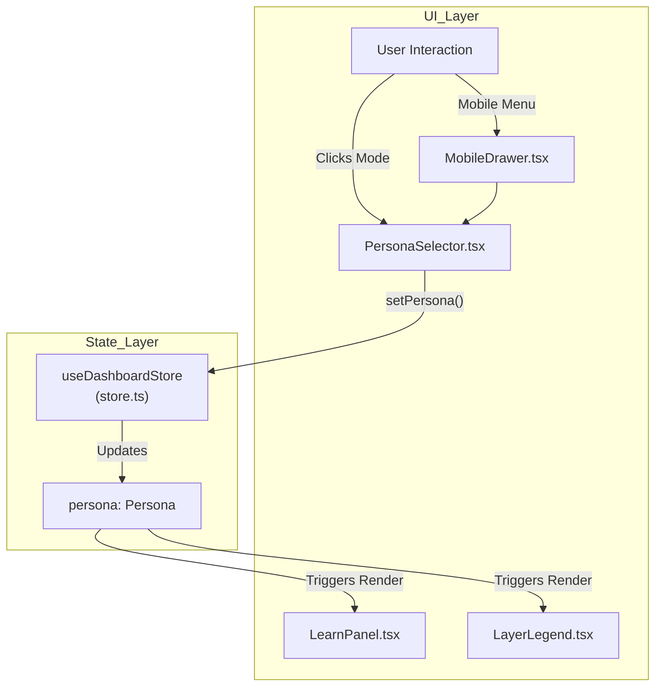
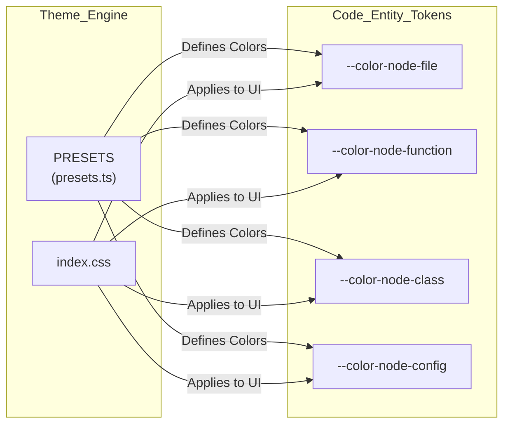

<!-- source: DeepWiki mcp.deepwiki.com · repo Lum1104/Understand-Anything · page 5.4 Persona Modes and Adaptive UI · fetched 2026-10-26 -->

# Persona Modes and Adaptive UI

Relevant source files

The following files were used as context for generating this wiki page:

- [understand-anything-plugin/packages/dashboard/src/components/CodeViewer.tsx](understand-anything-plugin/packages/dashboard/src/components/CodeViewer.tsx)
- [understand-anything-plugin/packages/dashboard/src/components/FileExplorer.tsx](understand-anything-plugin/packages/dashboard/src/components/FileExplorer.tsx)
- [understand-anything-plugin/packages/dashboard/src/components/FilterPanel.tsx](understand-anything-plugin/packages/dashboard/src/components/FilterPanel.tsx)
- [understand-anything-plugin/packages/dashboard/src/components/KeyboardShortcutsHelp.tsx](understand-anything-plugin/packages/dashboard/src/components/KeyboardShortcutsHelp.tsx)
- [understand-anything-plugin/packages/dashboard/src/components/LayerLegend.tsx](understand-anything-plugin/packages/dashboard/src/components/LayerLegend.tsx)
- [understand-anything-plugin/packages/dashboard/src/components/LearnPanel.tsx](understand-anything-plugin/packages/dashboard/src/components/LearnPanel.tsx)
- [understand-anything-plugin/packages/dashboard/src/components/NodeTooltip.tsx](understand-anything-plugin/packages/dashboard/src/components/NodeTooltip.tsx)
- [understand-anything-plugin/packages/dashboard/src/components/PathFinderModal.tsx](understand-anything-plugin/packages/dashboard/src/components/PathFinderModal.tsx)
- [understand-anything-plugin/packages/dashboard/src/components/PersonaSelector.tsx](understand-anything-plugin/packages/dashboard/src/components/PersonaSelector.tsx)
- [understand-anything-plugin/packages/dashboard/src/components/ProjectOverview.tsx](understand-anything-plugin/packages/dashboard/src/components/ProjectOverview.tsx)
- [understand-anything-plugin/packages/dashboard/src/components/SearchBar.tsx](understand-anything-plugin/packages/dashboard/src/components/SearchBar.tsx)
- [understand-anything-plugin/packages/dashboard/src/contexts/I18nContext.tsx](understand-anything-plugin/packages/dashboard/src/contexts/I18nContext.tsx)
- [understand-anything-plugin/packages/dashboard/src/hooks/useKeyboardShortcuts.ts](understand-anything-plugin/packages/dashboard/src/hooks/useKeyboardShortcuts.ts)
- [understand-anything-plugin/packages/dashboard/src/index.css](understand-anything-plugin/packages/dashboard/src/index.css)
- [understand-anything-plugin/packages/dashboard/src/themes/presets.ts](understand-anything-plugin/packages/dashboard/src/themes/presets.ts)
- [understand-anything-plugin/pnpm-workspace.yaml](understand-anything-plugin/pnpm-workspace.yaml)

## Purpose and Scope

The Understand Anything dashboard implements three distinct **persona modes** that adapt the user interface to match the technical background and needs of different users. These modes dynamically adjust graph visibility, panel layout, information density, and feature prominence to optimize the learning experience for each user type.

The core logic for persona-based adaptation resides in the dashboard's layout engine and the central Zustand store, with the `PersonaSelector` providing the primary entry point for user control [understand-anything-plugin/packages/dashboard/src/components/PersonaSelector.tsx:5-8]().

---

## The Three Persona Modes

The system supports three mutually exclusive persona modes, selectable via the `PersonaSelector` component [understand-anything-plugin/packages/dashboard/src/components/PersonaSelector.tsx:10-26]():

| Persona | Label | Target User | Primary Goal | Key Features |
|---------|-------|-------------|--------------|--------------|
| `non-technical` | **Overview** | Product managers, stakeholders | High-level architecture | Simplified graph, focus on concepts and modules |
| `junior` | **Learn** | New team members, students | Guided learning | `LearnPanel` prominent, tour active by default, language lessons |
| `experienced` | **Deep Dive** | Senior developers, architects | Deep analysis | Code-focused, `CodeViewer` active, full graph visibility |

**Sources:** [understand-anything-plugin/packages/dashboard/src/components/PersonaSelector.tsx:10-26]()

---

## Persona Selection Architecture

The dashboard uses a reactive architecture where the persona state triggers UI re-renders across multiple components.

**Diagram: Persona Selection Data Flow**

The `PersonaSelector` component maps user clicks to the `setPersona` action in the global store [understand-anything-plugin/packages/dashboard/src/components/PersonaSelector.tsx:33](). The component renders as a toggle group with active states highlighted using the theme's accent color [understand-anything-plugin/packages/dashboard/src/components/PersonaSelector.tsx:29-45]().

**Sources:** [understand-anything-plugin/packages/dashboard/src/components/PersonaSelector.tsx:5-47](), [understand-anything-plugin/packages/dashboard/src/components/LearnPanel.tsx:7-16]()

---

## Adaptive UI Components

### LearnPanel and Guided Tours
The `LearnPanel` is the primary interface for the `junior` persona. It manages the lifecycle of a "Project Tour" generated during the analysis phase [understand-anything-plugin/packages/dashboard/src/components/LearnPanel.tsx:6-16]().

*   **Tour State Management**: Tracks `tourActive`, `currentTourStep`, and provides navigation via `nextTourStep()` and `prevTourStep()` [understand-anything-plugin/packages/dashboard/src/components/LearnPanel.tsx:8-14]().
*   **Content Rendering**: Uses `ReactMarkdown` to render step descriptions, supporting custom components for code blocks and lists [understand-anything-plugin/packages/dashboard/src/components/LearnPanel.tsx:121-154]().
*   **Language Lessons**: Displays context-specific educational content (e.g., explaining decorators in TypeScript or goroutines in Go) if `step.languageLesson` is present [understand-anything-plugin/packages/dashboard/src/components/LearnPanel.tsx:158-167]().
*   **Component Linking**: Provides "Referenced Component" pills that trigger `selectNode(nodeId)` to focus the graph view on specific code entities mentioned in the tour [understand-anything-plugin/packages/dashboard/src/components/LearnPanel.tsx:170-186]().

### LayerLegend
The `LayerLegend` adapts based on the current `navigationLevel` and `activeLayerId` [understand-anything-plugin/packages/dashboard/src/components/LayerLegend.tsx:19-22](). It uses a shared `LAYER_PALETTE` to ensure visual consistency between the legend and the graph clusters [understand-anything-plugin/packages/dashboard/src/components/LayerLegend.tsx:5-13]().

### Adaptive Visual Search
The `SearchBar` adapts its results based on the graph's complexity. It supports both `fuzzy` and `semantic` search modes [understand-anything-plugin/packages/dashboard/src/components/SearchBar.tsx:30-31](). Search results are color-coded using `typeBadgeColors` which correspond to the CSS variables defined for each node type [understand-anything-plugin/packages/dashboard/src/components/SearchBar.tsx:5-22]().

**Sources:** [understand-anything-plugin/packages/dashboard/src/components/LearnPanel.tsx:6-186](), [understand-anything-plugin/packages/dashboard/src/components/LayerLegend.tsx:19-72](), [understand-anything-plugin/packages/dashboard/src/components/SearchBar.tsx:5-32]()

---

## Visual System and Theme Adaptation

The UI uses a "Dark Luxury" theme by default, but supports multiple presets and dynamic accent colors [understand-anything-plugin/packages/dashboard/src/themes/presets.ts:25-31]().

**Diagram: Visual Token Mapping**

### Visual Effects
*   **Noise Overlay**: A fixed SVG filter provides a tactile, luxury feel [understand-anything-plugin/packages/dashboard/src/index.css:104-115]().
*   **Glassmorphism**: Components use `.glass` and `.glass-heavy` classes with `backdrop-filter: blur(12px)` for depth [understand-anything-plugin/packages/dashboard/src/index.css:118-130]().
*   **Interactive Glows**: Nodes utilize `accentPulse` animations and `node-glow` shadows to indicate selection or focus [understand-anything-plugin/packages/dashboard/src/index.css:171-196]().

### Color Palette for Layers
Layers are assigned colors from a fixed `LAYER_PALETTE` to distinguish architectural boundaries:
*   **API (Blue)**: `rgba(74, 124, 155, 0.4)` [understand-anything-plugin/packages/dashboard/src/components/LayerLegend.tsx:6]()
*   **Data (Green)**: `rgba(90, 158, 111, 0.4)` [understand-anything-plugin/packages/dashboard/src/components/LayerLegend.tsx:7]()
*   **Service (Purple)**: `rgba(139, 111, 176, 0.4)` [understand-anything-plugin/packages/dashboard/src/components/LayerLegend.tsx:8]()
*   **Config (Gold)**: `rgba(201, 160, 108, 0.4)` [understand-anything-plugin/packages/dashboard/src/components/LayerLegend.tsx:9]()

**Sources:** [understand-anything-plugin/packages/dashboard/src/index.css:5-196](), [understand-anything-plugin/packages/dashboard/src/themes/presets.ts:3-171](), [understand-anything-plugin/packages/dashboard/src/components/LayerLegend.tsx:5-13]()

---

