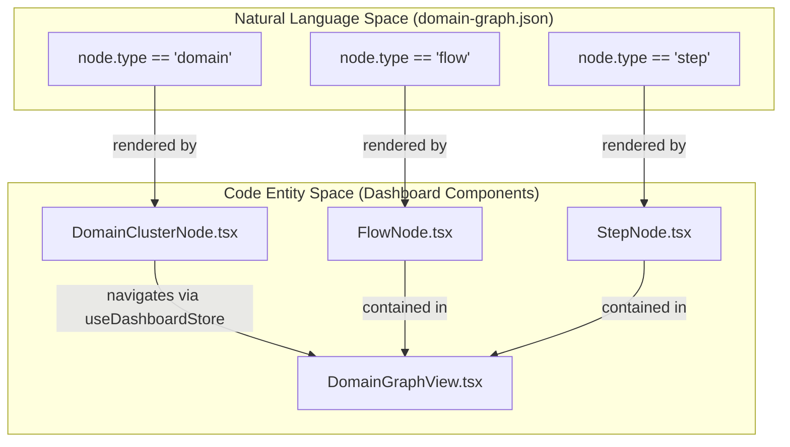
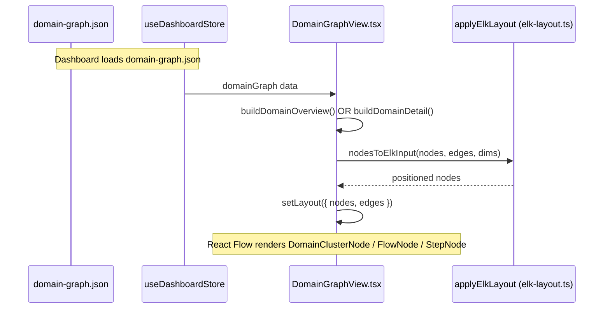

<!-- source: DeepWiki mcp.deepwiki.com · repo Lum1104/Understand-Anything · page 5.5 Domain Graph View · fetched 2026-10-26 -->

# Domain Graph View

Relevant source files

The following files were used as context for generating this wiki page:

- [understand-anything-plugin/packages/dashboard/src/components/DomainGraphView.tsx](understand-anything-plugin/packages/dashboard/src/components/DomainGraphView.tsx)
- [understand-anything-plugin/packages/dashboard/src/components/FlowNode.tsx](understand-anything-plugin/packages/dashboard/src/components/FlowNode.tsx)
- [understand-anything-plugin/packages/dashboard/src/components/StepNode.tsx](understand-anything-plugin/packages/dashboard/src/components/StepNode.tsx)
- [understand-anything-plugin/packages/dashboard/src/components/WarningBanner.tsx](understand-anything-plugin/packages/dashboard/src/components/WarningBanner.tsx)
- [understand-anything-plugin/packages/dashboard/src/utils/layout.ts](understand-anything-plugin/packages/dashboard/src/utils/layout.ts)

The `DomainGraphView` is a specialized visualization component within the Understand Anything dashboard designed to represent business logic and process flows rather than raw code structure. It implements a hierarchical drill-down pattern, allowing users to transition from a high-level "Domain Overview" to a granular "Flow Detail" view.

### Overview

The component consumes a specialized `domain-graph.json` file, which is generated by the `/understand-domain` skill. Unlike the standard technical knowledge graph, the domain graph focuses on three specific node types: `domain`, `flow`, and `step` [understand-anything-plugin/packages/dashboard/src/components/DomainGraphView.tsx:25-29](). 

The view is optimized for understanding "The Why" and "The How" of business processes, abstracting away file-system hierarchies in favor of logical domains.

### Data Consumption and Storage

The dashboard state manager (`useDashboardStore`) holds the `domainGraph` data and tracks the `activeDomainId` to determine the current drill-down level [understand-anything-plugin/packages/dashboard/src/components/DomainGraphView.tsx:168-170]().

| State Variable | Type | Purpose |
| :--- | :--- | :--- |
| `domainGraph` | `KnowledgeGraph \| null` | The parsed content of `domain-graph.json`. |
| `activeDomainId` | `string \| null` | The ID of the domain currently being inspected in detail. |
| `selectedNodeId` | `string \| null` | The ID of the node currently highlighted in the side panel. |

**Sources:**
- [understand-anything-plugin/packages/dashboard/src/components/DomainGraphView.tsx:168-170]()
- [understand-anything-plugin/packages/dashboard/src/components/StepNode.tsx:18-19]()
- [understand-anything-plugin/packages/dashboard/src/components/FlowNode.tsx:19-20]()

---

### Visualization Architecture

The view utilizes a "Drill-Down" pattern powered by React Flow. It switches between two rendering modes based on the presence of an `activeDomainId`.

#### 1. Domain Overview (Level 1)
This mode visualizes the entire business landscape.
- **Nodes**: `DomainClusterNode` represents broad business areas (e.g., "Authentication", "Order Processing").
- **Edges**: `cross_domain` edges show dependencies or data transfers between domains [understand-anything-plugin/packages/dashboard/src/components/DomainGraphView.tsx:73-85]().
- **Interactions**: Clicking a `DomainClusterNode` allows navigation into the detail view via the `navigateToDomain` store action.

#### 2. Flow Detail (Level 2)
This mode visualizes the internal mechanics of a specific domain.
- **Nodes**:
    - `FlowNode`: Represents a specific business process (e.g., "User Signup Flow") [understand-anything-plugin/packages/dashboard/src/components/FlowNode.tsx:17-50]().
    - `StepNode`: Represents an individual code-level step within a flow (e.g., "Validate Email", "Save to DB") [understand-anything-plugin/packages/dashboard/src/components/StepNode.tsx:16-51]().
- **Edges**: `flow_step` edges connect flows to their constituent steps in a sequential manner [understand-anything-plugin/packages/dashboard/src/components/DomainGraphView.tsx:102-104]().

#### Domain Logic Mapping
The following diagram illustrates how business concepts from the `domain-graph.json` map to the React components in the dashboard.

**Domain Concept to Component Mapping**

**Sources:**
- [understand-anything-plugin/packages/dashboard/src/components/DomainGraphView.tsx:25-29]()
- [understand-anything-plugin/packages/dashboard/src/components/FlowNode.tsx:17-50]()
- [understand-anything-plugin/packages/dashboard/src/components/StepNode.tsx:16-51]()

---

### Node Types and Implementation

#### DomainClusterNode
Displays high-level metadata including business rules and primary entities.
- **Data Structure**: Includes `entities`, `flowCount`, and `businessRules` [understand-anything-plugin/packages/dashboard/src/components/DomainGraphView.tsx:55-61]().
- **Logic**: It calculates the `flowCount` by filtering edges of type `contains_flow` where it is the source [understand-anything-plugin/packages/dashboard/src/components/DomainGraphView.tsx:46-51]().

#### FlowNode
Represents a specific entry point into the system.
- **Data Structure**: Includes `entryPoint` (e.g., an HTTP path like `/api/v1/login`) and `entryType` (e.g., "Express/Koa route") [understand-anything-plugin/packages/dashboard/src/components/FlowNode.tsx:6-13]().
- **Logic**: Renders with a specific `flowId` for state synchronization [understand-anything-plugin/packages/dashboard/src/components/FlowNode.tsx:17-30]().

#### StepNode
The most granular unit, linking business logic back to physical files.
- **Data Structure**: Includes `filePath` and `order` [understand-anything-plugin/packages/dashboard/src/components/StepNode.tsx:6-12]().
- **Logic**: The `order` is derived from the `weight` property of the `flow_step` edge and multiplied by 10 for display [understand-anything-plugin/packages/dashboard/src/components/DomainGraphView.tsx:150-150]().

**Sources:**
- [understand-anything-plugin/packages/dashboard/src/components/FlowNode.tsx:6-13]()
- [understand-anything-plugin/packages/dashboard/src/components/StepNode.tsx:6-12]()
- [understand-anything-plugin/packages/dashboard/src/components/DomainGraphView.tsx:46-61]()

---

### Layout and Flow Logic

The view uses the `applyElkLayout` utility to position nodes automatically. It defaults to a "Right" direction to emphasize process flow [understand-anything-plugin/packages/dashboard/src/components/DomainGraphView.tsx:197-199]().

**Domain Graph Data Flow**

**Key Functions:**
- `buildDomainOverview`: Filters the graph for `domain` nodes and `cross_domain` edges [understand-anything-plugin/packages/dashboard/src/components/DomainGraphView.tsx:41-88]().
- `buildDomainDetail`: Identifies all `flow` nodes belonging to a domain via `contains_flow` edges, then finds all `step` nodes via `flow_step` edges [understand-anything-plugin/packages/dashboard/src/components/DomainGraphView.tsx:90-165]().
- `applyElkLayout`: Computes coordinates asynchronously using the ELK engine. It consumes `nodesToElkInput` to prepare the data [understand-anything-plugin/packages/dashboard/src/components/DomainGraphView.tsx:197-202]().
- `mergeElkPositions`: Recombines the calculated coordinates with the original React Flow node objects [understand-anything-plugin/packages/dashboard/src/components/DomainGraphView.tsx:208-208]().

**Layout Constants:**
The system uses fixed dimensions for different node types to ensure the ELK algorithm can calculate accurate spacing:
- `NODE_WIDTH`: 280 [understand-anything-plugin/packages/dashboard/src/utils/layout.ts:15]()
- `NODE_HEIGHT`: 120 [understand-anything-plugin/packages/dashboard/src/utils/layout.ts:16]()
- `LAYER_CLUSTER_WIDTH`: 320 [understand-anything-plugin/packages/dashboard/src/utils/layout.ts:17]()
- `LAYER_CLUSTER_HEIGHT`: 180 [understand-anything-plugin/packages/dashboard/src/utils/layout.ts:18]()

**Sources:**
- [understand-anything-plugin/packages/dashboard/src/components/DomainGraphView.tsx:41-208]()
- [understand-anything-plugin/packages/dashboard/src/utils/layout.ts:15-18]()
- [understand-anything-plugin/packages/dashboard/src/utils/layout.ts:195-223]()

---

