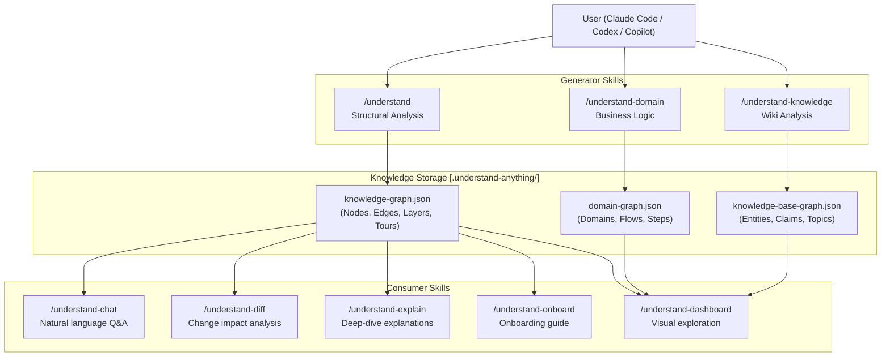

<!-- source: DeepWiki mcp.deepwiki.com · repo Lum1104/Understand-Anything · page 6 Skills and Commands · fetched 2026-10-26 -->

# Skills and Commands

Relevant source files

The following files were used as context for generating this wiki page:

- [.claude-plugin/marketplace.json](.claude-plugin/marketplace.json)
- [.claude-plugin/plugin.json](.claude-plugin/plugin.json)
- [.copilot-plugin/plugin.json](.copilot-plugin/plugin.json)
- [.cursor-plugin/plugin.json](.cursor-plugin/plugin.json)
- [README.md](README.md)
- [READMEs/README.es-ES.md](READMEs/README.es-ES.md)
- [READMEs/README.ja-JP.md](READMEs/README.ja-JP.md)
- [READMEs/README.ko-KR.md](READMEs/README.ko-KR.md)
- [READMEs/README.tr-TR.md](READMEs/README.tr-TR.md)
- [READMEs/README.zh-CN.md](READMEs/README.zh-CN.md)
- [READMEs/README.zh-TW.md](READMEs/README.zh-TW.md)
- [install.ps1](install.ps1)
- [install.sh](install.sh)
- [understand-anything-plugin/.claude-plugin/plugin.json](understand-anything-plugin/.claude-plugin/plugin.json)
- [understand-anything-plugin/package.json](understand-anything-plugin/package.json)

This page documents the eight skill commands available in Understand Anything. Skills provide the primary user interface for analyzing, querying, and exploring codebases through Claude Code and other supported AI platforms like Codex, Cursor, and Copilot [README.md:104-169](). The `/understand`, `/understand-domain`, and `/understand-knowledge` commands generate knowledge graphs, while the consumer skills leverage that data for natural language interaction and visualization.

For documentation of the multi-agent pipeline orchestrated by these commands, see [Multi-Agent Pipeline](#7). For dashboard-specific functionality, see [Interactive Dashboard](#5).

---

## Skill System Architecture

The skill system follows a generator-consumer pattern where specific commands create structured data (knowledge graphs) and others leverage that data for different use cases.

### Generator vs Consumer Skills

The architecture ensures that complex analysis is performed once, with results stored on disk to enable fast, low-latency queries across different contexts.

| Diagram: Skill Data Flow |
| :--- |

**Sources:** [README.md:113-169](), [understand-anything-plugin/package.json:11-15]()

### Skill Implementation Overview

Skills are defined in the `understand-anything-plugin/skills/` directory [README.md:144-159](). Each skill provides the LLM with the context needed to execute the command, including graph structure references and efficient reading strategies.

| Skill | Implementation Strategy | Primary Data Source |
|-------|-------------------------|---------------------|
| `/understand` | Multi-agent Pipeline | Source Code Files |
| `/understand-chat` | Fuzzy/Semantic Search | `knowledge-graph.json` |
| `/understand-diff` | Git Diff + 1-hop Expansion | `knowledge-graph.json` |
| `/understand-explain` | Neighborhood Extraction | `knowledge-graph.json` + Source |
| `/understand-onboard` | Tour & Layer Synthesis | `knowledge-graph.json` |
| `/understand-dashboard` | Vite + TokenGate | All Graph JSONs |
| `/understand-domain` | Domain-Analyzer Agent | Entry Points & Code Patterns |
| `/understand-knowledge` | Karpathy-pattern Parser | `index.md` + Wiki Articles |

**Sources:** [README.md:113-169](), [.cursor-plugin/plugin.json:13-14](), [.copilot-plugin/plugin.json:12-13]()

---

## /understand Command

The primary command for structural code analysis. It orchestrates a pipeline of specialized agents to map files, functions, and dependencies [README.md:113-120]().

- **Incremental Analysis**: Detects changes and performs partial updates by default [README.md:161-162]().
- **Localized Output**: Supports `--language` (en, zh, ja, ko, etc.) for node summaries and dashboard UI [README.md:121-136]().
- **Automation**: Supports `--auto-update` to install post-commit hooks [README.md:165-166]().

For a detailed breakdown of the analysis pipeline, see [/understand Command](#6.1).

**Sources:** [README.md:113-136](), [README.md:161-169]()

---

## /understand-chat Command

Provides natural language Q&A about the codebase [README.md:143-144]().

- **Search**: Employs fuzzy and semantic search across the graph [README.md:76-78]().
- **Context**: Builds a localized context from the knowledge graph to answer questions like "How does the payment flow work?" [README.md:144-144]().

For details on context building and search patterns, see [/understand-chat](#6.2).

**Sources:** [README.md:76-78](), [README.md:143-144]()

---

## /understand-diff Command

Analyzes Git diffs to understand change impact and risks [README.md:82-84]().

- **Impact Analysis**: Visualizes which parts of the system are affected by current changes before committing [README.md:82-84]().
- **Ripple Effects**: Detects 1-hop neighbors and impacted edges in the structural graph [README.md:146-147]().

For details on diff processing and risk scoring, see [/understand-diff](#6.3).

**Sources:** [README.md:82-84](), [README.md:146-147]()

---

## /understand-explain Command

Provides deep-dive explanations for specific files or functions [README.md:149-150]().

- **Context Neighborhood**: Extracts a component's code and its relationships from the graph [README.md:138-139]().
- **Deep Insight**: Explains complex patterns like closures or generics in the context of the specific file [README.md:96-98]().

For details on the explanation builder, see [/understand-explain](#6.4).

**Sources:** [README.md:96-98](), [README.md:149-150]()

---

## /understand-onboard Command

Generates a comprehensive onboarding guide for new team members [README.md:152-153]().

- **Synthesis**: Combines project overview, architecture layers, and guided tours into structured markdown [README.md:72-73]().
- **Learning Path**: Orders components by dependency to teach the codebase in the correct order [README.md:72-73]().

For details on guide generation, see [/understand-onboard](#6.5).

**Sources:** [README.md:72-73](), [README.md:152-153]()

---

## /understand-dashboard Command

Launches the interactive visualization dashboard [README.md:139-142]().

- **Visual Discovery**: Provides a structural graph, domain view, and persona-adaptive UI [README.md:86-88]().
- **Security**: Secured via TokenGate session management [README.md:140-142]().

For details on the dashboard server and UI components, see [/understand-dashboard](#6.6).

**Sources:** [README.md:86-88](), [README.md:139-142]()

---

## /understand-domain Command

Extracts business domains, flows, and steps from the codebase to create a `domain-graph.json` [README.md:61-63]().

- **Mapping**: Maps technical code entities to real-world business processes [README.md:61-63]().
- **Visualization**: Surfaces a horizontal graph of business logic in the dashboard [README.md:155-156]().

For details on domain extraction agents and preprocessing, see [/understand-domain](#6.7).

**Sources:** [README.md:61-63](), [README.md:155-156]()

---

## /understand-knowledge Command

Analyzes Karpathy-pattern LLM wikis to create a navigable graph of ideas and claims [README.md:65-68]().

- **Clustering**: Uses community clustering to group related wiki articles [README.md:65-68]().
- **Extraction**: Discovers implicit relationships and surfaces claims from `index.md` and article content [README.md:158-159]().

For details on wiki analysis and entity extraction, see [/understand-knowledge](#6.8).

**Sources:** [README.md:65-68](), [README.md:158-159]()

---

