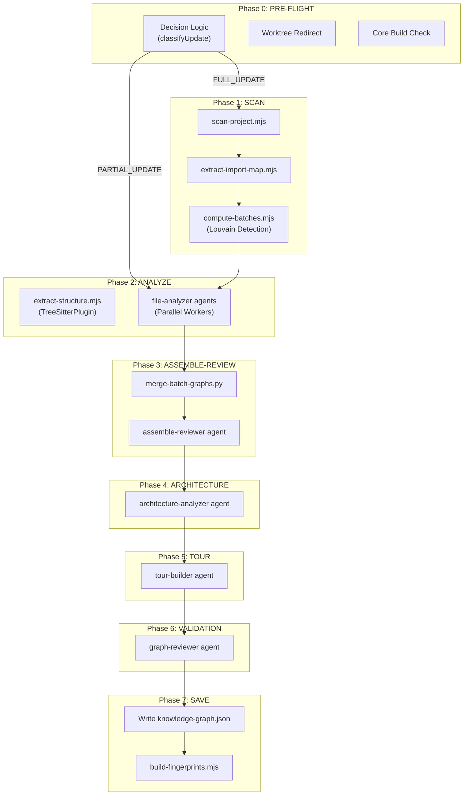
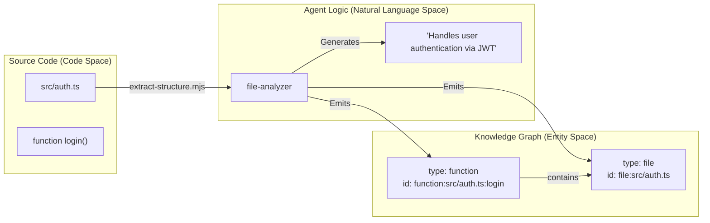

<!-- source: DeepWiki mcp.deepwiki.com · repo Lum1104/Understand-Anything · page 6.1 /understand Command · fetched 2026-10-26 -->

# /understand Command

<details>
<summary>Relevant source files</summary>

The following files were used as context for generating this wiki page:

- [tests/skill/understand/test_extract_import_map.test.mjs](tests/skill/understand/test_extract_import_map.test.mjs)
- [understand-anything-plugin/agents/file-analyzer.md](understand-anything-plugin/agents/file-analyzer.md)
- [understand-anything-plugin/skills/understand/SKILL.md](understand-anything-plugin/skills/understand/SKILL.md)
- [understand-anything-plugin/skills/understand/build-fingerprints.mjs](understand-anything-plugin/skills/understand/build-fingerprints.mjs)
- [understand-anything-plugin/skills/understand/compute-batches.mjs](understand-anything-plugin/skills/understand/compute-batches.mjs)
- [understand-anything-plugin/skills/understand/extract-import-map.mjs](understand-anything-plugin/skills/understand/extract-import-map.mjs)
- [understand-anything-plugin/skills/understand/merge-batch-graphs.py](understand-anything-plugin/skills/understand/merge-batch-graphs.py)
- [understand-anything-plugin/skills/understand/merge-subdomain-graphs.py](understand-anything-plugin/skills/understand/merge-subdomain-graphs.py)
- [understand-anything-plugin/skills/understand/scan-project.mjs](understand-anything-plugin/skills/understand/scan-project.mjs)

</details>


The `/understand` command is the primary entry point for analyzing a codebase. It orchestrates a multi-agent pipeline that produces a comprehensive `knowledge-graph.json` file containing nodes, edges, architectural layers, and guided tours. This command supports both full analysis and incremental updates based on Git state and structural fingerprints.

---

## Command Invocation

The `/understand` command accepts optional arguments to control the scope and behavior of the analysis:

| Argument | Behavior |
|----------|----------|
| `--full` | Force a complete rebuild, ignoring existing graph and metadata [understand-anything-plugin/skills/understand/SKILL.md:14-14]() |
| `--auto-update` | Enable automatic graph updates on commit (writes `autoUpdate: true` to `config.json`) [understand-anything-plugin/skills/understand/SKILL.md:15-15]() |
| `--no-auto-update` | Disable automatic graph updates [understand-anything-plugin/skills/understand/SKILL.md:16-16]() |
| `--review` | Run full LLM `graph-reviewer` instead of inline deterministic validation [understand-anything-plugin/skills/understand/SKILL.md:17-17]() |
| `--language <lang>` | Generate all textual content (summaries, tags, lessons) in the specified ISO 639-1 language [understand-anything-plugin/skills/understand/SKILL.md:18-18]() |
| `<directory>` | Scope analysis to a specific subdirectory or external repository [understand-anything-plugin/skills/understand/SKILL.md:19-19]() |

**Examples:**
```bash
/understand                    # Automatic mode (incremental if possible)
/understand --full             # Force full rebuild
/understand --language zh      # Analyze and generate content in Chinese
/understand ../other-project   # Analyze a different directory
```

Sources: [understand-anything-plugin/skills/understand/SKILL.md:1-19]()

---

## Analysis Pipeline Overview

The `/understand` command executes up to seven phases. It uses disk-based intermediate storage in `.understand-anything/intermediate/` to coordinate between specialized agents and scripts.

### Pipeline Architecture



Sources: [understand-anything-plugin/skills/understand/SKILL.md:22-246](), [understand-anything-plugin/skills/understand/scan-project.mjs:1-49](), [understand-anything-plugin/skills/understand/compute-batches.mjs:1-13]()

---

## Phase 0 & 1: Pre-flight and Deterministic Scanning

### Pre-flight Logic
Phase 0 resolves the `PROJECT_ROOT` and handles Git worktrees. If a worktree is detected, the command redirects output to the main repository root to prevent data loss when ephemeral worktrees are destroyed [understand-anything-plugin/skills/understand/SKILL.md:52-70](). It also ensures `@understand-anything/core` is built [understand-anything-plugin/skills/understand/SKILL.md:116-119]().

### Deterministic Scanning
Phase 1 replaces LLM-based file discovery with high-performance scripts:
- **`scan-project.mjs`**: Enumerates files using `git ls-files`, detects languages, and assigns categories (`code`, `config`, `docs`, etc.) [understand-anything-plugin/skills/understand/scan-project.mjs:17-24]().
- **`extract-import-map.mjs`**: Uses `TreeSitterPlugin` to resolve imports, supporting `tsconfig.json` aliases and monorepo package boundaries [understand-anything-plugin/skills/understand/extract-import-map.mjs:5-13]().
- **`compute-batches.mjs`**: Runs Louvain community detection on the import graph to group related files into batches, maximizing local context for LLM agents [understand-anything-plugin/skills/understand/compute-batches.mjs:5-12]().

Sources: [understand-anything-plugin/skills/understand/SKILL.md:42-120](), [understand-anything-plugin/skills/understand/scan-project.mjs:1-49](), [understand-anything-plugin/skills/understand/extract-import-map.mjs:1-34](), [understand-anything-plugin/skills/understand/compute-batches.mjs:1-13]()

---

## Phase 2: ANALYZE — Semantic Analysis

Files are batched and processed by `file-analyzer` agents. Each agent performs a two-step analysis [understand-anything-plugin/agents/file-analyzer.md:13-15]():

1.  **Structural Extraction**: Runs `extract-structure.mjs` to get deterministic data on functions, classes, and calls [understand-anything-plugin/agents/file-analyzer.md:27-29]().
2.  **LLM Semantic Pass**: The agent uses the structural data to generate summaries, complexity ratings, and localized tags in the requested language [understand-anything-plugin/agents/file-analyzer.md:19-23]().

### Analysis Mapping



Sources: [understand-anything-plugin/agents/file-analyzer.md:1-130](), [understand-anything-plugin/skills/understand/extract-structure.mjs:1-133]()

---

## Phase 3: ASSEMBLE-REVIEW — Normalization

This phase unifies batch results into `assembled-graph.json` using `merge-batch-graphs.py`.

### ID Normalization
The script maps inconsistent LLM identifiers to a canonical space:
- **Double Prefixes**: `file:file:src/foo.ts` → `file:src/foo.ts` [understand-anything-plugin/skills/understand/merge-batch-graphs.py:182-187]().
- **Legacy Prefixes**: `func:` → `function:` [understand-anything-plugin/skills/understand/merge-batch-graphs.py:199-201]().
- **Bare Paths**: Automatically adds the `file:` prefix if missing [understand-anything-plugin/skills/understand/merge-batch-graphs.py:203-206]().

### Edge Cleaning
The merger performs "dangling-edge" removal, dropping any edge whose source or target node was not found in the combined node set [understand-anything-plugin/skills/understand/merge-batch-graphs.py:313-324]().

Sources: [understand-anything-plugin/skills/understand/merge-batch-graphs.py:1-350](), [understand-anything-plugin/skills/understand/SKILL.md:183-201]()

---

## Phase 7: SAVE & Fingerprinting

Once the graph is finalized, Phase 7 persists the results and creates a structural baseline for future incremental updates.

### Structural Fingerprints
The `build-fingerprints.mjs` script generates `.understand-anything/fingerprints.json` [understand-anything-plugin/skills/understand/build-fingerprints.mjs:5-7]().
- It uses the `TreeSitterPlugin` to calculate hashes of code structures (function signatures, class members) [understand-anything-plugin/skills/understand/build-fingerprints.mjs:75-83]().
- During subsequent runs, the system compares current structures against this baseline to detect if a file needs a `PARTIAL_UPDATE` or if changes were purely cosmetic (comments/whitespace) [understand-anything-plugin/skills/understand/SKILL.md:237-246]().

Sources: [understand-anything-plugin/skills/understand/build-fingerprints.mjs:1-91](), [understand-anything-plugin/skills/understand/SKILL.md:237-246]()

---

## Error Handling & Resilience

- **Subdomain Merging**: `merge-subdomain-graphs.py` allows combining graphs from different parts of a large project. It deduplicates by `(source, target, type)` and keeps the highest-weight edge [understand-anything-plugin/skills/understand/merge-subdomain-graphs.py:77-89]().
- **JSON Tolerance**: All Python and Node scripts include try-catch blocks for JSON parsing to ensure a single malformed batch does not crash the entire pipeline [understand-anything-plugin/skills/understand/merge-batch-graphs.py:134-149](), [understand-anything-plugin/skills/understand/merge-subdomain-graphs.py:36-49]().
- **Validation**: The `graph-reviewer` agent provides a final LLM-based sanity check, ensuring the graph "makes sense" for a human developer [understand-anything-plugin/skills/understand/SKILL.md:225-231]().

Sources: [understand-anything-plugin/skills/understand/merge-batch-graphs.py:134-149](), [understand-anything-plugin/skills/understand/merge-subdomain-graphs.py:1-105](), [understand-anything-plugin/skills/understand/SKILL.md:225-231]()

---

